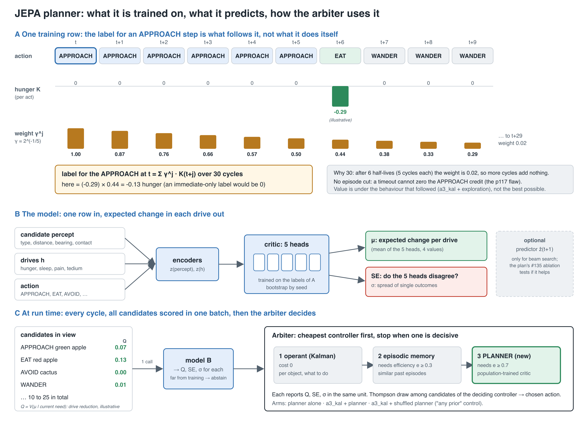

> **SUPERSEDED IN PART (2026-11-27).** The one-page plan is `jepa-planner-species-model.md`. This file is the unrevised detail appendix.
> Still valid: §A (what is logged), §B (collection run), §F (arbiter wiring). **Obsolete:** §C.3 and Decision D2 (the 30-cycle return label is dropped:
> the model learns the one-step cost K and the predictor, and value comes from search), the figure's panel A, and the calibration machinery
> in §C.5 (deferred to stage 4). §D (prototype on existing data) is dropped.

# JEPA planner: data, species model and arbiter integration (epic #139: #133-#136)

Status: **plan, 2026-11-26, for approval. No code, spec or run before approval.** Paper draft
(`uncertainty_arbitration`) §4.1, §4.4, §4.5, §8.1 row A6, §8.2, Appendix A ("Planner estimator"), Appendix B.2.
Builds on `controllers-spec.md` (§2 contract, §3.5), `jepa-retrain-v2-new-dims.md` (pipeline template),
`issue-113-episodic-estimator.md` (offline-first lesson), the #133 audit
(`audit.py` / `audit_out.txt` in the session scratchpad; to be committed as a short note under `docs/reports/` when #133 is closed).
#137 (recipe, test world, arms) and #138 (campaign) are out of scope except for the constraints they put on training data.

## Overview

*A: one training row. The label of a step is the drive changes K over the next 30 decision cycles, weighted by gamma^j (gamma = 2^(-1/5), as episodic
memory), so an APPROACH is valued by the EAT that follows it (§C.3). B: the model, encoders into M = 5 critic heads, with the optional
predictor of §C.1 dashed (§C.4-C.5). C: at run time all candidates are scored in one batch and the planner is the last, costliest controller of the arbiter (§F).
All numbers in the figure are illustrative. Source: `figures/jepa-planner/make_planner_figure.py`.*

---

## 0. Premises checked against the code: corrections (read first)

The direction of the epic holds. Ten points that change details or add work:

| # | Premise | What the code / data say | Consequence |
|---|---|---|---|
| P1 | "The deployed JEPA is `models/unified_critic`" | The runtime never reads the variant folders. `MLServiceExtension.Impl.extractContractToTemp` (`creature/ml/MLServiceExtension.java` ~L200-207) and `extractModelFiles` (~L210-222) read `/models/model_contract.json` and `/models/*.pt` at the resource **root**, which is `internal_critic`, trained 2026-07-01, 4-dim h, 9 actions. Nothing selects a variant: CLAUDE.md's "the runtime selects the variant from `model_variant`" is true only of the root contract. | Still stale; retraining stands. The planner bundle needs its own explicit model directory (§C.6). |
| P2 | "Only the training code is reusable" | The critic was **never trained on outcomes**. `ml/jepa/train.py` `critic_loss` (L102-147) regresses on a hand-written rule: `-tanh(h_d/2)` for the drive an action is "supposed" to relieve (EAT/APPROACH→hunger, SLEEP→sleep, AVOID/ESCAPE→pain, PLAY/WANDER→tedium), 0 elsewhere. That encodes the action tendency lists. | Reusable: encoder, VICReg, EMA target, adapter, TorchScript export, collapse gate. The critic loss, targets and dataset assembly are new code. |
| P3 | s_t is "the percept" | `prepare_dataset.py` (~L221-230) joins to each action the **last vision row by wall time**, not the acted-on target. `s_{t+1}` is the next row of a sorted, unshuffled loader (`train.py` L182-184, `train_species.py` L113 `shuffle=False`): the next decision's last-seen object, often another object, sometimes another creature at batch edges. | The predictor of every variant so far learned no consistent dynamics. Transitions must be object-matched (§C.2). |
| P4 | "Keep the OOD gate" | The gate is dead code. `latentPredErrorEma` is set once from `baseline_pred_error` (`WorldModelEngine.java` L72) and never updated, so `isOodSelfDisabled()` (L156-158) is constant. | "Keep" means "build". Spec in §C.5. |
| P5 | Per-cycle percepts are missing | Vision sets are logged: `Eye.java` L56 writes one `ObjectSeenState` per object seen. They carry no cycle id, only wall-ms `change_stimulus_state.time`. Smell rows (`smell_perceptions`) carry no distance or angle. a3_kal trial 1: Σ`n_perceived` = 1.60M ≈ 427k vision + 1.13M smell rows. `arbitration_decisions` has `cycle` but no h, no target key and no percept set. | What is missing is the **cycle key**, not the rows. One table at the decision point fixes it (§A). |
| P6 | Forced exploration "on top of a3_kal" | The arbiter's floor is fixed at ε = 0.03 (`Arbiter.Params.defaults()`, `FullAppraisal.withTheta` L751 copies it) and is not a setting. It is logged (`source = EPSILON`). a3_kal trial 1: `ABSTAIN_UNIFORM` is **42%** of decisions (230,543 / 543,984), `EPSILON` 3%. The behaviour policy is already largely uniform. | Exploration needs one new setting, and it costs less than assumed (§B.1). |
| P7 | The efficiency budget keeps the planner for calm decisions | a3_kal trial 1: e ≥ 0.7 on 7.7% of all decisions, and on all 1,118 decisions at hunger ≥ 4 (closed steps joined on cycle). | The efficiency arm consults the planner mostly when it is hungry. This is good for A6 but has to be stated. Measured on one trial only. |
| P8 | hunger ≥ 4 is 3.7% of rows | That is the audit's pooled figure. In a3_kal trial 1 it is 0.24% of the closed steps joined to decisions. | Sparsity is worse in the baseline arm than the audit headline. The collection world must create need (§B.2). |
| P9 | The test world has "mid-life change / devaluation" | No world-change mechanism exists (no devaluation/reversal code under `src/main/java`). | New Java for #137. It constrains training only through §B.2 (training must not contain the change). |
| P10 | The action vocabulary is in the contract | `WorldModelEngine` hard-codes a 9-action `ACTION_ORDER` (L22-25) and rejects any contract that differs (L53-61). | The v2 path reads the order from the contract (§C.6). |

One more fact the plan relies on: the episode buffer is not in `Valuation`, despite its javadoc. It is in
`MemorySystemActor` (`creature/memory/MemorySystemActor.java` L146-168). `recordDecision` (L157) receives the
`DecisionRecord(cycle, action, h, focalDrive, chosenQ)`, and `recordOutcome` (L167) stamps every attributed K with the
current decision cycle. **Both per-cycle streams the dataset needs already pass through one actor.**

---

## 1. Scope

| Area | Change | Issue |
|---|---|---|
| Telemetry (Java) | `decision_steps` and `cycle_outcomes` from `MemorySystemActor`; `decision_percepts` from `FullAppraisal`; h and target key added to `arbitration_decisions` | #134 (pre-req) |
| Extractor | three `TABLES` entries + `TABLE_ORDER` in `scripts/dl2l_data/tables.py` | #134 |
| Behaviour policy (Java) | `arbiterEpsilon` setting (default 0.03), optional per-creature override | #134 (collection) |
| Collection run | `experiments/p134_planner_collect.yml` + `simulations/p134_collect_*.conf` (content in §B, not written now) | #134 |
| Prototype (Python) | `ml/scripts/prototype_critic.py` on existing `episodic_engrams` | #134 |
| ML pipeline | `prepare_planner_dataset.py` (new), `jepa/model.py` (`PlannerModel`), `jepa/train.py` (critic NLL + ensemble), `export.py` (contract v2), `check_collapse.py` (reads v2), `training/p134_planner.yml` | #134 |
| Validation | `analysis/diagnostics/planner_offline.py` + report | #135 |
| Java inference | `PlannerModelExtension`, `PlannerEngine`, `PlannerEstimator`, `ModelContract` v2 | #136 |
| Arbiter | PLANNER controller wiring, budget modes, planner-alone, telemetry columns, settings validation | #136 |
| **Not here** | test world, devaluation mechanism, arms, sample size of the test (#137); CCAD campaign (#138); beam search (later, same interface); sleep adapter training (OFF) | |

---

## A. What is logged today, and what is missing for a per-cycle transition dataset

### A.1 Today (post-#79 Arrow tables, extracted by `tables.py`)

| Table | Writer | Granularity / key | Has |
|---|---|---|---|
| `perceptions` | `Eye` L56 | one row per object seen; wall-ms `time` | type, object_key, distance, angle, direction (vision only) |
| `smell_perceptions` | `Nose` L40 | one row per smell; wall ms | type only (no geometry) |
| `actions` | `FullAppraisal` L476 | one per decision; wall ms | action, selection type, **target_key**, focal_drive, inference_ms |
| `arbitration_decisions` | `FullAppraisal` L480-482 | one per decision; **`cycle`** | per-controller Q/SE/σ/conf, chosen/executed action + object type, efficiency, source; **no h, no target key**; planner_* columns empty |
| `drives` | `HomeostaticRegulation` L66 | one per regulation stimulus; wall ms | 9 emotion levels before/after |
| `drive_outcomes` | `HomeostaticRegulation` L136 | one per non-zero regulation; seq + wall ms | per-act K (d_hunger..d_tedium), action, object, target; BASELINE drift rows |
| `episodic_engrams` / `episode_returns` | `MemorySystemActor` / Valuation path | one per **closed** step; `step_cycle` | h_*, g_* (episode-cut discounted return), close_type, key k_00..k_14 |
| `behavioural_efficiency` | `PartialAppraisal` L325 | one per cycle; wall ms | n_objects, n_perceived |

### A.2 What a per-cycle transition dataset needs, and the gap

| Need | Available? | Gap |
|---|---|---|
| Full percept set at decision t, with geometry, in the frame the candidates used | Only by wall-ms proximity; smell without geometry | **No cycle key**; the candidate set (vision+smell perceptions after `PartialAppraisal`) is never logged |
| 4 drive levels h_t at every decision | Only for closed steps of open episodes (`episodic_engrams`); `drives` is per regulation event | **h per decision cycle** |
| Executed action and target object at t | action in `arbitration_decisions` (cycle); target only in `actions` (wall ms) | **target key on the cycle-keyed row** |
| Per-act K stamped with the decision cycle | `drive_outcomes` (wall ms); the episode buffer has the cycle but writes only closed episodes | **K per cycle, independent of episodes** |
| s_{t+1} | none | Defined in §C.2 from `decision_percepts` at t+1, matched by `object_key` |
| Exploration propensity | `source`, `candidate_count` | the ε in force (new setting, logged in `run_info` and per creature) |

### A.3 Code changes (after approval; each behind no flag because it only adds rows, but see the volume note)

1. **`DecisionStepState`** (new, `creature/bd/`), written by `MemorySystemActor.recordDecision` (L157) for **every**
   decision, not only buffered ones. Columns: `creature_key, cycle, action, object_type, target_key,
   target_sequential, h_hunger, h_sleep, h_pain, h_tedium, focal_drive`. `DecisionRecord` gains nothing: its `action`
   already holds `action.perception` (type, id, distance, angle).
2. **`CycleOutcomeState`** (new), written by `MemorySystemActor.recordOutcome` (L167): `creature_key, cycle, d_hunger,
   d_sleep, d_pain, d_tedium`, one row per attributed K (BASELINE drift is not sent there, `HomeostaticRegulation` L130-133).
   With the episode buffer in the same actor, the cycle stamp is the one the episodic returns use.
3. **`DecisionPerceptState`** (new), written by `FullAppraisal.selectAction` (L303-320) after `cycleDecisionCycle` is
   known: one row per perception in `emotional.getPerceptions()`. Columns: `creature_key, cycle, rank, object_key,
   object_sequential, object_type, distance, angle, sense (VISION|SMELL|SELF), contact`. Written in the same `persist`
   batch as the cycle's `ArbitrationDecisionState` (#84 atomicity). **Ordering check needed:** `cycleDecisionCycle` is set in
   `sendArbiterMessages` (L362-378), after selection. The row must take that value, not the previous cycle's.
4. **`ArbitrationDecisionState`**: add `h_hunger..h_tedium`, `executed_target_key`. These are cheap, and they make
   the arbitration table self-sufficient for replay (#135).
5. **`tables.py`**: `decision_steps`, `cycle_outcomes` and `decision_percepts` entries with `ORDER BY creature_key, cycle`, added to
   `TABLE_ORDER`. `arbitration_decisions` already selects `d.*`, so new columns flow through and old dumps still extract.
6. Tests: a `TestingHarness` functional test (two apples in view, one EAT) asserting one `decision_percepts` row per
   perception with the decision's cycle, `cycle_outcomes` K equal to the `drive_outcomes` non-BASELINE K over the run
   (the #100 conservation test, re-keyed), and `decision_steps` count equal to `arbitration_decisions` count. Extractor test
   on a tiny raw dump.

**Volume (assumption, from a3_kal trial 1):** about 544k decisions and about 1.7M perceptions per 5-creature hour. Expect
`decision_percepts` to be about 4x `perceptions.parquet` (12 MB → ~50 MB per trial) and `decision_steps` about the
size of `actions`. That is well below the 3.2 GB `stimulus_state` that broke the CCAD quota. **Decision D6:** write these
always, or only when a new `transitionLoggingEnabled` flag is on. Recommendation: a flag, default **off**, so existing
arms' dumps are unchanged.

---

## B. The dedicated collection run (#134)

### B.1 Behaviour policy

**a3_kal plus a raised arbiter floor.** Add `simulation.learningSettings.arbiterEpsilon` (default 0.03, validated in
[0, 1)) and pass it into `Arbiter.Params` instead of the default. Exploration then goes through the arbiter's existing,
logged path. With probability ε the pick is uniform over the candidates (`source = EPSILON`), and the stream
consumption is unchanged (`Arbiter` javadoc). Its propensity is known: P(a) ≥ ε/n with n = `candidate_count`. That is
enough for clipped importance weights later if they are needed.

- **Per-creature ε**, assigned from the creature index in the conf (e.g. creatures 1-2 at 0.03, 3-4 at 0.15, 5 at 0.30). This gives
  on-policy and off-policy trajectories in the same worlds, so the validation can check whether the critic's error depends on
  ε. Needs `creatureSettings` to accept an override (small change; alternative: one condition per ε). **Decision D4.**
- Rationale for a modest ε: the policy is already 42% abstain-uniform (P6). The gaps are rare *states* (high hunger,
  contact with cactus while hungry), not rare *actions*. A large ε raises deaths without filling the gaps.
- Tendency lists **off**, sleep lock **off**, as in the Kalman worlds, so the actions the critic sees are not pre-filtered.
  Whether the test arms turn them on is #137's choice. If they do, the planner is evaluated on a subset of what it was trained on, which is safe.
- Survival data from this run are **not** used for any claim. Its deaths are data (DEATH rows), not a result.

### B.2 World: training world vs test world

| Property | Training (collection) | Test (#137) | Why |
|---|---|---|---|
| Object types | RED, GREEN, GRAY apple, CACTUS, ALOE | the same **plus one held-out type** | OOD measure (#135.4). Recommendation: `ROTTEN_APPLE` (already in `EngramKeyEncoder.OBJECT_TYPES`). Its one-hot slot is reserved in the contract and is zero in all training rows |
| Food density | **randomised per trial** over a range that includes scarcity (e.g. food 0.25x-1x of the plants world) | fixed, pre-registered | creates hunger ≥ 4 states (P8) without a special policy; domain randomisation also widens the support the test draws from |
| Mid-life change / devaluation | **absent** | present | otherwise the planner has memorised the change and the "SE must react" test (spec §2.4) is void |
| Hazard (cactus pain) | present, as today | present, possibly costlier | the critic must have seen the hazard to price it; "costlier in test" is a shift and should be stated as one |
| Map size, creature count, respawn | as plants world (1923x1610, 5 creatures, instant respawn) | as #137 decides | |
| Neuromodulation, orexin, endocrine, expectancy, consolidation | OFF | OFF | h_t = 4 drives only |

Paper wording (proposed): "The species model is trained on a population living in worlds drawn from the same family as
the test world (same object types except one, randomised food density, no mid-life change), with seeds disjoint from
the test seeds". **Decision D5.**

### B.3 Seeds, trials, duration

- **Seeds:** collection `20000-20023`. Test seeds (#137) go in a block reserved now, `30000+`. Neither overlaps `10900-10911`. Seeds fix the initial
  world only. Trajectories are not replayable (`research-diary.md`, "Which results still stand"), so a split by seed is
  a split by world layout plus independent dynamics.
- **Trials:** 24 trials x 5 creatures x 60 min. Data-volume argument (assumptions marked):
  - Per trial-hour about 544k decisions (measured, a3_kal trial 1).
  - Target: at least 2,000 rows per (object type x action x hunger bin ≥ 4) cell, from at least 8 distinct seeds. Reasoning: per-step
    outcome sd of V about 0.05 (assumption; the audit's g_hunger sd is 0.06) and a target SE of the cell mean about 0.005 need about 100
    *independent* samples. Consecutive cycles are strongly autocorrelated. With an assumed design effect of about 20
    (about 7 cycles of γ-horizon times repeated approaches), that is about 2,000 rows.
  - If the scarcity randomisation lifts hunger ≥ 4 to about 2% of decisions (assumption, to be checked on the pilot), one trial gives
    about 11k such rows over about 30 affordable cells, about 360 per cell, and 24 trials give about 8.7k, above target with margin for non-uniform cells.
  - **A local pilot of 2 trials (one sparse, one dense) measures the hunger ≥ 4 share before the 24 are submitted.** If it is
    below 1%, widen the scarcity range rather than add trials.
- **Split:** by whole seed. 16 train / 4 validation (early stopping, calibration fit) / 4 test (reported once).
- **Where:** CCAD (SLURM + Singularity), `image: {source: registry}` pinned to the `sha-` of the commit with §A.3.
  `upload: {enabled: true, prefix: p134_planner_collect}`. `analysis:` a coverage module (cell counts, hunger
  histogram, deaths, ε shares), not a survival analysis.

### B.4 Intended spec content (not written now)

`experiments/p134_planner_collect.yml`: `name`, `trials: 24`, `seeds: [20000..20023]`, conditions = one per density
level (`simulations/p134_collect_d025.conf`, `_d050`, `_d075`, `_d100`, 6 trials each, each including `p117_kal_a3_kal.conf` then
overriding `worldObjectSettings`, `arbiterEpsilon`, `transitionLoggingEnabled = true`), `image: registry`,
`extract: {format: parquet, tables: all}`, `upload.prefix: p134_planner_collect`. Smoke variant
`p134_planner_collect_smoke.yml` (1 trial, 5 min, local, UI on, per the local-UI rule).

---

## C. Model design (#134)

### C.1 Decision: what the "planner" is at step one

Two designs answer the paper's one-step planner. Both sit behind the same `PlannerEstimator` interface.

| | (a) Direct critic Q(z_t, a, h) | (b) Latent predictor + critic on z_{t+1} |
|---|---|---|
| What it is | a population-trained value function over the encoded candidate percept | a world model: predicts the next latent of the target object, then values it |
| Needs transitions | no (encoder can be trained by the JEPA loss as an auxiliary) | yes (§C.2) |
| Supports beam search later | no (needs (b)) | yes |
| Risk | it is not "planning"; the paper's claim weakens to "a species prior" | one more learned stage that can be wrong; error compounds in rollouts |

**Recommendation:** train **one model with both**. Shared encoder, a JEPA predictor trained on object-matched transitions, and a
critic head that reads `[z_t, a, z_int(h)]` plus the predictor's `ẑ_{t+1}` (stop-gradient on `ẑ_{t+1}` into
the predictor, so value never shapes the dynamics). Ship the critic for the one-step score. #135 runs the **ablation
"critic without predictor input"**. If it is as good, the paper says plainly that step one is a learned prior, not
planning, and the predictor earns its place only in beam search. **Decision D1.**

### C.2 Inputs, transitions, s_{t+1}

- **Percept features** of one candidate (object-centric, like every controller): the `EngramKeyEncoder` percept block,
  unstandardised. That is a type one-hot (7 + 1 reserved held-out slot), distance / vision radius clipped to [0, 1], sin and cos of the bearing (in
  radians: the bug class fixed in PR #118 cannot return, because the same function produces both), and a contact flag. Population mean/sd are fitted on
  the train seeds and **shipped in the contract** (paper §4.3, which the current contract does not hold).
- **Context:** an optional pooled summary of the rest of the percept set (counts per type within the radius, nearest
  distance per type). It is cheap and lets the critic see "food elsewhere". It is off in the first model and added only if #135 shows
  the critic is blind to alternatives. **Open (Q5).**
- **h_t:** `[hunger, sleep, pain, tedium]`, standardised with contract stats.
- **Actions:** contract `action_index_order = [APPROACH, AVOID, EAT, ESCAPE, OBSERVE, SLEEP, WANDER]`. SLEEP and WANDER
  take the `self` percept.
- **s_{t+1}** for a decision (t, target o): the percept of the same `object_key` in `decision_percepts` at the creature's
  next decision cycle. If o is not in view at t+1, the transition gets `lost = 1` and is excluded from the L_pred loss. The rows
  stay in the critic loss. Self-targeted actions use the self percept, which has no dynamics beyond h. Expect a high share of lost
  transitions after AVOID/ESCAPE (assumption). It is reported, not hidden.

### C.3 Targets: horizon return, not episode-cut return

**Target:** `G^N_t = Σ_{j=0}^{N-1} γ^j K_{t+j}` per drive, summed from `cycle_outcomes` over the creature's own next N
decision cycles. Use γ = `EpisodeBuffer.DEFAULT_GAMMA` = 2^(-1/5), the same as the episodic returns, so Q is on the scale of the other two controllers.
N = 30 (γ^30 ≈ 0.016, so the truncation is negligible).

- **No episode cut, no timeout zeroing, no bootstrap from another controller.** This removes the audit's defects 1-2
  (zeroed APPROACH, pre-empted bootstrap) by construction. The planner also stops being a copy of episodic memory's
  targets (premise 6b). Episodic memory still cuts at its episode, and the two controllers then differ in their horizon,
  which is a real difference.
- **End of record:** a row whose horizon crosses the end of the run is dropped. A row whose horizon crosses **death** keeps the
  partial sum and `died = 1`. Death's lethal deviation is not a K row today (`EpisodeBuffer.onDeath` gets it, `cycle_outcomes` does not).
  Either log it as a K row at the death cycle (one line in `MemorySystemActor`) or drop horizons that cross death. Recommendation: log
  it. A planner that cannot see that starving kills is the failure mode we are testing for.
- **Immediate per-act K** (`N = 1`) is also emitted, as the training target of an auxiliary head and for the validation (#135)
  comparison with the operant cell. **Decision D2:** the shipped Q uses the horizon return G^N (recommendation) or the immediate K.
- The return is **policy-dependent** (it includes what the behaviour policy did next). It is stated as such: Q_planner is
  "the value under the population's behaviour", the same status as episodic memory's G.

### C.4 Losses and training

- `L = L_pred + λ_v·VICReg(z) + λ_c·L_crit`, with EMA target encoder (decay 0.996), as today (`train.py` L150-210). The **shuffle
  bug** goes: shuffle rows and carry explicit (s_t, s_{t+1}) pairs rather than `s_t[1:]`.
- `L_crit`: Gaussian NLL per drive (mean μ_d, log-variance) on standardised G^N, plus the immediate-K head with
  MSE. **Hunger sparsity:** inverse-frequency weights over hunger bins `[0,1), [1,2), [2,4), [4,7]`, capped at 20, and
  balanced batches over (object type, action). Report error per bin. Never report only the pooled loss.
- **Ensemble for SE:** M = 5 critic heads. Each has its own last two layers and init, and each sees a **bootstrap of train seeds**
  (resampled seed blocks, not rows, so the disagreement reflects world-to-world variation). Shared encoder and predictor.
  Assumption: a shared trunk understates epistemic uncertainty, and the OOD term below corrects for it.
- **Collapse gate:** `check_collapse.py` unchanged in logic (variance and effective rank of z on validation), reading the v2
  contract. A hard gate, as today.
- Trained jointly from scratch. Nothing is frozen from the July models (P1-P3: nothing in them is trustworthy).

### C.5 From heads to (Q, SE, σ) in the common unit, and reacting to shift

For candidate a at H_now:
- `Q = V(Ḡ | H_now)`, where `Ḡ` is the mean of the M heads' μ (`HomeostaticValue.value`, same code as the other controllers).
- `SE_ens = sd_m V(μ_m | H_now)`.
- `σ`: sd of `V(G | H_now)` with `G ~ N(Ḡ, diag(mean_m var_m))`, by the delta method (gradient of V at Ḡ; V is a difference of
  weighted norms, so the gradient is closed-form). This is checked against 64-draw Monte Carlo in a unit test.
- **OOD term:** `SE² = SE_ens² + (κ·r)²`, where `r` is the candidate's z-distance from the training distribution in the contract
  (Mahalanobis on z with mean and covariance shipped in the contract), and κ is fitted on the validation seeds so that z-calibration
  holds. A **real OOD gate:** above `r_max` (99.9th percentile of validation), the planner **abstains** on that candidate
  (`Estimate.abstain()`, the arbiter's existing no-claim path). This replaces the dead EMA of P4.
- **Reaction to change (spec §2.4, required):** a per-creature calibration rescale. `SE_eff = SE · clip(RMS(z_recent), 1, 3)`,
  where z = `(V_realised − Q)/√(SE²+σ²)` over the last 50 closed planner-estimated steps. Lower clip 1: the rescale only widens. It differs
  from #115's [0.5, 3] on purpose, because the planner is frozen and must never become more confident than validation showed. Realised values
  reach `FullAppraisal` as a message (a new immutable `PlannerCalibrationStimulus` from the memory system when a step closes), never through a
  shared object (CLAUDE.md anti-patterns; neuromodulator message-passing rule). **Open (Q4):** rescale from the planner's estimate of the
  **executed** action on every closed step (it is always computed when affordable, which is the B.1 risk "a controller never calibrates")
  or only on planner-decided steps. Recommendation: every step where the planner was consulted.

### C.6 Contract v2 and the Java side (Akka Extension pattern)

`model_contract.json`, `schema_version: 2`, `model_variant: "planner_v2"`, adds: `action_index_order` (7),
`percept_feature_order`, `percept_means/stds`, `internal_state_feature_order` (4), `h_means/stds`, `outcome_order`
(hunger, sleep, pain, tedium), `gamma`, `horizon_n`, `target_scale` (per drive), `ensemble_size`, `z_mean`,
`z_cov_inv` (or its Cholesky factor), `kappa`, `r_max`, `held_out_types`, provenance (`trained_on`, git sha, HF data prefix,
train seeds), `files` + `model_hash`. Files: `planner_encoder.pt`, `planner_internal_encoder.pt`,
`planner_predictor.pt`, `planner_critic.pt` (all M heads in one module returning NDList `[mu (M×4), logvar (M×4), k1 (4)]`).

- **`ModelContract`**: accept v1 and v2. v1 keeps its current validation. v2 validates its own file list and hash.
- **`PlannerModelExtension`** (new `AbstractExtensionId`): loads `/models/planner_v2/` (folder from
  `learningSettings.plannerModelDir`, default `planner_v2`) once per JVM, **only when the planner is enabled**, like
  `CreatureActor.worldModelInUse` (L220-226). It does not touch `MLServiceExtension` or the v1 root bundle, so the WORLD_MODEL filter and
  its experiments are unchanged. No per-creature adapter (sleep consolidation OFF).
- **`PlannerEngine`** (per creature, owned by `FullAppraisal`, created in `preStart`, closed in `postStop`): its own
  DJL `Predictor`s (not thread-safe, so one set per creature, as `WorldModelEngine` does today). **One batched forward per
  decision** over all candidates ([n, d] tensors; n is p50 9, p95 20, p99 25 in a3_kal trial 1). No 16-candidate cap.
- **`PlannerEstimator implements ValueEstimator`**: wraps the engine and is read-only during `estimate`. The rescale state is updated only
  by the calibration message, between decisions on the same actor. It lives inside `FullAppraisal`, **not** behind a TypedActor facade like the
  operant and episodic stores, so it adds no blocking `Await` to the hot path (#80).
- **Latency budget:** the planner's p95 inference per decision is ≤ 5 ms and the cycle rate in the planner arm is within 10% of a3_kal
  (#85 metric). Both are logged (`planner_latency_us` in `arbitration_decisions`, `actions.inference_ms`). These are assumed thresholds.
  **Decision D7.** If they are exceeded, the remedies are, in order: thread-count settings for PyTorch, smaller hidden size, consult only under the budget.

---

## D. Prototype stage on existing data (offline, hours; part of #134)

**Purpose:** to test only whether a critic head learns the per-drive return signal from (percept, action, h) and whether
ensemble SE plus a variance head calibrate on held-out seeds. It does **not** test the JEPA (no transitions), the
horizon target (episode-cut G only), OOD, or behaviour.

- **Data:** `ml/data_p117_kalman/{a3_kal,a3_all}/trial_*/episodic_engrams.parquet` only (the two arms with the APPROACH
  credit fix). Filter: `bootstrap_term == 0` (drop pre-empted), drop `close_type == TIMED_OUT & action == APPROACH & all g == 0`
  (a defensive filter; it should be empty in these arms), keep DEATH. Inputs are decoded from k_00..k_14 (the percept block is an invertible
  affine map of the raw features, the h block divided by λ = 0.5).
- **Split by whole seed:** seeds 10900-10907 train, 10908-10909 validation, 10910-10911 test. Both arms share seeds, so a seed
  goes to one split for both arms.
- **Models:** the C.4 critic heads on an MLP encoder of the 11 percept features (no JEPA loss), M = 5, NLL. Baselines:
  the per-(object, action) cell mean (the operant cell's information) and kNN on the key (episodic memory's information).
- **Success criteria (fixed before running):**
  1. On the test seeds, the critic's V-error (MAE of `V(Ĝ|H) − V(G|H)`) is ≤ the cell-mean baseline overall, and in the hunger ≥ 2 bin it is lower by a margin the paired bootstrap over seeds shows to be non-zero.
  2. Ranking: on EAT, green > red > gray in Q at hunger ≥ 2, and EAT cactus has Q < 0 at every hunger level (the audit's signs).
  3. Calibration on test seeds: mean z in [−0.1, 0.1], var z in [0.8, 1.25] (the ladder's A2 band, paper §8.1), overall and in
     each hunger bin with n ≥ 500.
  4. SE responds to support: mean SE in the hunger ≥ 4 bin is above that in hunger < 1.
  - If 1-2 fail, the per-drive target is not learnable from these features and the collection design is revisited before cluster time.
    If 3 fails with 1-2 passing, fix the uncertainty model (heads, bootstrap, κ) offline.
- **Output:** `ml/scripts/prototype_critic.py` + a short section in the #133 note. No model is exported from the prototype.

---

## E. Validation stage (#135), on the collection run's test seeds

All checks use the 4 held-out collection seeds, one evaluation, reported in `docs/reports/p135_planner_offline.md`
by `analysis/diagnostics/planner_offline.py`.

1. **Prediction:** MAE of V and per-drive MAE of G^N and of K, per hunger bin, per (object, action). Compare against the cell-mean
   and kNN baselines, and against the ablation "critic without ẑ_{t+1}" (D1). JEPA predictor: L_pred on non-lost transitions
   against a copy-last-latent baseline.
2. **Calibration:** z mean/var per drive bin and per ε group (B.1). Same bands as D.3. Also reported on the 2-3 lowest-density seeds alone.
3. **Replay on real decisions:** for every logged decision in the test seeds, rebuild the candidate set from
   `decision_percepts`, score it, and compare it with the logged operant/episodic estimates in `arbitration_decisions`. Report:
   P(planner best = APPROACH/EAT on food | a food and a gray apple in view, hunger ≥ 2), P(best ≠ EAT on cactus), and the planner's
   decisiveness `conf` against theirs at the same decisions. Report the share of decisions where the planner would be decisive (conf ≥ θ = 0.8) and the
   other two not. A near-zero share means the planner would never decide in A6, and that is reported.
4. **OOD:** inject the held-out type into the replayed candidate sets (ROTTEN_APPLE in place of the target type, same geometry).
   Report the share of abstentions from the gate and z on those that pass. The OOD result for the paper comes from #137's test world;
   this check only shows the gate works.
5. **Collapse gate** passes on the exported model.

**Go / no-go for #136 (all required):** collapse gate passes. E.1 critic beats the cell mean in hunger ≥ 2. E.2 var z in
[0.8, 1.25] and |mean z| ≤ 0.1 overall. E.3 signs correct (food > gray, cactus EAT avoided). E.4 at least 90% of the injected held-out
candidates abstain or have z variance ≤ 1.25. Latency in a JVM micro-benchmark under D7's budget. If calibration fails while prediction passes:
refit κ and the head variances on validation, once, then re-test. No second retune.

---

## F. Arbiter integration (#136), design level

- **Wiring (`FullAppraisal` L172-185):** controllers in cost order, `OPERANT`, `EPISODIC`, `PLANNER`, the last when
  `plannerEnabled`. `ControllerType.PLANNER(0.7)` exists. Its `Controller(type, estimator, minEfficiency)` constructor carries the
  budget arm.
- **Budget arms** (`plannerBudget = EFFICIENCY | AROUSAL | NONE`, default EFFICIENCY):
  - `EFFICIENCY`: minEff 0.7 (today's rule).
  - `NONE`: minEff 0.
  - `AROUSAL`: affordable iff max drive level ≥ 4.5 (the old `WorldModelFilter.HIGH_AROUSAL_THRESHOLD`). The arbiter
    budget is a scalar e, so this needs either a per-controller affordability predicate on `Arbiter.Controller` or `decide` taking
    the max arousal. Recommendation: a predicate `Controller.affordable(e, h)`, with a default that keeps today's
    `e >= minEfficiency`. It is pure and tested in `ArbiterTest`. `mostExpensiveAffordable` uses the same predicate.
- **Planner alone:** `controllers = [PLANNER]`. It is always consulted (i = 0), the budget is ignored, and the draw is the usual one. Needs
  `LearningSettings` validation to allow ARBITER without the operant estimator when `plannerAlone` is set. Focal drive stays
  required (episodes give the calibration stream). This is the #125 overlap: add the two flags and their validation in the style #125 proposes
  (one validated place), not as a third ad-hoc check. #125's full refactor stays separate.
- **"Any prior" control:** `plannerCriticShuffle = true` permutes the critic heads' outputs across candidates within a decision
  (seeded stream `"planner-shuffle"`). Q, SE and σ keep their marginal distribution and lose their link to the candidate. **Open (Q6):**
  shuffle, or an untrained critic with the same encoder. Recommendation: shuffle, because an untrained head has a different scale and SE, so it would
  fail for the wrong reason.
- **Telemetry:** fill the existing `planner_conf/q/se/sigma/basis`. Add `planner_se_ens`, `planner_ood_r`,
  `planner_rescale`, `planner_latency_us`, and `planner_consulted` (bool; false when unaffordable). Planner estimates of the
  **executed** action are recorded whenever the planner was consulted, which is what the calibration join needs.
- **Defaults:** every new flag defaults to today's behaviour (`plannerEnabled = false`, `arbiterEpsilon = 0.03`,
  `transitionLoggingEnabled = false`), so existing confs replay unchanged. `WorldModelFilter` stays as is and is
  not used by any A6 arm (the arbiter rejects legacy filters).
- **Thread safety:** one `PlannerEngine` per creature on the `FullAppraisal` actor. No shared Predictor. The ZooModels are shared and read-only.
- **Tests:** `PlannerEstimatorTest` (fixed tiny TorchScript fixture or a stubbed engine: shape, order, abstain above r_max,
  delta-method σ against Monte Carlo, rescale only widens, read-only). `ArbiterTest` (AROUSAL predicate, planner-alone,
  shuffle keeps marginals). A `TestingHarness` functional test (planner consulted under NONE, not under EFFICIENCY at
  low e, row written). An integration smoke run (1 creature, 2 min) that records planner rows. `mvn package` clean, all tests green.

---

## G. Ordering, milestones and verification

| Step | Issue | Delivers | Needs from the user | Verify |
|---|---|---|---|---|
| G0 | #133 | commit the audit note (`docs/reports/p133_planner_data_audit.md`) | ok to close #133 | — |
| G1 | #134 | **prototype (D)**, offline on existing data | approve D's criteria | criteria met or redesign |
| G2 | #134 | §A.3 logging + `arbiterEpsilon` (+ per-creature ε if D4) — **Java PR** | review PR | `mvn package`, new tests, local smoke with UI on; extractor reads the 3 tables |
| G3 | #134 | collection **recipe first** (`docs/experiments/p134_planner_collect_recipe.md`: world family, ε, seeds, volume target, coverage stop-rule), then 2-trial local pilot | approve recipe; CCAD VPN window | pilot hunger ≥ 4 share and cell coverage meet B.3 |
| G4 | #134 | 24-trial CCAD collection, HF `p134_planner_collect/` | VPN for submit and rescue | `ccad-status.yml`; coverage report |
| G5 | #134 | `prepare_planner_dataset.py`, `PlannerModel`, training spec `training/p134_planner.yml` (variant `planner_v2`), export, contract v2; HF model upload | approve D1/D2 | collapse gate; train/val curves; `validate_training.py` |
| G6 | #135 | offline validation (E) + report, go/no-go | read report, decide go | criteria in E |
| G7 | #136 | Java v2 inference, PlannerEstimator, arbiter wiring, telemetry — **Java PR** | review PR | `mvn package`, tests in F, local smoke records planner rows; latency within D7 |
| → | #137 | recipe for the test, pilot | — | — |

- CLAUDE.md step 5 applies twice. **G3/G4** is a data-collection experiment: its "hypothesis" is a coverage hypothesis
  ("the scarcity family produces ≥ 2,000 rows per hunger ≥ 4 cell"), with a short report. **#137** carries the behavioural hypothesis.
  Every run uploads to HF (never `upload.enabled: false`). Recipe before any run (memory rule).
- One branch per session with atomic commits. Java changes go through a PR. Report/analysis can go direct to main (memory rule).
- `graphify update .` after code changes.

---

## H. Risks and open questions, each with a recommendation

| # | Question | Recommendation |
|---|---|---|
| D1 | One-step planner: direct critic first, or latent predictor + critic? | Train both in one model. Ship the critic reading ẑ_{t+1}. #135 ablates the predictor input and the paper reports honestly whether step one is "planning" or "a species prior" (§C.1). |
| D2 | Label: per-act K, episode-cut G, or horizon G^N? | Horizon G^N (γ = 2^(-1/5), N = 30) from per-cycle K. It is episode-free, so it neither inherits the timeout/pre-emption defects nor copies episodic targets. K is an auxiliary head (§C.3). |
| D3 | hunger ≥ 4 sparsity | Fix it in the world (randomised scarcity), not the policy. Weight hunger bins (cap 20) and report per-bin error. Pilot measures the share before the campaign (§B.3). |
| D4 | Forced exploration and its cost | ε through the arbiter's logged floor, per creature {0.03, 0.15, 0.30}. The cost falls only on collection-run survival, which is not a result. The policy is already 42% abstain-uniform (P6). |
| D5 | Training world vs test world overlap, and how to state it | Same family, one held-out type, randomised density in training, no mid-life change in training, disjoint seeds. State it as in §B.2. The planner's success in the stable phase is in-distribution by design; the change and the held-out type are the out-of-distribution tests. |
| Q1 | Does training on classic creatures confound the "species prior" claim? | Partly, and it should be said. The prior is "what a3_kal-like ancestors experienced", and its values are policy-dependent (§C.3). Mitigations: ε-mixed behaviour, and the "any prior" control, which separates "a population prior helps" from "any extra controller helps". Q under the planner's own policy is a later on-policy retrain, and it is not claimed. |
| D6 | Always-on or flagged transition logging | Flagged, default off (§A.3). |
| D7 | Latency budget | p95 ≤ 5 ms per decision, cycle rate within 10% of a3_kal. These are assumptions, to be confirmed by the G7 smoke before #137. |
| Q2 | Efficiency budget gives the planner mostly hungry decisions (P7) | Keep the paper's three arms. Report deciding-controller share by hunger bin per arm, because the arms differ in *when* the planner is asked, not only in how often. |
| Q3 | Held-out type | `ROTTEN_APPLE` (slot already in the key encoder; its outcome must be defined in the test world). Alternative: a new type. That needs a world-object addition, but avoids any leakage from the July rotten-fruit runs, which are not used for training anyway. |
| Q4 | Calibration rescale source | Every closed step where the planner was consulted, executed action only. Clip [1, 3] (§C.5). |
| Q5 | Pooled context of other objects in the critic input | Off at first. Add it only if E.3 shows the critic ignores better alternatives in view. |
| Q6 | "Any prior" control: shuffled or untrained critic | Shuffled within decision (§F). |
| R1 | Distribution shift once the planner drives (B.2) | The OOD term and gate, the only-widening rescale, and planner estimates logged on every consulted decision. A post-hoc retrain on planner-arm data is future work, not part of A6. |
| R2 | The planner is never decisive (E.3 share ≈ 0) | Reported as a result. Do not lower θ for the planner only, which would be tuning until it wins (B.1). |
| R3 | Devaluation code (P9) is new Java in #137, and the training world must not contain it | Tracked in #137. The training confs here do not include any change mechanism. |
| R4 | `cycleDecisionCycle` ordering in `FullAppraisal` (A.3 item 3) | Test-first: the functional test asserts that the percept rows' cycle equals the decision row's cycle. |
| R5 | Old models and `WorldModelFilter` | Left untouched (v1 path). Their removal is a separate clean-up after A6. Nothing in A6 reads them. |
