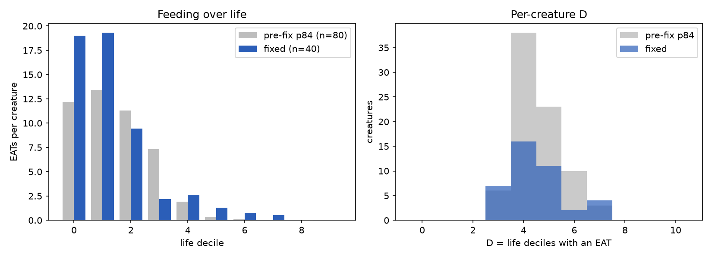
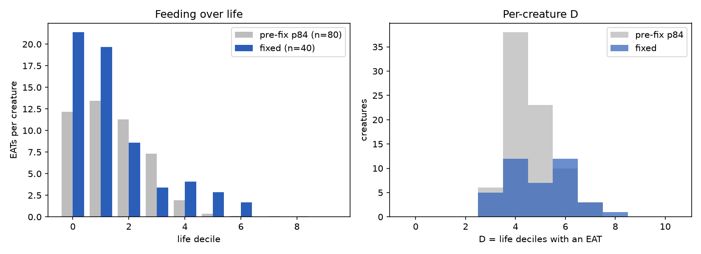

# Report: feeding at speed (#96) and seeded runs (#95) — issue #97

Protocol: [`docs/experiments/p97_feeding_fix_recipe.md`](../experiments/p97_feeding_fix_recipe.md)
(pre-registered; Revision 1 was added after v1 failed). Specs: `experiments/p97_feeding_fix.yml`,
`p97_feeding_fix_v2.yml`, `p97_seed_replay.yml`. Data on HF: `p97/`, `p97_v2/`, `p97_replay/`.
Analysis: `analysis/experiments/p97_feeding_fix.py`.

## Purpose

#96 reported that creatures stop eating mid-life once speed rises and blamed the contact path
(EAT only at `distance == 0`). #97 asked for that fixed, and for every random source to be seeded
(#95), so that arbiter arms can be paired by seed. Done criteria: EATs in every life decile on a
rerun of the legacy configuration, and reproducible runs.

## Assumptions

- Outcome D = number of life deciles (of 10) with at least one EAT, per creature, using `observed_s`
  as life length. Creatures are clustered in trials, so intervals resample trials.
- Pre-fix control is the **historical** p84 `legacy_nomem` data: unseeded, older image, 80 creatures.
  It is not a concurrent control.
- v1 and v2 share seeds 9701-9708, so trial N has the same initial world in both. Akka scheduling
  stays nondeterministic, so only the initial world is shared, not the trajectory.
- The diagnosis in Revision 1 of the recipe was exploratory (formed after looking at v1 data).

## Hypotheses

- H1: P[D >= 9] has a 95% lower bound > 0.6 and median D >= 9 (feeding sustained).
- H2: D exceeds the pre-fix baseline (descriptive).
- H3: same seed gives the same initial world.
- H4 (v2): late-life position spread is more than 3x v1's. H5: v2 D > v1 D, paired by seed.

## Results

### Seeding (H3): holds

Two runs with seed 9701 recorded the same seed in `run_info` and `manifest.json`, and all five
creatures started at identical positions. Full trajectories are not expected to match.

### Feeding: H1 fails in every arm

| Arm | creatures | mean D | median D | P[D >= 9] |
|---|---|---|---|---|
| pre-fix, mixed world (historical) | 80 | 4.58 | 4 | 0 |
| v1: arc + contact-range fix | 40 | 4.50 | 4 | 0 (interval 0-0) |
| v2: v1 + WANDER around heading | 40 | 4.97 | 5 | 0 (interval 0-0) |
| pre-fix, **gray-free** world (historical) | 80 | **9.91** | 10 | 1.00 (73 of 80 at D = 10, 7 at 9) |

- v1 vs pre-fix: Mann-Whitney p = 0.74, Cliff's delta -0.07. Total EATs fell 40% (2,207 vs 3,728).
- v2 vs pre-fix: p = 0.049, delta 0.18. v2 vs v1, paired by seed (Wilcoxon on trial means): p = 0.26.
- EATs per life decile, v1: 761, 772, 377, 88, 105, 52, 28, 22, 2, 0. v2: 855, 786, 343, 135, 163, 114, 68, 2, 3, 0.

### What the collapse is (v1 data, exploratory)

- **Confinement.** Median std of position by life decile (px): v1 185, 156, 99, 22, 13, 11, 14, 12, 9, 5;
  pre-fix 122, 146, 124, 87, 7, 6, 6, 6, 4, 2. After ~30% of life a creature moves inside ~10 px
  while stepping ~9 per action, among ~10 distinct objects.
- **Gray dominates what it sees.** Share of perceptions that are GRAY_APPLE: 54% in decile 0,
  93% in decile 9. Of APPROACH actions in deciles 5-9, 94-97% target gray.
- **Gray is learned as inedible.** The operant EAT probability for GRAY_APPLE falls from 12 to 0 in
  the first ~50 s; for RED/GREEN it stays 37-50. The probability of APPROACH on gray *rises* (30.8,
  vs 22.5 for red/green), because punishing EAT redistributes weight to the other actions.
- **Neighbourhood depletion.** Red and green fruit near a creature are eaten and respawn at random
  elsewhere; gray is never removed. In a ~150 px neighbourhood (about 11 objects) only gray remains.
- Hunger rises 0.3 -> 6.4 over life; speed rises with it (2.3 -> 9.5), so **speed is a consequence of
  the collapse, not its cause.**

### v2 intervention: H4 fails

WANDER used `perception.angle` (bearing to the object) where its comment says "current heading".
Fixing it (test-covered) did not release the trap: late-life spread 38 px vs 31 px in v1.

## Analysis

1. **The contact-path fix is correct and not sufficient.** Mouth arc and vision arc were decoupled
   from heading (radian bearing read as degrees). EAT is now afforded within mouth radius + object
   radius. These are real bugs, covered by tests, and they change perception for every arm. But
   they do not restore sustained feeding: mean D stays ~4.5-5.
2. **#96's premise does not hold as stated.** In the world without GRAY_APPLE, creatures eat in
   every decile (D = 9.91) and never die, *with the pre-fix code*. Feeding
   only collapses when an unrewarding fruit is present. The cause sits in the learned action
   probabilities and the world mix, not in the contact test.
3. **Mechanism, with the confidence it deserves.** The chain above (EAT on gray punished ->
   APPROACH on gray rises -> creature settles among grays -> local red/green exhausted) fits all
   the observations: the operant table, the gray share of perceptions, the confinement, and the
   gray-free control. I have **not** run an intervention that breaks the chain, so it is
   consistent evidence, not proof.
4. **The acceptance criterion is unreachable by a path fix.** "EATs in every decile on the legacy
   configuration" would need a change to the learning dynamics (for instance, punishing EAT must not
   raise APPROACH on the same target, or APPROACH must be extinguished at contact). That changes
   behaviour parity work in p84 (the legacy architecture is the reference there), so it is a design
   decision rather than a bug fix.
5. **Gray-free comparison caveats.** That world has 250 red + 250 green, a 30-minute cap and
   creatures that do not die, so deciles span ~1800 s instead of ~240 s. D is normalised by life
   length, which makes the arms comparable on shape but not on absolute time.

## Limits

Historical control (unseeded, older image); the arm sizes are 8 trials (sizing from the p84 baseline
SD, ICC from 16 trials); v2 vs v1 pairing shares the initial world only; the causal chain in
point 3 is untested by intervention.

## Recommendation

Merge the arc, contact-range, WANDER and seeding changes (all correct, tested). Do not describe
#96 as resolved. For the arbiter's A0 baseline, either use the gray-free legacy world, where
feeding is sustained, or decide explicitly whether the learning rule should change.
