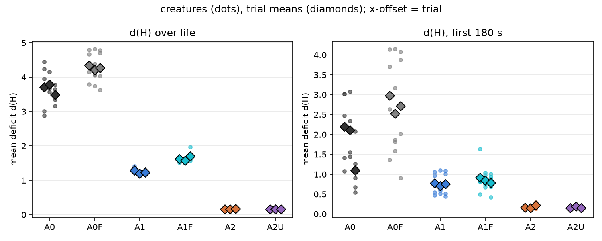
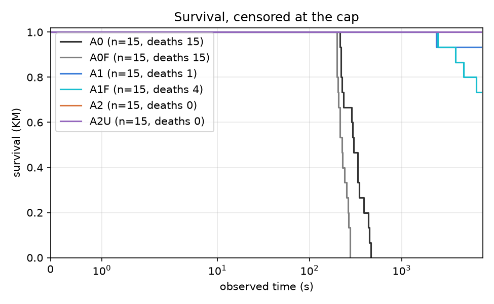
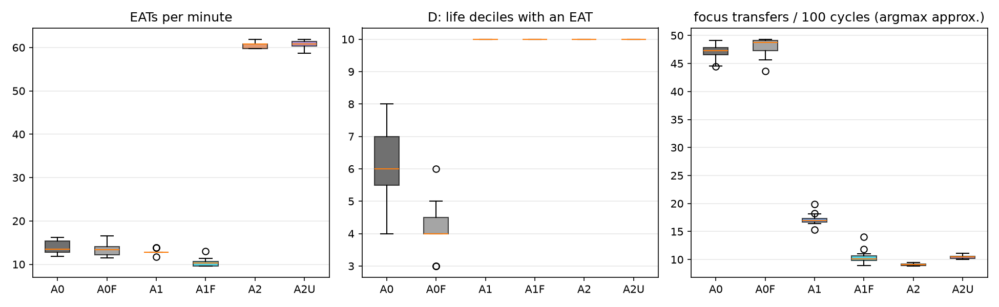

# Report: arbiter-ladder pilot (A0 / A1 / A2), untrained-table control and the affordance-filter fix — #106, #107

> Note — the A0 / A1 arms were produced before the affordance zero-weight fix (issue #130) and were also re-run after it; both are shown. The fix did not change their behaviour materially. See `docs/known-issues/affordance-zero-weight.md`.

Recipes (pre-registration): `docs/experiments/p107_pilot_stage2_recipe.md` (pilot), `p107_ctl_recipe.md` (control), `p107_fix_recipe.md` (fix).
Data on HuggingFace `felipedreis/dl2l-experiments`: `p107_pilot/`, `p107_pilot_ctl/`, `p107_pilot_fix/` (and the gates, `p107_pilot_gate/`, `p107_pilot_gate2/`, the tuning `p107_theta_tune/`).
Full generated tables: `p107_pilot_fix_report.md` (all six arms), `p107_pilot_ctl_report.md`, `p107_pilot_sample_size.md`. Module: `analysis/experiments/arbiter_ladder.py` (#106).

## Purpose

Descriptive pilot of the arbiter ladder, to (1) measure the spread of the outcomes #107 will pre-register so the A1 / A2 campaigns can be sized, (2) run the #106 analysis module end to end on real data,
and, added once the first results raised the question, (3) find out whether A2's advantage over A1 comes from the operant table learning, and (4) whether a defect found in the legacy affordance filter explains how A0 behaves.
No pilot number enters a campaign result.

## Assumptions

- The trial is the unit of replication; the 5 creatures of a trial share a world, a food supply and a seed. The same three seeds (10701-10703) are used in every arm, which pairs the initial world only (Akka scheduling keeps trajectories nondeterministic).
- Arms: A0 (`arbiter_a0.conf`, filter chain, no tracker), A1 (A0 + focus tracker, thresholds 0.4 / 0.15), A2 (A1 + operant estimator + arbiter, only `TARGET_DISTANCE` kept), A2u (A2 whose focus tracker never opens an episode, `focusThetaOn = 99`, so the table never trains), and A0 / A1 fixed (the affordance filter's all-zero-weight fallback made uniform).
- d(H) is the Euclidean norm of the positive deviations of hunger, sleep, pain and tedium from the set point 0.18, averaged over a creature's life; A0 lives minutes, so the first-180-second d(H) is the like-for-like measure across arms.
- Caveats on the data: (a) in creatures that survive to the cap `mouth_interactions` holds a whole number of 128-row blocks, so EAT counts of A1 / A2 survivors are lower bounds (short by up to 127 each); (b) A0's focus switches are an argmax-of-urgency approximation, because the regulated emotion is not persisted; (c) episode ids restart for each creature, so episodes are counted per `(creature, id)`.
- 3 seeds give an SD with 2 degrees of freedom; no p-values are used at 3 pairs.

## Hypothesis

None: the pilot is descriptive. Predictions recorded before the data are checked in the Analysis.

## Results

### Per-arm measures (creature mean, then trial means)

| measure | A0 (old filter) | A0 fixed | A1 (old filter) | A1 fixed | A2 operant arbiter | A2 untrained (control) |
|---|---|---|---|---|---|---|
| d(H) over life | 3.662 (trials 3.704, 3.791, 3.491) | 4.273 (trials 4.335, 4.216, 4.268) | 1.241 (trials 1.294, 1.194, 1.234) | 1.631 (trials 1.622, 1.569, 1.703) | 0.163 (trials 0.161, 0.164, 0.165) | 0.160 (trials 0.159, 0.158, 0.163) |
| d(H), first 180 s | 1.803 (trials 2.201, 2.113, 1.096) | 2.734 (trials 2.974, 2.518, 2.710) | 0.745 (trials 0.778, 0.704, 0.751) | 0.851 (trials 0.919, 0.845, 0.791) | 0.176 (trials 0.156, 0.154, 0.218) | 0.163 (trials 0.151, 0.187, 0.151) |
| EATs per minute | 13.967 (trials 14.551, 13.539, 13.812) | 13.388 (trials 12.884, 13.840, 13.440) | 12.952 (trials 12.813, 13.021, 13.022) | 10.388 (trials 10.029, 10.632, 10.502) | 60.623 (trials 60.623, 60.621, 60.626) | 60.740 (trials 61.024, 60.390, 60.808) |
| RED+GREEN EATs per minute | 7.523 (trials 7.854, 7.292, 7.423) | 6.300 (trials 5.839, 6.616, 6.444) | 11.450 (trials 11.134, 11.664, 11.553) | 9.360 (trials 9.137, 9.470, 9.472) | 25.321 (trials 25.233, 25.229, 25.501) | 25.356 (trials 25.231, 25.519, 25.318) |
| D: life deciles with an EAT | 6.267 (trials 6.600, 6.000, 6.200) | 4.133 (trials 4.000, 4.600, 3.800) | 10.000 (trials 10.000, 10.000, 10.000) | 10.000 (trials 10.000, 10.000, 10.000) | 10.000 (trials 10.000, 10.000, 10.000) | 10.000 (trials 10.000, 10.000, 10.000) |
| observed time (s) | 315.913 (trials 309.372, 316.727, 321.640) | 230.364 (trials 224.180, 238.254, 228.657) | 6874.842 (trials 6233.558, 7195.776, 7195.193) | 6444.464 (trials 7198.524, 5751.599, 6383.269) | 7195.652 (trials 7195.676, 7195.916, 7195.362) | 7198.626 (trials 7198.792, 7198.013, 7199.074) |
| died (share) | 1.000 (trials 1.000, 1.000, 1.000) | 1.000 (trials 1.000, 1.000, 1.000) | 0.067 (trials 0.200, 0.000, 0.000) | 0.267 (trials 0.000, 0.400, 0.400) | 0.000 (trials 0.000, 0.000, 0.000) | 0.000 (trials 0.000, 0.000, 0.000) |
| focus transfers per 100 cycles (argmax approx.) | 47.074 (trials 47.097, 47.195, 46.930) | 48.010 (trials 48.369, 48.486, 47.174) | 17.173 (trials 16.955, 17.492, 17.071) | 10.447 (trials 10.009, 11.172, 10.161) | 9.061 (trials 9.025, 9.077, 9.080) | 10.445 (trials 10.457, 10.531, 10.348) |
| focus opens per 100 cycles (argmax approx.) | 0.192 (trials 0.249, 0.164, 0.163) | 0.217 (trials 0.264, 0.156, 0.232) | 0.175 (trials 0.159, 0.184, 0.183) | 0.127 (trials 0.129, 0.132, 0.120) | 0.942 (trials 0.926, 0.933, 0.968) | 0.992 (trials 0.984, 0.996, 0.997) |
| focus transfers per 100 cycles (tracker) | n/a | n/a | 2.763 (trials 2.773, 2.725, 2.792) | 2.817 (trials 2.849, 2.801, 2.801) | 0.027 (trials 0.026, 0.026, 0.028) | n/a |
| focus opens per 100 cycles (tracker) | n/a | n/a | 0.167 (trials 0.167, 0.172, 0.161) | 0.126 (trials 0.119, 0.134, 0.124) | 0.044 (trials 0.042, 0.045, 0.046) | n/a |
| focused share of cycles (tracker) | n/a | n/a | 0.659 (trials 0.666, 0.649, 0.660) | 0.794 (trials 0.805, 0.778, 0.798) | 0.046 (trials 0.044, 0.047, 0.049) | n/a |

### Drive deficit

Per creature (dots) and per trial (diamonds).

### Survival

- A0 vs A1: deaths 15/15 vs 1/15 (Fisher p = 2.06e-07); KM median 303 s vs beyond the cap; log-rank p = 0.0000

### Feeding and focus

### Episodes (A1, A2)

Close-type mix per arm:

| condition | DEATH | PREEMPTED | REGULATED | TIMED_OUT |
|---|---|---|---|---|
| a1 | 0.000 | 0.877 | 0.122 | 0.001 |
| a1f | 0.000 | 0.911 | 0.083 | 0.006 |
| a2 | 0.000 | 0.081 | 0.780 | 0.140 |

Steps per episode:

| condition | count | 50% | mean | max |
|---|---|---|---|---|
| a1 | 90647.000 | 14.000 | 22.800 | 201.000 |
| a1f | 85683.000 | 16.000 | 27.300 | 201.000 |
| a2 | 2329.000 | 20.000 | 65.100 | 201.000 |

### A2 decision telemetry

**A2** (3,266,356 decisions). Source mix: {'SINGLE': 0.2023, 'GREEDY': 0.7646, 'THOMPSON': 0.0092, 'EPSILON': 0.0239}. Executed action not the chosen one: 6.15%. Informed share (late half, focused multi-candidate): 1.000. Deciding controller by life decile: {0: {'OPERANT': 1.0}, 1: {'OPERANT': 1.0}, 2: {'OPERANT': 1.0}, 3: {'OPERANT': 1.0}, 4: {'OPERANT': 1.0}, 5: {'OPERANT': 1.0}, 6: {'OPERANT': 1.0}, 7: {'OPERANT': 1.0}, 8: {'OPERANT': 1.0}, 9: {'OPERANT': 1.0}}.

Descriptive z by close type:

| close_type | n | mean | variance | rms |
|---|---|---|---|---|
| PREEMPTED | 23174.000 | 0.087 | 0.125 | 0.364 |
| REGULATED | 63199.000 | 0.007 | 0.139 | 0.373 |
| TIMED_OUT | 65325.000 | -0.038 | 0.016 | 0.134 |

**A2U** (3,269,113 decisions). Source mix: {'SINGLE': 0.1995, 'GREEDY': 0.7764, 'THOMPSON': 0.0, 'EPSILON': 0.0241}. Executed action not the chosen one: 6.16%. Informed share (late half, focused multi-candidate): n/a. Deciding controller by life decile: {0: {'OPERANT': 1.0}, 1: {'OPERANT': 1.0}, 2: {'OPERANT': 1.0}, 3: {'OPERANT': 1.0}, 4: {'OPERANT': 1.0}, 5: {'OPERANT': 1.0}, 6: {'OPERANT': 1.0}, 7: {'OPERANT': 1.0}, 8: {'OPERANT': 1.0}, 9: {'OPERANT': 1.0}}.

Descriptive z by close type:

### The three questions the pilot answered

| Question | Answer from the data |
|---|---|
| Does the ladder separate on regulation? | Yes, in all three seeds: d(H) over life 3.66 (A0), 1.24 (A1), 0.16 (A2); deaths 15 / 15, 1 / 15, 0 / 15. Between-seed SD of the paired differences is 0.05-0.18. |
| Does A2 beat A1 because the table learns? | No. A2 with a table that never trains has d(H) 0.160 against 0.163; per-seed A2 - A2u = +0.002, +0.006, +0.002 (margin +-0.06); feeding identical (red + green apples 25.4 against 25.3 per minute); all 15 alive. |
| Is the affordance-filter defect why A0 starves? | No. With the fix A0 still dies 15 / 15 (d(H) 4.27 against 3.66), the APPROACH share of cycles is unchanged (64-67% against 65-66%); A1 fixed has 4 / 15 deaths (1 / 15 before) and d(H) 1.63 (1.24). |

### Sample size for #107 (from `p107_pilot_sample_size.md`)

Paired trials per arm, power 0.8, alpha 0.05, on the point SD (on the upper-bound SD): A2 - A1 on d(H) over life 2 (3); A1 - A0 on the first-180-s d(H) 5 (15). Non-inferiority of A2 against A1, equal true means: margin 0.06 needs 7 (22), 10% of the A1 mean 3 (7), 20% 3 (4). If A2 is as much better than A1 as in the pilot, 2 trials suffice at any margin. The margin is #107's decision.

## Analysis

**1. The regulation ladder is real and very large, but it is a statement about these arms in this world, not about learning.** d(H) falls 3.66 -> 1.24 -> 0.16 from A0 to A2, in every seed, with a between-seed SD of the paired differences of 0.05-0.18, so the contrasts need two to five trials. Survival tells the same story (A0 dies in 3.5-7.7 minutes, A1 loses one creature in 15, A2 none). Predictions recorded before the data held: P1 (A0 creatures starve within about 3-8 minutes: observed 213-461 s), P2 (A1 survives most trials: 14 / 15), P3 (A2 survives to the cap with mean hunger about 0.3 and about 130-170 closed episodes per creature: observed 0.29-0.30 and 121-195).

**2. What takes A0 to A1 is the focus tracker, and the natural explanation is hysteresis, which the pilot does not test.** A1 is A0 plus the tracker, with the same filters; survival goes from 0 to 14 of 15 and d(H) from 3.66 to 1.24. A creature that picks one drive and keeps it until it is back in the band (thresholds 0.4 / 0.15) stops flipping between drives every cycle. Supporting hints are indirect: A0's drive label flips about 47 times per 100 cycles by the argmax approximation, A1's tracker transfers 2.8, and in gate 1 an A1 with the default thresholds (focused about 20% of cycles) had mean hunger 1.34 against 0.98 in gate 2 at 0.4 / 0.15 (focused about 66% of cycles), one trial each. None of this isolates hysteresis: an A1 with a very narrow band (for example 0.4 / 0.39) is the test and has not been run.

**3. What takes A1 to A2 is the arbiter replacing the filter chain, not the operant table.** The control removes every episode, so the table never trains and the tracker never focuses; its behaviour is indistinguishable from the trained A2 on regulation, feeding and survival. The pre-registered reading (all three per-seed differences within +-0.06) says training adds nothing measurable here. With an untrained table every candidate has Q = 0 and SE = 1, so the arbiter's Thompson draw is a uniform random pick among the candidates left by the tendency and distance pre-filters (A2 chooses WANDER 54%, APPROACH 27%, SLEEP 15%, EAT 3.9% of cycles; A0 / A1 APPROACH 63-65%, EAT 0.9%). The trained table is also fed on only about 4.6% of cycles (the focused ones), and the roughly 95% unfocused decisions read the untrained `NONE` bucket, so even a table that learns well can barely move behaviour. The telemetry's informed share of 1.0 only says that the maxima are not tied; it is not evidence that the choices are good.

**4. The world is easy for a random forager, which is why d(H) cannot discriminate controllers here.** About 40% of the objects are edible and the decision rate is high, so a controller that eats whenever EAT is on offer keeps hunger near 0.3. A2's red and green apple rate (25.3 per minute, a lower bound) is more than twice A1's and three times A0's. This is a ceiling effect on the outcome, and it is the main design consequence for the campaigns: an A1-versus-A2 comparison on d(H) in this world measures the selector change.

**5. Why A0 and A1 spend about 65% of their cycles on APPROACH and eat 0.9% of the time is not explained.** I found that the legacy affordance filter returned its first candidate (APPROACH) whenever every learned weight was 0, fixed it without a flag, and expected the APPROACH share to fall. It did not (64-67% after, 65-66% before), A0 still starves, and A0 / A1 got slightly worse (a deterministic fallback had been helping). The defect is real and the fix stays (issue #130), but it is not the cause. An earlier version of this work withdrew results on the strength of a mechanism read from code and a unit test; the measurement refuted it and the notices were softened. Finding the actual cause needs the candidate list and the chosen action logged per cycle in a short A0 run.

**6. Consequences for #107 and for the campaigns.**
- The sample sizes are small because the effects are large. The binding questions are design questions: the non-inferiority margin, and what an A1-versus-A2 campaign is supposed to show once the table is known not to matter in this world.
- To test whether learning can matter, the A2 versus untrained-A2 contrast has to be repeated in a world where drives bind and a random forager fails (the scarce and stress worlds of p104 / p105), and the unfocused cycles could be made to train the table.
- A0 starves in about five minutes, so #108's criterion "feeding sustained across life" cannot hold for it as specified. A1 on the fixed code (4 / 15 deaths) is a different arm from the pilot's A1 (1 / 15); campaigns should say which.
- The focus thresholds are global and were tuned on A2 only (4 settings, one seed, 30 minutes), which sits badly with the equal-tuning-budget rule of #107: it has to be documented as a decision or redone symmetrically. The arbiter's own theta, epsilon and tau are hard-coded and need config keys before they can be tuned.

**7. Limits.** Three seeds and five creatures per trial; one world; one control configuration; A0's focus-switch statistic is an approximation; EAT rates of A1 / A2 are lower bounds; the tuning of the focus thresholds used one seed; the survival contrasts between A1 and A2 are not separable at this size; and the legacy filters' behaviour (point 5) is unexplained.
