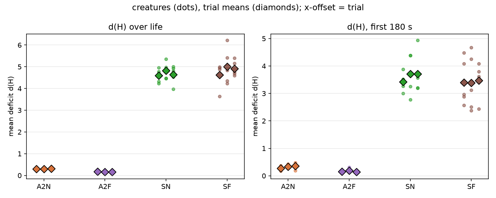
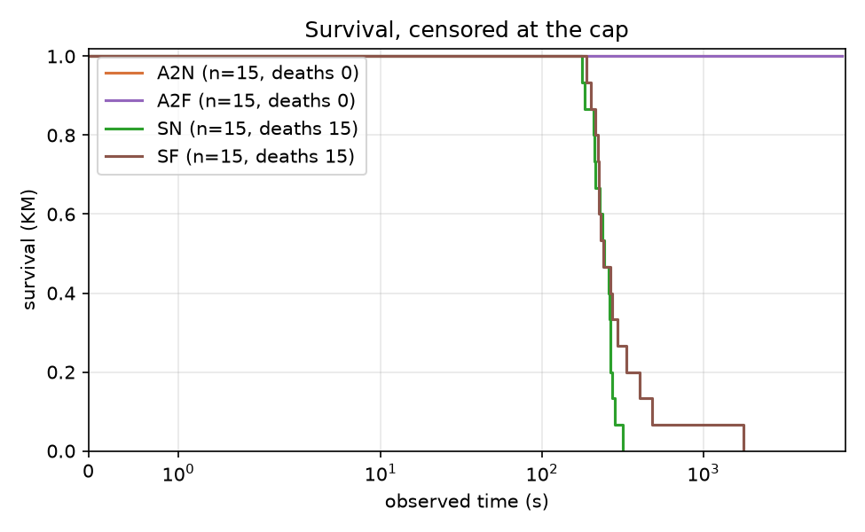
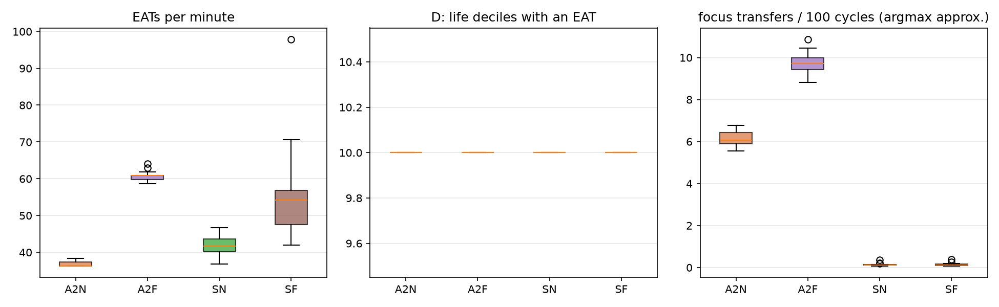

# Report: arbiter-ladder pilot (A0 / A1 / A2), analysis skeleton

## Purpose

Descriptive pilot of the arbiter ladder: spread of the outcomes #107 will pre-register, and a first run of the #106 analysis module end to end. Plan: `docs/plans/arbiter-ladder-pilot.md`, `docs/plans/issue-106-arbiter-ladder-analysis.md`; recipe: `docs/experiments/p107_pilot_stage2_recipe.md`. No pilot number enters a campaign result.

## Assumptions

The trial is the unit; creatures within a trial share a world, a food supply and a seed. The same seed is used in every arm (pairs the initial world only; Akka scheduling keeps trajectories nondeterministic). d(H) is measured from the set point 0.18. A0's focus switches use an argmax-of-urgency approximation, because the regulated emotion is not persisted. A0 lives minutes and A1/A2 up to the cap, so d(H) over life is not like for like; the common-window d(H) is. A1 and A2 use the tuned focus thresholds 0.4 / 0.15. DATA CAVEAT: in creatures that survive to the cap, `mouth_interactions` holds a whole number of 128-row blocks per creature (and `body_states` exactly 217,728 rows), so the last partial block is missing: EAT counts of A1/A2 survivors are lower bounds, short by up to 127 each (up to about 8% in A1, 2% in A2); A0 creatures, which died, are not quantized. The ordering of arms is not affected; the feeding rates are not exact.

## Hypothesis

None: this is a descriptive pilot. Predictions recorded before the data are in the recipe.

## Results

### Per-arm measures (creature mean, then trial means)

| measure | A2, per-outcome operant | A2, operant frozen | A2 scarce, per-outcome operant | A2 scarce, operant frozen |
|---|---|---|---|---|
| d(H) over life | 0.308 (trials 0.305, 0.304, 0.313) | 0.165 (trials 0.170, 0.161, 0.164) | 4.687 (trials 4.597, 4.817, 4.648) | 4.849 (trials 4.619, 5.010, 4.918) |
| d(H), first 180 s | 0.321 (trials 0.276, 0.330, 0.358) | 0.162 (trials 0.155, 0.185, 0.146) | 3.613 (trials 3.428, 3.705, 3.706) | 3.419 (trials 3.396, 3.385, 3.476) |
| EATs per minute | 36.782 (trials 36.937, 36.917, 36.492) | 60.622 (trials 59.989, 61.063, 60.813) | 42.019 (trials 42.622, 42.506, 40.928) | 55.892 (trials 53.142, 59.778, 54.755) |
| RED+GREEN EATs per minute | 17.562 (trials 17.806, 17.545, 17.336) | 25.284 (trials 24.921, 25.491, 25.441) | 2.727 (trials 2.834, 2.828, 2.520) | 3.287 (trials 2.939, 3.544, 3.377) |
| D: life deciles with an EAT | 10.000 (trials 10.000, 10.000, 10.000) | 10.000 (trials 10.000, 10.000, 10.000) | 10.000 (trials 10.000, 10.000, 10.000) | 10.000 (trials 10.000, 10.000, 10.000) |
| observed time (s) | 7196.570 (trials 7194.036, 7198.007, 7197.668) | 7195.788 (trials 7194.866, 7194.095, 7198.405) | 241.542 (trials 244.977, 246.362, 233.287) | 371.647 (trials 266.049, 551.938, 296.953) |
| died (share) | 0.000 (trials 0.000, 0.000, 0.000) | 0.000 (trials 0.000, 0.000, 0.000) | 1.000 (trials 1.000, 1.000, 1.000) | 1.000 (trials 1.000, 1.000, 1.000) |
| focus transfers per 100 cycles (argmax approx.) | 6.149 (trials 6.037, 6.555, 5.855) | 9.739 (trials 9.293, 9.713, 10.211) | 0.147 (trials 0.138, 0.186, 0.116) | 0.150 (trials 0.121, 0.165, 0.165) |
| focus opens per 100 cycles (argmax approx.) | 0.606 (trials 0.607, 0.617, 0.595) | 0.971 (trials 0.934, 0.972, 1.007) | 0.068 (trials 0.048, 0.082, 0.076) | 0.065 (trials 0.063, 0.059, 0.074) |
| focus transfers per 100 cycles (tracker) | 0.090 (trials 0.089, 0.089, 0.092) | 0.027 (trials 0.030, 0.026, 0.026) | 0.076 (trials 0.079, 0.065, 0.082) | 0.090 (trials 0.076, 0.105, 0.088) |
| focus opens per 100 cycles (tracker) | 0.147 (trials 0.147, 0.146, 0.147) | 0.043 (trials 0.045, 0.042, 0.042) | 0.471 (trials 0.474, 0.475, 0.465) | 0.469 (trials 0.475, 0.465, 0.466) |
| focused share of cycles (tracker) | 0.199 (trials 0.196, 0.196, 0.204) | 0.048 (trials 0.052, 0.044, 0.047) | 0.962 (trials 0.954, 0.961, 0.971) | 0.970 (trials 0.972, 0.975, 0.963) |
| episodes per creature | 515.467 (trials 513.200, 511.400, 521.800) | 152.267 (trials 161.800, 147.800, 147.200) | 39.333 (trials 40.200, 39.800, 38.000) | 64.400 (trials 44.000, 99.800, 49.400) |
### Drive deficit

Per creature (dots) and per trial (diamonds).
### Survival

no data
### Feeding and focus

EATs per minute, life deciles with an EAT, and the argmax-approximated focus transfers per 100 cycles.
### Episodes (A1, A2)

Close-type mix per arm:

| condition | DEATH | PREEMPTED | REGULATED | TIMED_OUT |
|---|---|---|---|---|
| a2f | 0.000 | 0.088 | 0.770 | 0.141 |
| a2n | 0.000 | 0.106 | 0.674 | 0.220 |
| sf | 0.016 | 0.188 | 0.021 | 0.775 |
| sn | 0.025 | 0.120 | 0.029 | 0.825 |

Steps per episode:

| condition | count | 50% | mean | max |
|---|---|---|---|---|
| a2f | 2284.000 | 23.000 | 68.600 | 201.000 |
| a2n | 7732.000 | 47.000 | 84.000 | 201.000 |
| sf | 966.000 | 201.000 | 167.400 | 201.000 |
| sn | 590.000 | 201.000 | 175.300 | 201.000 |
### A2 decision telemetry

**A2N** (3,268,030 decisions). Source mix: {'SINGLE': 0.1328, 'GREEDY': 0.8213, 'THOMPSON': 0.0199, 'EPSILON': 0.026}. Executed action not the chosen one: 4.02%. Informed share (late half, focused multi-candidate): 0.475. Deciding controller by life decile: {0: {'OPERANT': 1.0}, 1: {'OPERANT': 1.0}, 2: {'OPERANT': 1.0}, 3: {'OPERANT': 1.0}, 4: {'OPERANT': 1.0}, 5: {'OPERANT': 1.0}, 6: {'OPERANT': 1.0}, 7: {'OPERANT': 1.0}, 8: {'OPERANT': 1.0}, 9: {'OPERANT': 1.0}}.

Descriptive z by close type:

| close_type | n | mean | variance | rms |
|---|---|---|---|---|
| PREEMPTED | 94418.000 | 0.152 | 2.637 | 1.631 |
| REGULATED | 213389.000 | 0.127 | 1.970 | 1.409 |
| TIMED_OUT | 341797.000 | 0.195 | 2.823 | 1.691 |

**A2F** (3,267,776 decisions). Source mix: {'SINGLE': 0.2011, 'GREEDY': 0.7749, 'THOMPSON': 0.0, 'EPSILON': 0.024}. Executed action not the chosen one: 6.13%. Informed share (late half, focused multi-candidate): 0.000. Deciding controller by life decile: {0: {'OPERANT': 1.0}, 1: {'OPERANT': 1.0}, 2: {'OPERANT': 1.0}, 3: {'OPERANT': 1.0}, 4: {'OPERANT': 1.0}, 5: {'OPERANT': 1.0}, 6: {'OPERANT': 1.0}, 7: {'OPERANT': 1.0}, 8: {'OPERANT': 1.0}, 9: {'OPERANT': 1.0}}.

Descriptive z by close type:

| close_type | n | mean | variance | rms |
|---|---|---|---|---|
| PREEMPTED | 22966.000 | 0.014 | 0.001 | 0.037 |
| REGULATED | 68804.000 | 0.052 | 0.007 | 0.096 |
| TIMED_OUT | 64923.000 | 0.002 | 0.000 | 0.012 |

**SN** (107,440 decisions). Source mix: {'SINGLE': 0.3849, 'GREEDY': 0.5742, 'THOMPSON': 0.0225, 'EPSILON': 0.0183}. Executed action not the chosen one: 0.32%. Informed share (late half, focused multi-candidate): 0.539. Deciding controller by life decile: {0: {'OPERANT': 1.0}, 1: {'OPERANT': 1.0}, 2: {'OPERANT': 1.0}, 3: {'OPERANT': 1.0}, 4: {'OPERANT': 1.0}, 5: {'OPERANT': 1.0}, 6: {'OPERANT': 1.0}, 7: {'OPERANT': 1.0}, 8: {'OPERANT': 1.0}, 9: {'OPERANT': 1.0}}.

Descriptive z by close type:

| close_type | n | mean | variance | rms |
|---|---|---|---|---|
| DEATH | 1545.000 | -0.103 | 4.935 | 2.223 |
| PREEMPTED | 3466.000 | 0.212 | 1.280 | 1.151 |
| REGULATED | 511.000 | 0.127 | 0.121 | 0.370 |
| TIMED_OUT | 97887.000 | 0.184 | 1.489 | 1.234 |

**SF** (166,540 decisions). Source mix: {'SINGLE': 0.561, 'GREEDY': 0.4255, 'THOMPSON': 0.0, 'EPSILON': 0.0135}. Executed action not the chosen one: 0.42%. Informed share (late half, focused multi-candidate): 0.000. Deciding controller by life decile: {0: {'OPERANT': 1.0}, 1: {'OPERANT': 1.0}, 2: {'OPERANT': 1.0}, 3: {'OPERANT': 1.0}, 4: {'OPERANT': 1.0}, 5: {'OPERANT': 1.0}, 6: {'OPERANT': 1.0}, 7: {'OPERANT': 1.0}, 8: {'OPERANT': 1.0}, 9: {'OPERANT': 1.0}}.

Descriptive z by close type:

| close_type | n | mean | variance | rms |
|---|---|---|---|---|
| DEATH | 1876.000 | -0.238 | 0.481 | 0.733 |
| PREEMPTED | 8606.000 | 0.071 | 0.017 | 0.148 |
| REGULATED | 666.000 | 0.066 | 0.009 | 0.117 |
| TIMED_OUT | 150549.000 | 0.002 | 0.000 | 0.015 |
### Paired differences by seed

Differences of trial means, later arm minus earlier arm; SD has 2 degrees of freedom, so size on the 80% upper bound (2.12 x SD), not the point estimate.

| measure | contrast | per-seed differences | mean | SD (2 df) | 80% upper bound on SD |
|---|---|---|---|---|---|
| d(H) over life | A2N - A2F | [0.1357, 0.1437, 0.1493] | 0.143 | 0.007 | 0.014 |
| d(H) over life | SN - SF | [-0.0219, -0.1933, -0.2703] | -0.162 | 0.127 | 0.270 |
| d(H), first 180 s | A2N - A2F | [0.1208, 0.1443, 0.2124] | 0.159 | 0.048 | 0.101 |
| d(H), first 180 s | SN - SF | [0.0322, 0.3198, 0.2299] | 0.194 | 0.147 | 0.312 |
| EATs per minute | A2N - A2F | [-23.0522, -24.1465, -24.3216] | -23.840 | 0.688 | 1.458 |
| EATs per minute | SN - SF | [-10.5194, -17.2722, -13.8279] | -13.873 | 3.377 | 7.158 |
| RED+GREEN EATs per minute | A2N - A2F | [-7.1147, -7.9461, -8.105] | -7.722 | 0.532 | 1.128 |
| RED+GREEN EATs per minute | SN - SF | [-0.1055, -0.7154, -0.8568] | -0.559 | 0.399 | 0.846 |
| D: life deciles with an EAT | A2N - A2F | [0.0, 0.0, 0.0] | 0.000 | 0.000 | 0.000 |
| D: life deciles with an EAT | SN - SF | [0.0, 0.0, 0.0] | 0.000 | 0.000 | 0.000 |
| observed time (s) | A2N - A2F | [-0.83, 3.9128, -0.7372] | 0.782 | 2.712 | 5.749 |
| observed time (s) | SN - SF | [-21.0718, -305.5756, -63.6664] | -130.105 | 153.447 | 325.309 |
| died (share) | A2N - A2F | [0.0, 0.0, 0.0] | 0.000 | 0.000 | 0.000 |
| died (share) | SN - SF | [0.0, 0.0, 0.0] | 0.000 | 0.000 | 0.000 |
| focus transfers per 100 cycles (argmax approx.) | A2N - A2F | [-3.256, -3.1575, -4.3552] | -3.590 | 0.665 | 1.410 |
| focus transfers per 100 cycles (argmax approx.) | SN - SF | [0.0179, 0.0214, -0.0495] | -0.003 | 0.040 | 0.085 |
| focus opens per 100 cycles (argmax approx.) | A2N - A2F | [-0.3279, -0.3553, -0.4126] | -0.365 | 0.043 | 0.092 |
| focus opens per 100 cycles (argmax approx.) | SN - SF | [-0.0151, 0.0225, 0.0014] | 0.003 | 0.019 | 0.040 |
| focus transfers per 100 cycles (tracker) | A2N - A2F | [0.0589, 0.0622, 0.0661] | 0.062 | 0.004 | 0.008 |
| focus transfers per 100 cycles (tracker) | SN - SF | [0.0034, -0.0392, -0.006] | -0.014 | 0.022 | 0.047 |
| focus opens per 100 cycles (tracker) | A2N - A2F | [0.1024, 0.1044, 0.1059] | 0.104 | 0.002 | 0.004 |
| focus opens per 100 cycles (tracker) | SN - SF | [-0.0012, 0.0101, -0.0002] | 0.003 | 0.006 | 0.013 |
| focused share of cycles (tracker) | A2N - A2F | [0.1439, 0.1518, 0.1568] | 0.151 | 0.007 | 0.014 |
| focused share of cycles (tracker) | SN - SF | [-0.0186, -0.0145, 0.0078] | -0.008 | 0.014 | 0.030 |
| episodes per creature | A2N - A2F | [351.4, 363.6, 374.6] | 363.200 | 11.605 | 24.603 |
| episodes per creature | SN - SF | [-3.8, -60.0, -11.4] | -25.067 | 30.491 | 64.641 |

## Analysis

To be written from the tables above (and the sample-size computation of #107).
