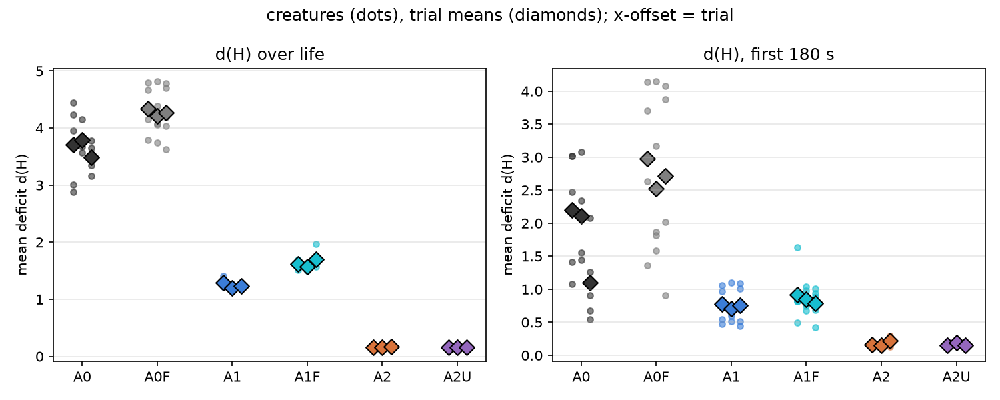
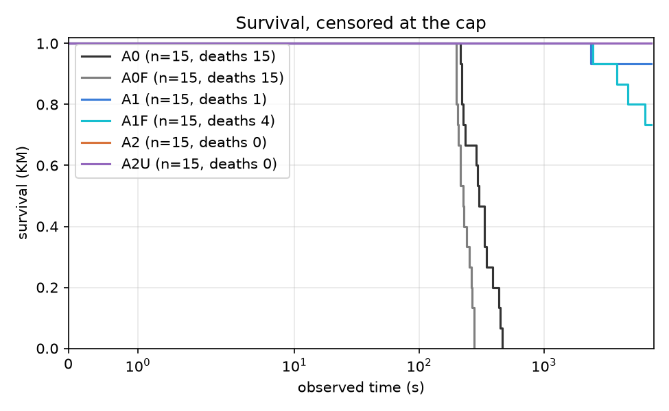
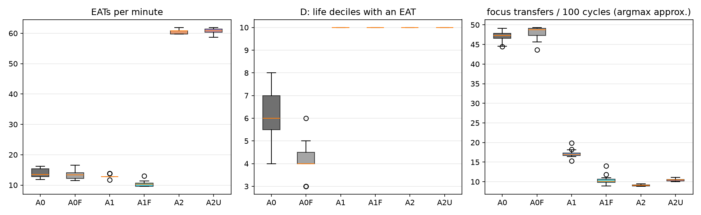

# Report: arbiter-ladder pilot (A0 / A1 / A2), analysis skeleton

## Purpose

Descriptive pilot of the arbiter ladder: spread of the outcomes #107 will pre-register, and a first run of the #106 analysis module end to end. Plan: `docs/plans/arbiter-ladder-pilot.md`, `docs/plans/issue-106-arbiter-ladder-analysis.md`; recipe: `docs/experiments/p107_pilot_stage2_recipe.md`. No pilot number enters a campaign result.

## Assumptions

The trial is the unit; creatures within a trial share a world, a food supply and a seed. The same seed is used in every arm (pairs the initial world only; Akka scheduling keeps trajectories nondeterministic). d(H) is measured from the set point 0.18. A0's focus switches use an argmax-of-urgency approximation, because the regulated emotion is not persisted. A0 lives minutes and A1/A2 up to the cap, so d(H) over life is not like for like; the common-window d(H) is. A1 and A2 use the tuned focus thresholds 0.4 / 0.15. DATA CAVEAT: in creatures that survive to the cap, `mouth_interactions` holds a whole number of 128-row blocks per creature (and `body_states` exactly 217,728 rows), so the last partial block is missing: EAT counts of A1/A2 survivors are lower bounds, short by up to 127 each (up to about 8% in A1, 2% in A2); A0 creatures, which died, are not quantized. The ordering of arms is not affected; the feeding rates are not exact.

## Hypothesis

None: this is a descriptive pilot. Predictions recorded before the data are in the recipe.

## Results

### Per-arm measures (creature mean, then trial means)

| measure | A0 (old filter) | A0 fixed | A1 (old filter) | A1 fixed | A2 operant arbiter | A2 untrained (control) |
|---|---|---|---|---|---|---|
| d(H) over life | 3.662 (trials 3.704, 3.791, 3.491) | 4.273 (trials 4.335, 4.216, 4.268) | 1.241 (trials 1.294, 1.194, 1.234) | 1.631 (trials 1.622, 1.569, 1.703) | 0.163 (trials 0.161, 0.164, 0.165) | 0.160 (trials 0.159, 0.158, 0.163) |
| d(H), first 180 s | 1.803 (trials 2.201, 2.113, 1.096) | 2.734 (trials 2.974, 2.518, 2.710) | 0.745 (trials 0.778, 0.704, 0.751) | 0.851 (trials 0.919, 0.845, 0.791) | 0.176 (trials 0.156, 0.154, 0.218) | 0.163 (trials 0.151, 0.187, 0.151) |
| EATs per minute | 13.967 (trials 14.551, 13.539, 13.812) | 13.388 (trials 12.884, 13.840, 13.440) | 12.952 (trials 12.813, 13.021, 13.022) | 10.388 (trials 10.029, 10.632, 10.502) | 60.623 (trials 60.623, 60.621, 60.626) | 60.740 (trials 61.024, 60.390, 60.808) |
| RED+GREEN EATs per minute | 7.523 (trials 7.854, 7.292, 7.423) | 6.300 (trials 5.839, 6.616, 6.444) | 11.450 (trials 11.134, 11.664, 11.553) | 9.360 (trials 9.137, 9.470, 9.472) | 25.321 (trials 25.233, 25.229, 25.501) | 25.356 (trials 25.231, 25.519, 25.318) |
| D: life deciles with an EAT | 6.267 (trials 6.600, 6.000, 6.200) | 4.133 (trials 4.000, 4.600, 3.800) | 10.000 (trials 10.000, 10.000, 10.000) | 10.000 (trials 10.000, 10.000, 10.000) | 10.000 (trials 10.000, 10.000, 10.000) | 10.000 (trials 10.000, 10.000, 10.000) |
| observed time (s) | 315.913 (trials 309.372, 316.727, 321.640) | 230.364 (trials 224.180, 238.254, 228.657) | 6874.842 (trials 6233.558, 7195.776, 7195.193) | 6444.464 (trials 7198.524, 5751.599, 6383.269) | 7195.652 (trials 7195.676, 7195.916, 7195.362) | 7198.626 (trials 7198.792, 7198.013, 7199.074) |
| died (share) | 1.000 (trials 1.000, 1.000, 1.000) | 1.000 (trials 1.000, 1.000, 1.000) | 0.067 (trials 0.200, 0.000, 0.000) | 0.267 (trials 0.000, 0.400, 0.400) | 0.000 (trials 0.000, 0.000, 0.000) | 0.000 (trials 0.000, 0.000, 0.000) |
| focus transfers per 100 cycles (argmax approx.) | 47.074 (trials 47.097, 47.195, 46.930) | 48.010 (trials 48.369, 48.486, 47.174) | 17.173 (trials 16.955, 17.492, 17.071) | 10.447 (trials 10.009, 11.172, 10.161) | 9.061 (trials 9.025, 9.077, 9.080) | 10.445 (trials 10.457, 10.531, 10.348) |
| focus opens per 100 cycles (argmax approx.) | 0.192 (trials 0.249, 0.164, 0.163) | 0.217 (trials 0.264, 0.156, 0.232) | 0.175 (trials 0.159, 0.184, 0.183) | 0.127 (trials 0.129, 0.132, 0.120) | 0.942 (trials 0.926, 0.933, 0.968) | 0.992 (trials 0.984, 0.996, 0.997) |
| focus transfers per 100 cycles (tracker) | n/a | n/a | 2.763 (trials 2.773, 2.725, 2.792) | 2.817 (trials 2.849, 2.801, 2.801) | 0.027 (trials 0.026, 0.026, 0.028) | n/a |
| focus opens per 100 cycles (tracker) | n/a | n/a | 0.167 (trials 0.167, 0.172, 0.161) | 0.126 (trials 0.119, 0.134, 0.124) | 0.044 (trials 0.042, 0.045, 0.046) | n/a |
| focused share of cycles (tracker) | n/a | n/a | 0.659 (trials 0.666, 0.649, 0.660) | 0.794 (trials 0.805, 0.778, 0.798) | 0.046 (trials 0.044, 0.047, 0.049) | n/a |
| episodes per creature | n/a | n/a | 6043.133 (trials 5532.800, 6239.000, 6357.600) | 5712.200 (trials 6430.400, 5087.400, 5618.800) | 155.267 (trials 149.000, 155.000, 161.800) | n/a |
### Drive deficit

Per creature (dots) and per trial (diamonds).
### Survival

- A0 vs A1: deaths 15/15 vs 1/15 (Fisher p = 2.06e-07); KM median 303 s vs beyond the cap; log-rank p = 0.0000
- A1 vs A2: deaths 1/15 vs 0/15 (Fisher p = 1); KM median beyond the cap vs beyond the cap; log-rank p = 0.3173
### Feeding and focus

EATs per minute, life deciles with an EAT, and the argmax-approximated focus transfers per 100 cycles.
### Episodes (A1, A2)

Close-type mix per arm:

| condition | DEATH | PREEMPTED | REGULATED | TIMED_OUT |
|---|---|---|---|---|
| a1 | 0.000 | 0.877 | 0.122 | 0.001 |
| a1f | 0.000 | 0.911 | 0.083 | 0.006 |
| a2 | 0.000 | 0.081 | 0.780 | 0.140 |

Steps per episode:

| condition | count | 50% | mean | max |
|---|---|---|---|---|
| a1 | 90647.000 | 14.000 | 22.800 | 201.000 |
| a1f | 85683.000 | 16.000 | 27.300 | 201.000 |
| a2 | 2329.000 | 20.000 | 65.100 | 201.000 |
### A2 decision telemetry

**A2** (3,266,356 decisions). Source mix: {'SINGLE': 0.2023, 'GREEDY': 0.7646, 'THOMPSON': 0.0092, 'EPSILON': 0.0239}. Executed action not the chosen one: 6.15%. Informed share (late half, focused multi-candidate): 1.000. Deciding controller by life decile: {0: {'OPERANT': 1.0}, 1: {'OPERANT': 1.0}, 2: {'OPERANT': 1.0}, 3: {'OPERANT': 1.0}, 4: {'OPERANT': 1.0}, 5: {'OPERANT': 1.0}, 6: {'OPERANT': 1.0}, 7: {'OPERANT': 1.0}, 8: {'OPERANT': 1.0}, 9: {'OPERANT': 1.0}}.

Descriptive z by close type:

| close_type | n | mean | variance | rms |
|---|---|---|---|---|
| PREEMPTED | 23174.000 | 0.087 | 0.125 | 0.364 |
| REGULATED | 63199.000 | 0.007 | 0.139 | 0.373 |
| TIMED_OUT | 65325.000 | -0.038 | 0.016 | 0.134 |

**A2U** (3,269,113 decisions). Source mix: {'SINGLE': 0.1995, 'GREEDY': 0.7764, 'THOMPSON': 0.0, 'EPSILON': 0.0241}. Executed action not the chosen one: 6.16%. Informed share (late half, focused multi-candidate): n/a. Deciding controller by life decile: {0: {'OPERANT': 1.0}, 1: {'OPERANT': 1.0}, 2: {'OPERANT': 1.0}, 3: {'OPERANT': 1.0}, 4: {'OPERANT': 1.0}, 5: {'OPERANT': 1.0}, 6: {'OPERANT': 1.0}, 7: {'OPERANT': 1.0}, 8: {'OPERANT': 1.0}, 9: {'OPERANT': 1.0}}.

Descriptive z by close type:

no closed steps
### Paired differences by seed

Differences of trial means, later arm minus earlier arm; SD has 2 degrees of freedom, so size on the 80% upper bound (2.12 x SD), not the point estimate.

| measure | contrast | per-seed differences | mean | SD (2 df) | 80% upper bound on SD |
|---|---|---|---|---|---|
| d(H) over life | A0F - A0 | [0.6304, 0.425, 0.7768] | 0.611 | 0.177 | 0.375 |
| d(H) over life | A1F - A1 | [0.3279, 0.3745, 0.4685] | 0.390 | 0.072 | 0.152 |
| d(H) over life | A1F - A0F | [-2.7124, -2.6473, -2.5654] | -2.642 | 0.074 | 0.156 |
| d(H) over life | A2 - A1F | [-1.4607, -1.4053, -1.5382] | -1.468 | 0.067 | 0.141 |
| d(H) over life | A2 - A0F | [-4.1731, -4.0526, -4.1035] | -4.110 | 0.060 | 0.128 |
| d(H), first 180 s | A0F - A0 | [0.7728, 0.405, 1.6141] | 0.931 | 0.620 | 1.314 |
| d(H), first 180 s | A1F - A1 | [0.1407, 0.1403, 0.0395] | 0.107 | 0.058 | 0.124 |
| d(H), first 180 s | A1F - A0F | [-2.0547, -1.6736, -1.9191] | -1.882 | 0.193 | 0.410 |
| d(H), first 180 s | A2 - A1F | [-0.7624, -0.6907, -0.5731] | -0.675 | 0.096 | 0.203 |
| d(H), first 180 s | A2 - A0F | [-2.8171, -2.3643, -2.4922] | -2.558 | 0.233 | 0.495 |
| EATs per minute | A0F - A0 | [-1.667, 0.3004, -0.3712] | -0.579 | 1.000 | 2.120 |
| EATs per minute | A1F - A1 | [-2.7839, -2.3887, -2.5197] | -2.564 | 0.201 | 0.427 |
| EATs per minute | A1F - A0F | [-2.855, -3.2076, -2.938] | -3.000 | 0.184 | 0.391 |
| EATs per minute | A2 - A1F | [50.5943, 49.9888, 50.1234] | 50.235 | 0.318 | 0.674 |
| EATs per minute | A2 - A0F | [47.7393, 46.7812, 47.1854] | 47.235 | 0.481 | 1.020 |
| RED+GREEN EATs per minute | A0F - A0 | [-2.0142, -0.6759, -0.9786] | -1.223 | 0.702 | 1.488 |
| RED+GREEN EATs per minute | A1F - A1 | [-1.9975, -2.1939, -2.0806] | -2.091 | 0.099 | 0.209 |
| RED+GREEN EATs per minute | A1F - A0F | [3.2975, 2.8537, 3.0279] | 3.060 | 0.224 | 0.474 |
| RED+GREEN EATs per minute | A2 - A1F | [16.0966, 15.7597, 16.0293] | 15.962 | 0.178 | 0.378 |
| RED+GREEN EATs per minute | A2 - A0F | [19.3941, 18.6134, 19.0571] | 19.022 | 0.392 | 0.830 |
| D: life deciles with an EAT | A0F - A0 | [-2.6, -1.4, -2.4] | -2.133 | 0.643 | 1.363 |
| D: life deciles with an EAT | A1F - A1 | [0.0, 0.0, 0.0] | 0.000 | 0.000 | 0.000 |
| D: life deciles with an EAT | A1F - A0F | [6.0, 5.4, 6.2] | 5.867 | 0.416 | 0.883 |
| D: life deciles with an EAT | A2 - A1F | [0.0, 0.0, 0.0] | 0.000 | 0.000 | 0.000 |
| D: life deciles with an EAT | A2 - A0F | [6.0, 5.4, 6.2] | 5.867 | 0.416 | 0.883 |
| observed time (s) | A0F - A0 | [-85.1916, -78.473, -92.9824] | -85.549 | 7.261 | 15.394 |
| observed time (s) | A1F - A1 | [964.9658, -1444.177, -811.9234] | -430.378 | 1249.070 | 2648.028 |
| observed time (s) | A1F - A0F | [6974.3436, 5513.3446, 6154.612] | 6214.100 | 732.314 | 1552.505 |
| observed time (s) | A2 - A1F | [-2.8476, 1444.3174, 812.093] | 751.188 | 725.502 | 1538.065 |
| observed time (s) | A2 - A0F | [6971.496, 6957.662, 6966.705] | 6965.288 | 7.025 | 14.893 |
| died (share) | A0F - A0 | [0.0, 0.0, 0.0] | 0.000 | 0.000 | 0.000 |
| died (share) | A1F - A1 | [-0.2, 0.4, 0.4] | 0.200 | 0.346 | 0.734 |
| died (share) | A1F - A0F | [-1.0, -0.6, -0.6] | -0.733 | 0.231 | 0.490 |
| died (share) | A2 - A1F | [0.0, -0.4, -0.4] | -0.267 | 0.231 | 0.490 |
| died (share) | A2 - A0F | [-1.0, -1.0, -1.0] | -1.000 | 0.000 | 0.000 |
| focus transfers per 100 cycles (argmax approx.) | A0F - A0 | [1.2721, 1.2914, 0.2444] | 0.936 | 0.599 | 1.270 |
| focus transfers per 100 cycles (argmax approx.) | A1F - A1 | [-6.9464, -6.3202, -6.9109] | -6.726 | 0.352 | 0.746 |
| focus transfers per 100 cycles (argmax approx.) | A1F - A0F | [-38.36, -37.3141, -37.0137] | -37.563 | 0.707 | 1.498 |
| focus transfers per 100 cycles (argmax approx.) | A2 - A1F | [-0.9837, -2.0956, -1.0805] | -1.387 | 0.616 | 1.306 |
| focus transfers per 100 cycles (argmax approx.) | A2 - A0F | [-39.3437, -39.4097, -38.0942] | -38.949 | 0.741 | 1.571 |
| focus opens per 100 cycles (argmax approx.) | A0F - A0 | [0.0145, -0.0081, 0.0695] | 0.025 | 0.040 | 0.085 |
| focus opens per 100 cycles (argmax approx.) | A1F - A1 | [-0.0306, -0.0527, -0.0625] | -0.049 | 0.016 | 0.035 |
| focus opens per 100 cycles (argmax approx.) | A1F - A0F | [-0.135, -0.0248, -0.1121] | -0.091 | 0.058 | 0.123 |
| focus opens per 100 cycles (argmax approx.) | A2 - A1F | [0.7973, 0.8014, 0.8479] | 0.816 | 0.028 | 0.060 |
| focus opens per 100 cycles (argmax approx.) | A2 - A0F | [0.6623, 0.7766, 0.7359] | 0.725 | 0.058 | 0.123 |
| focus transfers per 100 cycles (tracker) | A1F - A1 | [0.0756, 0.0758, 0.0097] | 0.054 | 0.038 | 0.081 |
| focus transfers per 100 cycles (tracker) | A2 - A1F | [-2.8225, -2.7749, -2.7735] | -2.790 | 0.028 | 0.059 |
| focus opens per 100 cycles (tracker) | A1F - A1 | [-0.0479, -0.038, -0.0374] | -0.041 | 0.006 | 0.013 |
| focus opens per 100 cycles (tracker) | A2 - A1F | [-0.0771, -0.0888, -0.0776] | -0.081 | 0.007 | 0.014 |
| focused share of cycles (tracker) | A1F - A1 | [0.1388, 0.1291, 0.1372] | 0.135 | 0.005 | 0.011 |
| focused share of cycles (tracker) | A2 - A1F | [-0.761, -0.7317, -0.7488] | -0.747 | 0.015 | 0.031 |
| episodes per creature | A1F - A1 | [897.6, -1151.6, -738.8] | -330.933 | 1083.777 | 2297.606 |
| episodes per creature | A2 - A1F | [-6281.4, -4932.4, -5457.0] | -5556.933 | 680.030 | 1441.663 |

## Analysis

To be written from the tables above (and the sample-size computation of #107).
