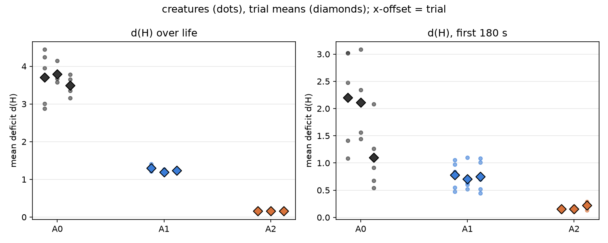
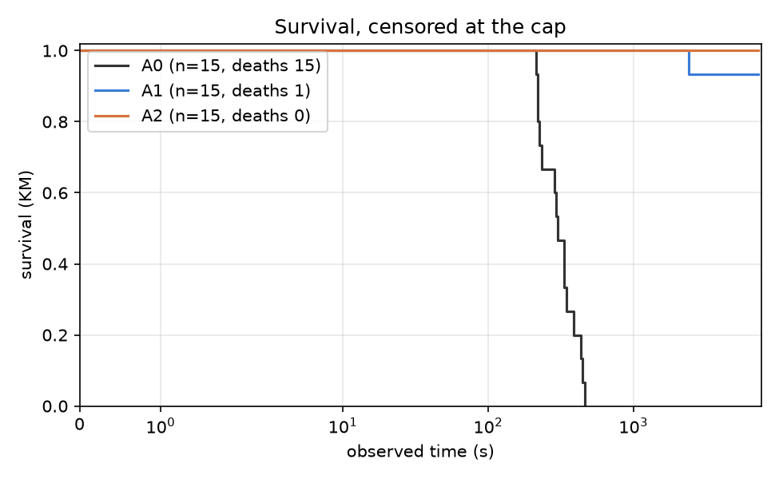
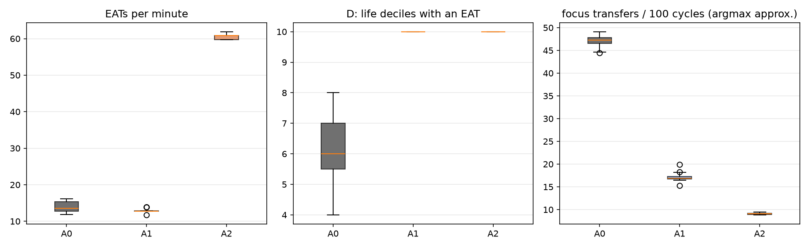

# Report: arbiter-ladder pilot (A0 / A1 / A2), analysis skeleton

> **Note — affordance zero-weight bug (fixed 2026-11-08).** This result predates the fix of a filter that returned the first candidate when every weight was 0. Measured on the arbiter-ladder arms (`p107_pilot_fix`) the fix did **not** change A0 / A1 behaviour materially (A0 still starves, the APPROACH share is unchanged; A1 d(H) +0.39), so the result is not considered invalid, but it has not been re-run. See [`docs/known-issues/affordance-zero-weight.md`](../known-issues/affordance-zero-weight.md).

## Purpose

Descriptive pilot of the arbiter ladder: spread of the outcomes #107 will pre-register, and a first run of the #106 analysis module end to end. Plan: `docs/plans/arbiter-ladder-pilot.md`, `docs/plans/issue-106-arbiter-ladder-analysis.md`; recipe: `docs/experiments/p107_pilot_stage2_recipe.md`. No pilot number enters a campaign result.

## Assumptions

The trial is the unit; creatures within a trial share a world, a food supply and a seed. The same seed is used in every arm (pairs the initial world only; Akka scheduling keeps trajectories nondeterministic). d(H) is measured from the set point 0.18. A0's focus switches use an argmax-of-urgency approximation, because the regulated emotion is not persisted. A0 lives minutes and A1/A2 up to the cap, so d(H) over life is not like for like; the common-window d(H) is. A1 and A2 use the tuned focus thresholds 0.4 / 0.15. DATA CAVEAT: in creatures that survive to the cap, `mouth_interactions` holds a whole number of 128-row blocks per creature (and `body_states` exactly 217,728 rows), so the last partial block is missing: EAT counts of A1/A2 survivors are lower bounds, short by up to 127 each (up to about 8% in A1, 2% in A2); A0 creatures, which died, are not quantized. The ordering of arms is not affected; the feeding rates are not exact.

## Hypothesis

None: this is a descriptive pilot. Predictions recorded before the data are in the recipe.

## Results

### Per-arm measures (creature mean, then trial means)

| measure | A0 baseline | A1 focus tracker | A2 operant arbiter |
|---|---|---|---|
| d(H) over life | 3.662 (trials 3.704, 3.791, 3.491) | 1.241 (trials 1.294, 1.194, 1.234) | 0.163 (trials 0.161, 0.164, 0.165) |
| d(H), first 180 s | 1.803 (trials 2.201, 2.113, 1.096) | 0.745 (trials 0.778, 0.704, 0.751) | 0.176 (trials 0.156, 0.154, 0.218) |
| EATs per minute | 13.967 (trials 14.551, 13.539, 13.812) | 12.952 (trials 12.813, 13.021, 13.022) | 60.623 (trials 60.623, 60.621, 60.626) |
| RED+GREEN EATs per minute | 7.523 (trials 7.854, 7.292, 7.423) | 11.450 (trials 11.134, 11.664, 11.553) | 25.321 (trials 25.233, 25.229, 25.501) |
| D: life deciles with an EAT | 6.267 (trials 6.600, 6.000, 6.200) | 10.000 (trials 10.000, 10.000, 10.000) | 10.000 (trials 10.000, 10.000, 10.000) |
| observed time (s) | 315.913 (trials 309.372, 316.727, 321.640) | 6874.842 (trials 6233.558, 7195.776, 7195.193) | 7195.652 (trials 7195.676, 7195.916, 7195.362) |
| died (share) | 1.000 (trials 1.000, 1.000, 1.000) | 0.067 (trials 0.200, 0.000, 0.000) | 0.000 (trials 0.000, 0.000, 0.000) |
| focus transfers per 100 cycles (argmax approx.) | 47.074 (trials 47.097, 47.195, 46.930) | 17.173 (trials 16.955, 17.492, 17.071) | 9.061 (trials 9.025, 9.077, 9.080) |
| focus opens per 100 cycles (argmax approx.) | 0.192 (trials 0.249, 0.164, 0.163) | 0.175 (trials 0.159, 0.184, 0.183) | 0.942 (trials 0.926, 0.933, 0.968) |
| focus transfers per 100 cycles (tracker) | n/a | 2.763 (trials 2.773, 2.725, 2.792) | 0.027 (trials 0.026, 0.026, 0.028) |
| focus opens per 100 cycles (tracker) | n/a | 0.167 (trials 0.167, 0.172, 0.161) | 0.044 (trials 0.042, 0.045, 0.046) |
| focused share of cycles (tracker) | n/a | 0.659 (trials 0.666, 0.649, 0.660) | 0.046 (trials 0.044, 0.047, 0.049) |
| episodes per creature | n/a | 6043.133 (trials 5532.800, 6239.000, 6357.600) | 155.267 (trials 149.000, 155.000, 161.800) |
### Drive deficit

Per creature (dots) and per trial (diamonds).
### Survival

- A0 vs A1: deaths 15/15 vs 1/15 (Fisher p = 2.06e-07); KM median 303 s vs beyond the cap; log-rank p = 0.0000
- A1 vs A2: deaths 1/15 vs 0/15 (Fisher p = 1); KM median beyond the cap vs beyond the cap; log-rank p = 0.3173
### Feeding and focus

EATs per minute, life deciles with an EAT, and the argmax-approximated focus transfers per 100 cycles.
### Episodes (A1, A2)

Close-type mix per arm:

| condition | DEATH | PREEMPTED | REGULATED | TIMED_OUT |
|---|---|---|---|---|
| a1 | 0.000 | 0.877 | 0.122 | 0.001 |
| a2 | 0.000 | 0.081 | 0.780 | 0.140 |

Steps per episode:

| condition | count | 50% | mean | max |
|---|---|---|---|---|
| a1 | 90647.000 | 14.000 | 22.800 | 201.000 |
| a2 | 2329.000 | 20.000 | 65.100 | 201.000 |
### A2 decision telemetry

**A2** (3,266,356 decisions). Source mix: {'SINGLE': 0.2023, 'GREEDY': 0.7646, 'THOMPSON': 0.0092, 'EPSILON': 0.0239}. Executed action not the chosen one: 6.15%. Informed share (late half, focused multi-candidate): 1.000. Deciding controller by life decile: {0: {'OPERANT': 1.0}, 1: {'OPERANT': 1.0}, 2: {'OPERANT': 1.0}, 3: {'OPERANT': 1.0}, 4: {'OPERANT': 1.0}, 5: {'OPERANT': 1.0}, 6: {'OPERANT': 1.0}, 7: {'OPERANT': 1.0}, 8: {'OPERANT': 1.0}, 9: {'OPERANT': 1.0}}.

Descriptive z by close type:

| close_type | n | mean | variance | rms |
|---|---|---|---|---|
| PREEMPTED | 23174.000 | 0.087 | 0.125 | 0.364 |
| REGULATED | 63199.000 | 0.007 | 0.139 | 0.373 |
| TIMED_OUT | 65325.000 | -0.038 | 0.016 | 0.134 |
### Paired differences by seed

Differences of trial means, later arm minus earlier arm; SD has 2 degrees of freedom, so size on the 80% upper bound (2.12 x SD), not the point estimate.

| measure | contrast | per-seed differences | mean | SD (2 df) | 80% upper bound on SD |
|---|---|---|---|---|---|
| d(H) over life | A1 - A0 | [-2.4098, -2.5968, -2.2571] | -2.421 | 0.170 | 0.361 |
| d(H) over life | A2 - A1 | [-1.1328, -1.0309, -1.0696] | -1.078 | 0.051 | 0.109 |
| d(H) over life | A2 - A0 | [-3.5427, -3.6276, -3.3268] | -3.499 | 0.155 | 0.329 |
| d(H), first 180 s | A1 - A0 | [-1.4226, -1.4089, -0.3445] | -1.059 | 0.619 | 1.311 |
| d(H), first 180 s | A2 - A1 | [-0.6217, -0.5504, -0.5336] | -0.569 | 0.047 | 0.099 |
| d(H), first 180 s | A2 - A0 | [-2.0444, -1.9593, -0.8781] | -1.627 | 0.650 | 1.378 |
| EATs per minute | A1 - A0 | [-1.7381, -0.5184, -0.7895] | -1.015 | 0.640 | 1.358 |
| EATs per minute | A2 - A1 | [47.8105, 47.6001, 47.6037] | 47.671 | 0.120 | 0.255 |
| EATs per minute | A2 - A0 | [46.0723, 47.0816, 46.8142] | 46.656 | 0.523 | 1.109 |
| RED+GREEN EATs per minute | A1 - A0 | [3.2808, 4.3717, 4.1298] | 3.927 | 0.573 | 1.215 |
| RED+GREEN EATs per minute | A2 - A1 | [14.0991, 13.5658, 13.9487] | 13.871 | 0.275 | 0.583 |
| RED+GREEN EATs per minute | A2 - A0 | [17.3799, 17.9375, 18.0785] | 17.799 | 0.369 | 0.783 |
| D: life deciles with an EAT | A1 - A0 | [3.4, 4.0, 3.8] | 3.733 | 0.306 | 0.648 |
| D: life deciles with an EAT | A2 - A1 | [0.0, 0.0, 0.0] | 0.000 | 0.000 | 0.000 |
| D: life deciles with an EAT | A2 - A0 | [3.4, 4.0, 3.8] | 3.733 | 0.306 | 0.648 |
| observed time (s) | A1 - A0 | [5924.1862, 6879.0486, 6873.553] | 6558.929 | 549.710 | 1165.386 |
| observed time (s) | A2 - A1 | [962.1182, 0.1404, 0.1696] | 320.809 | 555.390 | 1177.426 |
| observed time (s) | A2 - A0 | [6886.3044, 6879.189, 6873.7226] | 6879.739 | 6.309 | 13.375 |
| died (share) | A1 - A0 | [-0.8, -1.0, -1.0] | -0.933 | 0.115 | 0.245 |
| died (share) | A2 - A1 | [-0.2, 0.0, 0.0] | -0.067 | 0.115 | 0.245 |
| died (share) | A2 - A0 | [-1.0, -1.0, -1.0] | -1.000 | 0.000 | 0.000 |
| focus transfers per 100 cycles (argmax approx.) | A1 - A0 | [-30.1416, -29.7025, -29.8584] | -29.901 | 0.223 | 0.472 |
| focus transfers per 100 cycles (argmax approx.) | A2 - A1 | [-7.9301, -8.4158, -7.9914] | -8.112 | 0.265 | 0.561 |
| focus transfers per 100 cycles (argmax approx.) | A2 - A0 | [-38.0716, -38.1183, -37.8498] | -38.013 | 0.143 | 0.304 |
| focus opens per 100 cycles (argmax approx.) | A1 - A0 | [-0.0899, 0.0198, 0.0199] | -0.017 | 0.063 | 0.134 |
| focus opens per 100 cycles (argmax approx.) | A2 - A1 | [0.7666, 0.7487, 0.7855] | 0.767 | 0.018 | 0.039 |
| focus opens per 100 cycles (argmax approx.) | A2 - A0 | [0.6768, 0.7685, 0.8054] | 0.750 | 0.066 | 0.140 |
| focus transfers per 100 cycles (tracker) | A2 - A1 | [-2.7468, -2.6991, -2.7638] | -2.737 | 0.034 | 0.071 |
| focus opens per 100 cycles (tracker) | A2 - A1 | [-0.1249, -0.1267, -0.1149] | -0.122 | 0.006 | 0.013 |
| focused share of cycles (tracker) | A2 - A1 | [-0.6222, -0.6026, -0.6116] | -0.612 | 0.010 | 0.021 |
| episodes per creature | A2 - A1 | [-5383.8, -6084.0, -6195.8] | -5887.867 | 440.099 | 933.010 |

## Analysis

To be written from the tables above (and the sample-size computation of #107).
