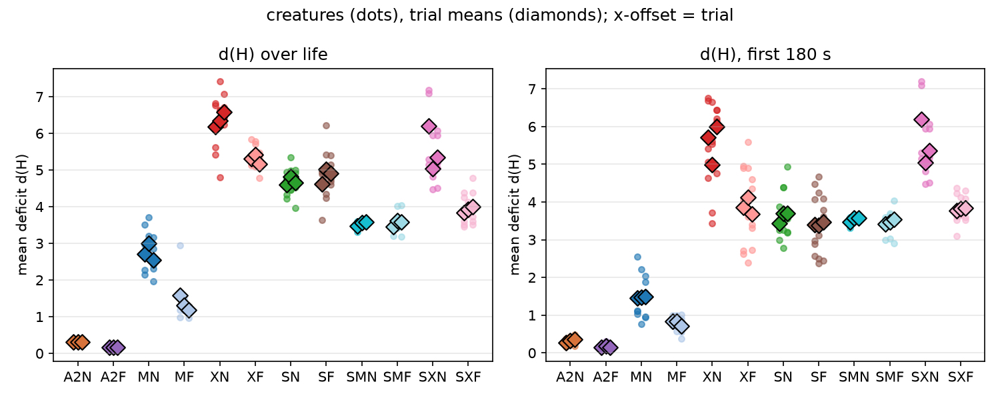
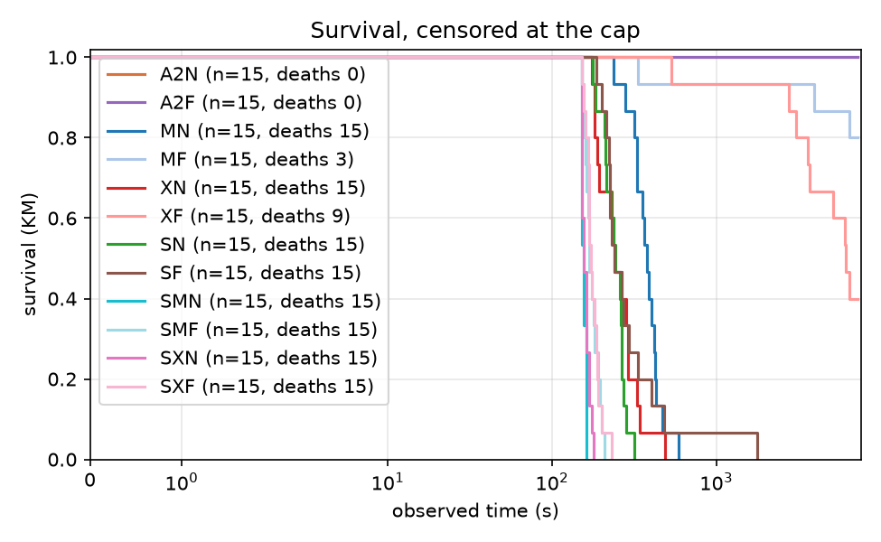
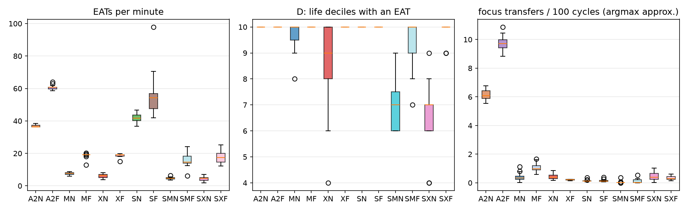

# Report: arbiter-ladder pilot (A0 / A1 / A2), analysis skeleton

## Purpose

Descriptive pilot of the arbiter ladder: spread of the outcomes #107 will pre-register, and a first run of the #106 analysis module end to end. Plan: `docs/plans/arbiter-ladder-pilot.md`, `docs/plans/issue-106-arbiter-ladder-analysis.md`; recipe: `docs/experiments/p107_pilot_stage2_recipe.md`. No pilot number enters a campaign result.

## Assumptions

The trial is the unit; creatures within a trial share a world, a food supply and a seed. The same seed is used in every arm (pairs the initial world only; Akka scheduling keeps trajectories nondeterministic). d(H) is measured from the set point 0.18. A0's focus switches use an argmax-of-urgency approximation, because the regulated emotion is not persisted. A0 lives minutes and A1/A2 up to the cap, so d(H) over life is not like for like; the common-window d(H) is. A1 and A2 use the tuned focus thresholds 0.4 / 0.15. DATA CAVEAT: in creatures that survive to the cap, `mouth_interactions` holds a whole number of 128-row blocks per creature (and `body_states` exactly 217,728 rows), so the last partial block is missing: EAT counts of A1/A2 survivors are lower bounds, short by up to 127 each (up to about 8% in A1, 2% in A2); A0 creatures, which died, are not quantized. The ordering of arms is not affected; the feeding rates are not exact.

## Hypothesis

None: this is a descriptive pilot. Predictions recorded before the data are in the recipe.

## Results

### Per-arm measures (creature mean, then trial means)

| measure | CAMPOS learning | CAMPOS frozen | MAPA learning | MAPA frozen | NONE learning | NONE frozen | scarce CAMPOS learning | scarce CAMPOS frozen | scarce MAPA learning | scarce MAPA frozen | scarce NONE learning | scarce NONE frozen |
|---|---|---|---|---|---|---|---|---|---|---|---|---|
| d(H) over life | 0.308 (trials 0.305, 0.304, 0.313) | 0.165 (trials 0.170, 0.161, 0.164) | 2.753 (trials 2.714, 3.002, 2.541) | 1.360 (trials 1.585, 1.314, 1.182) | 6.370 (trials 6.184, 6.342, 6.584) | 5.298 (trials 5.307, 5.414, 5.172) | 4.687 (trials 4.597, 4.817, 4.648) | 4.849 (trials 4.619, 5.010, 4.918) | 3.541 (trials 3.470, 3.571, 3.581) | 3.550 (trials 3.454, 3.610, 3.586) | 5.530 (trials 6.200, 5.035, 5.354) | 3.921 (trials 3.842, 3.919, 4.001) |
| d(H), first 180 s | 0.321 (trials 0.276, 0.330, 0.358) | 0.162 (trials 0.155, 0.185, 0.146) | 1.474 (trials 1.456, 1.480, 1.487) | 0.791 (trials 0.832, 0.829, 0.711) | 5.567 (trials 5.709, 4.991, 6.002) | 3.886 (trials 3.853, 4.124, 3.680) | 3.613 (trials 3.428, 3.705, 3.706) | 3.419 (trials 3.396, 3.385, 3.476) | 3.541 (trials 3.470, 3.571, 3.581) | 3.469 (trials 3.411, 3.463, 3.533) | 5.530 (trials 6.200, 5.035, 5.354) | 3.814 (trials 3.768, 3.831, 3.845) |
| EATs per minute | 36.782 (trials 36.937, 36.917, 36.492) | 60.622 (trials 59.989, 61.063, 60.813) | 7.510 (trials 8.042, 7.457, 7.030) | 18.786 (trials 18.002, 19.428, 18.929) | 6.053 (trials 5.571, 7.059, 5.530) | 18.685 (trials 18.049, 18.867, 19.141) | 42.019 (trials 42.622, 42.506, 40.928) | 55.892 (trials 53.142, 59.778, 54.755) | 4.701 (trials 4.875, 4.601, 4.626) | 16.023 (trials 17.255, 15.852, 14.961) | 4.352 (trials 4.931, 4.731, 3.395) | 17.471 (trials 15.931, 19.097, 17.386) |
| RED+GREEN EATs per minute | 17.562 (trials 17.806, 17.545, 17.336) | 25.284 (trials 24.921, 25.491, 25.441) | 4.655 (trials 4.988, 4.649, 4.328) | 7.867 (trials 7.287, 8.153, 8.161) | 3.205 (trials 2.355, 4.582, 2.677) | 7.836 (trials 7.528, 7.944, 8.037) | 2.727 (trials 2.834, 2.828, 2.520) | 3.287 (trials 2.939, 3.544, 3.377) | 0.200 (trials 0.224, 0.147, 0.227) | 0.937 (trials 1.020, 1.042, 0.749) | 0.334 (trials 0.482, 0.291, 0.227) | 1.088 (trials 0.851, 1.184, 1.227) |
| D: life deciles with an EAT | 10.000 (trials 10.000, 10.000, 10.000) | 10.000 (trials 10.000, 10.000, 10.000) | 9.667 (trials 10.000, 9.800, 9.200) | 10.000 (trials 10.000, 10.000, 10.000) | 8.467 (trials 8.800, 8.800, 7.800) | 10.000 (trials 10.000, 10.000, 10.000) | 10.000 (trials 10.000, 10.000, 10.000) | 10.000 (trials 10.000, 10.000, 10.000) | 6.933 (trials 6.600, 7.200, 7.000) | 9.267 (trials 9.800, 8.800, 9.200) | 6.467 (trials 7.400, 6.600, 5.400) | 9.867 (trials 9.600, 10.000, 10.000) |
| observed time (s) | 7196.570 (trials 7194.036, 7198.007, 7197.668) | 7195.788 (trials 7194.866, 7194.095, 7198.405) | 380.731 (trials 406.079, 374.920, 361.194) | 6469.962 (trials 5670.282, 7194.399, 6545.206) | 260.864 (trials 217.063, 330.811, 234.718) | 5370.861 (trials 4806.780, 6322.244, 4983.561) | 241.542 (trials 244.977, 246.362, 233.287) | 371.647 (trials 266.049, 551.938, 296.953) | 156.603 (trials 157.265, 156.468, 156.075) | 174.460 (trials 173.234, 180.487, 169.660) | 160.147 (trials 165.013, 159.495, 155.932) | 177.336 (trials 171.515, 178.801, 181.692) |
| died (share) | 0.000 (trials 0.000, 0.000, 0.000) | 0.000 (trials 0.000, 0.000, 0.000) | 1.000 (trials 1.000, 1.000, 1.000) | 0.200 (trials 0.400, 0.000, 0.200) | 1.000 (trials 1.000, 1.000, 1.000) | 0.600 (trials 0.600, 0.400, 0.800) | 1.000 (trials 1.000, 1.000, 1.000) | 1.000 (trials 1.000, 1.000, 1.000) | 1.000 (trials 1.000, 1.000, 1.000) | 1.000 (trials 1.000, 1.000, 1.000) | 1.000 (trials 1.000, 1.000, 1.000) | 1.000 (trials 1.000, 1.000, 1.000) |
| focus transfers per 100 cycles (argmax approx.) | 6.149 (trials 6.037, 6.555, 5.855) | 9.739 (trials 9.293, 9.713, 10.211) | 0.407 (trials 0.470, 0.413, 0.337) | 1.078 (trials 1.036, 1.027, 1.171) | 0.431 (trials 0.459, 0.362, 0.473) | 0.208 (trials 0.220, 0.204, 0.199) | 0.147 (trials 0.138, 0.186, 0.116) | 0.150 (trials 0.121, 0.165, 0.165) | 0.047 (trials 0.089, 0.021, 0.031) | 0.126 (trials 0.165, 0.020, 0.195) | 0.460 (trials 0.477, 0.383, 0.518) | 0.349 (trials 0.401, 0.253, 0.393) |
| focus opens per 100 cycles (argmax approx.) | 0.606 (trials 0.607, 0.617, 0.595) | 0.971 (trials 0.934, 0.972, 1.007) | 0.035 (trials 0.039, 0.032, 0.033) | 0.027 (trials 0.029, 0.025, 0.029) | 0.040 (trials 0.054, 0.023, 0.044) | 0.001 (trials 0.001, 0.001, 0.001) | 0.068 (trials 0.048, 0.082, 0.076) | 0.065 (trials 0.063, 0.059, 0.074) | 0.056 (trials 0.061, 0.043, 0.063) | 0.036 (trials 0.052, 0.039, 0.016) | 0.037 (trials 0.069, 0.015, 0.025) | 0.049 (trials 0.042, 0.064, 0.042) |
| focus transfers per 100 cycles (tracker) | 0.090 (trials 0.089, 0.089, 0.092) | 0.027 (trials 0.030, 0.026, 0.026) | 0.002 (trials 0.002, 0.002, 0.003) | 0.010 (trials 0.008, 0.012, 0.011) | 0.043 (trials 0.057, 0.040, 0.032) | 0.052 (trials 0.054, 0.048, 0.054) | 0.076 (trials 0.079, 0.065, 0.082) | 0.090 (trials 0.076, 0.105, 0.088) | 0.000 (trials 0.000, 0.000, 0.000) | 0.004 (trials 0.004, 0.000, 0.009) | 0.061 (trials 0.051, 0.069, 0.062) | 0.051 (trials 0.050, 0.050, 0.054) |
| focus opens per 100 cycles (tracker) | 0.147 (trials 0.147, 0.146, 0.147) | 0.043 (trials 0.045, 0.042, 0.042) | 0.476 (trials 0.478, 0.469, 0.482) | 0.453 (trials 0.459, 0.451, 0.447) | 0.477 (trials 0.468, 0.474, 0.489) | 0.469 (trials 0.469, 0.472, 0.466) | 0.471 (trials 0.474, 0.475, 0.465) | 0.469 (trials 0.475, 0.465, 0.466) | 0.498 (trials 0.499, 0.497, 0.499) | 0.495 (trials 0.494, 0.489, 0.502) | 0.471 (trials 0.470, 0.474, 0.468) | 0.473 (trials 0.472, 0.468, 0.480) |
| focused share of cycles (tracker) | 0.199 (trials 0.196, 0.196, 0.204) | 0.048 (trials 0.052, 0.044, 0.047) | 0.932 (trials 0.938, 0.917, 0.941) | 0.858 (trials 0.868, 0.858, 0.847) | 0.973 (trials 0.978, 0.968, 0.972) | 0.991 (trials 0.992, 0.990, 0.990) | 0.962 (trials 0.954, 0.961, 0.971) | 0.970 (trials 0.972, 0.975, 0.963) | 0.969 (trials 0.969, 0.969, 0.969) | 0.973 (trials 0.971, 0.973, 0.974) | 0.981 (trials 0.977, 0.983, 0.982) | 0.977 (trials 0.975, 0.974, 0.983) |
| episodes per creature | 515.467 (trials 513.200, 511.400, 521.800) | 152.267 (trials 161.800, 147.800, 147.200) | 54.467 (trials 58.400, 52.800, 52.200) | 901.667 (trials 789.200, 1008.000, 907.800) | 40.200 (trials 33.600, 50.800, 36.200) | 846.467 (trials 758.800, 994.200, 786.400) | 39.333 (trials 40.200, 39.800, 38.000) | 64.400 (trials 44.000, 99.800, 49.400) | 22.867 (trials 23.000, 22.800, 22.800) | 25.600 (trials 25.400, 26.000, 25.400) | 24.933 (trials 25.200, 25.400, 24.200) | 27.400 (trials 26.400, 27.200, 28.600) |
### Drive deficit

Per creature (dots) and per trial (diamonds).
### Survival

no data
### Feeding and focus

EATs per minute, life deciles with an EAT, and the argmax-approximated focus transfers per 100 cycles.
### Episodes (A1, A2)

Close-type mix per arm:

| condition | DEATH | PREEMPTED | REGULATED | TIMED_OUT |
|---|---|---|---|---|
| a2f | 0.000 | 0.088 | 0.770 | 0.141 |
| a2n | 0.000 | 0.106 | 0.674 | 0.220 |
| mf | 0.000 | 0.014 | 0.126 | 0.860 |
| mn | 0.018 | 0.001 | 0.028 | 0.952 |
| sf | 0.016 | 0.188 | 0.021 | 0.775 |
| smf | 0.039 | 0.003 | 0.013 | 0.945 |
| smn | 0.044 | 0.000 | 0.000 | 0.956 |
| sn | 0.025 | 0.120 | 0.029 | 0.825 |
| sxf | 0.036 | 0.090 | 0.015 | 0.859 |
| sxn | 0.040 | 0.107 | 0.013 | 0.840 |
| xf | 0.001 | 0.099 | 0.010 | 0.890 |
| xn | 0.025 | 0.076 | 0.025 | 0.874 |

Steps per episode:

| condition | count | 50% | mean | max |
|---|---|---|---|---|
| a2f | 2284.000 | 23.000 | 68.600 | 201.000 |
| a2n | 7732.000 | 47.000 | 84.000 | 201.000 |
| mf | 13525.000 | 201.000 | 185.100 | 201.000 |
| mn | 817.000 | 201.000 | 195.100 | 201.000 |
| sf | 966.000 | 201.000 | 167.400 | 201.000 |
| smf | 384.000 | 201.000 | 195.000 | 201.000 |
| smn | 343.000 | 201.000 | 194.600 | 201.000 |
| sn | 590.000 | 201.000 | 175.300 | 201.000 |
| sxf | 411.000 | 201.000 | 186.100 | 201.000 |
| sxn | 374.000 | 201.000 | 184.800 | 201.000 |
| xf | 12697.000 | 201.000 | 190.200 | 201.000 |
| xn | 603.000 | 201.000 | 187.400 | 201.000 |
### A2 decision telemetry

**A2N** (3,268,030 decisions). Source mix: {'SINGLE': 0.1328, 'GREEDY': 0.8213, 'THOMPSON': 0.0199, 'EPSILON': 0.026}. Executed action not the chosen one: 4.02%. Informed share (late half, focused multi-candidate): 0.475. Deciding controller by life decile: {0: {'OPERANT': 1.0}, 1: {'OPERANT': 1.0}, 2: {'OPERANT': 1.0}, 3: {'OPERANT': 1.0}, 4: {'OPERANT': 1.0}, 5: {'OPERANT': 1.0}, 6: {'OPERANT': 1.0}, 7: {'OPERANT': 1.0}, 8: {'OPERANT': 1.0}, 9: {'OPERANT': 1.0}}.

Descriptive z by close type:

| close_type | n | mean | variance | rms |
|---|---|---|---|---|
| PREEMPTED | 94418.000 | 0.152 | 2.637 | 1.631 |
| REGULATED | 213389.000 | 0.127 | 1.970 | 1.409 |
| TIMED_OUT | 341797.000 | 0.195 | 2.823 | 1.691 |

**A2F** (3,267,776 decisions). Source mix: {'SINGLE': 0.2011, 'GREEDY': 0.7749, 'THOMPSON': 0.0, 'EPSILON': 0.024}. Executed action not the chosen one: 6.13%. Informed share (late half, focused multi-candidate): 0.000. Deciding controller by life decile: {0: {'OPERANT': 1.0}, 1: {'OPERANT': 1.0}, 2: {'OPERANT': 1.0}, 3: {'OPERANT': 1.0}, 4: {'OPERANT': 1.0}, 5: {'OPERANT': 1.0}, 6: {'OPERANT': 1.0}, 7: {'OPERANT': 1.0}, 8: {'OPERANT': 1.0}, 9: {'OPERANT': 1.0}}.

Descriptive z by close type:

| close_type | n | mean | variance | rms |
|---|---|---|---|---|
| PREEMPTED | 22966.000 | 0.014 | 0.001 | 0.037 |
| REGULATED | 68804.000 | 0.052 | 0.007 | 0.096 |
| TIMED_OUT | 64923.000 | 0.002 | 0.000 | 0.012 |

**MN** (170,760 decisions). Source mix: {'SINGLE': 0.0, 'GREEDY': 0.9333, 'THOMPSON': 0.0367, 'EPSILON': 0.0299}. Executed action not the chosen one: 41.68%. Informed share (late half, focused multi-candidate): 0.645. Deciding controller by life decile: {0: {'OPERANT': 1.0}, 1: {'OPERANT': 1.0}, 2: {'OPERANT': 1.0}, 3: {'OPERANT': 1.0}, 4: {'OPERANT': 1.0}, 5: {'OPERANT': 1.0}, 6: {'OPERANT': 1.0}, 7: {'OPERANT': 1.0}, 8: {'OPERANT': 1.0}, 9: {'OPERANT': 1.0}}.

Descriptive z by close type:

| close_type | n | mean | variance | rms |
|---|---|---|---|---|
| DEATH | 961.000 | -0.514 | 1.223 | 1.219 |
| PREEMPTED | 75.000 | 0.011 | 0.001 | 0.029 |
| REGULATED | 1968.000 | 0.016 | 0.018 | 0.135 |
| TIMED_OUT | 156378.000 | 0.003 | 0.022 | 0.150 |

**MF** (2,937,995 decisions). Source mix: {'SINGLE': 0.0, 'GREEDY': 0.9699, 'THOMPSON': 0.0, 'EPSILON': 0.0301}. Executed action not the chosen one: 43.84%. Informed share (late half, focused multi-candidate): 0.000. Deciding controller by life decile: {0: {'OPERANT': 1.0}, 1: {'OPERANT': 1.0}, 2: {'OPERANT': 1.0}, 3: {'OPERANT': 1.0}, 4: {'OPERANT': 1.0}, 5: {'OPERANT': 1.0}, 6: {'OPERANT': 1.0}, 7: {'OPERANT': 1.0}, 8: {'OPERANT': 1.0}, 9: {'OPERANT': 1.0}}.

Descriptive z by close type:

| close_type | n | mean | variance | rms |
|---|---|---|---|---|
| DEATH | 329.000 | -0.349 | 0.803 | 0.960 |
| PREEMPTED | 21675.000 | 0.012 | 0.002 | 0.047 |
| REGULATED | 144433.000 | 0.029 | 0.003 | 0.065 |
| TIMED_OUT | 2336678.000 | 0.007 | 0.001 | 0.033 |

**XN** (116,200 decisions). Source mix: {'SINGLE': 0.0, 'GREEDY': 0.9328, 'THOMPSON': 0.0364, 'EPSILON': 0.0308}. Executed action not the chosen one: 38.24%. Informed share (late half, focused multi-candidate): 0.645. Deciding controller by life decile: {0: {'OPERANT': 1.0}, 1: {'OPERANT': 1.0}, 2: {'OPERANT': 1.0}, 3: {'OPERANT': 1.0}, 4: {'OPERANT': 1.0}, 5: {'OPERANT': 1.0}, 6: {'OPERANT': 1.0}, 7: {'OPERANT': 1.0}, 8: {'OPERANT': 1.0}, 9: {'OPERANT': 1.0}}.

Descriptive z by close type:

| close_type | n | mean | variance | rms |
|---|---|---|---|---|
| DEATH | 1612.000 | -0.275 | 0.570 | 0.803 |
| PREEMPTED | 4405.000 | 0.010 | 0.058 | 0.241 |
| REGULATED | 1077.000 | 0.039 | 0.012 | 0.115 |
| TIMED_OUT | 105927.000 | -0.003 | 0.015 | 0.123 |

**XF** (2,438,535 decisions). Source mix: {'SINGLE': 0.0, 'GREEDY': 0.97, 'THOMPSON': 0.0, 'EPSILON': 0.03}. Executed action not the chosen one: 44.49%. Informed share (late half, focused multi-candidate): 0.000. Deciding controller by life decile: {0: {'OPERANT': 1.0}, 1: {'OPERANT': 1.0}, 2: {'OPERANT': 1.0}, 3: {'OPERANT': 1.0}, 4: {'OPERANT': 1.0}, 5: {'OPERANT': 1.0}, 6: {'OPERANT': 1.0}, 7: {'OPERANT': 1.0}, 8: {'OPERANT': 1.0}, 9: {'OPERANT': 1.0}}.

Descriptive z by close type:

| close_type | n | mean | variance | rms |
|---|---|---|---|---|
| DEATH | 961.000 | -0.287 | 0.705 | 0.887 |
| PREEMPTED | 130122.000 | 0.027 | 0.005 | 0.075 |
| REGULATED | 12310.000 | 0.085 | 0.005 | 0.110 |
| TIMED_OUT | 2271501.000 | 0.002 | 0.002 | 0.047 |

**SN** (107,440 decisions). Source mix: {'SINGLE': 0.3849, 'GREEDY': 0.5742, 'THOMPSON': 0.0225, 'EPSILON': 0.0183}. Executed action not the chosen one: 0.32%. Informed share (late half, focused multi-candidate): 0.539. Deciding controller by life decile: {0: {'OPERANT': 1.0}, 1: {'OPERANT': 1.0}, 2: {'OPERANT': 1.0}, 3: {'OPERANT': 1.0}, 4: {'OPERANT': 1.0}, 5: {'OPERANT': 1.0}, 6: {'OPERANT': 1.0}, 7: {'OPERANT': 1.0}, 8: {'OPERANT': 1.0}, 9: {'OPERANT': 1.0}}.

Descriptive z by close type:

| close_type | n | mean | variance | rms |
|---|---|---|---|---|
| DEATH | 1545.000 | -0.103 | 4.935 | 2.223 |
| PREEMPTED | 3466.000 | 0.212 | 1.280 | 1.151 |
| REGULATED | 511.000 | 0.127 | 0.121 | 0.370 |
| TIMED_OUT | 97887.000 | 0.184 | 1.489 | 1.234 |

**SF** (166,540 decisions). Source mix: {'SINGLE': 0.561, 'GREEDY': 0.4255, 'THOMPSON': 0.0, 'EPSILON': 0.0135}. Executed action not the chosen one: 0.42%. Informed share (late half, focused multi-candidate): 0.000. Deciding controller by life decile: {0: {'OPERANT': 1.0}, 1: {'OPERANT': 1.0}, 2: {'OPERANT': 1.0}, 3: {'OPERANT': 1.0}, 4: {'OPERANT': 1.0}, 5: {'OPERANT': 1.0}, 6: {'OPERANT': 1.0}, 7: {'OPERANT': 1.0}, 8: {'OPERANT': 1.0}, 9: {'OPERANT': 1.0}}.

Descriptive z by close type:

| close_type | n | mean | variance | rms |
|---|---|---|---|---|
| DEATH | 1876.000 | -0.238 | 0.481 | 0.733 |
| PREEMPTED | 8606.000 | 0.071 | 0.017 | 0.148 |
| REGULATED | 666.000 | 0.066 | 0.009 | 0.117 |
| TIMED_OUT | 150549.000 | 0.002 | 0.000 | 0.015 |

**SMN** (68,860 decisions). Source mix: {'SINGLE': 0.0, 'GREEDY': 0.9664, 'THOMPSON': 0.0032, 'EPSILON': 0.0304}. Executed action not the chosen one: 39.84%. Informed share (late half, focused multi-candidate): 0.675. Deciding controller by life decile: {0: {'OPERANT': 1.0}, 1: {'OPERANT': 1.0}, 2: {'OPERANT': 1.0}, 3: {'OPERANT': 1.0}, 4: {'OPERANT': 1.0}, 5: {'OPERANT': 1.0}, 6: {'OPERANT': 1.0}, 7: {'OPERANT': 1.0}, 8: {'OPERANT': 1.0}, 9: {'OPERANT': 1.0}}.

Descriptive z by close type:

| close_type | n | mean | variance | rms |
|---|---|---|---|---|
| DEATH | 816.000 | -0.657 | 1.424 | 1.362 |
| TIMED_OUT | 65928.000 | 0.005 | 0.010 | 0.099 |

**SMF** (77,000 decisions). Source mix: {'SINGLE': 0.0, 'GREEDY': 0.969, 'THOMPSON': 0.0, 'EPSILON': 0.031}. Executed action not the chosen one: 40.71%. Informed share (late half, focused multi-candidate): 0.000. Deciding controller by life decile: {0: {'OPERANT': 1.0}, 1: {'OPERANT': 1.0}, 2: {'OPERANT': 1.0}, 3: {'OPERANT': 1.0}, 4: {'OPERANT': 1.0}, 5: {'OPERANT': 1.0}, 6: {'OPERANT': 1.0}, 7: {'OPERANT': 1.0}, 8: {'OPERANT': 1.0}, 9: {'OPERANT': 1.0}}.

Descriptive z by close type:

| close_type | n | mean | variance | rms |
|---|---|---|---|---|
| DEATH | 1528.000 | -0.359 | 0.853 | 0.991 |
| PREEMPTED | 27.000 | 0.025 | 0.000 | 0.031 |
| REGULATED | 375.000 | 0.017 | 0.002 | 0.043 |
| TIMED_OUT | 72963.000 | 0.001 | 0.000 | 0.013 |

**SXN** (70,480 decisions). Source mix: {'SINGLE': 0.0, 'GREEDY': 0.9652, 'THOMPSON': 0.0035, 'EPSILON': 0.0313}. Executed action not the chosen one: 35.17%. Informed share (late half, focused multi-candidate): 0.721. Deciding controller by life decile: {0: {'OPERANT': 1.0}, 1: {'OPERANT': 1.0}, 2: {'OPERANT': 1.0}, 3: {'OPERANT': 1.0}, 4: {'OPERANT': 1.0}, 5: {'OPERANT': 1.0}, 6: {'OPERANT': 1.0}, 7: {'OPERANT': 1.0}, 8: {'OPERANT': 1.0}, 9: {'OPERANT': 1.0}}.

Descriptive z by close type:

| close_type | n | mean | variance | rms |
|---|---|---|---|---|
| DEATH | 1553.000 | -0.301 | 0.630 | 0.849 |
| PREEMPTED | 4053.000 | 0.022 | 0.026 | 0.163 |
| REGULATED | 392.000 | 0.024 | 0.005 | 0.077 |
| TIMED_OUT | 63114.000 | -0.001 | 0.009 | 0.094 |

**SXF** (78,260 decisions). Source mix: {'SINGLE': 0.0, 'GREEDY': 0.9699, 'THOMPSON': 0.0, 'EPSILON': 0.0301}. Executed action not the chosen one: 41.05%. Informed share (late half, focused multi-candidate): 0.000. Deciding controller by life decile: {0: {'OPERANT': 1.0}, 1: {'OPERANT': 1.0}, 2: {'OPERANT': 1.0}, 3: {'OPERANT': 1.0}, 4: {'OPERANT': 1.0}, 5: {'OPERANT': 1.0}, 6: {'OPERANT': 1.0}, 7: {'OPERANT': 1.0}, 8: {'OPERANT': 1.0}, 9: {'OPERANT': 1.0}}.

Descriptive z by close type:

| close_type | n | mean | variance | rms |
|---|---|---|---|---|
| DEATH | 1468.000 | -0.365 | 0.813 | 0.973 |
| PREEMPTED | 3564.000 | 0.009 | 0.004 | 0.063 |
| REGULATED | 499.000 | 0.023 | 0.005 | 0.073 |
| TIMED_OUT | 70953.000 | 0.001 | 0.001 | 0.026 |
### Paired differences by seed

Differences of trial means, later arm minus earlier arm; SD has 2 degrees of freedom, so size on the 80% upper bound (2.12 x SD), not the point estimate.

| measure | contrast | per-seed differences | mean | SD (2 df) | 80% upper bound on SD |
|---|---|---|---|---|---|
| d(H) over life | MN - MF | [1.1296, 1.6884, 1.3594] | 1.392 | 0.281 | 0.596 |
| d(H) over life | XN - XF | [0.8767, 0.9281, 1.4116] | 1.072 | 0.295 | 0.626 |
| d(H) over life | SMN - SMF | [0.016, -0.039, -0.0048] | -0.009 | 0.028 | 0.059 |
| d(H) over life | SXN - SXF | [2.3585, 1.116, 1.3534] | 1.609 | 0.660 | 1.398 |
| d(H) over life | MN - A2N | [2.4088, 2.6977, 2.2279] | 2.445 | 0.237 | 0.502 |
| d(H) over life | XN - A2N | [5.8786, 6.0375, 6.2703] | 6.062 | 0.197 | 0.418 |
| d(H) over life | SMN - SN | [-1.1267, -1.2456, -1.0667] | -1.146 | 0.091 | 0.193 |
| d(H) over life | SXN - SN | [1.6038, 0.2185, 0.7064] | 0.843 | 0.703 | 1.490 |
| d(H) over life | A2N - A2F | [0.1357, 0.1437, 0.1493] | 0.143 | 0.007 | 0.014 |
| d(H) over life | SN - SF | [-0.0219, -0.1933, -0.2703] | -0.162 | 0.127 | 0.270 |
| d(H), first 180 s | MN - MF | [0.6237, 0.6512, 0.7759] | 0.684 | 0.081 | 0.172 |
| d(H), first 180 s | XN - XF | [1.8564, 0.8662, 2.322] | 1.682 | 0.743 | 1.576 |
| d(H), first 180 s | SMN - SMF | [0.0584, 0.1077, 0.0487] | 0.072 | 0.032 | 0.067 |
| d(H), first 180 s | SXN - SXF | [2.4329, 1.2042, 1.5095] | 1.716 | 0.640 | 1.356 |
| d(H), first 180 s | MN - A2N | [1.1799, 1.1505, 1.1293] | 1.153 | 0.025 | 0.054 |
| d(H), first 180 s | XN - A2N | [5.4334, 4.6611, 5.6442] | 5.246 | 0.518 | 1.097 |
| d(H), first 180 s | SMN - SN | [0.0421, -0.1342, -0.1248] | -0.072 | 0.099 | 0.210 |
| d(H), first 180 s | SXN - SN | [2.7727, 1.3299, 1.6483] | 1.917 | 0.758 | 1.607 |
| d(H), first 180 s | A2N - A2F | [0.1208, 0.1443, 0.2124] | 0.159 | 0.048 | 0.101 |
| d(H), first 180 s | SN - SF | [0.0322, 0.3198, 0.2299] | 0.194 | 0.147 | 0.312 |
| EATs per minute | MN - MF | [-9.9593, -11.971, -11.8993] | -11.277 | 1.141 | 2.420 |
| EATs per minute | XN - XF | [-12.4779, -11.808, -13.6109] | -12.632 | 0.911 | 1.932 |
| EATs per minute | SMN - SMF | [-12.3794, -11.251, -10.3353] | -11.322 | 1.024 | 2.171 |
| EATs per minute | SXN - SXF | [-10.9998, -14.3657, -13.9909] | -13.119 | 1.845 | 3.911 |
| EATs per minute | MN - A2N | [-28.895, -29.4594, -29.4622] | -29.272 | 0.327 | 0.693 |
| EATs per minute | XN - A2N | [-31.3666, -29.8581, -30.9619] | -30.729 | 0.781 | 1.655 |
| EATs per minute | SMN - SN | [-37.7469, -37.9045, -36.3015] | -37.318 | 0.884 | 1.873 |
| EATs per minute | SXN - SN | [-37.6914, -37.7749, -37.5328] | -37.666 | 0.123 | 0.261 |
| EATs per minute | A2N - A2F | [-23.0522, -24.1465, -24.3216] | -23.840 | 0.688 | 1.458 |
| EATs per minute | SN - SF | [-10.5194, -17.2722, -13.8279] | -13.873 | 3.377 | 7.158 |
| RED+GREEN EATs per minute | MN - MF | [-2.2998, -3.5039, -3.8332] | -3.212 | 0.807 | 1.711 |
| RED+GREEN EATs per minute | XN - XF | [-5.1725, -3.3625, -5.3597] | -4.632 | 1.103 | 2.338 |
| RED+GREEN EATs per minute | SMN - SMF | [-0.7954, -0.8945, -0.5216] | -0.737 | 0.193 | 0.410 |
| RED+GREEN EATs per minute | SXN - SXF | [-0.3683, -0.8937, -1.0] | -0.754 | 0.338 | 0.717 |
| RED+GREEN EATs per minute | MN - A2N | [-12.8188, -12.8958, -13.0076] | -12.907 | 0.095 | 0.201 |
| RED+GREEN EATs per minute | XN - A2N | [-15.4512, -12.9632, -14.6583] | -14.358 | 1.271 | 2.694 |
| RED+GREEN EATs per minute | SMN - SN | [-2.6095, -2.681, -2.2927] | -2.528 | 0.207 | 0.438 |
| RED+GREEN EATs per minute | SXN - SN | [-2.3512, -2.5376, -2.2925] | -2.394 | 0.128 | 0.271 |
| RED+GREEN EATs per minute | A2N - A2F | [-7.1147, -7.9461, -8.105] | -7.722 | 0.532 | 1.128 |
| RED+GREEN EATs per minute | SN - SF | [-0.1055, -0.7154, -0.8568] | -0.559 | 0.399 | 0.846 |
| D: life deciles with an EAT | MN - MF | [0.0, -0.2, -0.8] | -0.333 | 0.416 | 0.883 |
| D: life deciles with an EAT | XN - XF | [-1.2, -1.2, -2.2] | -1.533 | 0.577 | 1.224 |
| D: life deciles with an EAT | SMN - SMF | [-3.2, -1.6, -2.2] | -2.333 | 0.808 | 1.714 |
| D: life deciles with an EAT | SXN - SXF | [-2.2, -3.4, -4.6] | -3.400 | 1.200 | 2.544 |
| D: life deciles with an EAT | MN - A2N | [0.0, -0.2, -0.8] | -0.333 | 0.416 | 0.883 |
| D: life deciles with an EAT | XN - A2N | [-1.2, -1.2, -2.2] | -1.533 | 0.577 | 1.224 |
| D: life deciles with an EAT | SMN - SN | [-3.4, -2.8, -3.0] | -3.067 | 0.306 | 0.648 |
| D: life deciles with an EAT | SXN - SN | [-2.6, -3.4, -4.6] | -3.533 | 1.007 | 2.134 |
| D: life deciles with an EAT | A2N - A2F | [0.0, 0.0, 0.0] | 0.000 | 0.000 | 0.000 |
| D: life deciles with an EAT | SN - SF | [0.0, 0.0, 0.0] | 0.000 | 0.000 | 0.000 |
| observed time (s) | MN - MF | [-5264.2026, -6819.4784, -6184.012] | -6089.231 | 781.958 | 1657.751 |
| observed time (s) | XN - XF | [-4589.7166, -5991.4332, -4748.8422] | -5109.997 | 767.481 | 1627.060 |
| observed time (s) | SMN - SMF | [-15.9688, -24.0192, -13.585] | -17.858 | 5.468 | 11.591 |
| observed time (s) | SXN - SXF | [-6.502, -19.3068, -25.7604] | -17.190 | 9.802 | 20.781 |
| observed time (s) | MN - A2N | [-6787.9566, -6823.087, -6836.4732] | -6815.839 | 25.057 | 53.121 |
| observed time (s) | XN - A2N | [-6976.973, -6867.1966, -6962.9492] | -6935.706 | 59.744 | 126.657 |
| observed time (s) | SMN - SN | [-87.7116, -89.8938, -77.2124] | -84.939 | 6.780 | 14.374 |
| observed time (s) | SXN - SN | [-79.9638, -86.8674, -77.355] | -81.395 | 4.915 | 10.420 |
| observed time (s) | A2N - A2F | [-0.83, 3.9128, -0.7372] | 0.782 | 2.712 | 5.749 |
| observed time (s) | SN - SF | [-21.0718, -305.5756, -63.6664] | -130.105 | 153.447 | 325.309 |
| died (share) | MN - MF | [0.6, 1.0, 0.8] | 0.800 | 0.200 | 0.424 |
| died (share) | XN - XF | [0.4, 0.6, 0.2] | 0.400 | 0.200 | 0.424 |
| died (share) | SMN - SMF | [0.0, 0.0, 0.0] | 0.000 | 0.000 | 0.000 |
| died (share) | SXN - SXF | [0.0, 0.0, 0.0] | 0.000 | 0.000 | 0.000 |
| died (share) | MN - A2N | [1.0, 1.0, 1.0] | 1.000 | 0.000 | 0.000 |
| died (share) | XN - A2N | [1.0, 1.0, 1.0] | 1.000 | 0.000 | 0.000 |
| died (share) | SMN - SN | [0.0, 0.0, 0.0] | 0.000 | 0.000 | 0.000 |
| died (share) | SXN - SN | [0.0, 0.0, 0.0] | 0.000 | 0.000 | 0.000 |
| died (share) | A2N - A2F | [0.0, 0.0, 0.0] | 0.000 | 0.000 | 0.000 |
| died (share) | SN - SF | [0.0, 0.0, 0.0] | 0.000 | 0.000 | 0.000 |
| focus transfers per 100 cycles (argmax approx.) | MN - MF | [-0.5663, -0.6134, -0.8342] | -0.671 | 0.143 | 0.303 |
| focus transfers per 100 cycles (argmax approx.) | XN - XF | [0.239, 0.1582, 0.2732] | 0.223 | 0.059 | 0.125 |
| focus transfers per 100 cycles (argmax approx.) | SMN - SMF | [-0.0762, 0.0015, -0.1632] | -0.079 | 0.082 | 0.175 |
| focus transfers per 100 cycles (argmax approx.) | SXN - SXF | [0.0766, 0.1302, 0.1256] | 0.111 | 0.030 | 0.063 |
| focus transfers per 100 cycles (argmax approx.) | MN - A2N | [-5.5673, -6.1419, -5.5182] | -5.742 | 0.347 | 0.735 |
| focus transfers per 100 cycles (argmax approx.) | XN - A2N | [-5.5778, -6.1932, -5.3828] | -5.718 | 0.423 | 0.897 |
| focus transfers per 100 cycles (argmax approx.) | SMN - SN | [-0.0498, -0.1649, -0.0845] | -0.100 | 0.059 | 0.125 |
| focus transfers per 100 cycles (argmax approx.) | SXN - SN | [0.3387, 0.1971, 0.4024] | 0.313 | 0.105 | 0.223 |
| focus transfers per 100 cycles (argmax approx.) | A2N - A2F | [-3.256, -3.1575, -4.3552] | -3.590 | 0.665 | 1.410 |
| focus transfers per 100 cycles (argmax approx.) | SN - SF | [0.0179, 0.0214, -0.0495] | -0.003 | 0.040 | 0.085 |
| focus opens per 100 cycles (argmax approx.) | MN - MF | [0.0093, 0.0079, 0.0044] | 0.007 | 0.003 | 0.005 |
| focus opens per 100 cycles (argmax approx.) | XN - XF | [0.0534, 0.0214, 0.0425] | 0.039 | 0.016 | 0.034 |
| focus opens per 100 cycles (argmax approx.) | SMN - SMF | [0.0092, 0.0035, 0.0474] | 0.020 | 0.024 | 0.051 |
| focus opens per 100 cycles (argmax approx.) | SXN - SXF | [0.0276, -0.0486, -0.0162] | -0.012 | 0.038 | 0.081 |
| focus opens per 100 cycles (argmax approx.) | MN - A2N | [-0.5679, -0.5843, -0.5616] | -0.571 | 0.012 | 0.025 |
| focus opens per 100 cycles (argmax approx.) | XN - A2N | [-0.552, -0.5939, -0.5508] | -0.566 | 0.025 | 0.052 |
| focus opens per 100 cycles (argmax approx.) | SMN - SN | [0.0139, -0.0387, -0.0125] | -0.012 | 0.026 | 0.056 |
| focus opens per 100 cycles (argmax approx.) | SXN - SN | [0.0219, -0.066, -0.0504] | -0.031 | 0.047 | 0.100 |
| focus opens per 100 cycles (argmax approx.) | A2N - A2F | [-0.3279, -0.3553, -0.4126] | -0.365 | 0.043 | 0.092 |
| focus opens per 100 cycles (argmax approx.) | SN - SF | [-0.0151, 0.0225, 0.0014] | 0.003 | 0.019 | 0.040 |
| focus transfers per 100 cycles (tracker) | MN - MF | [-0.0059, -0.0102, -0.0082] | -0.008 | 0.002 | 0.005 |
| focus transfers per 100 cycles (tracker) | XN - XF | [0.0033, -0.0081, -0.0228] | -0.009 | 0.013 | 0.028 |
| focus transfers per 100 cycles (tracker) | SMN - SMF | [-0.0038, 0.0, -0.0086] | -0.004 | 0.004 | 0.009 |
| focus transfers per 100 cycles (tracker) | SXN - SXF | [0.0012, 0.0187, 0.0077] | 0.009 | 0.009 | 0.019 |
| focus transfers per 100 cycles (tracker) | MN - A2N | [-0.0868, -0.0871, -0.0892] | -0.088 | 0.001 | 0.003 |
| focus transfers per 100 cycles (tracker) | XN - A2N | [-0.0311, -0.0488, -0.0604] | -0.047 | 0.015 | 0.031 |
| focus transfers per 100 cycles (tracker) | SMN - SN | [-0.0791, -0.0654, -0.0824] | -0.076 | 0.009 | 0.019 |
| focus transfers per 100 cycles (tracker) | SXN - SN | [-0.0276, 0.0031, -0.0209] | -0.015 | 0.016 | 0.034 |
| focus transfers per 100 cycles (tracker) | A2N - A2F | [0.0589, 0.0622, 0.0661] | 0.062 | 0.004 | 0.008 |
| focus transfers per 100 cycles (tracker) | SN - SF | [0.0034, -0.0392, -0.006] | -0.014 | 0.022 | 0.047 |
| focus opens per 100 cycles (tracker) | MN - MF | [0.0193, 0.0173, 0.0348] | 0.024 | 0.010 | 0.020 |
| focus opens per 100 cycles (tracker) | XN - XF | [-0.0013, 0.0027, 0.0228] | 0.008 | 0.013 | 0.027 |
| focus opens per 100 cycles (tracker) | SMN - SMF | [0.0041, 0.0076, -0.003] | 0.003 | 0.005 | 0.011 |
| focus opens per 100 cycles (tracker) | SXN - SXF | [-0.0017, 0.0066, -0.0121] | -0.002 | 0.009 | 0.020 |
| focus opens per 100 cycles (tracker) | MN - A2N | [0.3313, 0.3225, 0.3346] | 0.329 | 0.006 | 0.013 |
| focus opens per 100 cycles (tracker) | XN - A2N | [0.3207, 0.3283, 0.3416] | 0.330 | 0.011 | 0.022 |
| focus opens per 100 cycles (tracker) | SMN - SN | [0.0248, 0.0218, 0.0331] | 0.027 | 0.006 | 0.012 |
| focus opens per 100 cycles (tracker) | SXN - SN | [-0.0037, -0.0006, 0.0023] | -0.001 | 0.003 | 0.006 |
| focus opens per 100 cycles (tracker) | A2N - A2F | [0.1024, 0.1044, 0.1059] | 0.104 | 0.002 | 0.004 |
| focus opens per 100 cycles (tracker) | SN - SF | [-0.0012, 0.0101, -0.0002] | 0.003 | 0.006 | 0.013 |
| focused share of cycles (tracker) | MN - MF | [0.0708, 0.0585, 0.0935] | 0.074 | 0.018 | 0.038 |
| focused share of cycles (tracker) | XN - XF | [-0.0139, -0.022, -0.018] | -0.018 | 0.004 | 0.009 |
| focused share of cycles (tracker) | SMN - SMF | [-0.0014, -0.0034, -0.0053] | -0.003 | 0.002 | 0.004 |
| focused share of cycles (tracker) | SXN - SXF | [0.0019, 0.0096, -0.0014] | 0.003 | 0.006 | 0.012 |
| focused share of cycles (tracker) | MN - A2N | [0.7423, 0.7204, 0.7363] | 0.733 | 0.011 | 0.024 |
| focused share of cycles (tracker) | XN - A2N | [0.7821, 0.7717, 0.7679] | 0.774 | 0.007 | 0.016 |
| focused share of cycles (tracker) | SMN - SN | [0.0158, 0.0085, -0.0014] | 0.008 | 0.009 | 0.018 |
| focused share of cycles (tracker) | SXN - SN | [0.0231, 0.0227, 0.0114] | 0.019 | 0.007 | 0.014 |
| focused share of cycles (tracker) | A2N - A2F | [0.1439, 0.1518, 0.1568] | 0.151 | 0.007 | 0.014 |
| focused share of cycles (tracker) | SN - SF | [-0.0186, -0.0145, 0.0078] | -0.008 | 0.014 | 0.030 |
| episodes per creature | MN - MF | [-730.8, -955.2, -855.6] | -847.200 | 112.436 | 238.363 |
| episodes per creature | XN - XF | [-725.2, -943.4, -750.2] | -806.267 | 119.417 | 253.164 |
| episodes per creature | SMN - SMF | [-2.4, -3.2, -2.6] | -2.733 | 0.416 | 0.883 |
| episodes per creature | SXN - SXF | [-1.2, -1.8, -4.4] | -2.467 | 1.701 | 3.606 |
| episodes per creature | MN - A2N | [-454.8, -458.6, -469.6] | -461.000 | 7.686 | 16.295 |
| episodes per creature | XN - A2N | [-479.6, -460.6, -485.6] | -475.267 | 13.051 | 27.669 |
| episodes per creature | SMN - SN | [-17.2, -17.0, -15.2] | -16.467 | 1.102 | 2.335 |
| episodes per creature | SXN - SN | [-15.0, -14.4, -13.8] | -14.400 | 0.600 | 1.272 |
| episodes per creature | A2N - A2F | [351.4, 363.6, 374.6] | 363.200 | 11.605 | 24.603 |
| episodes per creature | SN - SF | [-3.8, -60.0, -11.4] | -25.067 | 30.491 | 64.641 |

## Analysis

To be written from the tables above (and the sample-size computation of #107).
