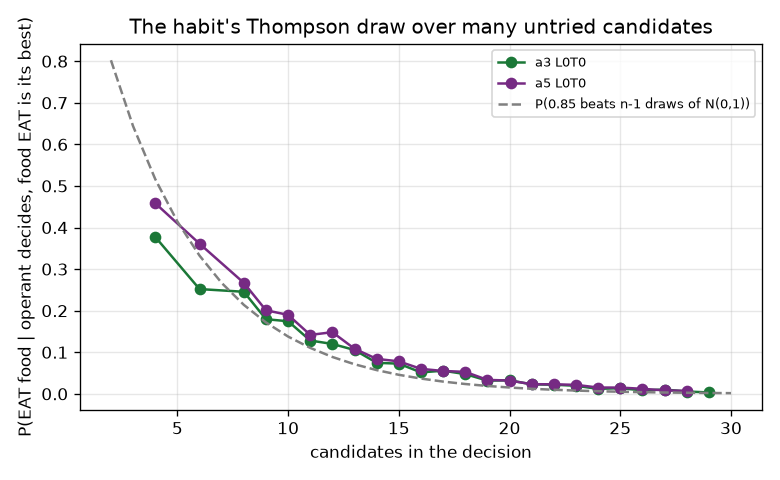
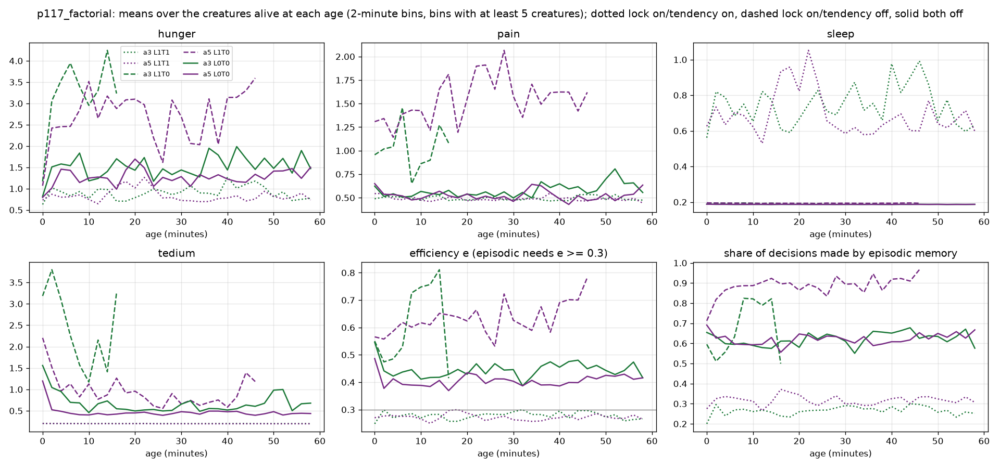

# Report: why the fixed order (A5) beats arbitration (A3), and what episodic memory learns (p117_factorial, per-decision analysis)

Follows [`p117_factorial_report.md`](p117_factorial_report.md). Data: `ml/data_p117_factorial` (96 trials, 480 creatures, about 39 million decisions). Code:
`analysis/diagnostics/p117_why_a5.py` (tables and figures); the ad hoc queries quoted below are DuckDB over the same Parquet files. Exploratory: these analyses were
not pre-registered, so they explain the registered result but do not test new hypotheses.

## Purpose

`p117_factorial` found that arbitration (A3) never beats the fixed order (A5). Where the controllers can be told apart (tendency off), A5 is better. This report asks why, and answers the
questions behind it. Is episodic memory helping? What does it learn, and how does it choose? How does arousal, and with it the efficiency budget, vary over a life?

## Assumptions

- The decision table records, per decision, the deciding controller, the number of candidates, the chosen (action, object), and the deciding controller's best, runner-up and chosen estimates. It does not record the candidate list.
  "A food EAT is available to the operant" is therefore read as **operant best Q >= 0.5**. Only a food or aloe EAT can have an operant Q that high (valence +1 after eating), so this selects decisions where the habit has a known good option.
- Engram values are recomputed from the stored `g`, `h` and bootstrap term with the code's value function, `V = d(h) - d(h + g) + bootstrap`, `d` = Euclidean deficit above 0.18.
- Drive trajectories are means over the creatures alive at each age, so later bins over-represent survivors.

## Hypothesis

Not pre-registered. After the first queries the working hypothesis was: arbitration hands decisions to the operant table that the operant then wastes, because its Thompson draw over many untried candidates (Q 0, SE 1) is close to uniform.

## Results

**1. Every death is from hunger.** All 166 deaths in the six cells checked (both tendency-off cells and the lock-on/tendency-on cell, both arms; the two lock-off/tendency-on cells have 1 death each and were not checked) end at hunger 7, with pain low (0.3-1.0). In the tendency-off cells, creatures under arbitration die with higher tedium (5.2 vs 2.6 with the lock on; 2.7 vs 1.1 with it off).

**2. A3 eats less food.** Hunger rises at 2.70 per creature-minute in every cell. With the lock on and the tendency off, A3 removes 1.76 per minute and A5 2.30 (food EATs 5.35 vs 6.97 per minute). With both off the gap is smaller (9.53 vs 10.14). A3 also eats more cactus in every cell, almost twice as much with the tendency on (6.5 vs 3.3 per minute).
The cycle rate is the same in both arms (about 30 decisions per creature-second), so the difference is per decision: A3 picks "EAT food" in 0.6% of its decisions (both off) and 0.9% (lock on), against 0.7% and 1.3% for A5.

**3. Under arbitration, episodic memory never eats food.** In A3 the episodic controller chooses "EAT food" in 0.0% (both off) and 0.1% (lock on) of its decisions, and all of A3's food EATs come from the operant table. In A5 the episodic controller chooses it in 0.8% and 1.4%.

**4. The operant table gets the food decisions in A3 and then wastes them.** Of the A3 decisions where a food EAT was the operant's best option (both off), 286k went to the operant because it was **decisive by the stop rule** (mean conf 0.83, above θ = 0.8). It then ate the food in **7.6%** of them. In A5 the same path occurred 60 times. There the operant decides only when episodic memory is unaffordable (173k decisions, also 7%).

| Why the operant decided (best option a food EAT, both priors off) | A3 | A5 |
|---|---|---|
| operant decisive (conf >= 0.8): consultation stops | 285,685 (ate food 7.6%) | 60 |
| episodic unaffordable (e < 0.3) | 82,217 (7.4%) | 173,450 (7.2%) |
| operant more decisive than episodic | 53,129 (2.8%) | 1,169 |

**5. Why the habit wastes them: decisiveness and the draw disagree.** Decisiveness compares the **two** best candidates: a food EAT at Q ≈ 0.85 (small SE) against an untried candidate at Q = 0, SE = 1, giving Φ(0.85 / 1.0) ≈ 0.80, just above θ. The Thompson draw then runs over **all** candidates, typically 10-30 in this world, because every action on every object in view is a candidate. Each untried candidate draws from N(0, 1), so the chance that the known 0.85 wins is about Φ(0.85)^(n-1). The measured rate follows that curve closely. It is 38-46% with 4 candidates and under 3% with 20 or more.

**6. What episodic memory learns** (engrams of the both-off cells, both arms; V at write time):

| Action, object | Engrams | Mean V | Share exactly 0 | From timed-out episodes |
|---|---|---|---|---|
| EAT food | 66,743 | **+0.167** | 0.0% | 62% |
| WANDER near food | 601,785 | +0.055 | 0.0% | 61% |
| WANDER near gray | 824,631 | +0.033 | 0.0% | 65% |
| EAT aloe | 11,015 | +0.017 | 0.0% | 78% |
| APPROACH food | 324,221 | **+0.008** | **63%** | 63% |
| EAT gray | 62,487 | +0.006 | 0.0% | 71% |
| APPROACH gray | 450,121 | +0.0002 | 69% | 69% |
| OBSERVE gray | 396,095 | -0.018 | 0.0% | 69% |
| EAT cactus | 8,629 | **-0.214** | 0.0% | 83% |

The consummatory values are right: food is worth the most, gray nothing, cactus is harmful. **APPROACH is not.** Approaching food is worth less than wandering next to it, and 63% of APPROACH-food engrams are exactly 0. They all come from timed-out episodes. The buffer's timeout rule (paper 4.2: "approach steps receive G = 0") zeroes APPROACH steps only. WANDER, SLEEP, AVOID and OBSERVE keep their Monte Carlo return. With 60-80% of episodes timing out, that rule erases the credit for approaching food, which is the credit A3 was built to supply.

**7. How episodic memory chooses.** Its median gap between the two best candidates is 0.006 against a median SE of 0.055. It is decisive in 1-2% of its decisions, and the Thompson draw picks a non-best candidate 70% of the time. The mean novelty bonus (0.031) is five times the typical gap, so novelty often decides among near-equal values. Unlike the habit, its prior SE is on the value scale (0.1), so a known good option is not swamped by untried ones. When its best option was a food EAT, it took it 75-92% of the time (few such cases).

**8. Arousal and the budget over a life.**

- **Tendency on:** hunger stays around 0.8-1.2 and efficiency sits just under 0.3 all life (0.26-0.30), so episodic memory is affordable in only about a third of decisions (it decides 25-35%). The creatures sleep enough to keep the sleep drive at 0.6-1.0.
- **Tendency off:** hunger is higher (1.2-1.9 with the lock off; 2.5-4 with it on), efficiency is 0.4-0.8, and episodic memory decides 60% (A3) to 90% (A5, lock on) of decisions. Arbitration does not raise that share over life, while the fixed order does (to above 90% with the lock on).
- The sleep drive stays at its floor (0.2) when the tendency is off, because the creatures choose SLEEP about a quarter of the time. Tedium is high early in life and higher under A3.
- With the lock on, A5 creatures spend more time in pain (pain 1.3-2.0 against 1.0-1.4 for A3) while living much longer.

## Analysis

**Why A5 beats A3.** Arbitration consults the cheap habit first and stops when it is "decisive". The habit's decisiveness is measured on its two best candidates, but its choice is a Thompson draw over all candidates, with an error bar of 1 on every untried one. In a world where 10-30 (object, action) pairs are in view, the habit is declared decisive exactly when a known food EAT is on offer. Then it eats the food less than 1 time in 10. The fixed order sends those decisions to episodic memory, whose error bars are on the value scale and whose known good options are not drowned by the unknown ones. This is the flaw the data show, and it is in the arbiter's design (stop rule and draw use different information), not in either controller alone.

**Is episodic memory helping?** Yes, but by less than the ladder assumed, and not through the mechanism it was built for. It knows what is good to eat and what hurts, and it is the better decider at food. In the plants run with the tendency off it kept creatures alive for tens of minutes where the habit alone (A2) lost all of them in about 5. It does not supply the APPROACH credit, because the timeout rule erases it. It rarely decides on value: 70% of its choices are exploratory, and novelty is large next to its value gaps.

**Arousal and the budget.** Efficiency follows hunger. Calm creatures (tendency on) sit just under the 0.3 threshold all life, so the budget gives episodic memory only a third of their decisions. Hungry creatures (tendency off) can afford it most of the time.

**Changes this suggests (each would need its own registered test):**
1. **Make the stop rule consistent with the draw:** compute decisiveness as the probability that the best candidate wins the draw against **all** others, not against the runner-up only. Alternatively, put the habit's untried prior on its own scale (smaller SE) or exclude unseen candidates from the draw.
2. **Fix the APPROACH credit:** do not zero APPROACH steps of timed-out episodes when a consummatory outcome followed within the episode, or zero every action of a timed-out episode, so that APPROACH is not singled out.
3. **Scale the novelty bonus to the value scale** (0.1 is about the value of a whole meal) or to the controller's SE.
4. **Reconsider the 0.3 budget threshold:** with the tendency on, efficiency hovers at 0.26-0.30, so the threshold decides the controller share almost by itself.

**Limitations.** Exploratory and post hoc. "Food available" is a proxy (operant best Q >= 0.5 also includes aloe EAT). Drive trajectories are survivor-weighted. The A2 comparison comes from another run (`p117_plants`, 3 trials, different cap).
