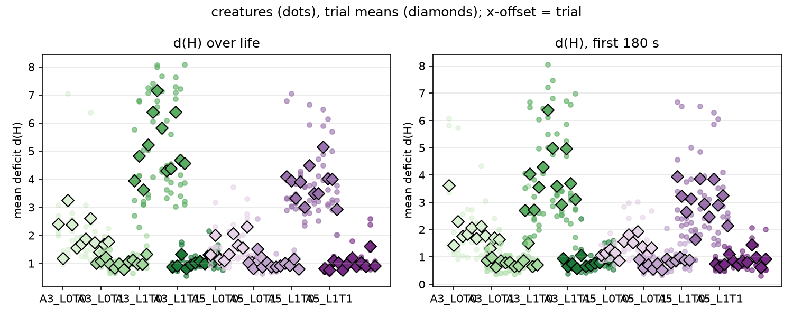
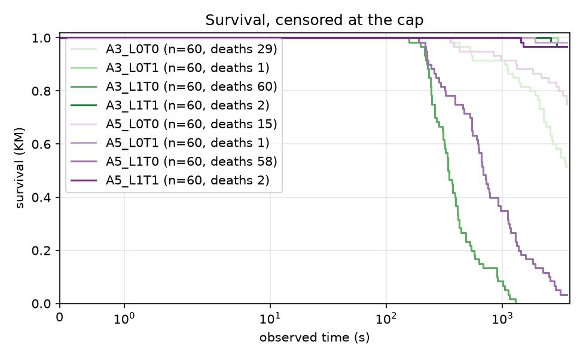
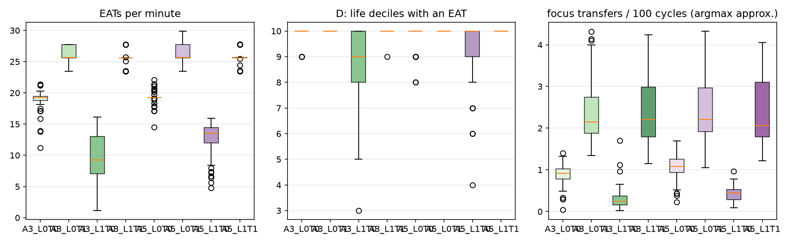

# Report: arbiter-ladder pilot (A0 / A1 / A2), analysis skeleton

## Purpose

Descriptive pilot of the arbiter ladder: spread of the outcomes #107 will pre-register, and a first run of the #106 analysis module end to end. Plan: `docs/plans/arbiter-ladder-pilot.md`, `docs/plans/issue-106-arbiter-ladder-analysis.md`; recipe: `docs/experiments/p107_pilot_stage2_recipe.md`. No pilot number enters a campaign result.

## Assumptions

The trial is the unit; creatures within a trial share a world, a food supply and a seed. The same seed is used in every arm (pairs the initial world only; Akka scheduling keeps trajectories nondeterministic). d(H) is measured from the set point 0.18. A0's focus switches use an argmax-of-urgency approximation, because the regulated emotion is not persisted. A0 lives minutes and A1/A2 up to the cap, so d(H) over life is not like for like; the common-window d(H) is. A1 and A2 use the tuned focus thresholds 0.4 / 0.15. DATA CAVEAT: in creatures that survive to the cap, `mouth_interactions` holds a whole number of 128-row blocks per creature (and `body_states` exactly 217,728 rows), so the last partial block is missing: EAT counts of A1/A2 survivors are lower bounds, short by up to 127 each (up to about 8% in A1, 2% in A2); A0 creatures, which died, are not quantized. The ordering of arms is not affected; the feeding rates are not exact.

## Hypothesis

None: this is a descriptive pilot. Predictions recorded before the data are in the recipe.

## Results

### Per-arm measures (creature mean, then trial means)

| measure | A3 lock off, tendency off | A3 lock off, tendency on | A3 lock on, tendency off | A3 lock on, tendency on | A5 lock off, tendency off | A5 lock off, tendency on | A5 lock on, tendency off | A5 lock on, tendency on |
|---|---|---|---|---|---|---|---|---|
| d(H) over life | 1.969 (trials 2.407, 1.190, 3.249, 2.384, 1.556, 1.709, 1.882, 2.619, 1.745, 1.410, 1.687, 1.791) | 1.033 (trials 1.004, 1.096, 1.224, 0.971, 0.847, 0.985, 0.779, 1.065, 1.134, 0.992, 0.973, 1.326) | 5.109 (trials 3.938, 4.826, 3.618, 5.233, 6.387, 7.160, 5.830, 4.313, 4.373, 6.387, 4.677, 4.569) | 1.057 (trials 0.874, 0.913, 1.328, 0.821, 0.965, 1.033, 1.089, 1.002, 1.312, 1.080, 1.241, 1.022) | 1.486 (trials 1.310, 2.012, 1.149, 1.110, 1.338, 2.057, 1.660, 1.555, 2.310, 1.058, 1.031, 1.239) | 0.987 (trials 1.027, 0.824, 1.513, 0.878, 1.024, 0.881, 0.887, 0.910, 1.004, 0.931, 1.166, 0.804) | 3.821 (trials 4.090, 3.954, 3.319, 3.902, 3.011, 4.485, 3.488, 3.496, 5.150, 4.022, 4.010, 2.922) | 1.006 (trials 0.815, 0.769, 1.112, 1.032, 0.773, 0.990, 1.209, 0.906, 1.027, 0.898, 1.619, 0.922) |
| d(H), first 180 s | 1.936 (trials 3.616, 1.425, 2.296, 1.754, 1.838, 2.069, 1.679, 2.121, 1.789, 1.315, 1.699, 1.636) | 0.836 (trials 0.867, 0.995, 0.642, 0.870, 0.793, 0.814, 0.652, 0.675, 0.861, 1.503, 0.657, 0.711) | 3.917 (trials 2.715, 4.039, 2.724, 3.559, 4.293, 6.376, 4.996, 3.599, 2.921, 4.977, 3.696, 3.108) | 0.824 (trials 0.941, 0.651, 0.749, 0.589, 1.073, 0.654, 0.688, 0.780, 0.794, 0.990, 0.923, 1.056) | 1.347 (trials 1.072, 1.140, 1.287, 1.170, 0.879, 1.577, 1.824, 1.525, 1.926, 1.364, 1.061, 1.344) | 0.787 (trials 0.904, 0.607, 0.721, 0.566, 0.752, 0.521, 0.936, 0.803, 0.864, 0.978, 0.894, 0.893) | 3.006 (trials 3.957, 3.233, 2.652, 3.129, 1.643, 3.871, 2.937, 2.476, 3.857, 2.911, 3.249, 2.155) | 0.871 (trials 0.748, 0.645, 0.740, 1.096, 0.850, 0.716, 0.858, 0.817, 1.459, 0.978, 0.621, 0.928) |
| EATs per minute | 18.796 (trials 19.332, 19.218, 16.176, 18.434, 18.360, 20.028, 19.014, 18.354, 19.056, 19.192, 18.976, 19.409) | 26.238 (trials 27.340, 26.058, 26.056, 26.480, 26.479, 26.915, 26.052, 25.634, 25.197, 26.914, 26.060, 25.673) | 9.771 (trials 11.997, 9.401, 11.388, 11.963, 6.276, 6.109, 9.536, 9.700, 11.217, 8.810, 10.559, 10.292) | 25.536 (trials 26.466, 26.036, 25.075, 26.036, 24.755, 25.190, 25.192, 26.042, 25.199, 25.614, 25.206, 25.624) | 19.330 (trials 19.628, 17.926, 19.656, 19.651, 18.491, 19.850, 20.750, 18.534, 19.805, 19.653, 19.221, 18.797) | 26.449 (trials 26.915, 26.053, 26.044, 26.052, 26.064, 26.478, 26.479, 27.342, 26.913, 26.502, 26.060, 26.485) | 12.570 (trials 12.132, 11.754, 13.417, 11.704, 13.621, 11.355, 14.053, 12.284, 11.357, 12.622, 12.923, 13.620) | 25.641 (trials 25.608, 26.478, 25.215, 25.223, 25.197, 26.058, 24.774, 25.201, 26.055, 26.910, 25.777, 25.198) |
| RED+GREEN EATs per minute | 9.249 (trials 9.676, 9.622, 7.911, 8.592, 9.226, 9.710, 9.521, 8.672, 9.752, 9.502, 9.493, 9.312) | 13.127 (trials 13.433, 12.875, 12.858, 13.156, 13.119, 13.434, 13.326, 12.643, 13.126, 13.771, 13.120, 12.658) | 4.640 (trials 5.562, 4.061, 5.368, 5.611, 3.232, 2.580, 5.091, 4.352, 5.279, 4.448, 5.140, 4.956) | 12.741 (trials 13.046, 13.075, 12.562, 13.071, 12.148, 12.699, 12.493, 12.644, 12.891, 12.854, 12.660, 12.752) | 9.780 (trials 9.753, 9.005, 9.892, 10.350, 9.437, 9.866, 10.365, 9.581, 9.499, 10.067, 9.988, 9.562) | 13.374 (trials 13.054, 13.133, 13.033, 13.330, 12.842, 13.259, 13.590, 13.845, 13.804, 13.635, 13.384, 13.576) | 6.173 (trials 5.783, 6.379, 6.963, 5.889, 6.353, 5.520, 6.994, 6.180, 5.285, 5.735, 6.057, 6.944) | 12.903 (trials 12.831, 13.219, 12.397, 12.972, 12.705, 12.812, 12.941, 12.981, 13.014, 13.241, 12.897, 12.823) |
| D: life deciles with an EAT | 9.950 (trials 10.000, 10.000, 9.800, 10.000, 10.000, 10.000, 9.800, 9.800, 10.000, 10.000, 10.000, 10.000) | 10.000 (trials 10.000, 10.000, 10.000, 10.000, 10.000, 10.000, 10.000, 10.000, 10.000, 10.000, 10.000, 10.000) | 8.583 (trials 9.600, 8.600, 8.400, 8.800, 7.200, 7.600, 8.200, 8.600, 8.800, 8.400, 9.600, 9.200) | 9.983 (trials 10.000, 10.000, 10.000, 10.000, 10.000, 10.000, 9.800, 10.000, 10.000, 10.000, 10.000, 10.000) | 9.833 (trials 10.000, 9.600, 10.000, 10.000, 9.800, 9.600, 10.000, 10.000, 9.600, 10.000, 10.000, 9.400) | 10.000 (trials 10.000, 10.000, 10.000, 10.000, 10.000, 10.000, 10.000, 10.000, 10.000, 10.000, 10.000, 10.000) | 9.250 (trials 9.000, 9.000, 10.000, 8.800, 10.000, 9.400, 10.000, 9.000, 8.000, 8.600, 9.400, 9.800) | 10.000 (trials 10.000, 10.000, 10.000, 10.000, 10.000, 10.000, 10.000, 10.000, 10.000, 10.000, 10.000, 10.000) |
| observed time (s) | 2779.670 (trials 2529.968, 3596.628, 1741.113, 1431.628, 3597.477, 3488.660, 2662.019, 2572.031, 2699.553, 3417.885, 2988.870, 2630.206) | 3585.904 (trials 3595.631, 3595.667, 3595.975, 3596.431, 3596.533, 3595.322, 3596.538, 3595.265, 3596.604, 3595.501, 3595.328, 3476.048) | 437.952 (trials 464.510, 313.193, 673.928, 529.245, 287.168, 230.692, 420.716, 492.776, 404.994, 413.366, 544.441, 480.397) | 3569.747 (trials 3598.299, 3598.705, 3397.834, 3598.769, 3598.720, 3597.568, 3597.314, 3597.894, 3461.899, 3597.966, 3595.342, 3596.651) | 3169.427 (trials 3484.856, 2346.279, 3594.568, 3595.519, 3141.456, 2891.538, 3011.948, 3303.963, 1876.329, 3595.248, 3595.989, 3595.431) | 3567.696 (trials 3595.336, 3596.427, 3260.764, 3596.508, 3594.801, 3596.597, 3596.489, 3595.328, 3595.565, 3593.428, 3595.393, 3595.712) | 1017.149 (trials 878.702, 1255.408, 1181.397, 569.234, 1017.380, 534.170, 1741.127, 1461.362, 540.941, 1025.615, 1030.851, 969.597) | 3525.251 (trials 3598.905, 3596.711, 3594.032, 3592.963, 3596.586, 3595.642, 3595.970, 3596.027, 3596.077, 3595.973, 2747.686, 3596.443) |
| died (share) | 0.483 (trials 1.000, 0.000, 0.600, 1.000, 0.000, 0.400, 0.400, 0.400, 0.600, 0.200, 0.400, 0.800) | 0.017 (trials 0.000, 0.000, 0.000, 0.000, 0.000, 0.000, 0.000, 0.000, 0.000, 0.000, 0.000, 0.200) | 1.000 (trials 1.000, 1.000, 1.000, 1.000, 1.000, 1.000, 1.000, 1.000, 1.000, 1.000, 1.000, 1.000) | 0.033 (trials 0.000, 0.000, 0.200, 0.000, 0.000, 0.000, 0.000, 0.000, 0.200, 0.000, 0.000, 0.000) | 0.250 (trials 0.200, 0.600, 0.000, 0.000, 0.200, 0.600, 0.600, 0.200, 0.600, 0.000, 0.000, 0.000) | 0.017 (trials 0.000, 0.000, 0.200, 0.000, 0.000, 0.000, 0.000, 0.000, 0.000, 0.000, 0.000, 0.000) | 0.967 (trials 1.000, 1.000, 1.000, 1.000, 1.000, 1.000, 0.800, 1.000, 1.000, 0.800, 1.000, 1.000) | 0.033 (trials 0.000, 0.000, 0.000, 0.000, 0.000, 0.000, 0.000, 0.000, 0.000, 0.000, 0.400, 0.000) |
| focus transfers per 100 cycles (argmax approx.) | 0.879 (trials 0.823, 1.058, 0.539, 0.622, 0.957, 0.937, 0.839, 0.825, 0.919, 1.117, 0.961, 0.953) | 2.393 (trials 2.088, 1.949, 1.806, 3.154, 3.352, 2.015, 3.601, 1.910, 2.799, 2.140, 2.101, 1.807) | 0.314 (trials 0.248, 0.240, 0.214, 0.356, 0.561, 0.624, 0.174, 0.143, 0.323, 0.271, 0.391, 0.221) | 2.375 (trials 3.143, 3.240, 2.560, 3.209, 2.796, 1.772, 1.781, 1.876, 1.664, 1.791, 1.599, 3.065) | 1.066 (trials 1.038, 0.797, 1.106, 1.314, 1.137, 0.879, 1.027, 1.067, 0.681, 1.357, 1.204, 1.179) | 2.460 (trials 1.945, 3.570, 1.626, 3.176, 1.815, 3.215, 3.470, 2.094, 2.058, 2.154, 2.067, 2.335) | 0.423 (trials 0.445, 0.494, 0.540, 0.303, 0.342, 0.445, 0.531, 0.411, 0.412, 0.403, 0.336, 0.414) | 2.378 (trials 3.156, 3.532, 1.617, 1.875, 3.115, 1.782, 1.724, 1.910, 1.825, 2.045, 2.803, 3.154) |
| focus opens per 100 cycles (argmax approx.) | 0.001 (trials 0.001, 0.001, 0.001, 0.001, 0.001, 0.001, 0.001, 0.003, 0.001, 0.002, 0.001, 0.001) | 0.083 (trials 0.095, 0.095, 0.071, 0.074, 0.083, 0.089, 0.084, 0.069, 0.072, 0.103, 0.082, 0.081) | 0.004 (trials 0.002, 0.008, 0.001, 0.002, 0.004, 0.010, 0.002, 0.002, 0.007, 0.008, 0.002, 0.001) | 0.029 (trials 0.035, 0.032, 0.022, 0.029, 0.021, 0.031, 0.028, 0.032, 0.029, 0.029, 0.031, 0.023) | 0.001 (trials 0.001, 0.003, 0.001, 0.001, 0.001, 0.001, 0.001, 0.002, 0.001, 0.001, 0.001, 0.001) | 0.094 (trials 0.097, 0.092, 0.074, 0.094, 0.080, 0.090, 0.083, 0.108, 0.090, 0.113, 0.089, 0.112) | 0.004 (trials 0.008, 0.005, 0.002, 0.002, 0.003, 0.002, 0.003, 0.007, 0.006, 0.003, 0.001, 0.001) | 0.031 (trials 0.034, 0.031, 0.026, 0.037, 0.027, 0.028, 0.029, 0.034, 0.032, 0.039, 0.028, 0.028) |
| focus transfers per 100 cycles (tracker) | 0.179 (trials 0.190, 0.078, 0.065, 0.189, 0.268, 0.220, 0.064, 0.215, 0.259, 0.207, 0.199, 0.198) | 0.344 (trials 0.412, 0.428, 0.433, 0.155, 0.157, 0.470, 0.146, 0.472, 0.151, 0.431, 0.407, 0.464) | 0.086 (trials 0.062, 0.064, 0.075, 0.138, 0.101, 0.017, 0.062, 0.045, 0.128, 0.098, 0.180, 0.060) | 0.283 (trials 0.143, 0.137, 0.140, 0.135, 0.144, 0.427, 0.411, 0.373, 0.460, 0.438, 0.452, 0.139) | 0.165 (trials 0.068, 0.169, 0.063, 0.232, 0.068, 0.240, 0.226, 0.237, 0.203, 0.188, 0.069, 0.212) | 0.302 (trials 0.343, 0.151, 0.377, 0.151, 0.417, 0.153, 0.154, 0.392, 0.374, 0.481, 0.312, 0.317) | 0.194 (trials 0.190, 0.206, 0.271, 0.263, 0.056, 0.189, 0.226, 0.202, 0.212, 0.170, 0.280, 0.065) | 0.266 (trials 0.143, 0.143, 0.374, 0.451, 0.140, 0.416, 0.345, 0.305, 0.304, 0.303, 0.128, 0.140) |
| focus opens per 100 cycles (tracker) | 0.502 (trials 0.507, 0.496, 0.489, 0.497, 0.494, 0.503, 0.497, 0.500, 0.511, 0.509, 0.509, 0.509) | 0.388 (trials 0.451, 0.453, 0.457, 0.247, 0.242, 0.470, 0.233, 0.491, 0.255, 0.453, 0.458, 0.444) | 0.466 (trials 0.466, 0.470, 0.460, 0.451, 0.467, 0.490, 0.478, 0.477, 0.452, 0.477, 0.438, 0.461) | 0.354 (trials 0.250, 0.241, 0.261, 0.238, 0.259, 0.453, 0.460, 0.440, 0.484, 0.456, 0.463, 0.247) | 0.521 (trials 0.514, 0.508, 0.513, 0.541, 0.507, 0.514, 0.528, 0.526, 0.500, 0.544, 0.518, 0.546) | 0.400 (trials 0.456, 0.241, 0.488, 0.250, 0.504, 0.244, 0.240, 0.516, 0.493, 0.443, 0.459, 0.461) | 0.439 (trials 0.441, 0.436, 0.419, 0.409, 0.477, 0.435, 0.430, 0.449, 0.435, 0.450, 0.412, 0.470) | 0.371 (trials 0.248, 0.242, 0.477, 0.410, 0.246, 0.468, 0.490, 0.458, 0.467, 0.448, 0.248, 0.246) |
| focused share of cycles (tracker) | 0.925 (trials 0.925, 0.928, 0.940, 0.926, 0.915, 0.921, 0.932, 0.934, 0.915, 0.917, 0.926, 0.926) | 0.397 (trials 0.392, 0.419, 0.420, 0.398, 0.384, 0.382, 0.360, 0.401, 0.416, 0.379, 0.381, 0.432) | 0.983 (trials 0.975, 0.981, 0.986, 0.985, 0.980, 0.988, 0.988, 0.988, 0.982, 0.985, 0.984, 0.969) | 0.396 (trials 0.397, 0.386, 0.421, 0.364, 0.417, 0.389, 0.401, 0.391, 0.383, 0.403, 0.408, 0.395) | 0.904 (trials 0.910, 0.929, 0.909, 0.885, 0.895, 0.917, 0.904, 0.893, 0.924, 0.889, 0.900, 0.899) | 0.386 (trials 0.413, 0.373, 0.423, 0.395, 0.419, 0.374, 0.388, 0.378, 0.364, 0.381, 0.375, 0.345) | 0.975 (trials 0.974, 0.975, 0.964, 0.984, 0.983, 0.979, 0.968, 0.981, 0.971, 0.978, 0.973, 0.971) | 0.386 (trials 0.390, 0.374, 0.410, 0.381, 0.383, 0.389, 0.400, 0.380, 0.381, 0.371, 0.385, 0.395) |
| episodes per creature | 562.500 (trials 512.400, 623.800, 300.600, 291.800, 797.800, 734.200, 454.800, 557.800, 600.800, 713.200, 617.600, 545.200) | 727.783 (trials 841.600, 861.400, 877.200, 432.800, 432.200, 927.800, 411.000, 937.200, 439.400, 875.200, 850.000, 847.600) | 73.467 (trials 74.000, 50.200, 110.000, 92.400, 48.400, 34.400, 71.000, 77.800, 69.400, 76.600, 102.000, 75.400) | 645.033 (trials 427.800, 411.400, 413.000, 406.400, 439.400, 860.200, 856.400, 799.000, 917.800, 882.600, 906.800, 419.600) | 641.983 (trials 610.600, 479.000, 625.600, 807.200, 546.600, 646.400, 661.400, 739.400, 393.800, 766.200, 637.200, 790.400) | 715.850 (trials 811.800, 422.200, 791.800, 434.800, 927.200, 429.800, 425.600, 922.200, 878.000, 966.400, 791.600, 788.800) | 192.983 (trials 169.600, 243.400, 241.400, 109.400, 164.000, 101.400, 336.000, 282.000, 109.000, 191.600, 210.200, 157.800) | 649.883 (trials 425.200, 418.800, 856.000, 894.400, 419.200, 884.200, 852.000, 774.400, 786.200, 762.400, 306.800, 419.000) |
| food share of EATs, first 20% of life (A3 criterion) | 0.471 (trials 0.496, 0.490, 0.465, 0.460, 0.471, 0.475, 0.472, 0.435, 0.466, 0.467, 0.476, 0.474) | 0.491 (trials 0.501, 0.480, 0.513, 0.481, 0.480, 0.487, 0.487, 0.504, 0.494, 0.496, 0.489, 0.485) | 0.474 (trials 0.487, 0.403, 0.466, 0.520, 0.571, 0.446, 0.565, 0.383, 0.473, 0.495, 0.445, 0.434) | 0.491 (trials 0.478, 0.515, 0.501, 0.491, 0.481, 0.507, 0.497, 0.462, 0.492, 0.473, 0.496, 0.505) | 0.498 (trials 0.494, 0.509, 0.502, 0.498, 0.486, 0.481, 0.470, 0.528, 0.512, 0.487, 0.508, 0.504) | 0.493 (trials 0.468, 0.512, 0.478, 0.497, 0.484, 0.508, 0.488, 0.492, 0.489, 0.504, 0.522, 0.475) | 0.500 (trials 0.421, 0.536, 0.484, 0.578, 0.515, 0.490, 0.512, 0.465, 0.488, 0.518, 0.444, 0.548) | 0.497 (trials 0.477, 0.495, 0.503, 0.491, 0.499, 0.483, 0.521, 0.521, 0.490, 0.496, 0.496, 0.495) |
### Drive deficit

Per creature (dots) and per trial (diamonds).
### Survival

- A3_L1T1 vs A5_L1T1: deaths 2/60 vs 2/60 (Fisher p = 1); KM median beyond the cap vs beyond the cap; log-rank p = 0.9865
- A3_L1T0 vs A5_L1T0: deaths 60/60 vs 58/60 (Fisher p = 0.496); KM median 340 s vs 682 s; log-rank p = 0.0000
- A3_L0T1 vs A5_L0T1: deaths 1/60 vs 1/60 (Fisher p = 1); KM median beyond the cap vs beyond the cap; log-rank p = 0.9953
- A3_L0T0 vs A5_L0T0: deaths 29/60 vs 15/60 (Fisher p = 0.0134); KM median beyond the cap vs beyond the cap; log-rank p = 0.0085
- A3_L1T0 vs A3_L1T1: deaths 60/60 vs 2/60 (Fisher p = 3.91e-32); KM median 340 s vs beyond the cap; log-rank p = 0.0000
- A3_L0T1 vs A3_L1T1: deaths 1/60 vs 2/60 (Fisher p = 1); KM median beyond the cap vs beyond the cap; log-rank p = 0.5538
- A3_L0T0 vs A3_L1T1: deaths 29/60 vs 2/60 (Fisher p = 8.51e-09); KM median beyond the cap vs beyond the cap; log-rank p = 0.0000
- A5_L1T0 vs A5_L1T1: deaths 58/60 vs 2/60 (Fisher p = 6.49e-29); KM median 682 s vs beyond the cap; log-rank p = 0.0000
- A5_L0T1 vs A5_L1T1: deaths 1/60 vs 2/60 (Fisher p = 1); KM median beyond the cap vs beyond the cap; log-rank p = 0.5538
- A5_L0T0 vs A5_L1T1: deaths 15/60 vs 2/60 (Fisher p = 0.00109); KM median beyond the cap vs beyond the cap; log-rank p = 0.0007
### Feeding and focus

EATs per minute, life deciles with an EAT, and the argmax-approximated focus transfers per 100 cycles.
### Episodes (A1, A2)

Close-type mix per arm:

| condition | DEATH | PREEMPTED | REGULATED | TIMED_OUT |
|---|---|---|---|---|
| a3_L0T0 | 0.001 | 0.177 | 0.317 | 0.505 |
| a3_L0T1 | 0.000 | 0.266 | 0.582 | 0.151 |
| a3_L1T0 | 0.014 | 0.187 | 0.025 | 0.774 |
| a3_L1T1 | 0.000 | 0.237 | 0.585 | 0.178 |
| a5_L0T0 | 0.000 | 0.140 | 0.385 | 0.475 |
| a5_L0T1 | 0.000 | 0.235 | 0.620 | 0.145 |
| a5_L1T0 | 0.005 | 0.279 | 0.093 | 0.623 |
| a5_L1T1 | 0.000 | 0.217 | 0.619 | 0.163 |

Steps per episode:

| condition | count | 50% | mean | max |
|---|---|---|---|---|
| a3_L0T0 | 33750.000 | 201.000 | 137.800 | 201.000 |
| a3_L0T1 | 43667.000 | 18.000 | 59.100 | 201.000 |
| a3_L1T0 | 4408.000 | 201.000 | 175.300 | 201.000 |
| a3_L1T1 | 38702.000 | 20.000 | 66.300 | 201.000 |
| a5_L0T0 | 38519.000 | 188.000 | 134.400 | 201.000 |
| a5_L0T1 | 42951.000 | 19.000 | 58.000 | 201.000 |
| a5_L1T0 | 11579.000 | 201.000 | 154.600 | 201.000 |
| a5_L1T1 | 38993.000 | 20.000 | 63.200 | 201.000 |
### A2 decision telemetry

**A3_L1T1** (6,476,593 decisions). Source mix: {'SINGLE': 0.0808, 'GREEDY': 0.7195, 'THOMPSON': 0.1722, 'EPSILON': 0.0276}. Executed action not the chosen one: 2.30%. Informed share (late half, focused multi-candidate): 0.883. Deciding controller by life decile: {0: {'OPERANT': 0.754, 'EPISODIC': 0.246}, 1: {'OPERANT': 0.732, 'EPISODIC': 0.268}, 2: {'OPERANT': 0.745, 'EPISODIC': 0.255}, 3: {'OPERANT': 0.747, 'EPISODIC': 0.253}, 4: {'OPERANT': 0.727, 'EPISODIC': 0.273}, 5: {'OPERANT': 0.718, 'EPISODIC': 0.282}, 6: {'OPERANT': 0.731, 'EPISODIC': 0.269}, 7: {'OPERANT': 0.72, 'EPISODIC': 0.28}, 8: {'OPERANT': 0.729, 'EPISODIC': 0.271}, 9: {'OPERANT': 0.742, 'EPISODIC': 0.258}}.

Descriptive z by close type:

| close_type | n | mean | variance | rms |
|---|---|---|---|---|
| DEATH | 144.000 | -1.622 | 58.967 | 7.822 |
| PREEMPTED | 599195.000 | 0.019 | 1.383 | 1.176 |
| REGULATED | 634456.000 | -0.027 | 1.354 | 1.164 |
| TIMED_OUT | 1330497.000 | 0.012 | 1.052 | 1.026 |

Episodic calibration (decisions the episodic controller made, per closed episode): n = 1,696,355, mean z -0.022, variance 0.433 (an honest SE gives 0 and 1). Episodic share of decisions by life decile: [0.2456, 0.2685, 0.2553, 0.2533, 0.2728, 0.2821, 0.269, 0.2803, 0.271, 0.2575]. Consulted the episodic controller in 0.272 of decisions, affordable in 0.332; mean novelty bonus 0.0082.

| close_type | n | mean | variance |
|---|---|---|---|
| DEATH | 26.000 | -8.679 | 239.734 |
| PREEMPTED | 394747.000 | -0.001 | 0.642 |
| REGULATED | 469320.000 | 0.048 | 0.695 |
| TIMED_OUT | 832262.000 | -0.072 | 0.171 |

**A3_L1T0** (786,760 decisions). Source mix: {'SINGLE': 0.0, 'GREEDY': 0.4452, 'THOMPSON': 0.5249, 'EPSILON': 0.0299}. Executed action not the chosen one: 42.25%. Informed share (late half, focused multi-candidate): 0.808. Deciding controller by life decile: {0: {'EPISODIC': 0.601, 'OPERANT': 0.399}, 1: {'EPISODIC': 0.773, 'OPERANT': 0.227}, 2: {'EPISODIC': 0.681, 'OPERANT': 0.319}, 3: {'EPISODIC': 0.626, 'OPERANT': 0.374}, 4: {'EPISODIC': 0.657, 'OPERANT': 0.343}, 5: {'EPISODIC': 0.618, 'OPERANT': 0.382}, 6: {'EPISODIC': 0.593, 'OPERANT': 0.407}, 7: {'EPISODIC': 0.567, 'OPERANT': 0.433}, 8: {'OPERANT': 0.504, 'EPISODIC': 0.496}, 9: {'OPERANT': 0.556, 'EPISODIC': 0.444}}.

Descriptive z by close type:

| close_type | n | mean | variance | rms |
|---|---|---|---|---|
| DEATH | 5725.000 | -1.240 | 39.528 | 6.408 |
| PREEMPTED | 69797.000 | 0.025 | 0.374 | 0.612 |
| REGULATED | 9558.000 | 0.128 | 0.377 | 0.627 |
| TIMED_OUT | 687474.000 | -0.004 | 0.164 | 0.404 |

Episodic calibration (decisions the episodic controller made, per closed episode): n = 465,097, mean z 0.002, variance 0.755 (an honest SE gives 0 and 1). Episodic share of decisions by life decile: [0.6007, 0.7728, 0.6814, 0.6259, 0.6572, 0.6177, 0.5933, 0.5673, 0.4964, 0.4445]. Consulted the episodic controller in 0.658 of decisions, affordable in 0.716; mean novelty bonus 0.0187.

| close_type | n | mean | variance |
|---|---|---|---|
| DEATH | 1015.000 | -5.474 | 197.940 |
| PREEMPTED | 51763.000 | 0.050 | 0.448 |
| REGULATED | 5113.000 | 0.244 | 0.563 |
| TIMED_OUT | 407206.000 | 0.007 | 0.229 |

**A3_L0T1** (6,505,538 decisions). Source mix: {'SINGLE': 0.0837, 'GREEDY': 0.7152, 'THOMPSON': 0.1737, 'EPSILON': 0.0274}. Executed action not the chosen one: 0.00%. Informed share (late half, focused multi-candidate): 0.887. Deciding controller by life decile: {0: {'OPERANT': 0.757, 'EPISODIC': 0.243}, 1: {'OPERANT': 0.731, 'EPISODIC': 0.269}, 2: {'OPERANT': 0.719, 'EPISODIC': 0.281}, 3: {'OPERANT': 0.751, 'EPISODIC': 0.249}, 4: {'OPERANT': 0.735, 'EPISODIC': 0.265}, 5: {'OPERANT': 0.723, 'EPISODIC': 0.277}, 6: {'OPERANT': 0.715, 'EPISODIC': 0.285}, 7: {'OPERANT': 0.743, 'EPISODIC': 0.257}, 8: {'OPERANT': 0.731, 'EPISODIC': 0.269}, 9: {'OPERANT': 0.734, 'EPISODIC': 0.266}}.

Descriptive z by close type:

| close_type | n | mean | variance | rms |
|---|---|---|---|---|
| DEATH | 134.000 | -0.422 | 12.814 | 3.591 |
| PREEMPTED | 712997.000 | 0.034 | 1.212 | 1.101 |
| REGULATED | 634282.000 | -0.007 | 1.031 | 1.015 |
| TIMED_OUT | 1233431.000 | 0.015 | 0.886 | 0.941 |

Episodic calibration (decisions the episodic controller made, per closed episode): n = 1,707,948, mean z -0.027, variance 0.451 (an honest SE gives 0 and 1). Episodic share of decisions by life decile: [0.2431, 0.2693, 0.2813, 0.249, 0.2647, 0.2772, 0.2852, 0.2568, 0.2688, 0.2661]. Consulted the episodic controller in 0.273 of decisions, affordable in 0.333; mean novelty bonus 0.0082.

| close_type | n | mean | variance |
|---|---|---|---|
| DEATH | 21.000 | -3.248 | 48.231 |
| PREEMPTED | 463271.000 | -0.014 | 0.693 |
| REGULATED | 469558.000 | 0.034 | 0.714 |
| TIMED_OUT | 775098.000 | -0.072 | 0.140 |

**A3_L0T0** (5,040,542 decisions). Source mix: {'SINGLE': 0.0, 'GREEDY': 0.4476, 'THOMPSON': 0.5224, 'EPSILON': 0.03}. Executed action not the chosen one: 0.00%. Informed share (late half, focused multi-candidate): 0.848. Deciding controller by life decile: {0: {'EPISODIC': 0.649, 'OPERANT': 0.351}, 1: {'EPISODIC': 0.606, 'OPERANT': 0.394}, 2: {'EPISODIC': 0.591, 'OPERANT': 0.409}, 3: {'EPISODIC': 0.603, 'OPERANT': 0.397}, 4: {'EPISODIC': 0.616, 'OPERANT': 0.384}, 5: {'EPISODIC': 0.588, 'OPERANT': 0.412}, 6: {'EPISODIC': 0.62, 'OPERANT': 0.38}, 7: {'EPISODIC': 0.633, 'OPERANT': 0.367}, 8: {'EPISODIC': 0.624, 'OPERANT': 0.376}, 9: {'EPISODIC': 0.665, 'OPERANT': 0.335}}.

Descriptive z by close type:

| close_type | n | mean | variance | rms |
|---|---|---|---|---|
| DEATH | 2887.000 | -2.595 | 105.210 | 10.579 |
| PREEMPTED | 425172.000 | 0.001 | 0.329 | 0.574 |
| REGULATED | 783947.000 | 0.084 | 0.376 | 0.619 |
| TIMED_OUT | 3437141.000 | -0.009 | 0.174 | 0.418 |

Episodic calibration (decisions the episodic controller made, per closed episode): n = 3,103,842, mean z 0.028, variance 0.295 (an honest SE gives 0 and 1). Episodic share of decisions by life decile: [0.6491, 0.6057, 0.5908, 0.6028, 0.6159, 0.5882, 0.6196, 0.633, 0.6241, 0.6653]. Consulted the episodic controller in 0.643 of decisions, affordable in 0.700; mean novelty bonus 0.0191.

| close_type | n | mean | variance |
|---|---|---|---|
| DEATH | 1305.000 | -5.310 | 217.998 |
| PREEMPTED | 284678.000 | 0.025 | 0.341 |
| REGULATED | 339137.000 | 0.220 | 0.423 |
| TIMED_OUT | 2478722.000 | 0.005 | 0.137 |

**A5_L1T1** (6,394,412 decisions). Source mix: {'SINGLE': 0.0848, 'GREEDY': 0.7198, 'THOMPSON': 0.1681, 'EPSILON': 0.0273}. Executed action not the chosen one: 2.35%. Informed share (late half, focused multi-candidate): 0.875. Deciding controller by life decile: {0: {'OPERANT': 0.685, 'EPISODIC': 0.315}, 1: {'OPERANT': 0.681, 'EPISODIC': 0.319}, 2: {'OPERANT': 0.686, 'EPISODIC': 0.314}, 3: {'OPERANT': 0.672, 'EPISODIC': 0.328}, 4: {'OPERANT': 0.685, 'EPISODIC': 0.315}, 5: {'OPERANT': 0.703, 'EPISODIC': 0.297}, 6: {'OPERANT': 0.69, 'EPISODIC': 0.31}, 7: {'OPERANT': 0.675, 'EPISODIC': 0.325}, 8: {'OPERANT': 0.678, 'EPISODIC': 0.322}, 9: {'OPERANT': 0.675, 'EPISODIC': 0.325}}.

Descriptive z by close type:

| close_type | n | mean | variance | rms |
|---|---|---|---|---|
| DEATH | 324.000 | -0.289 | 10.022 | 3.174 |
| PREEMPTED | 570945.000 | 0.066 | 0.529 | 0.730 |
| REGULATED | 660089.000 | 0.049 | 0.676 | 0.824 |
| TIMED_OUT | 1232791.000 | -0.034 | 0.215 | 0.465 |

Episodic calibration (decisions the episodic controller made, per closed episode): n = 2,001,145, mean z 0.008, variance 0.374 (an honest SE gives 0 and 1). Episodic share of decisions by life decile: [0.3151, 0.3189, 0.3142, 0.3276, 0.3149, 0.2974, 0.31, 0.3252, 0.3215, 0.3252]. Consulted the episodic controller in 0.319 of decisions, affordable in 0.319; mean novelty bonus 0.0098.

| close_type | n | mean | variance |
|---|---|---|---|
| DEATH | 52.000 | -1.724 | 15.518 |
| PREEMPTED | 468696.000 | 0.071 | 0.527 |
| REGULATED | 522726.000 | 0.061 | 0.663 |
| TIMED_OUT | 1009671.000 | -0.048 | 0.146 |

**A5_L1T0** (1,838,339 decisions). Source mix: {'SINGLE': 0.0, 'GREEDY': 0.3592, 'THOMPSON': 0.6109, 'EPSILON': 0.0299}. Executed action not the chosen one: 42.68%. Informed share (late half, focused multi-candidate): 0.940. Deciding controller by life decile: {0: {'EPISODIC': 0.752, 'OPERANT': 0.248}, 1: {'EPISODIC': 0.861, 'OPERANT': 0.139}, 2: {'EPISODIC': 0.878, 'OPERANT': 0.122}, 3: {'EPISODIC': 0.838, 'OPERANT': 0.162}, 4: {'EPISODIC': 0.863, 'OPERANT': 0.137}, 5: {'EPISODIC': 0.848, 'OPERANT': 0.152}, 6: {'EPISODIC': 0.9, 'OPERANT': 0.1}, 7: {'EPISODIC': 0.901, 'OPERANT': 0.099}, 8: {'EPISODIC': 0.905, 'OPERANT': 0.095}, 9: {'EPISODIC': 0.888, 'OPERANT': 0.112}}.

Descriptive z by close type:

| close_type | n | mean | variance | rms |
|---|---|---|---|---|
| DEATH | 6837.000 | -2.065 | 95.464 | 9.986 |
| PREEMPTED | 240901.000 | 0.023 | 0.294 | 0.542 |
| REGULATED | 88794.000 | 0.144 | 0.443 | 0.681 |
| TIMED_OUT | 1453602.000 | 0.008 | 0.182 | 0.427 |

Episodic calibration (decisions the episodic controller made, per closed episode): n = 1,549,018, mean z 0.014, variance 0.664 (an honest SE gives 0 and 1). Episodic share of decisions by life decile: [0.7521, 0.8609, 0.8776, 0.8384, 0.8627, 0.8479, 0.9004, 0.9009, 0.9052, 0.8883]. Consulted the episodic controller in 0.876 of decisions, affordable in 0.876; mean novelty bonus 0.0266.

| close_type | n | mean | variance |
|---|---|---|---|
| DEATH | 2832.000 | -4.533 | 218.964 |
| PREEMPTED | 209344.000 | 0.030 | 0.306 |
| REGULATED | 52900.000 | 0.243 | 0.622 |
| TIMED_OUT | 1283942.000 | 0.012 | 0.195 |

**A5_L0T1** (6,470,945 decisions). Source mix: {'SINGLE': 0.0833, 'GREEDY': 0.7169, 'THOMPSON': 0.1724, 'EPSILON': 0.0275}. Executed action not the chosen one: 0.00%. Informed share (late half, focused multi-candidate): 0.884. Deciding controller by life decile: {0: {'OPERANT': 0.724, 'EPISODIC': 0.276}, 1: {'OPERANT': 0.674, 'EPISODIC': 0.326}, 2: {'OPERANT': 0.665, 'EPISODIC': 0.335}, 3: {'OPERANT': 0.685, 'EPISODIC': 0.315}, 4: {'OPERANT': 0.681, 'EPISODIC': 0.319}, 5: {'OPERANT': 0.688, 'EPISODIC': 0.312}, 6: {'OPERANT': 0.665, 'EPISODIC': 0.335}, 7: {'OPERANT': 0.646, 'EPISODIC': 0.354}, 8: {'OPERANT': 0.699, 'EPISODIC': 0.301}, 9: {'OPERANT': 0.678, 'EPISODIC': 0.322}}.

Descriptive z by close type:

| close_type | n | mean | variance | rms |
|---|---|---|---|---|
| DEATH | 128.000 | -2.855 | 143.046 | 12.251 |
| PREEMPTED | 645469.000 | 0.062 | 0.525 | 0.727 |
| REGULATED | 652627.000 | 0.044 | 0.612 | 0.783 |
| TIMED_OUT | 1192178.000 | -0.037 | 0.163 | 0.406 |

Episodic calibration (decisions the episodic controller made, per closed episode): n = 2,042,883, mean z 0.005, variance 0.377 (an honest SE gives 0 and 1). Episodic share of decisions by life decile: [0.2763, 0.3261, 0.335, 0.3152, 0.3188, 0.3115, 0.335, 0.354, 0.3015, 0.3223]. Consulted the episodic controller in 0.321 of decisions, affordable in 0.321; mean novelty bonus 0.0099.

| close_type | n | mean | variance |
|---|---|---|---|
| DEATH | 52.000 | -6.901 | 325.528 |
| PREEMPTED | 530310.000 | 0.065 | 0.535 |
| REGULATED | 520517.000 | 0.051 | 0.662 |
| TIMED_OUT | 992004.000 | -0.050 | 0.117 |

**A5_L0T0** (5,748,518 decisions). Source mix: {'SINGLE': 0.0, 'GREEDY': 0.502, 'THOMPSON': 0.468, 'EPSILON': 0.03}. Executed action not the chosen one: 0.00%. Informed share (late half, focused multi-candidate): 0.816. Deciding controller by life decile: {0: {'EPISODIC': 0.643, 'OPERANT': 0.357}, 1: {'EPISODIC': 0.587, 'OPERANT': 0.413}, 2: {'EPISODIC': 0.59, 'OPERANT': 0.41}, 3: {'EPISODIC': 0.627, 'OPERANT': 0.373}, 4: {'EPISODIC': 0.62, 'OPERANT': 0.38}, 5: {'EPISODIC': 0.618, 'OPERANT': 0.382}, 6: {'EPISODIC': 0.602, 'OPERANT': 0.398}, 7: {'EPISODIC': 0.624, 'OPERANT': 0.376}, 8: {'EPISODIC': 0.629, 'OPERANT': 0.371}, 9: {'EPISODIC': 0.678, 'OPERANT': 0.322}}.

Descriptive z by close type:

| close_type | n | mean | variance | rms |
|---|---|---|---|---|
| DEATH | 1417.000 | -4.907 | 270.051 | 17.145 |
| PREEMPTED | 376451.000 | 0.034 | 0.312 | 0.560 |
| REGULATED | 1113330.000 | 0.122 | 0.387 | 0.634 |
| TIMED_OUT | 3686778.000 | 0.019 | 0.160 | 0.400 |

Episodic calibration (decisions the episodic controller made, per closed episode): n = 3,552,242, mean z 0.065, variance 0.335 (an honest SE gives 0 and 1). Episodic share of decisions by life decile: [0.643, 0.5873, 0.5897, 0.6269, 0.6195, 0.6177, 0.602, 0.6241, 0.6291, 0.6778]. Consulted the episodic controller in 0.624 of decisions, affordable in 0.624; mean novelty bonus 0.0192.

| close_type | n | mean | variance |
|---|---|---|---|
| DEATH | 805.000 | -8.436 | 446.219 |
| PREEMPTED | 267018.000 | 0.054 | 0.375 |
| REGULATED | 526006.000 | 0.261 | 0.473 |
| TIMED_OUT | 2758413.000 | 0.031 | 0.146 |
### Operant calibration (recipe 5)

Per trial: variance of z per (object type, action) cell with enough updates and varying outcomes, weighted by update count; adoption range [0.8, 1.25] for A2 (mean over trials). `pooled_variance` is the unrestricted variance of all z, for comparison: constant cells drag it down.

|  | statistic | pooled_variance | n_updates | cells | constant_cells |
|---|---|---|---|---|---|
| ('a3_L1T1', 1) | 1.006 | 0.459 | 11519.000 | 3.000 | 2.000 |
| ('a3_L1T1', 2) | 1.257 | 0.576 | 11491.000 | 3.000 | 2.000 |
| ('a3_L1T1', 3) | 0.806 | 0.346 | 11287.000 | 3.000 | 2.000 |
| ('a3_L1T1', 4) | 0.821 | 0.388 | 11309.000 | 3.000 | 2.000 |
| ('a3_L1T1', 5) | 1.004 | 0.437 | 11570.000 | 3.000 | 2.000 |
| ('a3_L1T1', 6) | 0.986 | 0.479 | 10752.000 | 3.000 | 2.000 |
| ('a3_L1T1', 7) | 1.207 | 0.568 | 10863.000 | 3.000 | 2.000 |
| ('a3_L1T1', 8) | 1.187 | 0.577 | 10899.000 | 3.000 | 2.000 |
| ('a3_L1T1', 9) | 1.111 | 0.556 | 10039.000 | 3.000 | 2.000 |
| ('a3_L1T1', 10) | 1.001 | 0.495 | 10791.000 | 3.000 | 2.000 |
| ('a3_L1T1', 11) | 0.718 | 0.350 | 10813.000 | 3.000 | 2.000 |
| ('a3_L1T1', 12) | 0.765 | 0.336 | 11849.000 | 3.000 | 2.000 |
| ('a3_L1T0', 1) | 0.494 | 0.182 | 677.000 | 2.000 | 3.000 |
| ('a3_L1T0', 2) | n/a | 0.198 | 352.000 | 0.000 | 4.000 |
| ('a3_L1T0', 3) | 1.185 | 0.141 | 1016.000 | 1.000 | 4.000 |
| ('a3_L1T0', 4) | 0.869 | 0.448 | 722.000 | 3.000 | 2.000 |
| ('a3_L1T0', 5) | n/a | 0.220 | 229.000 | 0.000 | 4.000 |
| ('a3_L1T0', 6) | n/a | 0.309 | 151.000 | 0.000 | 2.000 |
| ('a3_L1T0', 7) | 0.974 | 0.160 | 485.000 | 1.000 | 4.000 |
| ('a3_L1T0', 8) | 1.931 | 0.547 | 642.000 | 2.000 | 3.000 |
| ('a3_L1T0', 9) | 0.370 | 0.172 | 520.000 | 2.000 | 3.000 |
| ('a3_L1T0', 10) | 0.905 | 0.150 | 439.000 | 1.000 | 4.000 |
| ('a3_L1T0', 11) | 0.829 | 0.132 | 690.000 | 1.000 | 4.000 |
| ('a3_L1T0', 12) | 0.514 | 0.222 | 572.000 | 2.000 | 3.000 |
| ('a3_L0T1', 1) | 1.323 | 0.637 | 11211.000 | 3.000 | 2.000 |
| ('a3_L0T1', 2) | 1.286 | 0.614 | 11197.000 | 3.000 | 2.000 |
| ('a3_L0T1', 3) | 1.278 | 0.589 | 11276.000 | 3.000 | 2.000 |
| ('a3_L0T1', 4) | 1.072 | 0.482 | 11845.000 | 3.000 | 2.000 |
| ('a3_L0T1', 5) | 1.448 | 0.656 | 11619.000 | 3.000 | 2.000 |
| ('a3_L0T1', 6) | 1.380 | 0.685 | 10900.000 | 3.000 | 2.000 |
| ('a3_L0T1', 7) | 1.242 | 0.584 | 11412.000 | 3.000 | 2.000 |
| ('a3_L0T1', 8) | 1.296 | 0.614 | 11095.000 | 3.000 | 2.000 |
| ('a3_L0T1', 9) | 1.167 | 0.507 | 12102.000 | 3.000 | 2.000 |
| ('a3_L0T1', 10) | 1.300 | 0.658 | 10926.000 | 3.000 | 2.000 |
| ('a3_L0T1', 11) | 1.489 | 0.730 | 10743.000 | 3.000 | 2.000 |
| ('a3_L0T1', 12) | 1.177 | 0.531 | 10994.000 | 3.000 | 2.000 |
| ('a3_L0T0', 1) | 0.914 | 0.456 | 4845.000 | 3.000 | 2.000 |
| ('a3_L0T0', 2) | 1.238 | 0.640 | 6928.000 | 3.000 | 2.000 |
| ('a3_L0T0', 3) | 1.537 | 0.745 | 3342.000 | 3.000 | 2.000 |
| ('a3_L0T0', 4) | 1.468 | 0.694 | 2860.000 | 3.000 | 2.000 |
| ('a3_L0T0', 5) | 1.236 | 0.643 | 6630.000 | 3.000 | 2.000 |
| ('a3_L0T0', 6) | 1.208 | 0.608 | 6881.000 | 3.000 | 2.000 |
| ('a3_L0T0', 7) | 1.102 | 0.564 | 5087.000 | 3.000 | 2.000 |
| ('a3_L0T0', 8) | 1.045 | 0.525 | 4961.000 | 3.000 | 2.000 |
| ('a3_L0T0', 9) | 1.212 | 0.619 | 5103.000 | 3.000 | 2.000 |
| ('a3_L0T0', 10) | 1.297 | 0.666 | 6485.000 | 3.000 | 2.000 |
| ('a3_L0T0', 11) | 1.254 | 0.636 | 5597.000 | 3.000 | 2.000 |
| ('a3_L0T0', 12) | 1.169 | 0.573 | 5094.000 | 3.000 | 2.000 |
| ('a5_L1T1', 1) | 1.140 | 0.578 | 10414.000 | 3.000 | 2.000 |
| ('a5_L1T1', 2) | 1.050 | 0.534 | 10477.000 | 3.000 | 2.000 |
| ('a5_L1T1', 3) | 0.960 | 0.487 | 10184.000 | 3.000 | 2.000 |
| ('a5_L1T1', 4) | 0.941 | 0.522 | 9574.000 | 3.000 | 2.000 |
| ('a5_L1T1', 5) | 1.234 | 0.624 | 10421.000 | 3.000 | 2.000 |
| ('a5_L1T1', 6) | 0.987 | 0.516 | 10056.000 | 3.000 | 2.000 |
| ('a5_L1T1', 7) | 1.146 | 0.600 | 9937.000 | 3.000 | 2.000 |
| ('a5_L1T1', 8) | 0.991 | 0.525 | 9870.000 | 3.000 | 2.000 |
| ('a5_L1T1', 9) | 0.864 | 0.449 | 10194.000 | 3.000 | 2.000 |
| ('a5_L1T1', 10) | 0.838 | 0.436 | 10343.000 | 3.000 | 2.000 |
| ('a5_L1T1', 11) | 0.692 | 0.335 | 8263.000 | 3.000 | 2.000 |
| ('a5_L1T1', 12) | 1.172 | 0.587 | 10523.000 | 3.000 | 2.000 |
| ('a5_L1T0', 1) | 1.054 | 0.310 | 1253.000 | 2.000 | 3.000 |
| ('a5_L1T0', 2) | 0.563 | 0.215 | 1660.000 | 2.000 | 3.000 |
| ('a5_L1T0', 3) | 0.288 | 0.124 | 1639.000 | 2.000 | 3.000 |
| ('a5_L1T0', 4) | 0.537 | 0.289 | 864.000 | 3.000 | 2.000 |
| ('a5_L1T0', 5) | 1.152 | 0.148 | 1576.000 | 1.000 | 4.000 |
| ('a5_L1T0', 6) | 0.432 | 0.262 | 733.000 | 3.000 | 2.000 |
| ('a5_L1T0', 7) | 0.806 | 0.444 | 2443.000 | 3.000 | 2.000 |
| ('a5_L1T0', 8) | 0.437 | 0.162 | 2008.000 | 2.000 | 3.000 |
| ('a5_L1T0', 9) | 1.082 | 0.536 | 777.000 | 3.000 | 2.000 |
| ('a5_L1T0', 10) | 0.327 | 0.194 | 1480.000 | 3.000 | 2.000 |
| ('a5_L1T0', 11) | 0.942 | 0.489 | 1502.000 | 3.000 | 2.000 |
| ('a5_L1T0', 12) | 0.244 | 0.158 | 1428.000 | 3.000 | 2.000 |
| ('a5_L0T1', 1) | 1.164 | 0.594 | 10332.000 | 3.000 | 2.000 |
| ('a5_L0T1', 2) | 1.135 | 0.576 | 10739.000 | 3.000 | 2.000 |
| ('a5_L0T1', 3) | 1.372 | 0.684 | 9661.000 | 3.000 | 2.000 |
| ('a5_L0T1', 4) | 1.329 | 0.673 | 10611.000 | 3.000 | 2.000 |
| ('a5_L0T1', 5) | 1.172 | 0.602 | 10393.000 | 3.000 | 2.000 |
| ('a5_L0T1', 6) | 1.260 | 0.632 | 10709.000 | 3.000 | 2.000 |
| ('a5_L0T1', 7) | 1.203 | 0.607 | 10536.000 | 3.000 | 2.000 |
| ('a5_L0T1', 8) | 1.303 | 0.692 | 10380.000 | 3.000 | 2.000 |
| ('a5_L0T1', 9) | 1.316 | 0.700 | 10292.000 | 3.000 | 2.000 |
| ('a5_L0T1', 10) | 1.406 | 0.774 | 10070.000 | 3.000 | 2.000 |
| ('a5_L0T1', 11) | 1.262 | 0.660 | 10489.000 | 3.000 | 2.000 |
| ('a5_L0T1', 12) | 1.194 | 0.644 | 10244.000 | 3.000 | 2.000 |
| ('a5_L0T0', 1) | 1.298 | 0.669 | 7001.000 | 3.000 | 2.000 |
| ('a5_L0T0', 2) | 0.936 | 0.497 | 4498.000 | 3.000 | 2.000 |
| ('a5_L0T0', 3) | 1.084 | 0.568 | 7212.000 | 3.000 | 2.000 |
| ('a5_L0T0', 4) | 0.989 | 0.550 | 7051.000 | 3.000 | 2.000 |
| ('a5_L0T0', 5) | 1.417 | 0.738 | 6146.000 | 3.000 | 2.000 |
| ('a5_L0T0', 6) | 1.111 | 0.568 | 5763.000 | 3.000 | 2.000 |
| ('a5_L0T0', 7) | 0.926 | 0.483 | 6167.000 | 3.000 | 2.000 |
| ('a5_L0T0', 8) | 1.245 | 0.670 | 6264.000 | 3.000 | 2.000 |
| ('a5_L0T0', 9) | 1.187 | 0.587 | 3788.000 | 3.000 | 2.000 |
| ('a5_L0T0', 10) | 1.361 | 0.725 | 7063.000 | 3.000 | 2.000 |
| ('a5_L0T0', 11) | 1.226 | 0.663 | 6934.000 | 3.000 | 2.000 |
| ('a5_L0T0', 12) | 1.007 | 0.538 | 7052.000 | 3.000 | 2.000 |

**A3_L1T1** cells (>= 30 updates, outcomes vary):

|  | n | mean_z | variance | constant |
|---|---|---|---|---|
| ('ALOE', 'EAT') | 13796 | 0.001 | 1.002 | False |
| ('GREEN_APPLE', 'EAT') | 24399 | 0.059 | 1.078 | False |
| ('RED_APPLE', 'EAT') | 23042 | 0.060 | 1.084 | False |

Constant-outcome cells, left out:

|  | n | mean_z | variance | constant |
|---|---|---|---|---|
| ('CACTUS', 'EAT') | 24453 | -0.106 | 0.003 | True |
| ('GRAY_APPLE', 'EAT') | 47492 | -0.090 | 0.002 | True |

**A3_L1T0** cells (>= 30 updates, outcomes vary):

|  | n | mean_z | variance | constant |
|---|---|---|---|---|
| ('ALOE', 'EAT') | 502 | 0.032 | 1.154 | False |
| ('GREEN_APPLE', 'EAT') | 1247 | 0.254 | 0.126 | False |
| ('RED_APPLE', 'EAT') | 1103 | 0.256 | 0.268 | False |

Constant-outcome cells, left out:

|  | n | mean_z | variance | constant |
|---|---|---|---|---|
| ('CACTUS', 'EAT') | 1087 | -0.274 | 0.007 | True |
| ('GRAY_APPLE', 'EAT') | 2556 | -0.211 | 0.008 | True |

**A3_L0T1** cells (>= 30 updates, outcomes vary):

|  | n | mean_z | variance | constant |
|---|---|---|---|---|
| ('ALOE', 'EAT') | 14149 | -0.003 | 1.009 | False |
| ('GREEN_APPLE', 'EAT') | 25477 | 0.018 | 1.484 | False |
| ('RED_APPLE', 'EAT') | 23466 | 0.022 | 1.450 | False |

Constant-outcome cells, left out:

|  | n | mean_z | variance | constant |
|---|---|---|---|---|
| ('CACTUS', 'EAT') | 23336 | -0.108 | 0.003 | True |
| ('GRAY_APPLE', 'EAT') | 48892 | -0.089 | 0.002 | True |

**A3_L0T0** cells (>= 30 updates, outcomes vary):

|  | n | mean_z | variance | constant |
|---|---|---|---|---|
| ('ALOE', 'EAT') | 4682 | 0.026 | 1.043 | False |
| ('GREEN_APPLE', 'EAT') | 14110 | 0.047 | 1.176 | False |
| ('RED_APPLE', 'EAT') | 12990 | 0.029 | 1.398 | False |

Constant-outcome cells, left out:

|  | n | mean_z | variance | constant |
|---|---|---|---|---|
| ('CACTUS', 'EAT') | 4485 | -0.188 | 0.006 | True |
| ('GRAY_APPLE', 'EAT') | 27546 | -0.102 | 0.003 | True |

**A5_L1T1** cells (>= 30 updates, outcomes vary):

|  | n | mean_z | variance | constant |
|---|---|---|---|---|
| ('ALOE', 'EAT') | 13804 | 0.000 | 1.014 | False |
| ('GREEN_APPLE', 'EAT') | 24310 | 0.053 | 1.219 | False |
| ('RED_APPLE', 'EAT') | 22960 | 0.061 | 1.121 | False |

Constant-outcome cells, left out:

|  | n | mean_z | variance | constant |
|---|---|---|---|---|
| ('CACTUS', 'EAT') | 12495 | -0.131 | 0.004 | True |
| ('GRAY_APPLE', 'EAT') | 46687 | -0.090 | 0.002 | True |

**A5_L1T0** cells (>= 30 updates, outcomes vary):

|  | n | mean_z | variance | constant |
|---|---|---|---|---|
| ('ALOE', 'EAT') | 1532 | 0.078 | 1.021 | False |
| ('GREEN_APPLE', 'EAT') | 3737 | 0.166 | 0.277 | False |
| ('RED_APPLE', 'EAT') | 3393 | 0.163 | 0.370 | False |

Constant-outcome cells, left out:

|  | n | mean_z | variance | constant |
|---|---|---|---|---|
| ('CACTUS', 'EAT') | 1804 | -0.250 | 0.006 | True |
| ('GRAY_APPLE', 'EAT') | 6897 | -0.151 | 0.006 | True |

**A5_L0T1** cells (>= 30 updates, outcomes vary):

|  | n | mean_z | variance | constant |
|---|---|---|---|---|
| ('ALOE', 'EAT') | 14257 | 0.003 | 1.007 | False |
| ('GREEN_APPLE', 'EAT') | 25643 | 0.023 | 1.369 | False |
| ('RED_APPLE', 'EAT') | 24084 | 0.020 | 1.272 | False |

Constant-outcome cells, left out:

|  | n | mean_z | variance | constant |
|---|---|---|---|---|
| ('CACTUS', 'EAT') | 11926 | -0.133 | 0.004 | True |
| ('GRAY_APPLE', 'EAT') | 48546 | -0.090 | 0.002 | True |

**A5_L0T0** cells (>= 30 updates, outcomes vary):

|  | n | mean_z | variance | constant |
|---|---|---|---|---|
| ('ALOE', 'EAT') | 6212 | 0.048 | 0.970 | False |
| ('GREEN_APPLE', 'EAT') | 17003 | 0.038 | 1.278 | False |
| ('RED_APPLE', 'EAT') | 15814 | 0.039 | 1.154 | False |

Constant-outcome cells, left out:

|  | n | mean_z | variance | constant |
|---|---|---|---|---|
| ('CACTUS', 'EAT') | 4287 | -0.192 | 0.006 | True |
| ('GRAY_APPLE', 'EAT') | 31623 | -0.098 | 0.002 | True |
### Paired differences by seed

Differences of trial means, later arm minus earlier arm; SD has 2 degrees of freedom, so size on the 80% upper bound (2.12 x SD), not the point estimate.

| measure | contrast | per-seed differences | mean | SD (2 df) | 80% upper bound on SD |
|---|---|---|---|---|---|
| d(H) over life | A3_L1T1 - A5_L1T1 | [0.0588, 0.144, 0.2151, -0.2109, 0.1918, 0.0425, -0.1202, 0.0959, 0.2851, 0.1822, -0.3779, 0.0994] | 0.050 | 0.194 | n/a |
| d(H) over life | A3_L1T0 - A5_L1T0 | [-0.1518, 0.8722, 0.2988, 1.3312, 3.3753, 2.675, 2.3415, 0.8164, -0.7767, 2.3643, 0.667, 1.6461] | 1.288 | 1.235 | n/a |
| d(H) over life | A3_L0T1 - A5_L0T1 | [-0.0233, 0.2718, -0.2892, 0.0923, -0.177, 0.1039, -0.108, 0.1553, 0.1303, 0.0606, -0.1924, 0.522] | 0.046 | 0.224 | n/a |
| d(H) over life | A3_L0T0 - A5_L0T0 | [1.0978, -0.8225, 2.0996, 1.2738, 0.2179, -0.3483, 0.222, 1.064, -0.5657, 0.3525, 0.6566, 0.5522] | 0.483 | 0.833 | n/a |
| d(H) over life | A3_L1T0 - A3_L1T1 | [3.0643, 3.9132, 2.2906, 4.4117, 5.422, 6.1277, 4.7406, 3.3111, 3.0612, 5.3065, 3.4359, 3.5467] | 4.053 | 1.153 | n/a |
| d(H) over life | A3_L0T1 - A3_L1T1 | [0.13, 0.1829, -0.104, 0.1493, -0.118, -0.0475, -0.3097, 0.0637, -0.178, -0.0884, -0.268, 0.3043] | -0.024 | 0.190 | n/a |
| d(H) over life | A3_L0T0 - A3_L1T1 | [1.5336, 0.2768, 1.9215, 1.5628, 0.5915, 0.6762, 0.7929, 1.6176, 0.4326, 0.3304, 0.4459, 0.7695] | 0.913 | 0.581 | n/a |
| d(H) over life | A5_L1T0 - A5_L1T1 | [3.2749, 3.185, 2.2069, 2.8696, 2.2386, 3.4952, 2.2789, 2.5906, 4.1229, 3.1244, 2.391, 2.0] | 2.815 | 0.640 | n/a |
| d(H) over life | A5_L0T1 - A5_L1T1 | [0.212, 0.0551, 0.4002, -0.1539, 0.2508, -0.1089, -0.3219, 0.0043, -0.0232, 0.0333, -0.4535, -0.1183] | -0.019 | 0.239 | n/a |
| d(H) over life | A5_L0T0 - A5_L1T1 | [0.4946, 1.2434, 0.0369, 0.078, 0.5655, 1.067, 0.4506, 0.6494, 1.2833, 0.1601, -0.5885, 0.3167] | 0.480 | 0.543 | n/a |
| d(H), first 180 s | A3_L1T1 - A5_L1T1 | [0.1934, 0.0059, 0.0096, -0.5063, 0.223, -0.0614, -0.17, -0.0364, -0.6645, 0.0122, 0.3017, 0.1279] | -0.047 | 0.286 | n/a |
| d(H), first 180 s | A3_L1T0 - A5_L1T0 | [-1.2416, 0.8054, 0.0727, 0.4293, 2.6504, 2.5053, 2.0584, 1.1231, -0.9356, 2.066, 0.4467, 0.9528] | 0.911 | 1.260 | n/a |
| d(H), first 180 s | A3_L0T1 - A5_L0T1 | [-0.037, 0.3875, -0.0792, 0.3039, 0.0404, 0.2931, -0.2842, -0.1281, -0.0028, 0.5247, -0.2368, -0.1824] | 0.050 | 0.265 | n/a |
| d(H), first 180 s | A3_L0T0 - A5_L0T0 | [2.544, 0.2852, 1.0095, 0.5846, 0.9588, 0.492, -0.1455, 0.596, -0.1375, -0.0489, 0.638, 0.2918] | 0.589 | 0.726 | n/a |
| d(H), first 180 s | A3_L1T0 - A3_L1T1 | [1.7741, 3.388, 1.9752, 2.9693, 3.2197, 5.7221, 4.3081, 2.8192, 2.1271, 3.9872, 2.7728, 2.0524] | 3.093 | 1.148 | n/a |
| d(H), first 180 s | A3_L0T1 - A3_L1T1 | [-0.0745, 0.3444, -0.1075, 0.2803, -0.2808, 0.1594, -0.0356, -0.1055, 0.0671, 0.5131, -0.2661, -0.3446] | 0.012 | 0.267 | n/a |
| d(H), first 180 s | A3_L0T0 - A3_L1T1 | [2.6754, 0.7742, 1.547, 1.1648, 0.7644, 1.4145, 0.9912, 1.3408, 0.9947, 0.3255, 0.7762, 0.5807] | 1.112 | 0.607 | n/a |
| d(H), first 180 s | A5_L1T0 - A5_L1T1 | [3.209, 2.5885, 1.9121, 2.0337, 0.7924, 3.1553, 2.0798, 1.6597, 2.3982, 1.9333, 2.6277, 1.2274] | 2.135 | 0.718 | n/a |
| d(H), first 180 s | A5_L0T1 - A5_L1T1 | [0.1559, -0.0372, -0.0187, -0.5299, -0.0981, -0.1952, 0.0786, -0.0138, -0.5946, 0.0005, 0.2724, -0.0343] | -0.085 | 0.253 | n/a |
| d(H), first 180 s | A5_L0T0 - A5_L1T1 | [0.3248, 0.4949, 0.5471, 0.0739, 0.0286, 0.8611, 0.9668, 0.7084, 0.4677, 0.3866, 0.4399, 0.4168] | 0.476 | 0.277 | n/a |
| EATs per minute | A3_L1T1 - A5_L1T1 | [0.8581, -0.4415, -0.1407, 0.8129, -0.4417, -0.8678, 0.4177, 0.8408, -0.8561, -1.2956, -0.5706, 0.4256] | -0.105 | 0.752 | n/a |
| EATs per minute | A3_L1T0 - A5_L1T0 | [-0.135, -2.3529, -2.0291, 0.2582, -7.3452, -5.2459, -4.5167, -2.5843, -0.14, -3.8124, -2.3638, -3.3285] | -2.800 | 2.245 | n/a |
| EATs per minute | A3_L0T1 - A5_L0T1 | [0.425, 0.0055, 0.0116, 0.4276, 0.4145, 0.4366, -0.4274, -1.7085, -1.716, 0.4119, 0.0005, -0.8117] | -0.211 | 0.802 | n/a |
| EATs per minute | A3_L0T0 - A5_L0T0 | [-0.2967, 1.2916, -3.4806, -1.2172, -0.1317, 0.1783, -1.7363, -0.1809, -0.749, -0.4607, -0.2455, 0.612] | -0.535 | 1.215 | n/a |
| EATs per minute | A3_L1T0 - A3_L1T1 | [-14.4688, -16.6349, -13.6867, -14.0729, -18.4797, -19.0816, -15.6558, -16.3417, -13.9816, -16.8046, -14.6468, -15.3321] | -15.766 | 1.759 | n/a |
| EATs per minute | A3_L0T1 - A3_L1T1 | [0.874, 0.022, 0.9813, 0.4441, 1.7233, 1.7246, 0.8596, -0.4082, -0.0019, 1.2992, 0.8545, 0.0493] | 0.702 | 0.693 | n/a |
| EATs per minute | A3_L0T0 - A3_L1T1 | [-7.1343, -6.818, -8.8987, -7.6017, -6.3959, -5.1619, -6.1782, -7.6883, -6.1435, -6.4226, -6.23, -6.2146] | -6.741 | 0.971 | n/a |
| EATs per minute | A5_L1T0 - A5_L1T1 | [-13.4758, -14.7235, -11.7982, -13.5182, -11.5763, -14.7036, -10.7213, -12.9167, -14.6977, -14.2878, -12.8536, -11.578] | -13.071 | 1.400 | n/a |
| EATs per minute | A5_L0T1 - A5_L1T1 | [1.3071, -0.425, 0.829, 0.8294, 0.8671, 0.4202, 1.7048, 2.141, 0.8581, -0.4084, 0.2834, 1.2866] | 0.808 | 0.768 | n/a |
| EATs per minute | A5_L0T0 - A5_L1T1 | [-5.9795, -8.5511, -5.5588, -5.5715, -6.706, -6.208, -4.0242, -6.6667, -6.2505, -7.2575, -6.5552, -6.401] | -6.311 | 1.076 | n/a |
| RED+GREEN EATs per minute | A3_L1T1 - A5_L1T1 | [0.2156, -0.1441, 0.1645, 0.0991, -0.5577, -0.1136, -0.4485, -0.3369, -0.1232, -0.3875, -0.2369, -0.0708] | -0.162 | 0.244 | n/a |
| RED+GREEN EATs per minute | A3_L1T0 - A5_L1T0 | [-0.2207, -2.3173, -1.5947, -0.2785, -3.1211, -2.9406, -1.9029, -1.8282, -0.0057, -1.2871, -0.9172, -1.9878] | -1.533 | 1.028 | n/a |
| RED+GREEN EATs per minute | A3_L0T1 - A5_L0T1 | [0.3794, -0.2575, -0.1748, -0.1732, 0.2774, 0.1749, -0.2638, -1.2013, -0.6779, 0.1356, -0.2634, -0.9178] | -0.247 | 0.481 | n/a |
| RED+GREEN EATs per minute | A3_L0T0 - A5_L0T0 | [-0.0768, 0.6173, -1.9805, -1.7574, -0.2105, -0.1562, -0.8442, -0.9086, 0.2526, -0.5651, -0.4951, -0.2498] | -0.531 | 0.757 | n/a |
| RED+GREEN EATs per minute | A3_L1T0 - A3_L1T1 | [-7.4838, -9.0135, -7.1938, -7.4602, -8.9161, -10.119, -7.402, -8.2925, -7.6121, -8.4057, -7.5198, -7.7956] | -8.101 | 0.878 | n/a |
| RED+GREEN EATs per minute | A3_L0T1 - A3_L1T1 | [0.3868, -0.1992, 0.2959, 0.0853, 0.9716, 0.7355, 0.8335, -0.0008, 0.2348, 0.9166, 0.4606, -0.0935] | 0.386 | 0.404 | n/a |
| RED+GREEN EATs per minute | A3_L0T0 - A3_L1T1 | [-3.3697, -3.4524, -4.6507, -4.479, -2.9212, -2.989, -2.9716, -3.9719, -3.139, -3.3524, -3.167, -3.4395] | -3.492 | 0.577 | n/a |
| RED+GREEN EATs per minute | A5_L1T0 - A5_L1T1 | [-7.0475, -6.8402, -5.4345, -7.0826, -6.3528, -7.292, -5.9476, -6.8012, -7.7296, -7.5062, -6.8394, -5.8786] | -6.729 | 0.696 | n/a |
| RED+GREEN EATs per minute | A5_L0T1 - A5_L1T1 | [0.223, -0.0857, 0.6353, 0.3576, 0.1365, 0.447, 0.6488, 0.8636, 0.7895, 0.3934, 0.4872, 0.7535] | 0.471 | 0.286 | n/a |
| RED+GREEN EATs per minute | A5_L0T0 - A5_L1T1 | [-3.0773, -4.2137, -2.5056, -2.6225, -3.2684, -2.9463, -2.576, -3.4002, -3.5148, -3.1749, -2.9088, -3.2605] | -3.122 | 0.474 | n/a |
| D: life deciles with an EAT | A3_L1T1 - A5_L1T1 | [0.0, 0.0, 0.0, 0.0, 0.0, 0.0, -0.2, 0.0, 0.0, 0.0, 0.0, 0.0] | -0.017 | 0.058 | n/a |
| D: life deciles with an EAT | A3_L1T0 - A5_L1T0 | [0.6, -0.4, -1.6, 0.0, -2.8, -1.8, -1.8, -0.4, 0.8, -0.2, 0.2, -0.6] | -0.667 | 1.100 | n/a |
| D: life deciles with an EAT | A3_L0T1 - A5_L0T1 | [0.0, 0.0, 0.0, 0.0, 0.0, 0.0, 0.0, 0.0, 0.0, 0.0, 0.0, 0.0] | 0.000 | 0.000 | n/a |
| D: life deciles with an EAT | A3_L0T0 - A5_L0T0 | [0.0, 0.4, -0.2, 0.0, 0.2, 0.4, -0.2, -0.2, 0.4, 0.0, 0.0, 0.6] | 0.117 | 0.276 | n/a |
| D: life deciles with an EAT | A3_L1T0 - A3_L1T1 | [-0.4, -1.4, -1.6, -1.2, -2.8, -2.4, -1.6, -1.4, -1.2, -1.6, -0.4, -0.8] | -1.400 | 0.708 | n/a |
| D: life deciles with an EAT | A3_L0T1 - A3_L1T1 | [0.0, 0.0, 0.0, 0.0, 0.0, 0.0, 0.2, 0.0, 0.0, 0.0, 0.0, 0.0] | 0.017 | 0.058 | n/a |
| D: life deciles with an EAT | A3_L0T0 - A3_L1T1 | [0.0, 0.0, -0.2, 0.0, 0.0, 0.0, 0.0, -0.2, 0.0, 0.0, 0.0, 0.0] | -0.033 | 0.078 | n/a |
| D: life deciles with an EAT | A5_L1T0 - A5_L1T1 | [-1.0, -1.0, 0.0, -1.2, 0.0, -0.6, 0.0, -1.0, -2.0, -1.4, -0.6, -0.2] | -0.750 | 0.633 | n/a |
| D: life deciles with an EAT | A5_L0T1 - A5_L1T1 | [0.0, 0.0, 0.0, 0.0, 0.0, 0.0, 0.0, 0.0, 0.0, 0.0, 0.0, 0.0] | 0.000 | 0.000 | n/a |
| D: life deciles with an EAT | A5_L0T0 - A5_L1T1 | [0.0, -0.4, 0.0, 0.0, -0.2, -0.4, 0.0, 0.0, -0.4, 0.0, 0.0, -0.6] | -0.167 | 0.223 | n/a |
| observed time (s) | A3_L1T1 - A5_L1T1 | [-0.6058, 1.994, -196.1978, 5.8058, 2.1342, 1.9256, 1.3436, 1.8672, -134.1776, 1.9926, 847.6558, 0.2078] | 44.495 | 261.345 | n/a |
| observed time (s) | A3_L1T0 - A5_L1T0 | [-414.1922, -942.2152, -507.4684, -39.9886, -730.2116, -303.4776, -1320.4108, -968.5864, -135.947, -612.2492, -486.4096, -489.1994] | -579.196 | 365.441 | n/a |
| observed time (s) | A3_L0T1 - A5_L0T1 | [0.2944, -0.7596, 335.2108, -0.0776, 1.732, -1.275, 0.0484, -0.0628, 1.039, 2.0724, -0.0644, -119.6638] | 18.208 | 105.623 | n/a |
| observed time (s) | A3_L0T0 - A5_L0T0 | [-954.8882, 1250.3494, -1853.4552, -2163.891, 456.0206, 597.1228, -349.9294, -731.9322, 823.224, -177.3632, -607.119, -965.225] | -389.757 | 1044.556 | n/a |
| observed time (s) | A3_L1T0 - A3_L1T1 | [-3133.7896, -3285.5122, -2723.9056, -3069.5238, -3311.5518, -3366.8756, -3176.5974, -3105.1184, -3056.9056, -3184.6, -3050.9006, -3116.2538] | -3131.795 | 164.969 | n/a |
| observed time (s) | A3_L0T1 - A3_L1T1 | [-2.6686, -3.0382, 198.1412, -2.3386, -2.1864, -2.246, -0.7758, -2.6294, 134.7048, -2.465, -0.0136, -120.603] | 16.157 | 79.122 | n/a |
| observed time (s) | A3_L0T0 - A3_L1T1 | [-1068.3316, -2.0772, -1656.7212, -2167.1412, -1.2428, -108.9074, -935.2946, -1025.863, -762.3468, -180.0812, -606.4718, -966.4448] | -790.077 | 670.574 | n/a |
| observed time (s) | A5_L1T0 - A5_L1T1 | [-2720.2032, -2341.303, -2412.635, -3023.7294, -2579.206, -3061.4724, -1854.843, -2134.6648, -3055.1362, -2570.3582, -1716.8352, -2626.8466] | -2508.103 | 444.010 | n/a |
| observed time (s) | A5_L0T1 - A5_L1T1 | [-3.5688, -0.2846, -333.2674, 3.5448, -1.7842, 0.9546, 0.5194, -0.6994, -0.5118, -2.5448, 847.7066, -0.7314] | 42.444 | 271.041 | n/a |
| observed time (s) | A5_L0T0 - A5_L1T1 | [-114.0492, -1250.4326, 0.5362, 2.5556, -455.1292, -704.1046, -584.0216, -292.0636, -1719.7484, -0.7254, 848.303, -1.012] | -355.824 | 664.947 | n/a |
| died (share) | A3_L1T1 - A5_L1T1 | [0.0, 0.0, 0.2, 0.0, 0.0, 0.0, 0.0, 0.0, 0.2, 0.0, -0.4, 0.0] | 0.000 | 0.148 | n/a |
| died (share) | A3_L1T0 - A5_L1T0 | [0.0, 0.0, 0.0, 0.0, 0.0, 0.0, 0.2, 0.0, 0.0, 0.2, 0.0, 0.0] | 0.033 | 0.078 | n/a |
| died (share) | A3_L0T1 - A5_L0T1 | [0.0, 0.0, -0.2, 0.0, 0.0, 0.0, 0.0, 0.0, 0.0, 0.0, 0.0, 0.2] | 0.000 | 0.085 | n/a |
| died (share) | A3_L0T0 - A5_L0T0 | [0.8, -0.6, 0.6, 1.0, -0.2, -0.2, -0.2, 0.2, 0.0, 0.2, 0.4, 0.8] | 0.233 | 0.496 | n/a |
| died (share) | A3_L1T0 - A3_L1T1 | [1.0, 1.0, 0.8, 1.0, 1.0, 1.0, 1.0, 1.0, 0.8, 1.0, 1.0, 1.0] | 0.967 | 0.078 | n/a |
| died (share) | A3_L0T1 - A3_L1T1 | [0.0, 0.0, -0.2, 0.0, 0.0, 0.0, 0.0, 0.0, -0.2, 0.0, 0.0, 0.2] | -0.017 | 0.103 | n/a |
| died (share) | A3_L0T0 - A3_L1T1 | [1.0, 0.0, 0.4, 1.0, 0.0, 0.4, 0.4, 0.4, 0.4, 0.2, 0.4, 0.8] | 0.450 | 0.332 | n/a |
| died (share) | A5_L1T0 - A5_L1T1 | [1.0, 1.0, 1.0, 1.0, 1.0, 1.0, 0.8, 1.0, 1.0, 0.8, 0.6, 1.0] | 0.933 | 0.130 | n/a |
| died (share) | A5_L0T1 - A5_L1T1 | [0.0, 0.0, 0.2, 0.0, 0.0, 0.0, 0.0, 0.0, 0.0, 0.0, -0.4, 0.0] | -0.017 | 0.134 | n/a |
| died (share) | A5_L0T0 - A5_L1T1 | [0.2, 0.6, 0.0, 0.0, 0.2, 0.6, 0.6, 0.2, 0.6, 0.0, -0.4, 0.0] | 0.217 | 0.324 | n/a |
| focus transfers per 100 cycles (argmax approx.) | A3_L1T1 - A5_L1T1 | [-0.0135, -0.2914, 0.9432, 1.3337, -0.3188, -0.0103, 0.0573, -0.0338, -0.1611, -0.2535, -1.2038, -0.0891] | -0.003 | 0.633 | n/a |
| focus transfers per 100 cycles (argmax approx.) | A3_L1T0 - A5_L1T0 | [-0.1975, -0.2534, -0.3267, 0.053, 0.2194, 0.1784, -0.3564, -0.2682, -0.0893, -0.1321, 0.0549, -0.1923] | -0.109 | 0.194 | n/a |
| focus transfers per 100 cycles (argmax approx.) | A3_L0T1 - A5_L0T1 | [0.1431, -1.6211, 0.1795, -0.0223, 1.5372, -1.1996, 0.1312, -0.1835, 0.7408, -0.0139, 0.0337, -0.5284] | -0.067 | 0.815 | n/a |
| focus transfers per 100 cycles (argmax approx.) | A3_L0T0 - A5_L0T0 | [-0.2154, 0.2606, -0.5662, -0.6923, -0.1791, 0.0578, -0.1879, -0.2424, 0.2381, -0.2399, -0.2429, -0.2257] | -0.186 | 0.278 | n/a |
| focus transfers per 100 cycles (argmax approx.) | A3_L1T0 - A3_L1T1 | [-2.8949, -3.0, -2.3464, -2.8533, -2.235, -1.1479, -1.6069, -1.7333, -1.341, -1.5202, -1.2078, -2.8437] | -2.061 | 0.715 | n/a |
| focus transfers per 100 cycles (argmax approx.) | A3_L0T1 - A3_L1T1 | [-1.0547, -1.2911, -0.754, -0.0555, 0.5561, 0.2433, 1.8197, 0.0336, 1.1352, 0.3489, 0.5016, -1.2585] | 0.019 | 0.966 | n/a |
| focus transfers per 100 cycles (argmax approx.) | A3_L0T0 - A3_L1T1 | [-2.3196, -2.1824, -2.0207, -2.5872, -1.8386, -0.8345, -0.9419, -1.0518, -0.7449, -0.6744, -0.6378, -2.1119] | -1.495 | 0.740 | n/a |
| focus transfers per 100 cycles (argmax approx.) | A5_L1T0 - A5_L1T1 | [-2.7109, -3.0381, -1.0765, -1.5726, -2.7732, -1.3366, -1.1932, -1.4988, -1.4128, -1.6415, -2.4665, -2.7404] | -1.955 | 0.724 | n/a |
| focus transfers per 100 cycles (argmax approx.) | A5_L0T1 - A5_L1T1 | [-1.2112, 0.0386, 0.0096, 1.3006, -1.2998, 1.4326, 1.7458, 0.1834, 0.2333, 0.1093, -0.7359, -0.8191] | 0.082 | 1.008 | n/a |
| focus transfers per 100 cycles (argmax approx.) | A5_L0T0 - A5_L1T1 | [-2.1177, -2.7345, -0.5112, -0.5611, -1.9782, -0.9026, -0.6967, -0.8432, -1.1441, -0.688, -1.5987, -1.9752] | -1.313 | 0.740 | n/a |
| focus opens per 100 cycles (argmax approx.) | A3_L1T1 - A5_L1T1 | [0.0015, 0.0007, -0.0035, -0.0073, -0.0055, 0.0027, -0.001, -0.0027, -0.0032, -0.0099, 0.0031, -0.0046] | -0.002 | 0.004 | n/a |
| focus opens per 100 cycles (argmax approx.) | A3_L1T0 - A5_L1T0 | [-0.0056, 0.0031, -0.0011, 0.0002, 0.0014, 0.0076, -0.0009, -0.0047, 0.0008, 0.0049, 0.001, 0.0004] | 0.001 | 0.004 | n/a |
| focus opens per 100 cycles (argmax approx.) | A3_L0T1 - A5_L0T1 | [-0.0013, 0.0034, -0.0027, -0.0198, 0.0025, -0.0018, 0.0008, -0.0388, -0.0178, -0.0099, -0.0072, -0.031] | -0.010 | 0.014 | n/a |
| focus opens per 100 cycles (argmax approx.) | A3_L0T0 - A5_L0T0 | [-0.0004, -0.0025, -0.0003, -0.0002, 0.0001, -0.0007, -0.0005, 0.0005, -0.0002, 0.0004, -0.0, -0.0001] | -0.000 | 0.001 | n/a |
| focus opens per 100 cycles (argmax approx.) | A3_L1T0 - A3_L1T1 | [-0.0329, -0.0237, -0.021, -0.0274, -0.017, -0.0214, -0.0258, -0.0296, -0.022, -0.0218, -0.0292, -0.022] | -0.024 | 0.005 | n/a |
| focus opens per 100 cycles (argmax approx.) | A3_L0T1 - A3_L1T1 | [0.0602, 0.0633, 0.0489, 0.0445, 0.0615, 0.0576, 0.0559, 0.0375, 0.0431, 0.0739, 0.0503, 0.0578] | 0.055 | 0.010 | n/a |
| focus opens per 100 cycles (argmax approx.) | A3_L0T0 - A3_L1T1 | [-0.0342, -0.0314, -0.0218, -0.0284, -0.02, -0.0303, -0.0271, -0.0291, -0.0281, -0.0278, -0.0306, -0.0225] | -0.028 | 0.004 | n/a |
| focus opens per 100 cycles (argmax approx.) | A5_L1T0 - A5_L1T1 | [-0.0257, -0.0261, -0.0235, -0.0349, -0.0239, -0.0263, -0.0259, -0.0276, -0.026, -0.0366, -0.0271, -0.027] | -0.028 | 0.004 | n/a |
| focus opens per 100 cycles (argmax approx.) | A5_L0T1 - A5_L1T1 | [0.063, 0.0606, 0.0481, 0.057, 0.0535, 0.0621, 0.0541, 0.0735, 0.0577, 0.0739, 0.0605, 0.0842] | 0.062 | 0.010 | n/a |
| focus opens per 100 cycles (argmax approx.) | A5_L0T0 - A5_L1T1 | [-0.0322, -0.0281, -0.025, -0.0355, -0.0257, -0.0268, -0.0276, -0.0324, -0.0311, -0.0381, -0.0275, -0.027] | -0.030 | 0.004 | n/a |
| focus transfers per 100 cycles (tracker) | A3_L1T1 - A5_L1T1 | [0.0004, -0.0061, -0.2335, -0.3159, 0.0042, 0.0106, 0.0659, 0.0684, 0.1564, 0.1349, 0.3243, -0.0006] | 0.017 | 0.167 | n/a |
| focus transfers per 100 cycles (tracker) | A3_L1T0 - A5_L1T0 | [-0.128, -0.1422, -0.1958, -0.1248, 0.0457, -0.1729, -0.1645, -0.1566, -0.0844, -0.0712, -0.1, -0.0056] | -0.108 | 0.071 | n/a |
| focus transfers per 100 cycles (tracker) | A3_L0T1 - A5_L0T1 | [0.0681, 0.2771, 0.0562, 0.0039, -0.26, 0.3165, -0.0079, 0.08, -0.2233, -0.0496, 0.0951, 0.1469] | 0.042 | 0.171 | n/a |
| focus transfers per 100 cycles (tracker) | A3_L0T0 - A5_L0T0 | [0.1226, -0.0913, 0.0015, -0.0422, 0.2002, -0.0204, -0.1615, -0.0218, 0.0557, 0.0186, 0.1295, -0.0141] | 0.015 | 0.100 | n/a |
| focus transfers per 100 cycles (tracker) | A3_L1T0 - A3_L1T1 | [-0.0814, -0.073, -0.0655, 0.0023, -0.043, -0.4104, -0.3494, -0.3276, -0.3321, -0.3394, -0.2718, -0.0793] | -0.198 | 0.152 | n/a |
| focus transfers per 100 cycles (tracker) | A3_L0T1 - A3_L1T1 | [0.2682, 0.2908, 0.2927, 0.0192, 0.0126, 0.0429, -0.2657, 0.0988, -0.309, -0.0067, -0.0452, 0.3253] | 0.060 | 0.210 | n/a |
| focus transfers per 100 cycles (tracker) | A3_L0T0 - A3_L1T1 | [0.0468, -0.0593, -0.0754, 0.0541, 0.124, -0.2073, -0.3473, -0.1578, -0.2014, -0.2309, -0.2533, 0.0593] | -0.104 | 0.151 | n/a |
| focus transfers per 100 cycles (tracker) | A5_L1T0 - A5_L1T1 | [0.047, 0.0631, -0.1032, -0.1888, -0.0844, -0.2269, -0.119, -0.1026, -0.0913, -0.1332, 0.1525, -0.0743] | -0.072 | 0.108 | n/a |
| focus transfers per 100 cycles (tracker) | A5_L0T1 - A5_L1T1 | [0.2005, 0.0076, 0.003, -0.3006, 0.2767, -0.263, -0.1919, 0.0872, 0.0707, 0.1778, 0.184, 0.1779] | 0.036 | 0.192 | n/a |
| focus transfers per 100 cycles (tracker) | A5_L0T0 - A5_L1T1 | [-0.0754, 0.0259, -0.3104, -0.2197, -0.072, -0.1763, -0.1199, -0.0677, -0.1007, -0.1146, -0.0584, 0.0728] | -0.101 | 0.102 | n/a |
| focus opens per 100 cycles (tracker) | A3_L1T1 - A5_L1T1 | [0.002, -0.001, -0.2156, -0.1717, 0.0139, -0.0148, -0.0297, -0.0183, 0.0172, 0.0078, 0.215, 0.0013] | -0.016 | 0.105 | n/a |
| focus opens per 100 cycles (tracker) | A3_L1T0 - A5_L1T0 | [0.0254, 0.0334, 0.0415, 0.0422, -0.0103, 0.0548, 0.0488, 0.0284, 0.0175, 0.0262, 0.0265, -0.0088] | 0.027 | 0.020 | n/a |
| focus opens per 100 cycles (tracker) | A3_L0T1 - A5_L0T1 | [-0.005, 0.2115, -0.0317, -0.0029, -0.2617, 0.2266, -0.0062, -0.0247, -0.2377, 0.01, -0.0019, -0.0175] | -0.012 | 0.142 | n/a |
| focus opens per 100 cycles (tracker) | A3_L0T0 - A5_L0T0 | [-0.0071, -0.0116, -0.0241, -0.0435, -0.0132, -0.0106, -0.031, -0.0257, 0.0107, -0.0349, -0.0095, -0.0373] | -0.020 | 0.016 | n/a |
| focus opens per 100 cycles (tracker) | A3_L1T0 - A3_L1T1 | [0.2165, 0.2286, 0.1993, 0.2133, 0.2076, 0.0367, 0.0184, 0.0377, -0.0315, 0.0207, -0.025, 0.2139] | 0.111 | 0.109 | n/a |
| focus opens per 100 cycles (tracker) | A3_L0T1 - A3_L1T1 | [0.2014, 0.2116, 0.1956, 0.0093, -0.0175, 0.0172, -0.2267, 0.0516, -0.2286, -0.0026, -0.0058, 0.1966] | 0.033 | 0.153 | n/a |
| focus opens per 100 cycles (tracker) | A3_L0T0 - A3_L1T1 | [0.2568, 0.2553, 0.2275, 0.2592, 0.2342, 0.05, 0.0368, 0.0605, 0.0266, 0.0529, 0.0456, 0.2616] | 0.147 | 0.107 | n/a |
| focus opens per 100 cycles (tracker) | A5_L1T0 - A5_L1T1 | [0.1931, 0.1943, -0.0578, -0.0006, 0.2318, -0.033, -0.0601, -0.009, -0.0318, 0.0023, 0.1635, 0.224] | 0.068 | 0.120 | n/a |
| focus opens per 100 cycles (tracker) | A5_L0T1 - A5_L1T1 | [0.2084, -0.0008, 0.0117, -0.1594, 0.2581, -0.2243, -0.2502, 0.058, 0.0263, -0.0048, 0.211, 0.2154] | 0.029 | 0.174 | n/a |
| focus opens per 100 cycles (tracker) | A5_L0T0 - A5_L1T1 | [0.2659, 0.2659, 0.036, 0.131, 0.2613, 0.0458, 0.0381, 0.068, 0.0331, 0.0956, 0.27, 0.3001] | 0.151 | 0.111 | n/a |
| focused share of cycles (tracker) | A3_L1T1 - A5_L1T1 | [0.0072, 0.012, 0.0106, -0.0173, 0.0344, -0.0002, 0.001, 0.0115, 0.0017, 0.0322, 0.0234, 0.0002] | 0.010 | 0.015 | n/a |
| focused share of cycles (tracker) | A3_L1T0 - A5_L1T0 | [0.0009, 0.006, 0.0223, 0.0008, -0.0026, 0.0094, 0.0196, 0.0074, 0.0103, 0.0067, 0.0108, -0.0021] | 0.007 | 0.008 | n/a |
| focused share of cycles (tracker) | A3_L0T1 - A5_L0T1 | [-0.0201, 0.0458, -0.0033, 0.0029, -0.0347, 0.0083, -0.0282, 0.0225, 0.0526, -0.0023, 0.0057, 0.0879] | 0.011 | 0.036 | n/a |
| focused share of cycles (tracker) | A3_L0T0 - A5_L0T0 | [0.0159, -0.001, 0.0304, 0.0413, 0.0194, 0.0039, 0.0277, 0.0405, -0.0089, 0.0284, 0.0264, 0.027] | 0.021 | 0.016 | n/a |
| focused share of cycles (tracker) | A3_L1T0 - A3_L1T1 | [0.5778, 0.5949, 0.5652, 0.6213, 0.5631, 0.5997, 0.5873, 0.5969, 0.5991, 0.5819, 0.5761, 0.5737] | 0.586 | 0.017 | n/a |
| focused share of cycles (tracker) | A3_L0T1 - A3_L1T1 | [-0.0048, 0.0333, -0.0006, 0.0345, -0.0326, -0.0065, -0.0412, 0.0093, 0.0337, -0.0238, -0.0273, 0.0372] | 0.001 | 0.029 | n/a |
| focused share of cycles (tracker) | A3_L0T0 - A3_L1T1 | [0.5281, 0.5418, 0.5192, 0.5621, 0.4976, 0.532, 0.5308, 0.5425, 0.5321, 0.5145, 0.518, 0.5308] | 0.529 | 0.016 | n/a |
| focused share of cycles (tracker) | A5_L1T0 - A5_L1T1 | [0.5841, 0.6009, 0.5535, 0.6032, 0.6001, 0.59, 0.5687, 0.601, 0.5905, 0.6074, 0.5886, 0.5761] | 0.589 | 0.016 | n/a |
| focused share of cycles (tracker) | A5_L0T1 - A5_L1T1 | [0.0224, -0.0005, 0.0133, 0.0143, 0.0365, -0.015, -0.012, -0.0018, -0.0172, 0.0107, -0.0096, -0.0504] | -0.001 | 0.023 | n/a |
| focused share of cycles (tracker) | A5_L0T0 - A5_L1T1 | [0.5194, 0.5548, 0.4994, 0.5035, 0.5127, 0.5278, 0.5041, 0.5134, 0.5427, 0.5183, 0.515, 0.504] | 0.518 | 0.017 | n/a |
| episodes per creature | A3_L1T1 - A5_L1T1 | [2.6, -7.4, -443.0, -488.0, 20.2, -24.0, 4.4, 24.6, 131.6, 120.2, 600.0, 0.6] | -4.850 | 274.284 | n/a |
| episodes per creature | A3_L1T0 - A5_L1T0 | [-95.6, -193.2, -131.4, -17.0, -115.6, -67.0, -265.0, -204.2, -39.6, -115.0, -108.2, -82.4] | -119.517 | 71.143 | n/a |
| episodes per creature | A3_L0T1 - A5_L0T1 | [29.8, 439.2, 85.4, -2.0, -495.0, 498.0, -14.6, 15.0, -438.6, -91.2, 58.4, 58.8] | 11.933 | 286.102 | n/a |
| episodes per creature | A3_L0T0 - A5_L0T0 | [-98.2, 144.8, -325.0, -515.4, 251.2, 87.8, -206.6, -181.6, 207.0, -53.0, -19.6, -245.2] | -79.483 | 229.366 | n/a |
| episodes per creature | A3_L1T0 - A3_L1T1 | [-353.8, -361.2, -303.0, -314.0, -391.0, -825.8, -785.4, -721.2, -848.4, -806.0, -804.8, -344.2] | -571.567 | 239.922 | n/a |
| episodes per creature | A3_L0T1 - A3_L1T1 | [413.8, 450.0, 464.2, 26.4, -7.2, 67.6, -445.4, 138.2, -478.4, -7.4, -56.8, 428.0] | 82.750 | 322.655 | n/a |
| episodes per creature | A3_L0T0 - A3_L1T1 | [84.6, 212.4, -112.4, -114.6, 358.4, -126.0, -401.6, -241.2, -317.0, -169.4, -289.2, 125.6] | -82.533 | 231.336 | n/a |
| episodes per creature | A5_L1T0 - A5_L1T1 | [-255.6, -175.4, -614.6, -785.0, -255.2, -782.8, -516.0, -492.4, -677.2, -570.8, -96.6, -261.2] | -456.900 | 239.990 | n/a |
| episodes per creature | A5_L0T1 - A5_L1T1 | [386.6, 3.4, -64.2, -459.6, 508.0, -454.4, -426.4, 147.8, 91.8, 204.0, 484.8, 369.8] | 65.967 | 357.089 | n/a |
| episodes per creature | A5_L0T0 - A5_L1T1 | [185.4, 60.2, -230.4, -87.2, 127.4, -237.8, -190.6, -35.0, -392.4, 3.8, 330.4, 371.4] | -7.900 | 235.365 | n/a |
| food share of EATs, first 20% of life (A3 criterion) | A3_L1T1 - A5_L1T1 | [0.0014, 0.0199, -0.0012, 0.0006, -0.0178, 0.0242, -0.0233, -0.0589, 0.0012, -0.0228, -0.0007, 0.0101] | -0.006 | 0.022 | n/a |
| food share of EATs, first 20% of life (A3 criterion) | A3_L1T0 - A5_L1T0 | [0.0666, -0.1334, -0.0185, -0.0577, 0.0557, -0.0443, 0.0535, -0.0816, -0.0145, -0.023, 0.0018, -0.1139] | -0.026 | 0.065 | n/a |
| food share of EATs, first 20% of life (A3 criterion) | A3_L0T1 - A5_L0T1 | [0.033, -0.0324, 0.0351, -0.0162, -0.0043, -0.0217, -0.0013, 0.0123, 0.0049, -0.0077, -0.0327, 0.01] | -0.002 | 0.022 | n/a |
| food share of EATs, first 20% of life (A3 criterion) | A3_L0T0 - A5_L0T0 | [0.0017, -0.0184, -0.0364, -0.0379, -0.0148, -0.0061, 0.0021, -0.0932, -0.0467, -0.0202, -0.0325, -0.0295] | -0.028 | 0.026 | n/a |
| food share of EATs, first 20% of life (A3 criterion) | A3_L1T0 - A3_L1T1 | [0.0091, -0.1116, -0.0356, 0.029, 0.0903, -0.0613, 0.0681, -0.0787, -0.0185, 0.0218, -0.0504, -0.0708] | -0.017 | 0.062 | n/a |
| food share of EATs, first 20% of life (A3 criterion) | A3_L0T1 - A3_L1T1 | [0.0227, -0.0349, 0.0118, -0.0107, -0.0011, -0.0204, -0.0102, 0.0423, 0.0024, 0.0233, -0.0068, -0.0193] | -0.000 | 0.022 | n/a |
| food share of EATs, first 20% of life (A3 criterion) | A3_L0T0 - A3_L1T1 | [0.0179, -0.0243, -0.0359, -0.0313, -0.0099, -0.0323, -0.0254, -0.0272, -0.026, -0.0059, -0.02, -0.0303] | -0.021 | 0.015 | n/a |
| food share of EATs, first 20% of life (A3 criterion) | A5_L1T0 - A5_L1T1 | [-0.0561, 0.0417, -0.0183, 0.0873, 0.0168, 0.0072, -0.0087, -0.0561, -0.0028, 0.0221, -0.0529, 0.0532] | 0.003 | 0.045 | n/a |
| food share of EATs, first 20% of life (A3 criterion) | A5_L0T1 - A5_L1T1 | [-0.0089, 0.0174, -0.0245, 0.0061, -0.0145, 0.0256, -0.0322, -0.029, -0.0013, 0.0082, 0.0252, -0.0192] | -0.004 | 0.021 | n/a |
| food share of EATs, first 20% of life (A3 criterion) | A5_L0T0 - A5_L1T1 | [0.0175, 0.014, -0.0007, 0.0072, -0.0129, -0.002, -0.0508, 0.0071, 0.0219, -0.0085, 0.0118, 0.0093] | 0.001 | 0.019 | n/a |

## Analysis

To be written from the tables above (and the sample-size computation of #107).
