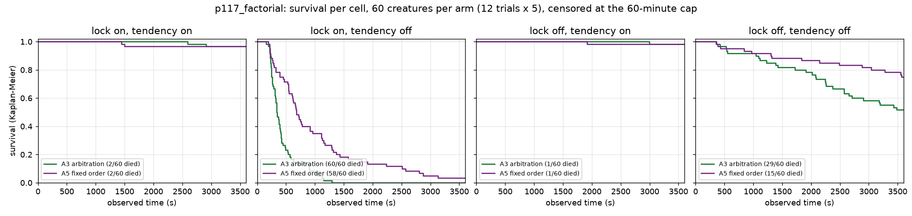

# Report: arbitration vs fixed order, crossed with the sleep lock and the action tendency lists (p117_factorial)

Experiment `p117_factorial`, run 2026-11-12/13 on CCAD, image `ghcr.io/felipedreis/dl2l:sha-a2611e8` (branch `feature/a3-episodic`). Pre-registration:
[`docs/experiments/p117_factorial_recipe.md`](../experiments/p117_factorial_recipe.md). Data: `ml/data_p117_factorial`, HF `felipedreis/dl2l-experiments/p117_factorial/`.
Readings: `analysis/diagnostics/p117_factorial_readings.py`. The analysis module's full tables (per-arm measures, all paired differences, decision telemetry,
calibration per trial) are in [`p117_factorial_module_tables.md`](p117_factorial_module_tables.md).

## Purpose

The previous run, `p117_plants` (3 trials), put the fixed order above arbitration in a world with plants, with the sleep lock and the innate action tendency lists both off: A5 lost
7 of 15 creatures, A3 13 of 15. That is the opposite of the uncertainty-arbitration paper's main contrast, and it came from a run that changed the world and two hand-built priors at once.
This experiment asks, at a sample size sized for it: does arbitration (A3) lose to the fixed order (A5), and in which settings of the two priors; and what does each prior do to each controller.

## Assumptions

- **Arms.** Eight: controller {A3 arbitration, A5 fixed order} x sleep lock {on, off} x action tendency {on, off}. Everything else as the ladder's A3 / A5 (CAMPOS lists when the tendency is on,
  focus thresholds 0.4 / 0.15, theta 0.8, epsilon 0.03, tau 1, episodic key lambda 0.5, prior sigma 0.1, budget e >= 0.3, novelty 0.1 / sqrt(1 + n_eff)). A unit test pins that the configs differ only in these flags.
- **World.** The pilot world (1923 x 1610; 100 red, 100 green, 300 gray apples, instant respawn) plus 140 cactus and 140 aloe, 5 creatures per trial, **60-minute cap** (not the 120 of earlier runs: absolute times are not comparable with them).
- **Sample.** 12 trials per arm (seeds 10900-10911, the same in every arm, so arms are paired by initial world), 96 trials, 480 creatures. Sized from `p117_plants` on observed time: 12 trials give 80% power on the
  conservative (upper-bound) SD. d(H) was not powered (21-84 trials needed) and is secondary.
- **Unit and tests.** The trial is the unit of replication. Each contrast is reported two ways: (a) per-seed paired differences of trial means (12 pairs; paired t, two-sided; sign count), the check; (b) Kaplan-Meier with a
  log-rank test on creatures pooled within an arm, as pre-registered. (b) treats the 5 creatures of a trial as independent, which they are not (they share a world and a food supply), so its p-values are optimistic; where (a) and (b) disagree, (a) governs.
- **Infrastructure.** Three trials (a5 lock-on/tendency-off trials 2 and 12, a5 lock-off/tendency-on trial 7) failed at start-up from a pre-existing race (the holder resolves the collision detector before it exists, `ActorNotFound`, no retry) and were re-run with the same seed and script.
  The failed attempts are kept on disk (`*_failed_*`), produced no data, and are not in the analysis. All 96 trials then completed with every core table present.

## Hypothesis

Pre-registered (recipe section 4): (1) with both priors off, A5 survives longer than A3 (replicating `p117_plants`); (2) with the tendency on, both controllers reach the ceiling at 60 minutes, so the controller contrast is not readable there;
(3) the sleep lock matters little next to the tendency; (4) open: whether arbitration loses only where the tendency is off.

Readability rule (F0): a cell is ceiling-limited if at least 11 of its 12 trials end with every creature alive at the cap, floor-limited if every creature dies within 600 s.

## Results

### Per cell

| Cell | Deaths | Mean observed time | Trials with all alive at cap | d(H) over life | EATs / min | Episodic decides | Gate overrides | F0 |
|---|---|---|---|---|---|---|---|---|
| A3, lock on, tendency on | 2/60 | 3570 s | 10 | 1.06 | 25.5 | 26.6% | 2.3% | readable (near ceiling) |
| A5, lock on, tendency on | 2/60 | 3525 s | 11 | 1.01 | 25.6 | 31.7% | 2.4% | ceiling |
| A3, lock on, tendency off | 60/60 | 438 s | 0 | 5.11 | 9.8 | 60.6% | **42.3%** | readable |
| A5, lock on, tendency off | 58/60 | 1017 s | 0 | 3.82 | 12.6 | 86.3% | **42.7%** | readable |
| A3, lock off, tendency on | 1/60 | 3586 s | 11 | 1.03 | 26.2 | 26.6% | 0 | ceiling |
| A5, lock off, tendency on | 1/60 | 3568 s | 11 | 0.99 | 26.4 | 32.0% | 0 | ceiling |
| A3, lock off, tendency off | 29/60 | 2780 s | 2 | 1.97 | 18.8 | 61.9% | 0 | readable |
| A5, lock off, tendency off | 15/60 | 3169 s | 5 | 1.49 | 19.3 | 62.2% | 0 | readable |

"Gate overrides": share of decisions where the executed action is not the chosen one, which with the sleep lock on is the lock holding a sleeping creature in SLEEP.

### F1: arbitration (A3) minus fixed order (A5), per cell

| Cell | Observed time, trial means (seeds +/-) | Paired t | Deaths (creatures) | Log-rank | d(H) over life |
|---|---|---|---|---|---|
| lock on, tendency on | +44 s (9 / 3) | p = 0.57 | 2 vs 2 | p = 0.99 | +0.05 (p = 0.39) |
| **lock on, tendency off** | **-579 s (0 / 12)** | **p = 0.0002** | 60 vs 58 | p = 3e-8 | **+1.29 (p = 0.004)** |
| lock off, tendency on | +18 s (6 / 6) | p = 0.56 | 1 vs 1 | p = 0.995 | +0.05 (p = 0.50) |
| **lock off, tendency off** | -390 s (4 / 8) | p = 0.22 | **29 vs 15** | **p = 0.0085** | +0.48 (p = 0.07) |

### F2: removing a prior, per controller (cell minus both priors on)

| Controller, change | Observed time (seeds +/-) | Paired t | Deaths | Log-rank |
|---|---|---|---|---|
| A3, lock removed | +16 s (2 / 10) | p = 0.49 | 1 vs 2 | p = 0.55 |
| A3, tendency removed | -3132 s (0 / 12) | p = 1e-15 | 60 vs 2 | p = 1e-33 |
| A3, both removed | -790 s (0 / 12) | p = 0.002 | 29 vs 2 | p = 1e-8 |
| A5, lock removed | +42 s (4 / 8) | p = 0.60 | 1 vs 2 | p = 0.55 |
| A5, tendency removed | -2508 s (0 / 12) | p = 7e-10 | 58 vs 2 | p = 1e-29 |
| A5, both removed | -356 s (3 / 9) | p = 0.09 | 15 vs 2 | p = 0.0007 |

### Budget and calibration

- **Budget.** With the tendency on, efficiency averages 0.27-0.28 and the episodic controller is affordable in about a third of decisions and decides 27-32%. With the tendency off, efficiency is 0.41-0.61 (the creatures are hungrier and in pain more often) and it decides 61-86%.
- **Operant calibration** (recipe 5, per trial; adoption range [0.8, 1.25]): inside the range in both tendency-on/lock-on cells (A3 mean 0.99, 9 of 12 trials in range; A5 1.00, 11 of 12); above it with the lock off and the tendency on (1.26-1.29); low and scattered with the tendency off and the lock on (0.66-0.90, about 5 of 12), where the creatures die before the cells accumulate updates.
- **Episodic calibration** (per closed episode): mean z between -0.03 and +0.07 in every cell, variance 0.30-0.76: the episodic error bars are honest on average and conservative (too wide), as in the earlier runs.

Further figures from the analysis module: [d(H)](figures/p117_factorial/deficit.png), [survival per arm](figures/p117_factorial/survival.png), [feeding and focus](figures/p117_factorial/feeding_and_focus.png).

## Analysis

**Arbitration never beats the fixed order.** In no cell is A3 better than A5 on any primary or secondary measure. Where the controllers matter, the fixed order is better:

- **Lock on, tendency off:** A5 outlives A3 in all 12 seeds (mean +579 s, paired p = 0.0002), with lower d(H). Both arms die almost entirely, so this is a difference in how long the creatures last, not in whether they survive.
- **Lock off, tendency off** (the setting of `p117_plants`): A5 loses half as many creatures (15 vs 29 of 60; log-rank p = 0.0085). The trial-level check points the same way but is not significant (8 of 12 seeds, p = 0.22), because the spread between seeds is large (SD 1045 s). Hypothesis 1 therefore replicates on the pre-registered creature-level test but not on the trial-level check. Read as a consistent direction with a moderate effect, not as a settled result.
- **Tendency on:** both controllers are at the ceiling (1-2 deaths out of 60). Hypothesis 2 holds, so these cells cannot test the controllers.

Hypothesis 4 is answered in its first half: arbitration loses only where the tendency is off. That is also the only place in this world where the choice of controller can show at all, so the data cannot say whether arbitration would also lose in a world where the tendency is on but survival is not at the ceiling.

**The innate tendency lists carry survival in this world.** Removing them with the lock on kills almost every creature (60 and 58 of 60), at a mean of 7 minutes (A3) and 17 minutes (A5). Neither the operant table nor episodic memory replaces the hand-written "eat when hungry" rule within an hour.

**Hypothesis 3 is half wrong: the sleep lock is harmless with the tendency on and very harmful without it.** With the tendency on, removing the lock changes nothing (p = 0.5-0.6). With the tendency off, the lock overrides 42% of all decisions. SLEEP is then a candidate everywhere, every chosen SLEEP holds the creature for 10 cycles, and the creatures starve. Removing the lock in that setting cuts deaths from 60 to 29 (A3) and from 58 to 15 (A5). This matches the earlier tendency experiment (`p107_tendency`), where SLEEP plus the 10-cycle lock made every arm worse. So the cost attributed in `p117_plants` to "both priors off" is mostly the tendency. The lock matters only in combination: its harm needs a selector that picks SLEEP freely.

**What could explain A5 > A3 (not tested here).** In the lock-on, tendency-off cell, the episodic controller decides 86% of decisions under the fixed order against 61% under arbitration. Arbitration hands the rest to the operant table whenever the table is the more decisive controller (when and why it is, is not measured here). Fewer episodic decisions there go with shorter lives. In the lock-off, tendency-off cell, however, the shares are equal (62% vs 62%) and A5 still loses fewer creatures. So it is not only how often the episodic controller decides but which decisions each rule gives it. A per-decision analysis (which controller decides at contact vs at a distance, and with what outcome) is the next step; this run's `arbitration_decisions` tables (about 39 million rows) contain what it needs.

**Consequences for the ladder and the paper.**

1. In this world the paper's main contrast (A3 better than A5) is not supported, and it is reversed wherever it can be read. This should be reported as a finding, with the mechanism question above.
2. The campaign as pre-registered (pilot world, tendency and lock on) cannot test A3 vs A5: both arms would sit near the ceiling. A world where the tendency is on but survival is not saturated, or the tendency-off/lock-off setting at the campaign's sample size, is needed before #117.
3. The sleep lock should be off in any arm where SLEEP can be chosen freely. With the tendency on it is harmless; without it, it is the main cause of death.
4. The start-up race (`ActorNotFound` on the collision detector, 3 of 96 trials) needs a retry in the holder before a 16-trial-per-arm campaign.

**Limitations.** One world, one cap (60 minutes), 12 trials per arm. Creature-level log-rank p-values are optimistic (creatures within a trial are not independent). d(H) is not powered. The three re-run trials share their seed with the failed attempts but ran on another node and later in the window.
