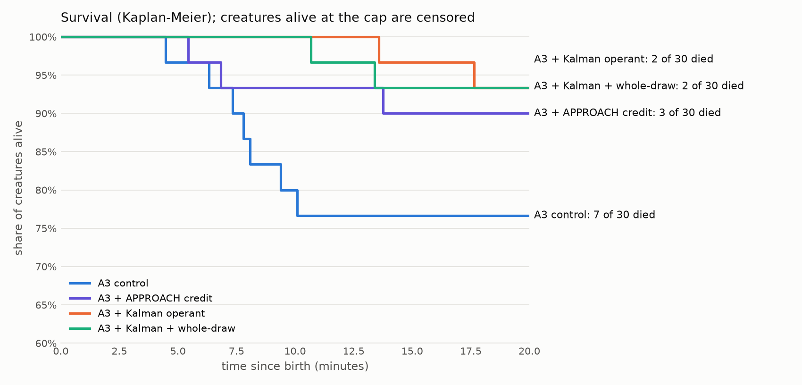
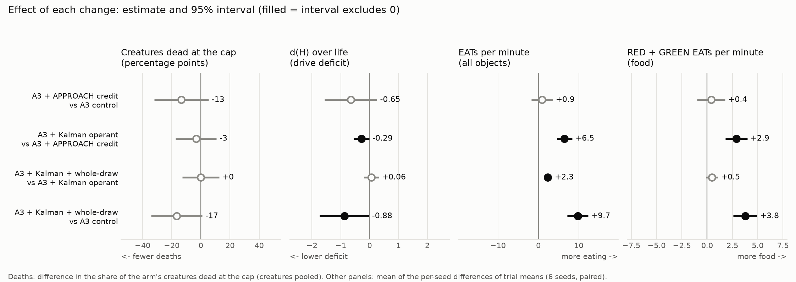
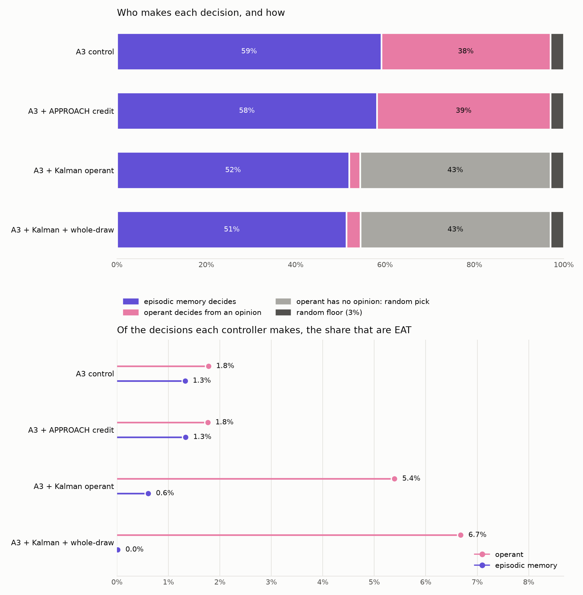
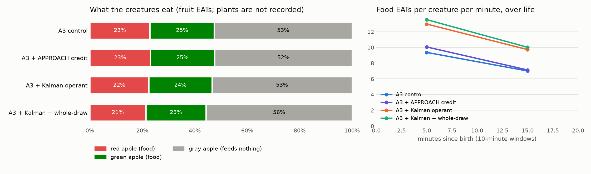
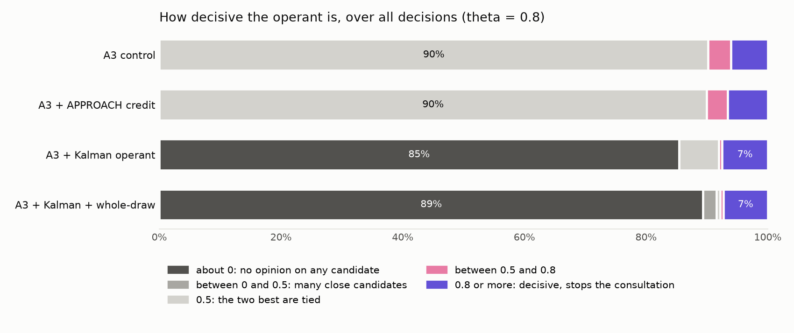
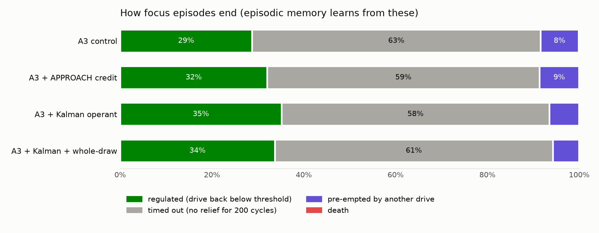
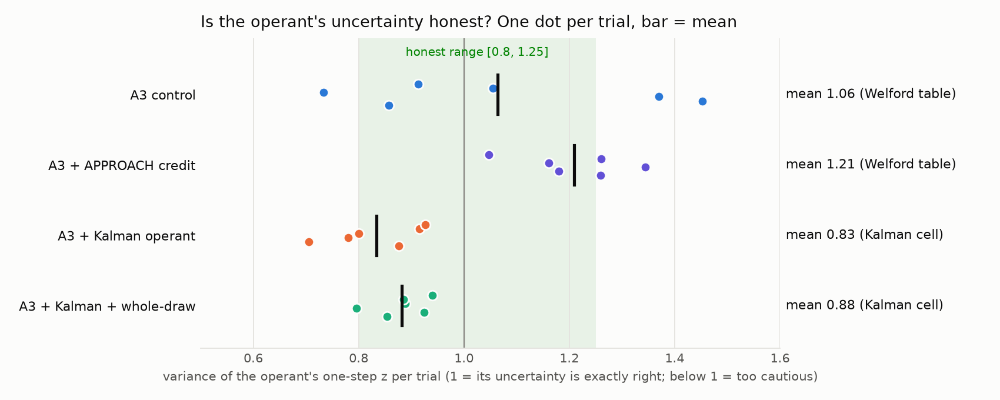

# Report: local pilot of the Kalman operant cell, the whole-draw stop rule and the APPROACH credit in A3

Laptop pilot `p117_kalman_local`, 2026-11-25. Recipe: [`docs/experiments/p117_kalman_recipe.md`](../experiments/p117_kalman_recipe.md) (sections 7 and 8). The powered test is the cluster campaign: [`p117_kalman_report.md`](p117_kalman_report.md).

**In short.** Adding the three changes one at a time, the Kalman operant cell is the step that moves the creature: it eats about 6.5 more times per minute, in all 6 seeds. The APPROACH credit alone changes little, and the whole-draw stop rule shows no effect in 20 minutes. Deaths fall from 7 of 30 to 2 of 30, but at n = 6 and a 20-minute cap that is a direction, not a result. The cluster run later showed the whole-draw rule to be harmful over a full hour, which this pilot was too short to see.

## Purpose

To run the campaign's arms before cluster time was available, and to debug the new switches, the new data columns and the analysis end to end. The question is the campaign's: does each change move A3 in the plants world, and which one matters?

## The experiment at a glance

| arm | what changes against the arm above |
|---|---|
| A3 control | nothing (today's code) |
| A3 + APPROACH credit | a timed-out episode keeps the credit of its approaches (`timeoutZeroesApproach = false`) |
| A3 + Kalman operant | the operant table becomes a Kalman cell (`operantEstimator = KALMAN`) |
| A3 + Kalman + whole-draw | the whole-draw stop rule (`arbiterStopRule = WHOLE_DRAW`) |

Plants world with the sleep lock and the action tendency off, as in the campaign. **6 trials per arm, 5 creatures per trial (30 per arm), a 20-minute cap, seeds 10900-10905**, trials run one after the other on a laptop (image from commit `8ce28ec`, UI on). No A5 arm.

## Assumptions

- The trial is the unit; the seed pairs the initial world only. Death counts pool the 30 creatures of an arm.
- Survival is censored at 20 minutes, a third of the campaign's window; the campaign's numbers are not comparable.
- **n = 6 per arm: every reading is directional.** A p-value near 0.05 is not a pass.
- The Kalman constants were chosen on a replay of `p117_factorial` data and frozen before the run. Fruit EATs only are recorded (no cactus or aloe).

## Hypothesis

From the recipe, read on the 20-minute window: (1) the APPROACH credit is no worse than the control; (2) the Kalman cell has fewer deaths than the arm before it; (3) all three changes have fewer deaths than the control; (4) falsification: all three no better than the control.

## Results

### Survival

Seven control creatures die within 20 minutes, against 3, 2 and 2 in the other arms. All 14 deaths are starvation.

### Effect of each change

Each row adds one change (the last row compares all three with the control). A filled dot means the 95% interval excludes zero.

- **The Kalman cell is the change that moves feeding**: +6.5 EATs per minute and +2.9 food EATs over the arm before it, with a lower drive deficit (-0.29). All three intervals exclude zero.
- **The APPROACH credit alone** changes feeding by +0.9 EATs per minute and deaths by -13 points, neither established.
- **The whole-draw rule** adds 2.3 EATs per minute, +0.5 food EATs (not established) and no change in deaths.
- **All three against the control:** +9.7 EATs per minute, +3.8 food, d(H) -0.88 (all clear of zero); deaths -17 points, interval touching zero.

### What changes inside the arbiter

The APPROACH credit changes nothing here: the two arms without the Kalman cell look identical. With the Kalman cell, episodic memory's share falls from about 60% to 53%. About 43% of all decisions become the operant's random picks among candidates it has no opinion on. The share of the operant's decisions that are EAT triples (1.8% to 5.4%), while episodic memory nearly stops eating (0.6%, and 0.0% with the whole-draw rule). This matches the campaign.

### What they eat

The Kalman arms eat more food throughout the 20 minutes, but not more selectively: gray apples are 53-56% of the fruit eaten, against 52-53% without the Kalman cell.

### How decisive the operant is

As in the campaign, the operant reaches the stopping threshold in only 6-8% of decisions in every arm. Without the Kalman cell the rest is mostly ties between untried cells (90%). With it, the rest is mostly "no opinion on any candidate" (85-89%).

### How focus episodes end, and calibration

Most focus episodes time out (58-63%), so the APPROACH credit fix reaches most of what episodic memory learns from; that it still changes little suggests the lost credit was not what limited A3. The Kalman cell's uncertainty is honest on average and slightly cautious (0.83 and 0.88); the Welford table sits between 1.06 and 1.21.

## Analysis

The pilot did its job. Every switch, column and figure works end to end on real runs, and it pointed at the right change: the Kalman cell is what makes the creature eat more food, through an operant that eats where the old table wandered. Its readings on survival were directional (7 deaths against 2), and the cluster campaign confirmed them only in direction (20 against 13 of 60).

What the pilot got wrong is the whole-draw stop rule. It showed no difference over 20 minutes, while the campaign found it harmful over an hour (28 against 13 deaths of 60). Deaths are spread over the whole hour, half of them after minute 30, so a 20-minute window sees only the first third of them. The lesson for the next pilot is that a survival effect needs the full window, even when feeding effects show up early.

Hypotheses on this window: (1) held; (2) not shown (2 against 3 deaths), although its feeding effect is clear; (3) held in direction (2 against 7); (4) did not occur.

## Where the numbers come from

- Data: HF `felipedreis/dl2l-experiments`, prefix `p117_kalman_local/`; locally `ml/data_p117_kalman_local/`.
- Figures: `analysis/diagnostics/p117_kalman_aggregates.py p117_kalman_local` and `analysis/diagnostics/p117_kalman_figures.py p117_kalman_local`; per-creature measures in `figures/p117_kalman_local/creature_metrics.csv`.
