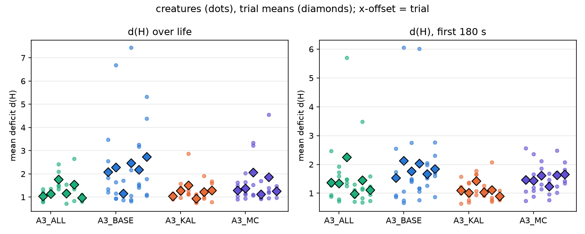
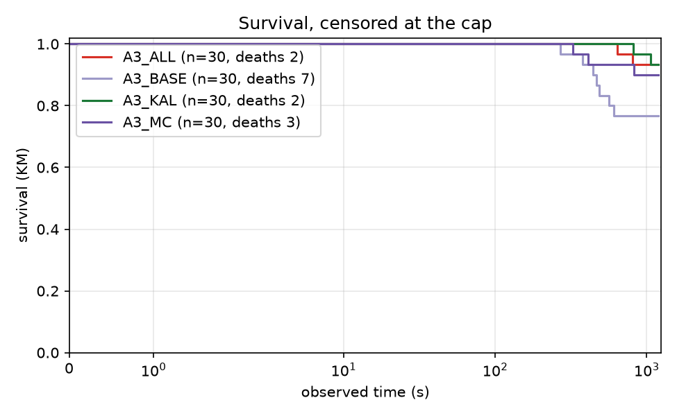
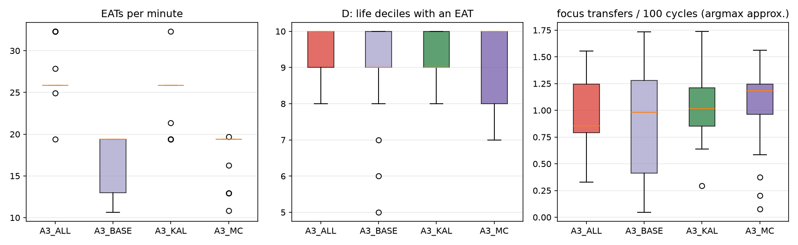

# Report: local pilot of the Kalman operant cell, the whole-draw stop rule and the APPROACH credit in A3 (p117_kalman_local, 20 minutes)

## Purpose

A pilot of the `p117_kalman` campaign, run on the laptop because the cluster was not reachable: do the three changes of `docs/plans/operant-kalman-and-stop-rule.md` (APPROACH credit that survives a timeout, Kalman operant cell, whole-draw stop rule) move A3 in the plants world, added one at a time? It also served to debug the switches, the new columns and the analysis module before the cluster run. Recipe: `docs/experiments/p117_kalman_recipe.md` (sections 1-4 and 8). The powered test is the cluster run, reported in `p117_kalman_report.md`.

## Assumptions

- Four arms in the plants world with the sleep lock and the action tendency off: `a3_base`, `a3_mc` (+ APPROACH credit), `a3_kal` (+ Kalman operant), `a3_all` (+ whole-draw stop rule). **6 trials per arm, seeds 10900-10905, 5 creatures per trial, cap 20 minutes** (not 60), trials run one after the other on a laptop, image built from commit `8ce28ec`, UI on.
- The trial is the unit; the seed pairs the initial world only. Survival is censored at 1200 s, so the numbers of `p117_factorial` (60 minutes) are not comparable. With n = 6 the readings are directional; a log-rank p near 0.05 is not a pass.
- Kalman constants (tau2 = 1e-4, pooled-variance floor 0.16) were chosen on a replay of `p117_factorial` data and frozen before the run.
- Data caveat as in `p117_kalman_report.md` (fruit interactions only; survivors' EAT counts are lower bounds).

## Hypothesis

Recipe sections 3 and 4, with the 20-minute window of section 8: (1) `a3_mc` no worse than the control; (2) `a3_kal` fewer deaths than `a3_mc`; (3) `a3_all` fewer deaths than the control; (4) falsification: `a3_all` no better than the control. The cluster campaign, not this pilot, decides the stop rule.

## Results

**Headline.** Deaths at 20 minutes (of 30 creatures per arm): control 7, + APPROACH credit 3, + Kalman operant 2, + whole-draw rule 2. EATs per minute 17.2, 18.2, 24.6, 27.0; d(H) over life 2.15, 1.50, 1.21, 1.27. All three changes against the control: 2 against 7 deaths (log-rank p = 0.060, Fisher p = 0.145); survival and d(H) better in 5 of 6 seeds, feeding in 6 of 6.

### Per-arm measures (creature mean, then trial means)

| measure | A3 + all three (+ whole-draw stop rule) | A3 (control) | A3 + APPROACH credit + Kalman operant | A3 + APPROACH credit |
|---|---|---|---|---|
| d(H) over life | 1.271 (trials 1.043, 1.147, 1.765, 1.158, 1.541, 0.974) | 2.149 (trials 2.078, 2.276, 1.164, 2.472, 2.177, 2.729) | 1.210 (trials 1.034, 1.268, 1.516, 0.933, 1.217, 1.290) | 1.495 (trials 1.285, 1.376, 2.056, 1.127, 1.867, 1.259) |
| d(H), first 180 s | 1.421 (trials 1.373, 1.351, 2.253, 0.983, 1.455, 1.109) | 1.830 (trials 1.528, 2.133, 1.769, 2.034, 1.674, 1.844) | 1.099 (trials 1.107, 1.016, 1.423, 1.036, 1.116, 0.896) | 1.507 (trials 1.461, 1.435, 1.621, 1.242, 1.625, 1.660) |
| EATs per minute | 26.970 (trials 28.446, 25.859, 26.255, 27.151, 26.961, 27.151) | 17.235 (trials 15.100, 18.103, 19.394, 18.158, 14.939, 17.716) | 24.630 (trials 25.858, 23.273, 23.663, 25.860, 23.272, 25.855) | 18.152 (trials 18.100, 18.101, 17.116, 19.395, 19.394, 16.807) |
| RED+GREEN EATs per minute | 11.951 (trials 12.516, 11.566, 11.335, 12.161, 12.149, 11.980) | 8.188 (trials 7.697, 8.014, 9.404, 8.640, 7.096, 8.278) | 11.477 (trials 12.323, 10.505, 11.147, 11.768, 10.888, 12.227) | 8.586 (trials 8.575, 8.626, 7.446, 9.617, 9.050, 8.201) |
| D: life deciles with an EAT | 9.567 (trials 10.000, 9.400, 9.400, 9.600, 9.600, 9.400) | 9.000 (trials 7.800, 9.200, 9.200, 9.800, 8.200, 9.800) | 9.300 (trials 9.600, 9.200, 9.400, 9.200, 9.000, 9.400) | 9.133 (trials 8.600, 9.400, 8.600, 9.400, 9.800, 9.000) |
| observed time (s) | 1156.956 (trials 1187.943, 1187.981, 1078.423, 1188.018, 1111.357, 1188.011) | 1017.769 (trials 1043.900, 1004.165, 1187.966, 1063.022, 885.639, 921.924) | 1171.269 (trials 1188.040, 1188.000, 1113.428, 1187.928, 1188.051, 1162.168) | 1121.276 (trials 1188.078, 1187.990, 787.545, 1187.954, 1188.008, 1188.082) |
| died (share) | 0.067 (trials 0.000, 0.000, 0.200, 0.000, 0.200, 0.000) | 0.233 (trials 0.200, 0.200, 0.000, 0.200, 0.400, 0.400) | 0.067 (trials 0.000, 0.000, 0.200, 0.000, 0.000, 0.200) | 0.100 (trials 0.000, 0.000, 0.600, 0.000, 0.000, 0.000) |
| focus transfers per 100 cycles (argmax approx.) | 0.956 (trials 1.179, 0.943, 0.623, 1.008, 0.879, 1.103) | 0.887 (trials 0.783, 0.939, 1.230, 1.055, 0.544, 0.769) | 1.020 (trials 1.128, 0.898, 0.766, 1.281, 1.026, 1.018) | 1.081 (trials 1.142, 1.135, 0.798, 1.292, 0.939, 1.179) |
| focus opens per 100 cycles (argmax approx.) | 0.002 (trials 0.001, 0.002, 0.002, 0.002, 0.002, 0.001) | 0.001 (trials 0.001, 0.001, 0.001, 0.002, 0.001, 0.002) | 0.002 (trials 0.002, 0.001, 0.002, 0.001, 0.002, 0.001) | 0.002 (trials 0.002, 0.002, 0.002, 0.003, 0.001, 0.002) |
| focus transfers per 100 cycles (tracker) | 0.063 (trials 0.065, 0.054, 0.042, 0.070, 0.060, 0.088) | 0.086 (trials 0.084, 0.076, 0.111, 0.085, 0.063, 0.100) | 0.075 (trials 0.071, 0.083, 0.075, 0.072, 0.066, 0.082) | 0.100 (trials 0.084, 0.111, 0.106, 0.094, 0.086, 0.116) |
| focus opens per 100 cycles (tracker) | 0.508 (trials 0.502, 0.510, 0.509, 0.513, 0.503, 0.512) | 0.490 (trials 0.488, 0.495, 0.491, 0.497, 0.486, 0.486) | 0.507 (trials 0.505, 0.497, 0.502, 0.512, 0.518, 0.510) | 0.496 (trials 0.498, 0.500, 0.490, 0.497, 0.493, 0.498) |
| focused share of cycles (tracker) | 0.888 (trials 0.869, 0.880, 0.913, 0.894, 0.894, 0.876) | 0.941 (trials 0.945, 0.942, 0.916, 0.940, 0.942, 0.958) | 0.883 (trials 0.869, 0.901, 0.887, 0.880, 0.884, 0.878) | 0.920 (trials 0.921, 0.915, 0.943, 0.905, 0.927, 0.910) |
| episodes per creature | 197.900 (trials 202.000, 200.800, 178.600, 207.000, 188.000, 211.000) | 177.700 (trials 180.600, 175.000, 212.600, 186.400, 147.600, 164.000) | 202.933 (trials 204.400, 204.600, 191.400, 206.600, 206.800, 203.800) | 199.600 (trials 207.400, 216.000, 142.800, 209.600, 204.800, 217.000) |
| food share of EATs, first 20% of life (A3 criterion) | 0.445 (trials 0.449, 0.475, 0.438, 0.431, 0.452, 0.424) | 0.476 (trials 0.513, 0.444, 0.469, 0.478, 0.538, 0.412) | 0.468 (trials 0.489, 0.445, 0.464, 0.461, 0.453, 0.495) | 0.447 (trials 0.473, 0.465, 0.375, 0.458, 0.453, 0.458) |
### Drive deficit

Per creature (dots) and per trial (diamonds).
### Survival

- A3_MC vs A3_BASE: deaths 3/30 vs 7/30 (Fisher p = 0.299); KM median beyond the cap vs beyond the cap; log-rank p = 0.1713
- A3_KAL vs A3_MC: deaths 2/30 vs 3/30 (Fisher p = 1); KM median beyond the cap vs beyond the cap; log-rank p = 0.6212
- A3_ALL vs A3_KAL: deaths 2/30 vs 2/30 (Fisher p = 1); KM median beyond the cap vs beyond the cap; log-rank p = 0.9725
- A3_ALL vs A3_BASE: deaths 2/30 vs 7/30 (Fisher p = 0.145); KM median beyond the cap vs beyond the cap; log-rank p = 0.0599
### Feeding and focus

EATs per minute, life deciles with an EAT, and the argmax-approximated focus transfers per 100 cycles.
### Episodes (close types per arm)

Close-type mix per arm:

| condition | DEATH | PREEMPTED | REGULATED | TIMED_OUT |
|---|---|---|---|---|
| a3_all | 0.000 | 0.057 | 0.337 | 0.606 |
| a3_base | 0.001 | 0.083 | 0.287 | 0.628 |
| a3_kal | 0.000 | 0.065 | 0.352 | 0.583 |
| a3_mc | 0.000 | 0.086 | 0.320 | 0.593 |

Steps per episode:

| condition | count | 50% | mean | max |
|---|---|---|---|---|
| a3_all | 5937.000 | 201.000 | 156.100 | 201.000 |
| a3_base | 5331.000 | 201.000 | 160.700 | 201.000 |
| a3_kal | 6088.000 | 201.000 | 153.400 | 201.000 |
| a3_mc | 5988.000 | 201.000 | 155.100 | 201.000 |
### Decision telemetry (operant and episodic controllers)

**A3_BASE** (919,572 decisions). Source mix: {'SINGLE': 0.0, 'GREEDY': 0.4552, 'THOMPSON': 0.5149, 'EPSILON': 0.03, 'ABSTAIN_UNIFORM': 0.0}. Executed action not the chosen one: 0.00%. Informed share (late half, focused multi-candidate): 0.834. Deciding controller by life decile: {0: {'EPISODIC': 0.649, 'OPERANT': 0.351}, 1: {'EPISODIC': 0.669, 'OPERANT': 0.331}, 2: {'EPISODIC': 0.595, 'OPERANT': 0.405}, 3: {'EPISODIC': 0.557, 'OPERANT': 0.443}, 4: {'EPISODIC': 0.596, 'OPERANT': 0.404}, 5: {'EPISODIC': 0.588, 'OPERANT': 0.412}, 6: {'EPISODIC': 0.572, 'OPERANT': 0.428}, 7: {'EPISODIC': 0.63, 'OPERANT': 0.37}, 8: {'EPISODIC': 0.648, 'OPERANT': 0.352}, 9: {'EPISODIC': 0.594, 'OPERANT': 0.406}}.

Descriptive z by close type:

| close_type | n | mean | variance | rms |
|---|---|---|---|---|
| DEATH | 668.000 | -1.597 | 72.011 | 8.629 |
| PREEMPTED | 43555.000 | 0.015 | 0.401 | 0.633 |
| REGULATED | 137073.000 | 0.082 | 0.347 | 0.595 |
| TIMED_OUT | 675090.000 | -0.002 | 0.162 | 0.403 |

Episodic calibration (decisions the episodic controller made, per closed episode): n = 556,627, mean z 0.036, variance 0.280 (an honest SE gives 0 and 1). Episodic share of decisions by life decile: [0.6489, 0.669, 0.5952, 0.5568, 0.5963, 0.5878, 0.5724, 0.6296, 0.6478, 0.5935]. Consulted the episodic controller in 0.644 of decisions, affordable in 0.693; mean novelty bonus 0.0189.

| close_type | n | mean | variance |
|---|---|---|---|
| DEATH | 87.000 | -10.108 | 468.800 |
| PREEMPTED | 30455.000 | 0.043 | 0.467 |
| REGULATED | 59153.000 | 0.222 | 0.403 |
| TIMED_OUT | 466932.000 | 0.014 | 0.142 |

**A3_MC** (1,013,667 decisions). Source mix: {'SINGLE': 0.0, 'GREEDY': 0.4617, 'THOMPSON': 0.5084, 'EPSILON': 0.0298, 'ABSTAIN_UNIFORM': 0.0}. Executed action not the chosen one: 0.00%. Informed share (late half, focused multi-candidate): 0.820. Deciding controller by life decile: {0: {'EPISODIC': 0.653, 'OPERANT': 0.347}, 1: {'EPISODIC': 0.659, 'OPERANT': 0.341}, 2: {'EPISODIC': 0.646, 'OPERANT': 0.354}, 3: {'EPISODIC': 0.583, 'OPERANT': 0.417}, 4: {'EPISODIC': 0.503, 'OPERANT': 0.497}, 5: {'EPISODIC': 0.589, 'OPERANT': 0.411}, 6: {'EPISODIC': 0.615, 'OPERANT': 0.385}, 7: {'EPISODIC': 0.524, 'OPERANT': 0.476}, 8: {'EPISODIC': 0.603, 'OPERANT': 0.397}, 9: {'EPISODIC': 0.621, 'OPERANT': 0.379}}.

Descriptive z by close type:

| close_type | n | mean | variance | rms |
|---|---|---|---|---|
| DEATH | 205.000 | -4.908 | 165.816 | 13.751 |
| PREEMPTED | 48049.000 | 0.025 | 0.376 | 0.614 |
| REGULATED | 164802.000 | 0.081 | 0.354 | 0.600 |
| TIMED_OUT | 715202.000 | -0.002 | 0.196 | 0.443 |

Episodic calibration (decisions the episodic controller made, per closed episode): n = 603,123, mean z 0.043, variance 0.274 (an honest SE gives 0 and 1). Episodic share of decisions by life decile: [0.653, 0.6593, 0.6458, 0.5829, 0.5026, 0.5887, 0.615, 0.5238, 0.6026, 0.6206]. Consulted the episodic controller in 0.629 of decisions, affordable in 0.682; mean novelty bonus 0.0185.

| close_type | n | mean | variance |
|---|---|---|---|
| DEATH | 102.000 | -9.408 | 293.304 |
| PREEMPTED | 31837.000 | 0.066 | 0.425 |
| REGULATED | 67995.000 | 0.232 | 0.419 |
| TIMED_OUT | 503189.000 | 0.018 | 0.163 |

**A3_KAL** (1,059,242 decisions). Source mix: {'SINGLE': 0.0, 'GREEDY': 0.1817, 'THOMPSON': 0.3625, 'EPSILON': 0.0299, 'ABSTAIN_UNIFORM': 0.4259}. Executed action not the chosen one: 0.00%. Informed share (late half, focused multi-candidate): 0.676. Deciding controller by life decile: {0: {'EPISODIC': 0.65, 'OPERANT': 0.35}, 1: {'EPISODIC': 0.565, 'OPERANT': 0.435}, 2: {'EPISODIC': 0.543, 'OPERANT': 0.457}, 3: {'EPISODIC': 0.517, 'OPERANT': 0.483}, 4: {'EPISODIC': 0.538, 'OPERANT': 0.462}, 5: {'OPERANT': 0.528, 'EPISODIC': 0.472}, 6: {'OPERANT': 0.513, 'EPISODIC': 0.487}, 7: {'OPERANT': 0.536, 'EPISODIC': 0.464}, 8: {'EPISODIC': 0.565, 'OPERANT': 0.435}, 9: {'EPISODIC': 0.553, 'OPERANT': 0.447}}.

Descriptive z by close type:

| close_type | n | mean | variance | rms |
|---|---|---|---|---|
| DEATH | 7.000 | -11.392 | 265.967 | 18.915 |
| PREEMPTED | 22671.000 | 0.129 | 0.595 | 0.782 |
| REGULATED | 82422.000 | 0.212 | 0.538 | 0.764 |
| TIMED_OUT | 482078.000 | 0.035 | 0.250 | 0.501 |

Episodic calibration (decisions the episodic controller made, per closed episode): n = 563,160, mean z 0.091, variance 0.214 (an honest SE gives 0 and 1). Episodic share of decisions by life decile: [0.6503, 0.5648, 0.5433, 0.5165, 0.5382, 0.4722, 0.4869, 0.464, 0.5646, 0.5531]. Consulted the episodic controller in 0.539 of decisions, affordable in 0.598; mean novelty bonus 0.0168.

| close_type | n | mean | variance |
|---|---|---|---|
| DEATH | 7.000 | -11.392 | 265.967 |
| PREEMPTED | 21615.000 | 0.145 | 0.480 |
| REGULATED | 75417.000 | 0.277 | 0.414 |
| TIMED_OUT | 466121.000 | 0.059 | 0.157 |

**A3_ALL** (1,046,346 decisions). Source mix: {'SINGLE': 0.0, 'GREEDY': 0.1913, 'THOMPSON': 0.3535, 'EPSILON': 0.0299, 'ABSTAIN_UNIFORM': 0.4252}. Executed action not the chosen one: 0.00%. Informed share (late half, focused multi-candidate): 0.689. Deciding controller by life decile: {0: {'EPISODIC': 0.647, 'OPERANT': 0.353}, 1: {'EPISODIC': 0.528, 'OPERANT': 0.472}, 2: {'EPISODIC': 0.571, 'OPERANT': 0.429}, 3: {'EPISODIC': 0.503, 'OPERANT': 0.497}, 4: {'OPERANT': 0.523, 'EPISODIC': 0.477}, 5: {'EPISODIC': 0.544, 'OPERANT': 0.456}, 6: {'EPISODIC': 0.506, 'OPERANT': 0.494}, 7: {'EPISODIC': 0.501, 'OPERANT': 0.499}, 8: {'EPISODIC': 0.521, 'OPERANT': 0.479}, 9: {'OPERANT': 0.501, 'EPISODIC': 0.499}}.

Descriptive z by close type:

| close_type | n | mean | variance | rms |
|---|---|---|---|---|
| DEATH | 97.000 | -5.771 | 193.135 | 14.982 |
| PREEMPTED | 21499.000 | 0.110 | 0.540 | 0.743 |
| REGULATED | 73707.000 | 0.214 | 0.576 | 0.788 |
| TIMED_OUT | 486245.000 | 0.037 | 0.253 | 0.505 |

Episodic calibration (decisions the episodic controller made, per closed episode): n = 550,953, mean z 0.089, variance 0.245 (an honest SE gives 0 and 1). Episodic share of decisions by life decile: [0.647, 0.5278, 0.5709, 0.5026, 0.4765, 0.5442, 0.5062, 0.5012, 0.5209, 0.4986]. Consulted the episodic controller in 0.551 of decisions, affordable in 0.609; mean novelty bonus 0.0166.

| close_type | n | mean | variance |
|---|---|---|---|
| DEATH | 97.000 | -5.771 | 193.135 |
| PREEMPTED | 20067.000 | 0.125 | 0.401 |
| REGULATED | 66365.000 | 0.275 | 0.434 |
| TIMED_OUT | 464424.000 | 0.062 | 0.158 |
### Operant calibration (recipe 5)

Per trial: variance of z per (object type, action) cell with enough updates and varying outcomes, weighted by update count; adoption range [0.8, 1.25] for A2 (mean over trials). `pooled_variance` is the unrestricted variance of all z, for comparison: constant cells drag it down.

|  | statistic | pooled_variance | n_updates | cells | constant_cells |
|---|---|---|---|---|---|
| ('a3_base', 1) | 0.858 | 0.429 | 2108.000 | 3.000 | 2.000 |
| ('a3_base', 2) | 1.452 | 0.680 | 2106.000 | 3.000 | 2.000 |
| ('a3_base', 3) | 1.370 | 0.680 | 2532.000 | 3.000 | 2.000 |
| ('a3_base', 4) | 0.734 | 0.368 | 2143.000 | 3.000 | 2.000 |
| ('a3_base', 5) | 1.055 | 0.483 | 1833.000 | 3.000 | 2.000 |
| ('a3_base', 6) | 0.913 | 0.438 | 1867.000 | 3.000 | 2.000 |
| ('a3_mc', 1) | 1.259 | 0.617 | 2496.000 | 3.000 | 2.000 |
| ('a3_mc', 2) | 1.180 | 0.567 | 2360.000 | 3.000 | 2.000 |
| ('a3_mc', 3) | 1.344 | 0.589 | 1783.000 | 3.000 | 2.000 |
| ('a3_mc', 4) | 1.161 | 0.600 | 2468.000 | 3.000 | 2.000 |
| ('a3_mc', 5) | 1.260 | 0.609 | 2494.000 | 3.000 | 2.000 |
| ('a3_mc', 6) | 1.048 | 0.520 | 2321.000 | 3.000 | 2.000 |
| ('a3_kal', 1) | 0.864 | 0.486 | 3330.000 | 4.000 | 1.000 |
| ('a3_kal', 2) | 0.691 | 0.376 | 3144.000 | 4.000 | 1.000 |
| ('a3_kal', 3) | 0.767 | 0.431 | 3006.000 | 4.000 | 1.000 |
| ('a3_kal', 4) | 0.787 | 0.431 | 3417.000 | 4.000 | 1.000 |
| ('a3_kal', 5) | 0.901 | 0.498 | 3257.000 | 4.000 | 1.000 |
| ('a3_kal', 6) | 0.912 | 0.512 | 3225.000 | 4.000 | 1.000 |
| ('a3_all', 1) | 0.843 | 0.441 | 3513.000 | 4.000 | 1.000 |
| ('a3_all', 2) | 0.914 | 0.493 | 3332.000 | 4.000 | 1.000 |
| ('a3_all', 3) | 0.783 | 0.414 | 3216.000 | 4.000 | 1.000 |
| ('a3_all', 4) | 0.878 | 0.468 | 3439.000 | 4.000 | 1.000 |
| ('a3_all', 5) | 0.871 | 0.463 | 3265.000 | 4.000 | 1.000 |
| ('a3_all', 6) | 0.930 | 0.489 | 3583.000 | 4.000 | 1.000 |

**A3_BASE** cells (>= 30 updates, outcomes vary):

|  | n | mean_z | variance | constant |
|---|---|---|---|---|
| ('ALOE', 'EAT') | 935 | 0.055 | 1.022 | False |
| ('GREEN_APPLE', 'EAT') | 2556 | 0.090 | 1.333 | False |
| ('RED_APPLE', 'EAT') | 2348 | 0.079 | 1.178 | False |

Constant-outcome cells, left out:

|  | n | mean_z | variance | constant |
|---|---|---|---|---|
| ('CACTUS', 'EAT') | 1376 | -0.220 | 0.007 | True |
| ('GRAY_APPLE', 'EAT') | 5374 | -0.136 | 0.005 | True |

**A3_MC** cells (>= 30 updates, outcomes vary):

|  | n | mean_z | variance | constant |
|---|---|---|---|---|
| ('ALOE', 'EAT') | 1014 | 0.028 | 1.171 | False |
| ('GREEN_APPLE', 'EAT') | 2865 | 0.076 | 1.334 | False |
| ('RED_APPLE', 'EAT') | 2689 | 0.066 | 1.547 | False |

Constant-outcome cells, left out:

|  | n | mean_z | variance | constant |
|---|---|---|---|---|
| ('CACTUS', 'EAT') | 1295 | -0.227 | 0.007 | True |
| ('GRAY_APPLE', 'EAT') | 6059 | -0.133 | 0.004 | True |

**A3_KAL** cells (>= 30 updates, outcomes vary):

|  | n | mean_z | variance | constant |
|---|---|---|---|---|
| ('ALOE', 'EAT') | 2772 | -0.005 | 0.617 | False |
| ('CACTUS', 'EAT') | 507 | -0.064 | 0.010 | False |
| ('GREEN_APPLE', 'EAT') | 3876 | 0.029 | 1.277 | False |
| ('RED_APPLE', 'EAT') | 3602 | 0.020 | 0.962 | False |

Constant-outcome cells, left out:

|  | n | mean_z | variance | constant |
|---|---|---|---|---|
| ('GRAY_APPLE', 'EAT') | 8622 | -0.000 | 0.000 | True |

**A3_ALL** cells (>= 30 updates, outcomes vary):

|  | n | mean_z | variance | constant |
|---|---|---|---|---|
| ('ALOE', 'EAT') | 2873 | -0.006 | 0.749 | False |
| ('CACTUS', 'EAT') | 272 | -0.111 | 0.014 | False |
| ('GREEN_APPLE', 'EAT') | 3961 | 0.042 | 1.361 | False |
| ('RED_APPLE', 'EAT') | 3678 | 0.002 | 1.032 | False |

Constant-outcome cells, left out:

|  | n | mean_z | variance | constant |
|---|---|---|---|---|
| ('GRAY_APPLE', 'EAT') | 9564 | 0.000 | 0.000 | True |
### Paired differences by seed

Differences of trial means, later arm minus earlier arm; SD has 2 degrees of freedom, so size on the 80% upper bound (2.12 x SD), not the point estimate.

| measure | contrast | per-seed differences | mean | SD (2 df) | 80% upper bound on SD |
|---|---|---|---|---|---|
| d(H) over life | A3_MC - A3_BASE | [-0.7926, -0.8998, 0.8925, -1.3454, -0.3098, -1.4692] | -0.654 | 0.864 | n/a |
| d(H) over life | A3_KAL - A3_MC | [-0.2511, -0.1081, -0.5403, -0.1935, -0.6496, 0.0312] | -0.285 | 0.260 | n/a |
| d(H) over life | A3_ALL - A3_KAL | [0.0086, -0.1213, 0.2486, 0.2247, 0.3232, -0.316] | 0.061 | 0.249 | n/a |
| d(H) over life | A3_ALL - A3_BASE | [-1.0351, -1.1293, 0.6008, -1.3143, -0.6362, -1.7541] | -0.878 | 0.811 | n/a |
| d(H), first 180 s | A3_MC - A3_BASE | [-0.0673, -0.6977, -0.1478, -0.7922, -0.0487, -0.1842] | -0.323 | 0.332 | n/a |
| d(H), first 180 s | A3_KAL - A3_MC | [-0.3539, -0.4184, -0.1984, -0.2062, -0.5093, -0.7646] | -0.408 | 0.212 | n/a |
| d(H), first 180 s | A3_ALL - A3_KAL | [0.2661, 0.3345, 0.8303, -0.0524, 0.3393, 0.2134] | 0.322 | 0.288 | n/a |
| d(H), first 180 s | A3_ALL - A3_BASE | [-0.1551, -0.7816, 0.4841, -1.0508, -0.2188, -0.7354] | -0.410 | 0.558 | n/a |
| EATs per minute | A3_MC - A3_BASE | [2.9996, -0.0018, -2.2783, 1.2368, 4.4545, -0.9095] | 0.917 | 2.504 | n/a |
| EATs per minute | A3_KAL - A3_MC | [7.7579, 5.1716, 6.5471, 6.4653, 3.878, 9.048] | 6.478 | 1.828 | n/a |
| EATs per minute | A3_ALL - A3_KAL | [2.588, 2.5864, 2.5913, 1.291, 3.689, 1.2962] | 2.340 | 0.916 | n/a |
| EATs per minute | A3_ALL - A3_BASE | [13.3455, 7.7562, 6.8601, 8.9931, 12.0215, 9.4348] | 9.735 | 2.493 | n/a |
| RED+GREEN EATs per minute | A3_MC - A3_BASE | [0.8787, 0.6119, -1.9579, 0.9764, 1.9542, -0.0768] | 0.398 | 1.327 | n/a |
| RED+GREEN EATs per minute | A3_KAL - A3_MC | [3.7476, 1.8787, 3.701, 2.1518, 1.838, 4.0258] | 2.890 | 1.035 | n/a |
| RED+GREEN EATs per minute | A3_ALL - A3_KAL | [0.1929, 1.0608, 0.1872, 0.393, 1.261, -0.2476] | 0.475 | 0.575 | n/a |
| RED+GREEN EATs per minute | A3_ALL - A3_BASE | [4.8192, 3.5515, 1.9303, 3.5213, 5.0532, 3.7013] | 3.763 | 1.118 | n/a |
| D: life deciles with an EAT | A3_MC - A3_BASE | [0.8, 0.2, -0.6, -0.4, 1.6, -0.8] | 0.133 | 0.927 | n/a |
| D: life deciles with an EAT | A3_KAL - A3_MC | [1.0, -0.2, 0.8, -0.2, -0.8, 0.4] | 0.167 | 0.686 | n/a |
| D: life deciles with an EAT | A3_ALL - A3_KAL | [0.4, 0.2, 0.0, 0.4, 0.6, 0.0] | 0.267 | 0.242 | n/a |
| D: life deciles with an EAT | A3_ALL - A3_BASE | [2.2, 0.2, 0.2, -0.2, 1.4, -0.4] | 0.567 | 1.015 | n/a |
| observed time (s) | A3_MC - A3_BASE | [144.1778, 183.8252, -400.4206, 124.9316, 302.3694, 266.1584] | 103.507 | 256.324 | n/a |
| observed time (s) | A3_KAL - A3_MC | [-0.0376, 0.01, 325.8828, -0.0262, 0.0422, -25.9146] | 49.993 | 135.555 | n/a |
| observed time (s) | A3_ALL - A3_KAL | [-0.0974, -0.0188, -35.005, 0.0902, -76.6932, 25.8436] | -14.313 | 36.182 | n/a |
| observed time (s) | A3_ALL - A3_BASE | [144.0428, 183.8164, -109.5428, 124.9956, 225.7184, 266.0874] | 139.186 | 132.420 | n/a |
| died (share) | A3_MC - A3_BASE | [-0.2, -0.2, 0.6, -0.2, -0.4, -0.4] | -0.133 | 0.372 | n/a |
| died (share) | A3_KAL - A3_MC | [0.0, 0.0, -0.4, 0.0, 0.0, 0.2] | -0.033 | 0.197 | n/a |
| died (share) | A3_ALL - A3_KAL | [0.0, 0.0, 0.0, 0.0, 0.2, -0.2] | 0.000 | 0.126 | n/a |
| died (share) | A3_ALL - A3_BASE | [-0.2, -0.2, 0.2, -0.2, -0.2, -0.4] | -0.167 | 0.197 | n/a |
| focus transfers per 100 cycles (argmax approx.) | A3_MC - A3_BASE | [0.359, 0.1965, -0.4327, 0.2368, 0.3946, 0.4099] | 0.194 | 0.319 | n/a |
| focus transfers per 100 cycles (argmax approx.) | A3_KAL - A3_MC | [-0.0145, -0.237, -0.0313, -0.0112, 0.0867, -0.161] | -0.061 | 0.117 | n/a |
| focus transfers per 100 cycles (argmax approx.) | A3_ALL - A3_KAL | [0.0512, 0.0442, -0.1431, -0.2731, -0.1465, 0.0848] | -0.064 | 0.144 | n/a |
| focus transfers per 100 cycles (argmax approx.) | A3_ALL - A3_BASE | [0.3957, 0.0037, -0.6071, -0.0475, 0.3348, 0.3336] | 0.069 | 0.380 | n/a |
| focus opens per 100 cycles (argmax approx.) | A3_MC - A3_BASE | [0.0006, 0.0004, 0.0007, 0.0004, 0.0004, -0.0001] | 0.000 | 0.000 | n/a |
| focus opens per 100 cycles (argmax approx.) | A3_KAL - A3_MC | [0.0005, -0.0002, -0.0002, -0.001, 0.0007, -0.0008] | -0.000 | 0.001 | n/a |
| focus opens per 100 cycles (argmax approx.) | A3_ALL - A3_KAL | [-0.0011, 0.0002, 0.0006, 0.0005, -0.0005, 0.0001] | -0.000 | 0.001 | n/a |
| focus opens per 100 cycles (argmax approx.) | A3_ALL - A3_BASE | [0.0, 0.0004, 0.0011, -0.0001, 0.0006, -0.0007] | 0.000 | 0.001 | n/a |
| focus transfers per 100 cycles (tracker) | A3_MC - A3_BASE | [-0.0002, 0.0352, -0.0051, 0.0098, 0.0227, 0.0166] | 0.013 | 0.015 | n/a |
| focus transfers per 100 cycles (tracker) | A3_KAL - A3_MC | [-0.0129, -0.0279, -0.0307, -0.0229, -0.0202, -0.0344] | -0.025 | 0.008 | n/a |
| focus transfers per 100 cycles (tracker) | A3_ALL - A3_KAL | [-0.0056, -0.0296, -0.0339, -0.0017, -0.0054, 0.0065] | -0.012 | 0.016 | n/a |
| focus transfers per 100 cycles (tracker) | A3_ALL - A3_BASE | [-0.0186, -0.0224, -0.0697, -0.0148, -0.0029, -0.0113] | -0.023 | 0.024 | n/a |
| focus opens per 100 cycles (tracker) | A3_MC - A3_BASE | [0.0098, 0.0053, -0.0004, -0.0005, 0.0073, 0.0115] | 0.006 | 0.005 | n/a |
| focus opens per 100 cycles (tracker) | A3_KAL - A3_MC | [0.0072, -0.0029, 0.0118, 0.0151, 0.0248, 0.0125] | 0.011 | 0.009 | n/a |
| focus opens per 100 cycles (tracker) | A3_ALL - A3_KAL | [-0.0027, 0.0124, 0.0072, 0.0008, -0.0146, 0.0014] | 0.001 | 0.009 | n/a |
| focus opens per 100 cycles (tracker) | A3_ALL - A3_BASE | [0.0142, 0.0148, 0.0186, 0.0155, 0.0174, 0.0254] | 0.018 | 0.004 | n/a |
| focused share of cycles (tracker) | A3_MC - A3_BASE | [-0.0235, -0.0267, 0.0262, -0.035, -0.0148, -0.0486] | -0.020 | 0.026 | n/a |
| focused share of cycles (tracker) | A3_KAL - A3_MC | [-0.0518, -0.0139, -0.0557, -0.0249, -0.0426, -0.032] | -0.037 | 0.016 | n/a |
| focused share of cycles (tracker) | A3_ALL - A3_KAL | [-0.0005, -0.0214, 0.0264, 0.014, 0.0095, -0.0019] | 0.004 | 0.016 | n/a |
| focused share of cycles (tracker) | A3_ALL - A3_BASE | [-0.0758, -0.062, -0.0031, -0.046, -0.0478, -0.0825] | -0.053 | 0.028 | n/a |
| episodes per creature | A3_MC - A3_BASE | [26.8, 41.0, -69.8, 23.2, 57.2, 53.0] | 21.900 | 46.931 | n/a |
| episodes per creature | A3_KAL - A3_MC | [-3.0, -11.4, 48.6, -3.0, 2.0, -13.2] | 3.333 | 22.898 | n/a |
| episodes per creature | A3_ALL - A3_KAL | [-2.4, -3.8, -12.8, 0.4, -18.8, 7.2] | -5.033 | 9.354 | n/a |
| episodes per creature | A3_ALL - A3_BASE | [21.4, 25.8, -34.0, 20.6, 40.4, 47.0] | 20.200 | 28.625 | n/a |
| food share of EATs, first 20% of life (A3 criterion) | A3_MC - A3_BASE | [-0.04, 0.0206, -0.094, -0.0197, -0.085, 0.0467] | -0.029 | 0.056 | n/a |
| food share of EATs, first 20% of life (A3 criterion) | A3_KAL - A3_MC | [0.0164, -0.0195, 0.0892, 0.0024, 0.0004, 0.0362] | 0.021 | 0.038 | n/a |
| food share of EATs, first 20% of life (A3 criterion) | A3_ALL - A3_KAL | [-0.0403, 0.0301, -0.0266, -0.0301, -0.0014, -0.0706] | -0.023 | 0.034 | n/a |
| food share of EATs, first 20% of life (A3 criterion) | A3_ALL - A3_BASE | [-0.0639, 0.0312, -0.0314, -0.0474, -0.0861, 0.0123] | -0.031 | 0.045 | n/a |

## Analysis

- **The Kalman cell is the change that moves feeding** (`a3_kal` against `a3_mc`: +6.5 EATs per minute and +2.9 RED+GREEN, 6 of 6 seeds); the share of the operant's decisions that execute EAT goes from 1.8% to 5.4%. The APPROACH credit alone moves little (+0.9 EATs per minute, mixed seeds; 7 to 3 deaths, p = 0.17). The whole-draw rule showed no measurable effect (2 and 2 deaths).
- **What this pilot could not see:** the whole-draw rule. The cluster campaign (60 minutes, 12 trials) found it harmful (28 against 13 deaths, p = 0.004); deaths are spread over the hour, so a 20-minute window sees about a third of them. Read this pilot as a debugging run that pointed in the right direction for the Kalman cell and was wrong, by omission, about the stop rule.
- **Not established:** survival differences (n = 6, log-rank p 0.06-0.62), selectivity of the extra eating (food share of EATs 0.445 against 0.476), and anything about A5 (not run). Full discussion and the verdict against the stop rule: `p117_kalman_report.md`, Analysis.
