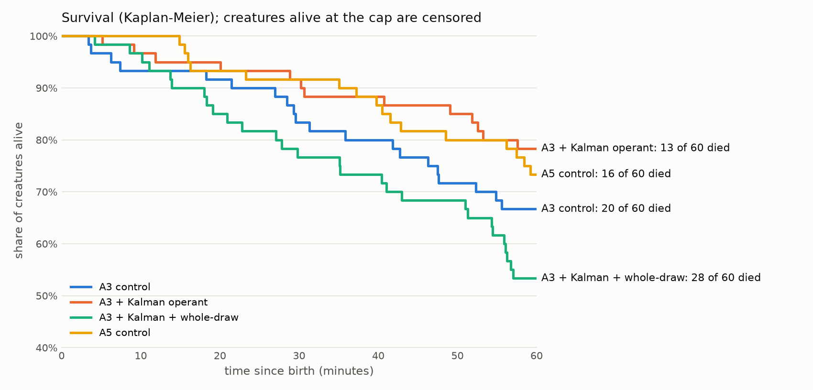
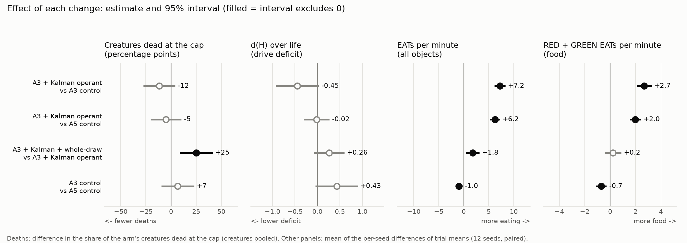
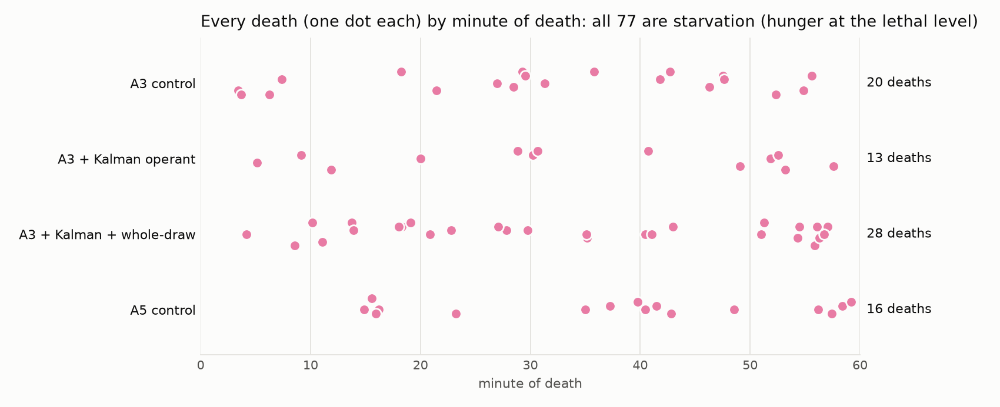
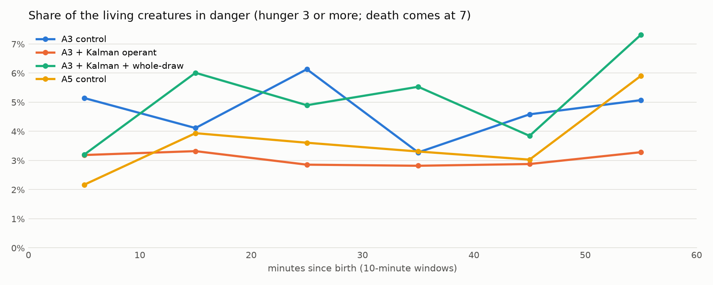
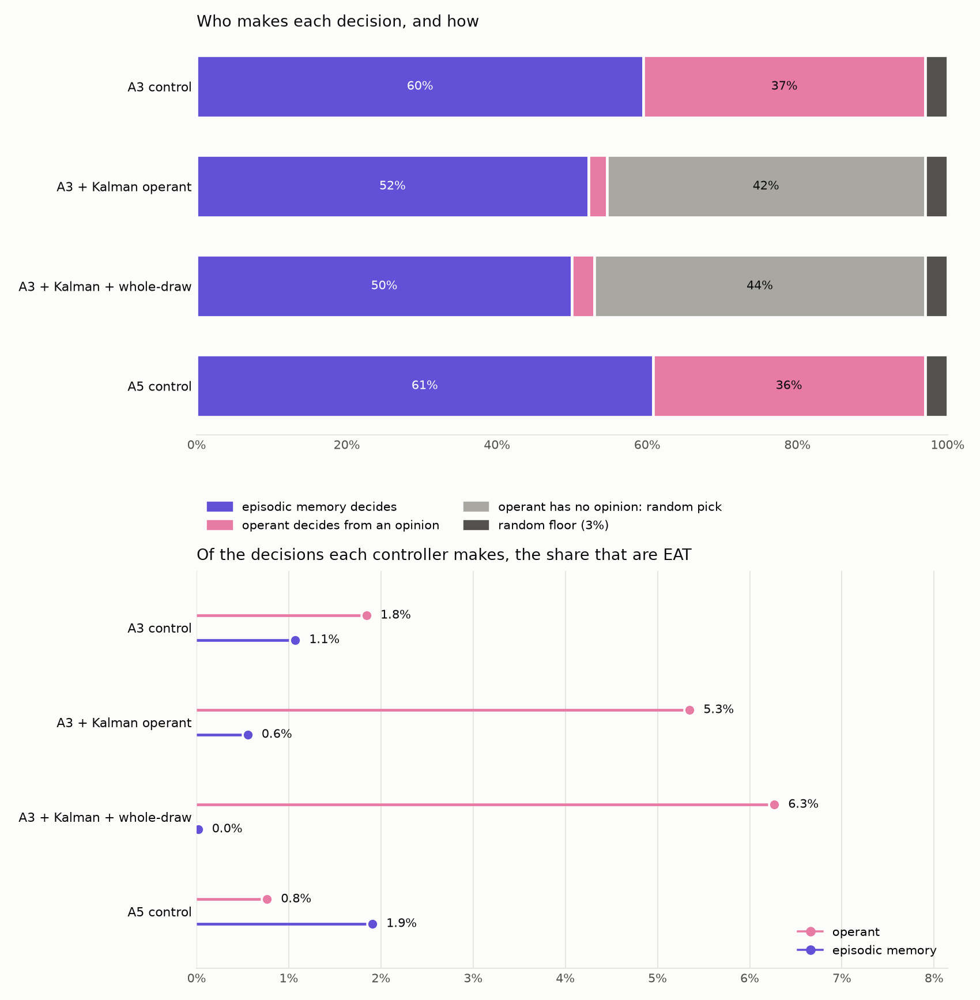
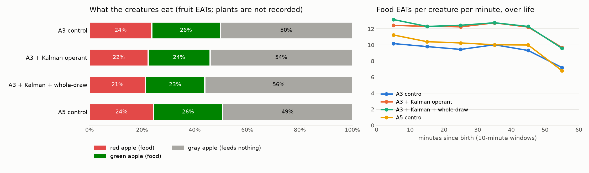
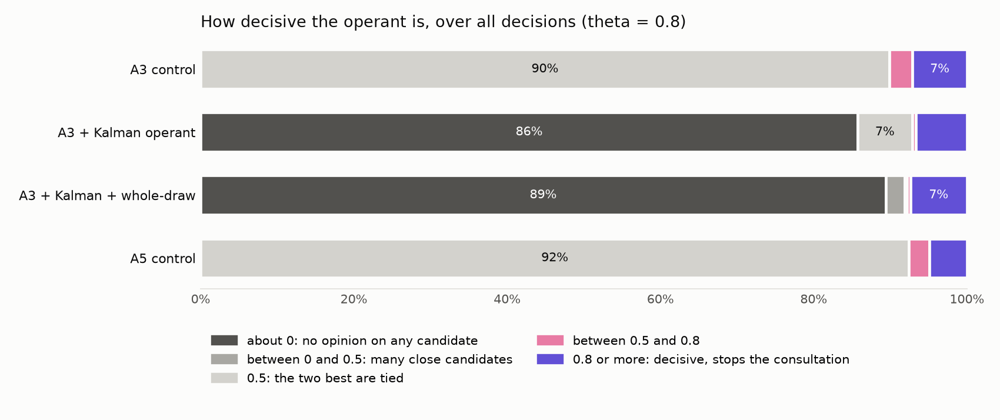
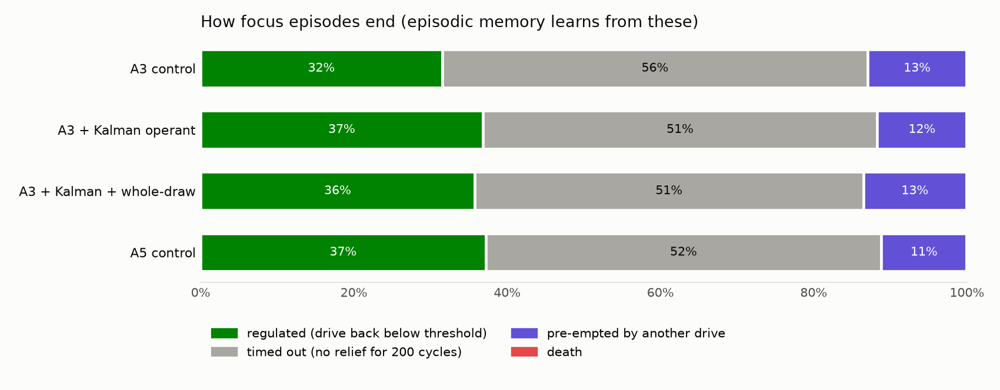
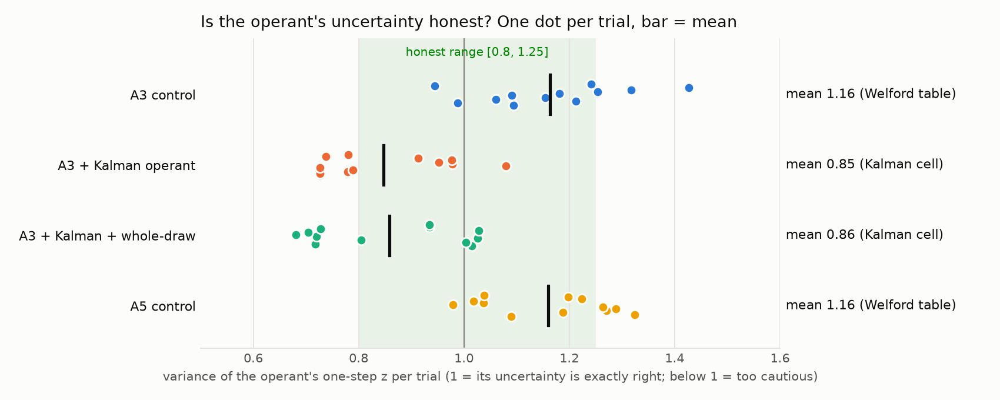
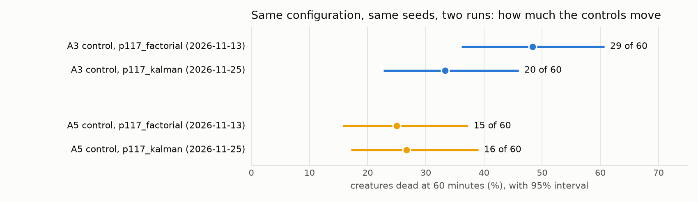

# Report: the Kalman operant cell, the whole-draw stop rule and the APPROACH credit in A3

CCAD campaign `p117_kalman`, 2026-11-25. Pre-registration: [`docs/experiments/p117_kalman_recipe.md`](../experiments/p117_kalman_recipe.md). Plan: [`docs/plans/operant-kalman-and-stop-rule.md`](../plans/operant-kalman-and-stop-rule.md). Local pilot: [`p117_kalman_local_report.md`](p117_kalman_local_report.md).

**In short.** Replacing the operant table by a Kalman cell (together with the APPROACH credit fix) makes A3 as good as the fixed order (A5) at staying alive and regulating hunger, and clearly better at finding food: about 7 more EATs per minute, in every one of the 12 seeds. It does not make arbitration *beat* the fixed order, and its survival gain over the A3 control is within the run-to-run noise. The second change, the whole-draw stop rule, is harmful: 28 deaths of 60 against 13 without it. Every death in every arm is starvation.

## Purpose

`p117_factorial` showed that arbitration (A3) dies more than the fixed order (A5) in the plants world when the hand-built action tendency is off. `docs/reports/p117_factorial_mechanism.md` traced it to the arbiter: untried operant cells enter the draw as lottery tickets, the stop rule declares the habit decisive on the top two candidates while the draw runs over all of them, and a timed-out episode erases the credit of the approaches that led to food. This experiment tests the plan's three fixes: **does A3 with them survive, regulate and feed at least as well as A5, and which change is responsible?**

## The experiment at a glance

| arm | what it is | what changes against the arm above |
|---|---|---|
| A3 control | arbitration between the operant table (Welford cells, valence sample) and episodic memory | nothing (today's code) |
| A3 + Kalman operant | the operant table becomes a Kalman cell: drive-reduction sample, a prior pooled over objects, no opinion on actions never tried; plus the APPROACH credit survives a timeout | `operantEstimator = KALMAN`, `timeoutZeroesApproach = false` |
| A3 + Kalman + whole-draw | the arbiter stops consulting when the best candidate would win the whole draw, not when it beats the second best | `arbiterStopRule = WHOLE_DRAW` |
| A5 control | the same two controllers in a fixed order: episodic memory decides whenever it has evidence | the fixed-order switch instead of arbitration |

World: the pilot world (100 red, 100 green, 300 gray apples) plus 140 cactus and 140 aloe; the sleep lock and the action tendency off. **12 trials per arm, 5 creatures per trial (60 creatures per arm), 60-minute cap, seeds 10900-10911 in every arm.** One image (`sha-7cb8310`), one CCAD window.

## Assumptions

- **The trial is the unit.** Creatures of a trial share a world, a food supply and a seed. The seed pairs the initial world only; Akka scheduling keeps trajectories nondeterministic. The paired comparisons pair trials by seed; the death counts and the survival tests pool the 60 creatures of an arm, treating creatures of one trial as independent, which overstates the evidence somewhat.
- **Censoring.** A creature alive at 60 minutes is censored, not missing.
- **Frozen constants.** The Kalman cell's constants (drift 1e-4 per outcome on the object, prior outcome variance 0.01 and floor 0.0025, pooled-prior variance floor 0.16) were chosen on a replay of the `p117_factorial` data of this cell **with the same seeds**, and frozen before the run. The calibration below is therefore a check that the cell behaves live as it did offline, not an independent test.
- **What the data record.** Fruit EATs are recorded per object type; eating cactus or aloe is not. Survivors' EAT counts are lower bounds by up to about 8% (a block-size artefact of the export), in every arm alike.
- **Two controls are re-run on this image.** The numbers of `p117_factorial` (older image) are shown only to measure run-to-run variation, never pooled.

## Hypothesis

Written before the run (recipe sections 2b and 4):

1. A3 + Kalman operant has fewer deaths than the A3 control, because untried operant cells no longer win draws.
2. A3 + Kalman + whole-draw has no more deaths than A5 and fewer than the A3 control.
3. **Stop rule:** the work on the arbiter ends unless one of the two Kalman arms has fewer deaths than the A3 control and no more than A5.

## Results

### 1. Survival

Deaths start within the first minutes and continue to the cap in every arm; half of them come after minute 30. The whole-draw arm separates from the others from about minute 15 on. The Kalman arm and A5 end close together, above the A3 control.

### 2. Effect of each change

Each row compares two arms: the dot is the estimate, the line its 95% interval, and a filled dot means the interval excludes zero.

- **Feeding is the clear effect.** The Kalman operant adds 7.2 EATs per minute over the A3 control and 6.2 over A5, of which 2.7 and 2.0 are food (red and green apples). All four intervals exclude zero.
- **Deaths and d(H) move the right way but are not established.** The Kalman arm has 12 percentage points fewer deaths than the A3 control (13 against 20 of 60) and a lower drive deficit (-0.45); both intervals include zero. Against A5 it is level (-5 points, d(H) -0.02).
- **The whole-draw rule costs 25 percentage points of deaths** (28 against 13 of 60) on top of the Kalman arm, with an interval clear of zero. It adds a little eating (+1.8 EATs per minute) but no food (+0.2).
- **A3 control against A5:** 7 points more deaths and a higher deficit, neither established; A5 eats about one EAT per minute more.

| contrast | deaths (of 60) | log-rank p | Fisher p |
|---|---|---|---|
| A3 + Kalman vs A3 control | 13 vs 20 | 0.14 | 0.22 |
| A3 + Kalman vs A5 control | 13 vs 16 | 0.56 | 0.67 |
| + whole-draw vs A3 + Kalman | 28 vs 13 | 0.004 | 0.007 |
| + whole-draw vs A3 control | 28 vs 20 | 0.16 | 0.19 |
| + whole-draw vs A5 control | 28 vs 16 | 0.018 | 0.037 |
| A3 control vs A5 control | 20 vs 16 | 0.37 | 0.55 |

### 3. Why the creatures die

All 77 deaths are starvation: hunger had reached the lethal level and was the highest drive in the creature's last record. Pain from cactus never killed a creature. The question is therefore only how well each arm keeps its creatures fed.

A creature is in danger when its hunger is 3 or more (death comes at 7). In 5 of the 6 ten-minute windows the Kalman arm has the smallest share of its living creatures in danger (about 3%), against 2-7% in the other arms. The whole-draw arm has the largest share in most windows.

### 4. What changes inside the arbiter

- **Who decides.** Episodic memory makes 60% of the decisions in both controls and about half in the Kalman arms; the operant takes the rest.
- **How the Kalman operant decides.** In the Kalman arms almost all of the operant's decisions (42-44% of all decisions) are random picks among candidates it has no opinion on: approaching, wandering and sleeping never produce an outcome for it to learn from, so it abstains on them. It decides from an opinion in only 2-3% of decisions, and those are the EATs.
- **What each controller does.** The share of the operant's decisions that are EAT triples, from 1.8% in the A3 control to 5.3% with the Kalman cell (6.3% with the whole-draw rule); in A5 it is 0.8%. Episodic memory eats less as the operant eats more, and with the whole-draw rule it never eats at all (0.0%): every bite is the operant's.

### 5. What they eat

The Kalman arms eat more food at every stage of life: about 12 to 13 food EATs per creature-minute, against 9.5 to 11 for the two controls, and they stay ahead in every ten-minute window. They are not more selective. Gray apples, which feed nothing, are 54% of the fruit eaten with the Kalman cell and 56% with the whole-draw rule, against 50% and 49% in the controls. The Kalman creatures eat more of everything, and the extra food outweighs the wasted bites. The rate falls in the last window in every arm; it is not interpreted here.

### 6. How decisive the operant is

The operant reaches the stopping threshold (0.8) in 5-7% of decisions in every arm, so it almost never decides alone. In the controls the rest is mostly a tie between untried cells at exactly 0.5 (90-92%). In the Kalman arms the rest is mostly "no opinion on any candidate" (86-89%). The stop rule therefore barely changes how often the cheap controller decides, and the whole-draw rule could not have helped through that route. How it does harm is not established (see the Analysis).

### 7. How focus episodes end

Half or more of the focus episodes time out in every arm (51-56%). Those are the episodes in which the old rule zeroed the credit of the approaches, so the APPROACH fix touches the majority of what episodic memory learns from. Slightly more episodes end regulated with the Kalman cell (37% against 32% in the A3 control).

### 8. Can the numbers be trusted?

The operant's uncertainty is honest when the variance of its one-step prediction error, scaled by its own uncertainty, is near 1. The Kalman cell sits inside the accepted range on average but near its lower edge (0.85 and 0.86): its uncertainty is slightly too wide, which is the cautious direction. The old Welford table was also inside the range (1.16 in both controls).

**The A3 control is not stable from run to run.** With the same configuration and seeds it had 29 deaths of 60 in `p117_factorial` and 20 here; A5 had 15 and 16. A difference of 7 deaths between two arms, such as the Kalman arm against the A3 control, is smaller than this shift and should not be read as an effect on its own.

## Analysis

**What the data support.** The Kalman operant cell, introduced together with the APPROACH credit fix, gives A3 an operant that acts at the object: it eats where the old table wandered, its uncertainty is honestly scaled, and its creatures eat about 28% more food (11.8 against 9.2 food EATs per minute) and are less often in danger of starving. With it, arbitration is level with the fixed order on survival (13 and 16 deaths) and regulation (same d(H)) and ahead of it on feeding. In the earlier experiments arbitration lost to the fixed order; here it no longer does.

**What the data do not support.**
- *Arbitration beating the fixed order.* It matches A5; it does not beat it.
- *A survival gain over the A3 control.* 13 against 20 deaths is in the right direction, but the control itself moved by 9 deaths between two runs of the same configuration. The consistent signals are feeding (12 of 12 seeds), the share of creatures in danger (5 of 6 windows) and d(H) (lower in 10 of 12 seeds), not the death count.
- *The whole-draw stop rule.* It is harmful. The data show what changes with it (episodic memory stops eating entirely, more gray apples are eaten, more creatures are in danger), not why. It should not be adopted.
- *Which of the two changes in the Kalman arm does the work.* The APPROACH fix and the Kalman cell were added together here. In the local pilot the APPROACH fix alone changed feeding by +0.9 EATs per minute and the Kalman cell by +6.5, so the feeding gain is the Kalman cell's; the pilot cannot say how the two share the survival effect.

**Against the pre-registered hypotheses.** (1) The Kalman arm has fewer deaths than the A3 control in direction only. (2) The whole-draw arm has more deaths than both A5 and the A3 control: **falsified**. (3) The stop rule is met by the Kalman arm in direction (13 < 20 and 13 <= 16), without statistical support in either comparison.

**Recommendation.** Keep the arbiter's two-best stop rule (the default). Use the Kalman arm (`operantEstimator = KALMAN`, `timeoutZeroesApproach = false`) as the classic baseline for the comparison with the JEPA. It is no worse than the fixed order, it feeds clearly better, and its operant reports in the same unit as episodic memory, as the controllers spec requires. The arbiter work has reached its stated goal, a fair classic baseline, and not the stronger one of arbitration winning. Whether to continue is the researcher's decision.

## Where the numbers come from

- Data: HF `felipedreis/dl2l-experiments`, prefix `p117_kalman/`; locally `ml/data_p117_kalman/`.
- Figures: `analysis/diagnostics/p117_kalman_aggregates.py` (aggregates, cached in `figures/p117_kalman/aggregates.json`) and `analysis/diagnostics/p117_kalman_figures.py`.
- Per-creature measures: `figures/p117_kalman/creature_metrics.csv`, from the analysis module (`PYTHONPATH=analysis python3 -m dl2l_analysis --experiment p117_kalman`). Re-running the module overwrites this report with its generic tables; regenerate the figures with the two scripts above and keep this text.
