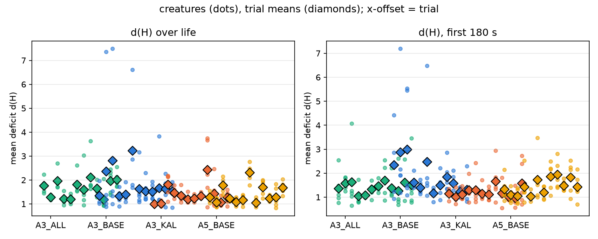
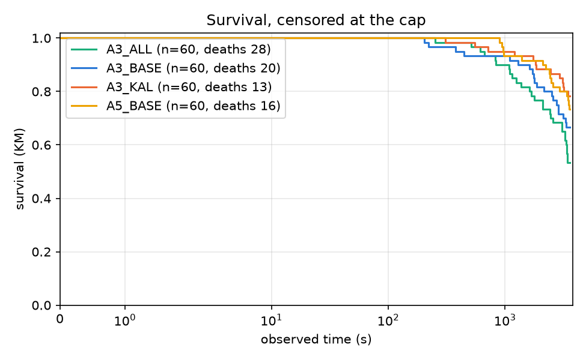
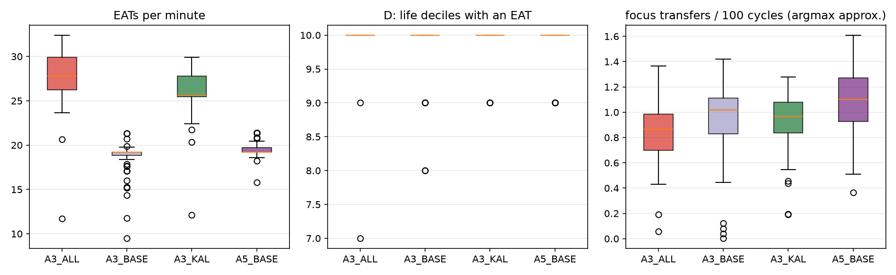

# Report: the Kalman operant cell, the whole-draw stop rule and the APPROACH credit in A3 (p117_kalman, CCAD, 60 minutes)

## Purpose

Two hypotheses from the earlier experiments are tested. `p117_factorial` showed that A3 (arbitration between the operant and the episodic controller) dies more than A5 (the same controllers in a fixed order) in the plants world when the hand-built action tendency is off, and `docs/reports/p117_factorial_mechanism.md` traced it to three things in the arbiter: (1) untried operant cells enter the draw as lottery tickets, (2) the stop rule declares the habit decisive on the top two candidates while the draw runs over all of them, (3) a timed-out episode erases the credit of the approaches. The plan `docs/plans/operant-kalman-and-stop-rule.md` fixes them with a Kalman operant cell (drive-reduction sample, pooled prior, abstention), a whole-draw stop rule and an APPROACH credit that survives the timeout.

**The question:** does A3 with these changes survive, regulate and feed at least as well as the fixed order (A5), and which change is responsible? Pre-registration: `docs/experiments/p117_kalman_recipe.md` (sections 1 to 4, revised in 2b before the run). Spec: `experiments/p117_kalman.yml`.

## Assumptions

- **Design.** Four arms, all in the plants world (pilot world plus 140 cactus and 140 aloe) with the sleep lock off and the action tendency off, the only cell of `p117_factorial` where the controllers were distinguishable and A3 was not floor-limited: `a3_base` (A3 control), `a3_kal` (A3 + APPROACH credit + Kalman operant), `a3_all` (+ whole-draw stop rule) and `a5_base` (A5 control, re-run on this image). 12 trials per arm, seeds 10900-10911 (the same in every arm and in `p117_factorial`), 5 creatures per trial (60 per arm), cap 60 minutes. CCAD, image `ghcr.io/felipedreis/dl2l:sha-7cb8310`, one image for all four arms.
- **Unit.** The trial is the unit: creatures within a trial share a world, a food supply and a seed. The seed pairs the initial world only (Akka scheduling keeps trajectories nondeterministic). The log-rank and Fisher tests pool the 60 creatures of an arm and therefore treat creatures of one trial as independent; the paired trial-level differences are the check.
- **Censoring.** A creature alive at 3600 s is censored, not missing. d(H) is measured from the set point 0.18.
- **Frozen constants.** Kalman cell: tau2 = 1e-4, prior outcome variance 0.01, floor 0.0025, pooled-variance floor 0.16, chosen on the replay of the `a3_L0T0` data of `p117_factorial` (`analysis/diagnostics/kalman_operant_replay.py`) and frozen before this run. That replay used the same seeds and the same world as this campaign, so the calibration of the Kalman cell on these seeds is not an independent check. Theta 0.8, epsilon 0.03, tau 1 in every arm.
- **Data caveat.** `mouth_interactions` records fruit interactions only (cactus and aloe do not appear in it) and, in creatures that survive to the cap, holds a whole number of 128-row blocks, so EAT counts of survivors are lower bounds short by up to 127 each (up to about 8% of a creature's count). The same applies to every arm; feeding rates are not exact, and the ordering of arms is not affected.
- **Not comparable.** The `a3_base` and `a5_base` arms are re-runs on a newer image; the numbers of `p117_factorial` (A3 29 and A5 15 deaths of 60 in this cell) are not pooled with them.

## Hypothesis

Written before the run (recipe sections 2b and 4):
1. `a3_mc` no worse than the control (the arm was dropped after the local pilot; not tested here).
2. `a3_kal` has fewer deaths than the arm before it, because untried operant cells no longer win draws.
3. `a3_all` has no more deaths than `a5_base` and fewer than `a3_base`.
4. **Stop rule, fixed before the run:** the arbiter work stops unless `a3_all` (or `a3_kal`) has fewer deaths than `a3_base` and no more deaths than `a5_base` (log-rank on creatures, trial-level paired differences as the check). The overall falsification of the plan was `a3_all` having no fewer deaths than `a3_base`.

## Results

**Headline.** Deaths at 60 minutes (of 60 creatures per arm): `a3_base` 20, `a3_kal` **13**, `a3_all` 28, `a5_base` 16. EATs per minute: 18.6, 25.8, 27.6, 19.6. d(H) over life: 1.83, 1.39, 1.65, 1.40.

| contrast | deaths | log-rank p | Fisher p |
|---|---|---|---|
| `a3_kal` vs `a3_base` | 13 vs 20 | 0.14 | 0.22 |
| `a3_kal` vs `a5_base` | 13 vs 16 | 0.56 | 0.67 |
| `a3_all` vs `a3_kal` | 28 vs 13 | 0.004 | 0.007 |
| `a3_all` vs `a3_base` | 28 vs 20 | 0.16 | 0.19 |
| `a3_all` vs `a5_base` | 28 vs 16 | 0.018 | 0.037 |
| `a3_base` vs `a5_base` | 20 vs 16 | 0.37 | 0.55 |

The tables and figures below are the generated ones (per-arm creature means with trial means in brackets, survival curves, calibration, paired differences by seed).

### Per-arm measures (creature mean, then trial means)

| measure | A3 + all three (+ whole-draw stop rule) | A3 (control) | A3 + APPROACH credit + Kalman operant | A5 (fixed order, control) |
|---|---|---|---|---|
| d(H) over life | 1.646 (trials 1.771, 1.280, 1.964, 1.207, 1.191, 1.822, 1.602, 2.118, 1.646, 1.186, 1.962, 2.006) | 1.832 (trials 1.349, 2.367, 2.810, 1.327, 1.401, 3.238, 1.636, 1.532, 1.508, 1.661, 1.626, 1.525) | 1.385 (trials 0.992, 1.021, 1.813, 1.468, 1.348, 1.192, 1.238, 1.339, 2.437, 1.431, 1.059, 1.282) | 1.404 (trials 1.274, 1.069, 1.783, 1.225, 1.076, 1.163, 2.309, 1.049, 1.701, 1.233, 1.278, 1.683) |
| d(H), first 180 s | 1.415 (trials 1.372, 1.583, 1.634, 1.052, 1.079, 1.323, 1.464, 1.701, 1.381, 1.258, 1.619, 1.516) | 1.862 (trials 2.351, 2.871, 2.990, 1.617, 1.390, 2.483, 1.164, 1.503, 1.845, 1.581, 1.234, 1.315) | 1.211 (trials 1.143, 1.014, 1.114, 1.305, 1.302, 1.155, 1.117, 1.657, 1.161, 1.015, 0.966, 1.581) | 1.450 (trials 1.326, 1.096, 1.040, 1.428, 1.038, 1.732, 1.205, 1.864, 1.939, 1.480, 1.828, 1.428) |
| EATs per minute | 27.592 (trials 27.194, 29.048, 27.554, 27.762, 27.989, 28.444, 27.595, 23.813, 28.530, 28.048, 29.065, 26.060) | 18.567 (trials 19.276, 18.140, 17.151, 18.474, 19.206, 17.459, 19.580, 19.010, 18.944, 17.982, 18.708, 18.870) | 25.797 (trials 26.051, 26.480, 25.375, 26.350, 26.244, 27.342, 26.480, 26.052, 21.780, 24.149, 27.345, 25.915) | 19.557 (trials 19.653, 19.218, 19.715, 19.221, 19.220, 20.072, 19.067, 19.218, 19.221, 20.507, 20.200, 19.368) |
| RED+GREEN EATs per minute | 12.074 (trials 11.957, 12.715, 12.076, 12.182, 12.443, 12.314, 12.208, 10.239, 12.639, 12.404, 12.689, 11.025) | 9.164 (trials 9.673, 8.744, 8.839, 9.239, 9.583, 8.150, 9.634, 9.137, 9.614, 8.856, 9.321, 9.174) | 11.849 (trials 11.931, 12.222, 11.820, 11.944, 11.944, 12.579, 11.989, 11.875, 10.072, 11.235, 12.534, 12.043) | 9.863 (trials 9.870, 9.659, 9.894, 9.934, 9.904, 10.303, 9.162, 9.859, 9.757, 10.234, 10.060, 9.723) |
| D: life deciles with an EAT | 9.933 (trials 10.000, 10.000, 10.000, 10.000, 10.000, 9.800, 10.000, 9.400, 10.000, 10.000, 10.000, 10.000) | 9.883 (trials 10.000, 10.000, 9.800, 9.800, 10.000, 9.600, 10.000, 10.000, 10.000, 9.600, 10.000, 9.800) | 9.950 (trials 10.000, 10.000, 10.000, 10.000, 10.000, 10.000, 10.000, 10.000, 9.400, 10.000, 10.000, 10.000) | 9.933 (trials 9.800, 10.000, 10.000, 10.000, 10.000, 10.000, 9.600, 10.000, 10.000, 9.800, 10.000, 10.000) |
| observed time (s) | 2850.982 (trials 2542.157, 3595.753, 2081.812, 3596.349, 3562.212, 2529.032, 2892.129, 2460.975, 3462.098, 3092.729, 3215.478, 1181.062) | 3029.297 (trials 3254.577, 2919.953, 2803.147, 3537.522, 3598.914, 1953.143, 3096.865, 2873.219, 3232.917, 2952.700, 2822.471, 3306.131) | 3257.556 (trials 3596.610, 3596.422, 2312.404, 3465.150, 3567.311, 3595.408, 3596.333, 3596.457, 1521.540, 3221.680, 3594.908, 3426.456) | 3239.535 (trials 3595.236, 3596.609, 2305.201, 3596.091, 3596.272, 3596.626, 1586.557, 3596.615, 3566.072, 3595.196, 3344.533, 2899.410) |
| died (share) | 0.467 (trials 0.400, 0.000, 1.000, 0.000, 0.200, 0.800, 0.400, 0.600, 0.400, 0.200, 0.600, 1.000) | 0.333 (trials 0.200, 0.200, 0.400, 0.200, 0.000, 0.800, 0.200, 0.600, 0.200, 0.200, 0.400, 0.600) | 0.217 (trials 0.000, 0.000, 0.800, 0.200, 0.200, 0.000, 0.000, 0.000, 0.800, 0.200, 0.000, 0.400) | 0.267 (trials 0.000, 0.000, 1.000, 0.000, 0.000, 0.000, 1.000, 0.000, 0.200, 0.000, 0.400, 0.600) |
| focus transfers per 100 cycles (argmax approx.) | 0.841 (trials 0.790, 0.978, 0.676, 0.974, 0.976, 0.803, 0.847, 0.598, 0.839, 1.049, 0.772, 0.785) | 0.929 (trials 1.058, 0.880, 0.781, 0.951, 1.035, 0.613, 1.056, 1.072, 1.080, 0.820, 0.910, 0.891) | 0.930 (trials 1.068, 1.035, 0.769, 0.869, 0.933, 1.079, 1.016, 0.942, 0.545, 0.917, 0.925, 1.057) | 1.080 (trials 1.173, 1.227, 0.795, 1.153, 1.173, 1.273, 0.694, 1.352, 0.968, 1.235, 1.044, 0.877) |
| focus opens per 100 cycles (argmax approx.) | 0.001 (trials 0.002, 0.002, 0.001, 0.001, 0.001, 0.001, 0.002, 0.001, 0.001, 0.002, 0.000, 0.001) | 0.001 (trials 0.001, 0.001, 0.001, 0.001, 0.001, 0.001, 0.000, 0.002, 0.001, 0.001, 0.001, 0.001) | 0.001 (trials 0.001, 0.000, 0.002, 0.001, 0.001, 0.001, 0.002, 0.001, 0.001, 0.001, 0.002, 0.001) | 0.001 (trials 0.002, 0.001, 0.002, 0.001, 0.001, 0.001, 0.001, 0.001, 0.001, 0.001, 0.001, 0.000) |
| focus transfers per 100 cycles (tracker) | 0.126 (trials 0.211, 0.207, 0.046, 0.051, 0.051, 0.238, 0.049, 0.130, 0.207, 0.049, 0.218, 0.048) | 0.137 (trials 0.081, 0.069, 0.064, 0.082, 0.271, 0.201, 0.194, 0.207, 0.237, 0.078, 0.078, 0.079) | 0.119 (trials 0.047, 0.045, 0.273, 0.233, 0.182, 0.222, 0.184, 0.052, 0.043, 0.045, 0.058, 0.042) | 0.130 (trials 0.231, 0.059, 0.065, 0.196, 0.061, 0.058, 0.213, 0.067, 0.228, 0.254, 0.073, 0.058) |
| focus opens per 100 cycles (tracker) | 0.513 (trials 0.524, 0.530, 0.502, 0.507, 0.509, 0.514, 0.500, 0.514, 0.526, 0.506, 0.523, 0.502) | 0.497 (trials 0.491, 0.495, 0.495, 0.503, 0.502, 0.484, 0.506, 0.512, 0.504, 0.491, 0.489, 0.497) | 0.516 (trials 0.514, 0.511, 0.515, 0.519, 0.534, 0.529, 0.532, 0.503, 0.501, 0.502, 0.518, 0.515) | 0.520 (trials 0.531, 0.522, 0.513, 0.530, 0.510, 0.516, 0.511, 0.516, 0.542, 0.530, 0.518, 0.506) |
| focused share of cycles (tracker) | 0.883 (trials 0.884, 0.871, 0.892, 0.874, 0.869, 0.880, 0.884, 0.913, 0.879, 0.870, 0.874, 0.906) | 0.929 (trials 0.921, 0.938, 0.944, 0.929, 0.921, 0.946, 0.926, 0.922, 0.912, 0.932, 0.928, 0.930) | 0.881 (trials 0.873, 0.883, 0.881, 0.878, 0.877, 0.866, 0.881, 0.892, 0.910, 0.885, 0.867, 0.878) | 0.907 (trials 0.900, 0.903, 0.908, 0.900, 0.908, 0.909, 0.925, 0.904, 0.903, 0.901, 0.906, 0.915) |
| episodes per creature | 544.883 (trials 541.400, 775.000, 344.200, 605.800, 603.600, 566.000, 483.000, 478.000, 731.200, 517.200, 695.800, 197.400) | 575.883 (trials 563.800, 508.400, 485.000, 626.400, 805.200, 411.600, 640.400, 601.800, 691.000, 516.000, 485.200, 575.800) | 614.817 (trials 609.800, 603.400, 542.800, 758.200, 743.600, 777.800, 747.200, 602.600, 259.600, 534.200, 621.800, 576.800) | 626.800 (trials 798.800, 631.000, 402.200, 762.600, 620.400, 623.600, 343.000, 633.200, 796.000, 822.800, 592.800, 495.200) |
| food share of EATs, first 20% of life (A3 criterion) | 0.445 (trials 0.458, 0.451, 0.456, 0.433, 0.455, 0.443, 0.455, 0.411, 0.444, 0.453, 0.430, 0.450) | 0.480 (trials 0.483, 0.492, 0.527, 0.459, 0.483, 0.445, 0.477, 0.461, 0.482, 0.465, 0.492, 0.489) | 0.461 (trials 0.466, 0.460, 0.457, 0.443, 0.445, 0.472, 0.445, 0.446, 0.501, 0.461, 0.455, 0.479) | 0.495 (trials 0.502, 0.482, 0.498, 0.507, 0.507, 0.500, 0.464, 0.501, 0.500, 0.484, 0.487, 0.505) |
### Drive deficit

Per creature (dots) and per trial (diamonds).
### Survival

- A3_ALL vs A3_KAL: deaths 28/60 vs 13/60 (Fisher p = 0.00668); KM median beyond the cap vs beyond the cap; log-rank p = 0.0041
- A3_ALL vs A3_BASE: deaths 28/60 vs 20/60 (Fisher p = 0.192); KM median beyond the cap vs beyond the cap; log-rank p = 0.1627
- A3_KAL vs A3_BASE: deaths 13/60 vs 20/60 (Fisher p = 0.22); KM median beyond the cap vs beyond the cap; log-rank p = 0.1410
- A3_ALL vs A5_BASE: deaths 28/60 vs 16/60 (Fisher p = 0.0366); KM median beyond the cap vs beyond the cap; log-rank p = 0.0178
- A3_KAL vs A5_BASE: deaths 13/60 vs 16/60 (Fisher p = 0.67); KM median beyond the cap vs beyond the cap; log-rank p = 0.5577
- A3_BASE vs A5_BASE: deaths 20/60 vs 16/60 (Fisher p = 0.55); KM median beyond the cap vs beyond the cap; log-rank p = 0.3696
### Feeding and focus

EATs per minute, life deciles with an EAT, and the argmax-approximated focus transfers per 100 cycles.
### Episodes (close types per arm)

Close-type mix per arm:

| condition | DEATH | PREEMPTED | REGULATED | TIMED_OUT |
|---|---|---|---|---|
| a3_all | 0.001 | 0.134 | 0.358 | 0.507 |
| a3_base | 0.001 | 0.129 | 0.315 | 0.555 |
| a3_kal | 0.000 | 0.117 | 0.368 | 0.515 |
| a5_base | 0.000 | 0.111 | 0.372 | 0.516 |

Steps per episode:

| condition | count | 50% | mean | max |
|---|---|---|---|---|
| a3_all | 32693.000 | 201.000 | 138.700 | 201.000 |
| a3_base | 34553.000 | 201.000 | 147.100 | 201.000 |
| a3_kal | 36889.000 | 201.000 | 140.600 | 201.000 |
| a5_base | 37608.000 | 201.000 | 141.400 | 201.000 |
### Decision telemetry (operant and episodic controllers)

**A3_BASE** (5,495,531 decisions). Source mix: {'SINGLE': 0.0, 'GREEDY': 0.4494, 'THOMPSON': 0.5206, 'EPSILON': 0.0299, 'ABSTAIN_UNIFORM': 0.0}. Executed action not the chosen one: 0.00%. Informed share (late half, focused multi-candidate): 0.848. Deciding controller by life decile: {0: {'EPISODIC': 0.648, 'OPERANT': 0.352}, 1: {'EPISODIC': 0.578, 'OPERANT': 0.422}, 2: {'EPISODIC': 0.576, 'OPERANT': 0.424}, 3: {'EPISODIC': 0.604, 'OPERANT': 0.396}, 4: {'EPISODIC': 0.622, 'OPERANT': 0.378}, 5: {'EPISODIC': 0.593, 'OPERANT': 0.407}, 6: {'EPISODIC': 0.598, 'OPERANT': 0.402}, 7: {'EPISODIC': 0.63, 'OPERANT': 0.37}, 8: {'EPISODIC': 0.638, 'OPERANT': 0.362}, 9: {'EPISODIC': 0.647, 'OPERANT': 0.353}}.

Descriptive z by close type:

| close_type | n | mean | variance | rms |
|---|---|---|---|---|
| DEATH | 2265.000 | -2.050 | 77.121 | 9.016 |
| PREEMPTED | 342309.000 | 0.004 | 0.358 | 0.598 |
| REGULATED | 867317.000 | 0.085 | 0.382 | 0.624 |
| TIMED_OUT | 3870119.000 | -0.009 | 0.181 | 0.426 |

Episodic calibration (decisions the episodic controller made, per closed episode): n = 3,351,634, mean z 0.029, variance 0.250 (an honest SE gives 0 and 1). Episodic share of decisions by life decile: [0.6479, 0.5781, 0.5763, 0.6042, 0.6224, 0.5926, 0.598, 0.6299, 0.6382, 0.647]. Consulted the episodic controller in 0.638 of decisions, affordable in 0.695; mean novelty bonus 0.0189.

| close_type | n | mean | variance |
|---|---|---|---|
| DEATH | 987.000 | -4.289 | 167.070 |
| PREEMPTED | 223308.000 | 0.032 | 0.386 |
| REGULATED | 379917.000 | 0.219 | 0.429 |
| TIMED_OUT | 2747422.000 | 0.005 | 0.142 |

**A3_KAL** (5,910,193 decisions). Source mix: {'SINGLE': 0.0, 'GREEDY': 0.1846, 'THOMPSON': 0.3615, 'EPSILON': 0.0299, 'ABSTAIN_UNIFORM': 0.424}. Executed action not the chosen one: 0.00%. Informed share (late half, focused multi-candidate): 0.687. Deciding controller by life decile: {0: {'EPISODIC': 0.595, 'OPERANT': 0.405}, 1: {'EPISODIC': 0.554, 'OPERANT': 0.446}, 2: {'EPISODIC': 0.541, 'OPERANT': 0.459}, 3: {'EPISODIC': 0.517, 'OPERANT': 0.483}, 4: {'EPISODIC': 0.546, 'OPERANT': 0.454}, 5: {'EPISODIC': 0.512, 'OPERANT': 0.488}, 6: {'EPISODIC': 0.541, 'OPERANT': 0.459}, 7: {'EPISODIC': 0.516, 'OPERANT': 0.484}, 8: {'EPISODIC': 0.529, 'OPERANT': 0.471}, 9: {'EPISODIC': 0.525, 'OPERANT': 0.475}}.

Descriptive z by close type:

| close_type | n | mean | variance | rms |
|---|---|---|---|---|
| DEATH | 493.000 | -7.799 | 328.176 | 19.706 |
| PREEMPTED | 182082.000 | 0.085 | 0.499 | 0.712 |
| REGULATED | 465200.000 | 0.202 | 0.560 | 0.775 |
| TIMED_OUT | 2642494.000 | 0.030 | 0.231 | 0.482 |

Episodic calibration (decisions the episodic controller made, per closed episode): n = 3,159,597, mean z 0.084, variance 0.258 (an honest SE gives 0 and 1). Episodic share of decisions by life decile: [0.5949, 0.5544, 0.541, 0.5172, 0.5461, 0.5123, 0.5413, 0.5161, 0.5295, 0.5252]. Consulted the episodic controller in 0.541 of decisions, affordable in 0.593; mean novelty bonus 0.0167.

| close_type | n | mean | variance |
|---|---|---|---|
| DEATH | 489.000 | -7.282 | 278.847 |
| PREEMPTED | 173269.000 | 0.114 | 0.380 |
| REGULATED | 424563.000 | 0.272 | 0.425 |
| TIMED_OUT | 2561276.000 | 0.052 | 0.152 |

**A3_ALL** (5,171,269 decisions). Source mix: {'SINGLE': 0.0, 'GREEDY': 0.1891, 'THOMPSON': 0.3406, 'EPSILON': 0.0299, 'ABSTAIN_UNIFORM': 0.4404}. Executed action not the chosen one: 0.00%. Informed share (late half, focused multi-candidate): 0.686. Deciding controller by life decile: {0: {'EPISODIC': 0.586, 'OPERANT': 0.414}, 1: {'EPISODIC': 0.526, 'OPERANT': 0.474}, 2: {'EPISODIC': 0.524, 'OPERANT': 0.476}, 3: {'OPERANT': 0.507, 'EPISODIC': 0.493}, 4: {'EPISODIC': 0.502, 'OPERANT': 0.498}, 5: {'EPISODIC': 0.5, 'OPERANT': 0.5}, 6: {'OPERANT': 0.505, 'EPISODIC': 0.495}, 7: {'OPERANT': 0.527, 'EPISODIC': 0.473}, 8: {'EPISODIC': 0.511, 'OPERANT': 0.489}, 9: {'EPISODIC': 0.54, 'OPERANT': 0.46}}.

Descriptive z by close type:

| close_type | n | mean | variance | rms |
|---|---|---|---|---|
| DEATH | 911.000 | -8.097 | 340.227 | 20.135 |
| PREEMPTED | 169077.000 | 0.100 | 0.525 | 0.731 |
| REGULATED | 377863.000 | 0.209 | 0.599 | 0.802 |
| TIMED_OUT | 2244786.000 | 0.034 | 0.239 | 0.490 |

Episodic calibration (decisions the episodic controller made, per closed episode): n = 2,648,167, mean z 0.083, variance 0.341 (an honest SE gives 0 and 1). Episodic share of decisions by life decile: [0.5863, 0.5255, 0.5238, 0.4928, 0.5022, 0.5003, 0.4954, 0.4732, 0.5106, 0.5404]. Consulted the episodic controller in 0.535 of decisions, affordable in 0.594; mean novelty bonus 0.0160.

| close_type | n | mean | variance |
|---|---|---|---|
| DEATH | 904.000 | -8.161 | 342.071 |
| PREEMPTED | 157355.000 | 0.123 | 0.363 |
| REGULATED | 338604.000 | 0.276 | 0.447 |
| TIMED_OUT | 2151304.000 | 0.053 | 0.143 |

**A5_BASE** (5,877,535 decisions). Source mix: {'SINGLE': 0.0, 'GREEDY': 0.4985, 'THOMPSON': 0.4714, 'EPSILON': 0.03, 'ABSTAIN_UNIFORM': 0.0}. Executed action not the chosen one: 0.00%. Informed share (late half, focused multi-candidate): 0.818. Deciding controller by life decile: {0: {'EPISODIC': 0.673, 'OPERANT': 0.327}, 1: {'EPISODIC': 0.584, 'OPERANT': 0.416}, 2: {'EPISODIC': 0.617, 'OPERANT': 0.383}, 3: {'EPISODIC': 0.604, 'OPERANT': 0.396}, 4: {'EPISODIC': 0.606, 'OPERANT': 0.394}, 5: {'EPISODIC': 0.613, 'OPERANT': 0.387}, 6: {'EPISODIC': 0.624, 'OPERANT': 0.376}, 7: {'EPISODIC': 0.605, 'OPERANT': 0.395}, 8: {'EPISODIC': 0.664, 'OPERANT': 0.336}, 9: {'EPISODIC': 0.674, 'OPERANT': 0.326}}.

Descriptive z by close type:

| close_type | n | mean | variance | rms |
|---|---|---|---|---|
| DEATH | 1759.000 | -2.237 | 89.619 | 9.725 |
| PREEMPTED | 292336.000 | 0.041 | 0.299 | 0.548 |
| REGULATED | 1111954.000 | 0.122 | 0.375 | 0.624 |
| TIMED_OUT | 3913216.000 | 0.020 | 0.161 | 0.402 |

Episodic calibration (decisions the episodic controller made, per closed episode): n = 3,658,667, mean z 0.066, variance 0.254 (an honest SE gives 0 and 1). Episodic share of decisions by life decile: [0.6734, 0.5842, 0.6172, 0.6035, 0.606, 0.6128, 0.6237, 0.6051, 0.6636, 0.6745]. Consulted the episodic controller in 0.629 of decisions, affordable in 0.629; mean novelty bonus 0.0194.

| close_type | n | mean | variance |
|---|---|---|---|
| DEATH | 832.000 | -4.296 | 180.112 |
| PREEMPTED | 206602.000 | 0.064 | 0.352 |
| REGULATED | 520434.000 | 0.263 | 0.456 |
| TIMED_OUT | 2930799.000 | 0.033 | 0.146 |
### Operant calibration (recipe 5)

Per trial: variance of z per (object type, action) cell with enough updates and varying outcomes, weighted by update count; adoption range [0.8, 1.25] for A2 (mean over trials). `pooled_variance` is the unrestricted variance of all z, for comparison: constant cells drag it down.

|  | statistic | pooled_variance | n_updates | cells | constant_cells |
|---|---|---|---|---|---|
| ('a3_base', 1) | 1.095 | 0.569 | 6174.000 | 3.000 | 2.000 |
| ('a3_base', 2) | 1.154 | 0.590 | 5662.000 | 3.000 | 2.000 |
| ('a3_base', 3) | 1.091 | 0.557 | 5246.000 | 3.000 | 2.000 |
| ('a3_base', 4) | 1.182 | 0.599 | 6624.000 | 3.000 | 2.000 |
| ('a3_base', 5) | 1.254 | 0.652 | 6849.000 | 3.000 | 2.000 |
| ('a3_base', 6) | 1.318 | 0.635 | 3777.000 | 3.000 | 2.000 |
| ('a3_base', 7) | 1.427 | 0.730 | 5932.000 | 3.000 | 2.000 |
| ('a3_base', 8) | 0.944 | 0.482 | 5509.000 | 3.000 | 2.000 |
| ('a3_base', 9) | 1.241 | 0.649 | 6118.000 | 3.000 | 2.000 |
| ('a3_base', 10) | 0.988 | 0.515 | 5444.000 | 3.000 | 2.000 |
| ('a3_base', 11) | 1.213 | 0.610 | 5340.000 | 3.000 | 2.000 |
| ('a3_base', 12) | 1.060 | 0.522 | 6256.000 | 3.000 | 2.000 |
| ('a3_kal', 1) | 0.723 | 0.390 | 9685.000 | 4.000 | 1.000 |
| ('a3_kal', 2) | 0.723 | 0.398 | 9887.000 | 4.000 | 1.000 |
| ('a3_kal', 3) | 1.073 | 0.591 | 6011.000 | 4.000 | 1.000 |
| ('a3_kal', 4) | 0.974 | 0.532 | 9475.000 | 4.000 | 1.000 |
| ('a3_kal', 5) | 0.947 | 0.513 | 9669.000 | 4.000 | 1.000 |
| ('a3_kal', 6) | 0.972 | 0.529 | 10005.000 | 4.000 | 1.000 |
| ('a3_kal', 7) | 0.909 | 0.491 | 9824.000 | 4.000 | 1.000 |
| ('a3_kal', 8) | 0.733 | 0.400 | 9591.000 | 4.000 | 1.000 |
| ('a3_kal', 9) | 0.770 | 0.419 | 3977.000 | 4.000 | 1.000 |
| ('a3_kal', 10) | 0.722 | 0.401 | 8265.000 | 4.000 | 1.000 |
| ('a3_kal', 11) | 0.774 | 0.420 | 10031.000 | 4.000 | 1.000 |
| ('a3_kal', 12) | 0.784 | 0.433 | 9028.000 | 4.000 | 1.000 |
| ('a3_all', 1) | 1.009 | 0.527 | 7051.000 | 4.000 | 1.000 |
| ('a3_all', 2) | 1.022 | 0.535 | 10669.000 | 4.000 | 1.000 |
| ('a3_all', 3) | 0.713 | 0.376 | 5772.000 | 4.000 | 1.000 |
| ('a3_all', 4) | 0.677 | 0.356 | 10278.000 | 4.000 | 1.000 |
| ('a3_all', 5) | 0.700 | 0.372 | 10007.000 | 4.000 | 1.000 |
| ('a3_all', 6) | 1.022 | 0.532 | 7533.000 | 4.000 | 1.000 |
| ('a3_all', 7) | 0.723 | 0.385 | 8051.000 | 4.000 | 1.000 |
| ('a3_all', 8) | 0.928 | 0.481 | 6630.000 | 4.000 | 1.000 |
| ('a3_all', 9) | 0.930 | 0.493 | 9885.000 | 4.000 | 1.000 |
| ('a3_all', 10) | 0.713 | 0.374 | 8899.000 | 4.000 | 1.000 |
| ('a3_all', 11) | 0.999 | 0.522 | 9142.000 | 4.000 | 1.000 |
| ('a3_all', 12) | 0.801 | 0.399 | 3162.000 | 3.000 | 2.000 |
| ('a5_base', 1) | 1.089 | 0.578 | 7204.000 | 3.000 | 2.000 |
| ('a5_base', 2) | 1.289 | 0.680 | 6965.000 | 3.000 | 2.000 |
| ('a5_base', 3) | 1.264 | 0.640 | 4592.000 | 3.000 | 2.000 |
| ('a5_base', 4) | 0.979 | 0.532 | 7021.000 | 3.000 | 2.000 |
| ('a5_base', 5) | 1.037 | 0.556 | 6920.000 | 3.000 | 2.000 |
| ('a5_base', 6) | 1.018 | 0.541 | 7207.000 | 3.000 | 2.000 |
| ('a5_base', 7) | 1.224 | 0.579 | 3265.000 | 3.000 | 2.000 |
| ('a5_base', 8) | 1.197 | 0.635 | 6967.000 | 3.000 | 2.000 |
| ('a5_base', 9) | 1.038 | 0.547 | 7075.000 | 3.000 | 2.000 |
| ('a5_base', 10) | 1.324 | 0.697 | 7287.000 | 3.000 | 2.000 |
| ('a5_base', 11) | 1.188 | 0.612 | 6674.000 | 3.000 | 2.000 |
| ('a5_base', 12) | 1.271 | 0.649 | 5806.000 | 3.000 | 2.000 |

**A3_BASE** cells (>= 30 updates, outcomes vary):

|  | n | mean_z | variance | constant |
|---|---|---|---|---|
| ('ALOE', 'EAT') | 5024 | 0.021 | 1.003 | False |
| ('GREEN_APPLE', 'EAT') | 15513 | 0.043 | 1.218 | False |
| ('RED_APPLE', 'EAT') | 14154 | 0.012 | 1.660 | False |

Constant-outcome cells, left out:

|  | n | mean_z | variance | constant |
|---|---|---|---|---|
| ('CACTUS', 'EAT') | 4384 | -0.188 | 0.006 | True |
| ('GRAY_APPLE', 'EAT') | 29856 | -0.099 | 0.002 | True |

**A3_KAL** cells (>= 30 updates, outcomes vary):

|  | n | mean_z | variance | constant |
|---|---|---|---|---|
| ('ALOE', 'EAT') | 15317 | 0.023 | 1.186 | False |
| ('CACTUS', 'EAT') | 1842 | -0.032 | 0.032 | False |
| ('GREEN_APPLE', 'EAT') | 20783 | 0.014 | 1.220 | False |
| ('RED_APPLE', 'EAT') | 19616 | 0.002 | 1.049 | False |

Constant-outcome cells, left out:

|  | n | mean_z | variance | constant |
|---|---|---|---|---|
| ('GRAY_APPLE', 'EAT') | 47890 | 0.000 | 0.000 | True |

**A3_ALL** cells (>= 30 updates, outcomes vary):

|  | n | mean_z | variance | constant |
|---|---|---|---|---|
| ('ALOE', 'EAT') | 13703 | 0.029 | 1.232 | False |
| ('CACTUS', 'EAT') | 1423 | -0.042 | 0.160 | False |
| ('GREEN_APPLE', 'EAT') | 18465 | 0.025 | 1.154 | False |
| ('RED_APPLE', 'EAT') | 17410 | 0.003 | 1.021 | False |

Constant-outcome cells, left out:

|  | n | mean_z | variance | constant |
|---|---|---|---|---|
| ('GRAY_APPLE', 'EAT') | 46078 | -0.000 | 0.000 | True |

**A5_BASE** cells (>= 30 updates, outcomes vary):

|  | n | mean_z | variance | constant |
|---|---|---|---|---|
| ('ALOE', 'EAT') | 6281 | 0.037 | 1.054 | False |
| ('GREEN_APPLE', 'EAT') | 17446 | 0.031 | 1.429 | False |
| ('RED_APPLE', 'EAT') | 16110 | 0.040 | 1.241 | False |

Constant-outcome cells, left out:

|  | n | mean_z | variance | constant |
|---|---|---|---|---|
| ('CACTUS', 'EAT') | 4468 | -0.189 | 0.006 | True |
| ('GRAY_APPLE', 'EAT') | 32678 | -0.098 | 0.002 | True |
### Paired differences by seed

Differences of trial means, later arm minus earlier arm; SD has 2 degrees of freedom, so size on the 80% upper bound (2.12 x SD), not the point estimate.

| measure | contrast | per-seed differences | mean | SD (2 df) | 80% upper bound on SD |
|---|---|---|---|---|---|
| d(H) over life | A3_ALL - A3_KAL | [0.7794, 0.2585, 0.1513, -0.2602, -0.1568, 0.6301, 0.3641, 0.7796, -0.791, -0.2452, 0.9033, 0.7242] | 0.261 | 0.534 | n/a |
| d(H) over life | A3_ALL - A3_BASE | [0.4217, -1.0876, -0.8457, -0.1194, -0.2096, -1.4162, -0.0344, 0.586, 0.1373, -0.4755, 0.3356, 0.4813] | -0.186 | 0.651 | n/a |
| d(H) over life | A3_KAL - A3_BASE | [-0.3577, -1.3461, -0.997, 0.1408, -0.0528, -2.0463, -0.3985, -0.1937, 0.9283, -0.2303, -0.5677, -0.2429] | -0.447 | 0.753 | n/a |
| d(H) over life | A3_ALL - A5_BASE | [0.497, 0.2103, 0.1818, -0.0176, 0.1149, 0.6592, -0.7071, 1.0692, -0.0557, -0.0471, 0.6842, 0.3234] | 0.243 | 0.456 | n/a |
| d(H) over life | A3_KAL - A5_BASE | [-0.2824, -0.0482, 0.0306, 0.2426, 0.2717, 0.0292, -1.0712, 0.2895, 0.7353, 0.1982, -0.2191, -0.4008] | -0.019 | 0.450 | n/a |
| d(H) over life | A3_BASE - A5_BASE | [0.0753, 1.2979, 1.0275, 0.1018, 0.3245, 2.0754, -0.6727, 0.4832, -0.193, 0.4284, 0.3486, -0.1579] | 0.428 | 0.740 | n/a |
| d(H), first 180 s | A3_ALL - A3_KAL | [0.2289, 0.5685, 0.5203, -0.2526, -0.2223, 0.1682, 0.347, 0.0434, 0.2201, 0.2429, 0.653, -0.0654] | 0.204 | 0.293 | n/a |
| d(H), first 180 s | A3_ALL - A3_BASE | [-0.9794, -1.2883, -1.3553, -0.5648, -0.3104, -1.1607, 0.3007, 0.1976, -0.4641, -0.3227, 0.3853, 0.2005] | -0.447 | 0.637 | n/a |
| d(H), first 180 s | A3_KAL - A3_BASE | [-1.2083, -1.8568, -1.8756, -0.3123, -0.0881, -1.3288, -0.0463, 0.1542, -0.6842, -0.5656, -0.2677, 0.2659] | -0.651 | 0.749 | n/a |
| d(H), first 180 s | A3_ALL - A5_BASE | [0.0461, 0.4864, 0.5939, -0.3755, 0.0411, -0.4088, 0.2597, -0.1633, -0.5585, -0.2222, -0.2088, 0.0877] | -0.035 | 0.356 | n/a |
| d(H), first 180 s | A3_KAL - A5_BASE | [-0.1827, -0.0821, 0.0736, -0.1229, 0.2633, -0.5769, -0.0873, -0.2068, -0.7786, -0.4651, -0.8618, 0.1531] | -0.240 | 0.358 | n/a |
| d(H), first 180 s | A3_BASE - A5_BASE | [1.0255, 1.7747, 1.9492, 0.1894, 0.3514, 0.7519, -0.0409, -0.3609, -0.0944, 0.1005, -0.5942, -0.1127] | 0.412 | 0.810 | n/a |
| EATs per minute | A3_ALL - A3_KAL | [1.1427, 2.5679, 2.1794, 1.412, 1.7449, 1.1021, 1.1151, -2.239, 6.7496, 3.8998, 1.7201, 0.1446] | 1.795 | 2.137 | n/a |
| EATs per minute | A3_ALL - A3_BASE | [7.9182, 10.9073, 10.4031, 9.2878, 8.783, 10.9849, 8.0151, 4.8036, 9.5861, 10.0662, 10.3579, 7.1902] | 9.025 | 1.810 | n/a |
| EATs per minute | A3_KAL - A3_BASE | [6.7755, 8.3394, 8.2237, 7.8759, 7.0381, 9.8828, 6.9, 7.0426, 2.8365, 6.1664, 8.6378, 7.0456] | 7.230 | 1.719 | n/a |
| EATs per minute | A3_ALL - A5_BASE | [7.5412, 9.8295, 7.8398, 8.5407, 8.7689, 8.3715, 8.5286, 4.5953, 9.3087, 7.5409, 8.8659, 6.6917] | 8.035 | 1.377 | n/a |
| EATs per minute | A3_KAL - A5_BASE | [6.3985, 7.2616, 5.6603, 7.1287, 7.024, 7.2694, 7.4135, 6.8343, 2.5591, 3.6411, 7.1458, 6.5471] | 6.240 | 1.561 | n/a |
| EATs per minute | A3_BASE - A5_BASE | [-0.377, -1.0778, -2.5633, -0.7472, -0.0141, -2.6134, 0.5135, -0.2084, -0.2774, -2.5253, -1.492, -0.4985] | -0.990 | 1.076 | n/a |
| RED+GREEN EATs per minute | A3_ALL - A3_KAL | [0.0253, 0.4928, 0.2556, 0.2383, 0.4989, -0.2651, 0.2196, -1.6364, 2.5667, 1.1692, 0.1545, -1.0188] | 0.225 | 1.037 | n/a |
| RED+GREEN EATs per minute | A3_ALL - A3_BASE | [2.2831, 3.9711, 3.237, 2.943, 2.8605, 4.1645, 2.5744, 1.1014, 3.025, 3.5478, 3.3675, 1.8505] | 2.910 | 0.871 | n/a |
| RED+GREEN EATs per minute | A3_KAL - A3_BASE | [2.2578, 3.4782, 2.9814, 2.7047, 2.3616, 4.4296, 2.3548, 2.7378, 0.4582, 2.3786, 3.213, 2.8693] | 2.685 | 0.931 | n/a |
| RED+GREEN EATs per minute | A3_ALL - A5_BASE | [2.0868, 3.0559, 2.182, 2.2483, 2.5398, 2.0113, 3.0465, 0.3793, 2.8821, 2.1703, 2.6287, 1.3017] | 2.211 | 0.762 | n/a |
| RED+GREEN EATs per minute | A3_KAL - A5_BASE | [2.0615, 2.5631, 1.9264, 2.01, 2.0409, 2.2764, 2.8269, 2.0158, 0.3154, 1.0011, 2.4742, 2.3205] | 1.986 | 0.691 | n/a |
| RED+GREEN EATs per minute | A3_BASE - A5_BASE | [-0.1963, -0.9152, -1.055, -0.6947, -0.3207, -2.1532, 0.4721, -0.722, -0.1429, -1.3775, -0.7388, -0.5488] | -0.699 | 0.664 | n/a |
| D: life deciles with an EAT | A3_ALL - A3_KAL | [0.0, 0.0, 0.0, 0.0, 0.0, -0.2, 0.0, -0.6, 0.6, 0.0, 0.0, 0.0] | -0.017 | 0.262 | n/a |
| D: life deciles with an EAT | A3_ALL - A3_BASE | [0.0, 0.0, 0.2, 0.2, 0.0, 0.2, 0.0, -0.6, 0.0, 0.4, 0.0, 0.2] | 0.050 | 0.243 | n/a |
| D: life deciles with an EAT | A3_KAL - A3_BASE | [0.0, 0.0, 0.2, 0.2, 0.0, 0.4, 0.0, 0.0, -0.6, 0.4, 0.0, 0.2] | 0.067 | 0.261 | n/a |
| D: life deciles with an EAT | A3_ALL - A5_BASE | [0.2, 0.0, 0.0, 0.0, 0.0, -0.2, 0.4, -0.6, 0.0, 0.2, 0.0, 0.0] | 0.000 | 0.241 | n/a |
| D: life deciles with an EAT | A3_KAL - A5_BASE | [0.2, 0.0, 0.0, 0.0, 0.0, 0.0, 0.4, 0.0, -0.6, 0.2, 0.0, 0.0] | 0.017 | 0.233 | n/a |
| D: life deciles with an EAT | A3_BASE - A5_BASE | [0.2, 0.0, -0.2, -0.2, 0.0, -0.4, 0.4, 0.0, 0.0, -0.2, 0.0, -0.2] | -0.050 | 0.211 | n/a |
| observed time (s) | A3_ALL - A3_KAL | [-1054.453, -0.6694, -230.592, 131.199, -5.0982, -1066.3756, -704.204, -1135.4816, 1940.5582, -128.9516, -379.4296, -2245.3938] | -406.574 | 1004.046 | n/a |
| observed time (s) | A3_ALL - A3_BASE | [-712.42, 675.8002, -721.3346, 58.827, -36.702, 575.8888, -204.7358, -412.2434, 229.1804, 140.029, 393.0074, -2125.0686] | -178.314 | 762.403 | n/a |
| observed time (s) | A3_KAL - A3_BASE | [342.033, 676.4696, -490.7426, -72.372, -31.6038, 1642.2644, 499.4682, 723.2382, -1711.3778, 268.9806, 772.437, 120.3252] | 228.260 | 813.427 | n/a |
| observed time (s) | A3_ALL - A5_BASE | [-1053.0796, -0.8564, -223.3892, 0.2582, -34.0598, -1067.594, 1305.5724, -1135.6402, -103.9738, -502.4668, -129.0548, -1718.3478] | -388.553 | 781.314 | n/a |
| observed time (s) | A3_KAL - A5_BASE | [1.3734, -0.187, 7.2028, -130.9408, -28.9616, -1.2184, 2009.7764, -0.1586, -2044.532, -373.5152, 250.3748, 527.046] | 18.022 | 890.017 | n/a |
| observed time (s) | A3_BASE - A5_BASE | [-340.6596, -676.6566, 497.9454, -58.5688, 2.6422, -1643.4828, 1510.3082, -723.3968, -333.1542, -642.4958, -522.0622, 406.7208] | -210.238 | 784.047 | n/a |
| died (share) | A3_ALL - A3_KAL | [0.4, 0.0, 0.2, -0.2, 0.0, 0.8, 0.4, 0.6, -0.4, 0.0, 0.6, 0.6] | 0.250 | 0.373 | n/a |
| died (share) | A3_ALL - A3_BASE | [0.2, -0.2, 0.6, -0.2, 0.2, 0.0, 0.2, 0.0, 0.2, 0.0, 0.2, 0.4] | 0.133 | 0.231 | n/a |
| died (share) | A3_KAL - A3_BASE | [-0.2, -0.2, 0.4, 0.0, 0.2, -0.8, -0.2, -0.6, 0.6, 0.0, -0.4, -0.2] | -0.117 | 0.395 | n/a |
| died (share) | A3_ALL - A5_BASE | [0.4, 0.0, 0.0, 0.0, 0.2, 0.8, -0.6, 0.6, 0.2, 0.2, 0.2, 0.4] | 0.200 | 0.352 | n/a |
| died (share) | A3_KAL - A5_BASE | [0.0, 0.0, -0.2, 0.2, 0.2, 0.0, -1.0, 0.0, 0.6, 0.2, -0.4, -0.2] | -0.050 | 0.392 | n/a |
| died (share) | A3_BASE - A5_BASE | [0.2, 0.2, -0.6, 0.2, 0.0, 0.8, -0.8, 0.6, 0.0, 0.2, 0.0, 0.0] | 0.067 | 0.438 | n/a |
| focus transfers per 100 cycles (argmax approx.) | A3_ALL - A3_KAL | [-0.2783, -0.0573, -0.0932, 0.1049, 0.0433, -0.2762, -0.1682, -0.3442, 0.2935, 0.1315, -0.1523, -0.2717] | -0.089 | 0.198 | n/a |
| focus transfers per 100 cycles (argmax approx.) | A3_ALL - A3_BASE | [-0.2681, 0.0983, -0.1049, 0.0231, -0.0589, 0.19, -0.208, -0.4738, -0.2415, 0.2287, -0.1375, -0.1053] | -0.088 | 0.202 | n/a |
| focus transfers per 100 cycles (argmax approx.) | A3_KAL - A3_BASE | [0.0102, 0.1556, -0.0117, -0.0818, -0.1022, 0.4662, -0.0398, -0.1297, -0.5351, 0.0972, 0.0148, 0.1663] | 0.001 | 0.234 | n/a |
| focus transfers per 100 cycles (argmax approx.) | A3_ALL - A5_BASE | [-0.3827, -0.2493, -0.1191, -0.1789, -0.1965, -0.4701, 0.1536, -0.7543, -0.1291, -0.1862, -0.2714, -0.0914] | -0.240 | 0.224 | n/a |
| focus transfers per 100 cycles (argmax approx.) | A3_KAL - A5_BASE | [-0.1044, -0.192, -0.0259, -0.2838, -0.2398, -0.1938, 0.3218, -0.4101, -0.4226, -0.3176, -0.1191, 0.1802] | -0.151 | 0.224 | n/a |
| focus transfers per 100 cycles (argmax approx.) | A3_BASE - A5_BASE | [-0.1146, -0.3477, -0.0142, -0.2021, -0.1376, -0.66, 0.3616, -0.2805, 0.1124, -0.4148, -0.1339, 0.0139] | -0.151 | 0.264 | n/a |
| focus opens per 100 cycles (argmax approx.) | A3_ALL - A3_KAL | [0.0008, 0.0014, -0.001, 0.0005, -0.0007, 0.0, 0.0, 0.0, 0.0001, 0.0008, -0.0017, 0.0001] | 0.000 | 0.001 | n/a |
| focus opens per 100 cycles (argmax approx.) | A3_ALL - A3_BASE | [0.0012, 0.0009, 0.0001, 0.0009, 0.0, 0.0005, 0.0012, -0.0006, 0.0001, 0.001, -0.0002, 0.0004] | 0.000 | 0.001 | n/a |
| focus opens per 100 cycles (argmax approx.) | A3_KAL - A3_BASE | [0.0004, -0.0005, 0.001, 0.0004, 0.0007, 0.0004, 0.0012, -0.0006, -0.0001, 0.0002, 0.0015, 0.0003] | 0.000 | 0.001 | n/a |
| focus opens per 100 cycles (argmax approx.) | A3_ALL - A5_BASE | [0.0, 0.001, -0.0008, 0.0006, -0.0006, 0.0006, 0.0003, -0.0002, 0.0004, 0.0004, -0.0007, 0.0006] | 0.000 | 0.001 | n/a |
| focus opens per 100 cycles (argmax approx.) | A3_KAL - A5_BASE | [-0.0007, -0.0004, 0.0001, 0.0001, 0.0001, 0.0005, 0.0002, -0.0002, 0.0003, -0.0004, 0.001, 0.0004] | 0.000 | 0.000 | n/a |
| focus opens per 100 cycles (argmax approx.) | A3_BASE - A5_BASE | [-0.0011, 0.0001, -0.0009, -0.0003, -0.0006, 0.0001, -0.001, 0.0004, 0.0004, -0.0006, -0.0005, 0.0002] | -0.000 | 0.001 | n/a |
| focus transfers per 100 cycles (tracker) | A3_ALL - A3_KAL | [0.1639, 0.1616, -0.2263, -0.1823, -0.1304, 0.0161, -0.1354, 0.0786, 0.1644, 0.0044, 0.1609, 0.0058] | 0.007 | 0.145 | n/a |
| focus transfers per 100 cycles (tracker) | A3_ALL - A3_BASE | [0.1302, 0.1373, -0.0178, -0.0312, -0.2195, 0.0373, -0.1451, -0.0769, -0.0296, -0.0294, 0.1405, -0.0307] | -0.011 | 0.111 | n/a |
| focus transfers per 100 cycles (tracker) | A3_KAL - A3_BASE | [-0.0337, -0.0242, 0.2084, 0.1511, -0.0891, 0.0213, -0.0097, -0.1555, -0.194, -0.0338, -0.0204, -0.0365] | -0.018 | 0.112 | n/a |
| focus transfers per 100 cycles (tracker) | A3_ALL - A5_BASE | [-0.0195, 0.1476, -0.0186, -0.1454, -0.0101, 0.1804, -0.1638, 0.0639, -0.0212, -0.2048, 0.1456, -0.0104] | -0.005 | 0.125 | n/a |
| focus transfers per 100 cycles (tracker) | A3_KAL - A5_BASE | [-0.1834, -0.014, 0.2077, 0.0369, 0.1204, 0.1643, -0.0285, -0.0147, -0.1855, -0.2092, -0.0153, -0.0162] | -0.011 | 0.134 | n/a |
| focus transfers per 100 cycles (tracker) | A3_BASE - A5_BASE | [-0.1497, 0.0103, -0.0007, -0.1141, 0.2095, 0.1431, -0.0187, 0.1408, 0.0084, -0.1754, 0.0052, 0.0203] | 0.007 | 0.117 | n/a |
| focus opens per 100 cycles (tracker) | A3_ALL - A3_KAL | [0.0103, 0.0189, -0.0125, -0.0129, -0.0245, -0.0149, -0.032, 0.0109, 0.0254, 0.0035, 0.0042, -0.0131] | -0.003 | 0.018 | n/a |
| focus opens per 100 cycles (tracker) | A3_ALL - A3_BASE | [0.0334, 0.0342, 0.007, 0.0034, 0.007, 0.0302, -0.0062, 0.0016, 0.0223, 0.0143, 0.0336, 0.0046] | 0.015 | 0.015 | n/a |
| focus opens per 100 cycles (tracker) | A3_KAL - A3_BASE | [0.0231, 0.0153, 0.0195, 0.0163, 0.0315, 0.0451, 0.0258, -0.0093, -0.0031, 0.0108, 0.0294, 0.0177] | 0.018 | 0.015 | n/a |
| focus opens per 100 cycles (tracker) | A3_ALL - A5_BASE | [-0.0067, 0.0077, -0.0107, -0.0232, -0.0004, -0.0022, -0.0109, -0.0023, -0.0154, -0.0237, 0.0048, -0.0044] | -0.007 | 0.010 | n/a |
| focus opens per 100 cycles (tracker) | A3_KAL - A5_BASE | [-0.017, -0.0112, 0.0018, -0.0103, 0.0241, 0.0126, 0.0211, -0.0132, -0.0409, -0.0273, 0.0005, 0.0087] | -0.004 | 0.019 | n/a |
| focus opens per 100 cycles (tracker) | A3_BASE - A5_BASE | [-0.0401, -0.0265, -0.0177, -0.0266, -0.0074, -0.0324, -0.0047, -0.0039, -0.0377, -0.0381, -0.0288, -0.009] | -0.023 | 0.014 | n/a |
| focused share of cycles (tracker) | A3_ALL - A3_KAL | [0.0108, -0.0119, 0.0111, -0.0041, -0.0072, 0.0132, 0.0026, 0.0212, -0.0309, -0.0149, 0.0079, 0.0281] | 0.002 | 0.017 | n/a |
| focused share of cycles (tracker) | A3_ALL - A3_BASE | [-0.0379, -0.0667, -0.0516, -0.0553, -0.0511, -0.0667, -0.0426, -0.0093, -0.0328, -0.0618, -0.0534, -0.0243] | -0.046 | 0.017 | n/a |
| focused share of cycles (tracker) | A3_KAL - A3_BASE | [-0.0487, -0.0548, -0.0627, -0.0512, -0.044, -0.0799, -0.0452, -0.0305, -0.0019, -0.0468, -0.0613, -0.0524] | -0.048 | 0.019 | n/a |
| focused share of cycles (tracker) | A3_ALL - A5_BASE | [-0.016, -0.0316, -0.0159, -0.0265, -0.0381, -0.0294, -0.0407, 0.0088, -0.0239, -0.0304, -0.0316, -0.0092] | -0.024 | 0.014 | n/a |
| focused share of cycles (tracker) | A3_KAL - A5_BASE | [-0.0268, -0.0197, -0.027, -0.0224, -0.0309, -0.0426, -0.0433, -0.0124, 0.007, -0.0155, -0.0395, -0.0373] | -0.026 | 0.015 | n/a |
| focused share of cycles (tracker) | A3_BASE - A5_BASE | [0.0219, 0.0351, 0.0357, 0.0288, 0.013, 0.0372, 0.0018, 0.0181, 0.0089, 0.0313, 0.0218, 0.0151] | 0.022 | 0.011 | n/a |
| episodes per creature | A3_ALL - A3_KAL | [-68.4, 171.6, -198.6, -152.4, -140.0, -211.8, -264.2, -124.6, 471.6, -17.0, 74.0, -379.4] | -69.933 | 225.632 | n/a |
| episodes per creature | A3_ALL - A3_BASE | [-22.4, 266.6, -140.8, -20.6, -201.6, 154.4, -157.4, -123.8, 40.2, 1.2, 210.6, -378.4] | -31.000 | 184.399 | n/a |
| episodes per creature | A3_KAL - A3_BASE | [46.0, 95.0, 57.8, 131.8, -61.6, 366.2, 106.8, 0.8, -431.4, 18.2, 136.6, 1.0] | 38.933 | 182.922 | n/a |
| episodes per creature | A3_ALL - A5_BASE | [-257.4, 144.0, -58.0, -156.8, -16.8, -57.6, 140.0, -155.2, -64.8, -305.6, 103.0, -297.8] | -81.917 | 159.142 | n/a |
| episodes per creature | A3_KAL - A5_BASE | [-189.0, -27.6, 140.6, -4.4, 123.2, 154.2, 404.2, -30.6, -536.4, -288.6, 29.0, 81.6] | -11.983 | 240.517 | n/a |
| episodes per creature | A3_BASE - A5_BASE | [-235.0, -122.6, 82.8, -136.2, 184.8, -212.0, 297.4, -31.4, -105.0, -306.8, -107.6, 80.6] | -50.917 | 179.976 | n/a |
| food share of EATs, first 20% of life (A3 criterion) | A3_ALL - A3_KAL | [-0.0078, -0.0098, -0.0003, -0.0099, 0.0101, -0.0295, 0.0099, -0.0347, -0.0568, -0.0081, -0.0251, -0.029] | -0.016 | 0.020 | n/a |
| food share of EATs, first 20% of life (A3 criterion) | A3_ALL - A3_BASE | [-0.0243, -0.0416, -0.071, -0.0263, -0.0285, -0.0021, -0.0223, -0.0496, -0.0376, -0.0119, -0.062, -0.0398] | -0.035 | 0.020 | n/a |
| food share of EATs, first 20% of life (A3 criterion) | A3_KAL - A3_BASE | [-0.0165, -0.0318, -0.0707, -0.0164, -0.0386, 0.0274, -0.0321, -0.015, 0.0191, -0.0038, -0.0369, -0.0108] | -0.019 | 0.026 | n/a |
| food share of EATs, first 20% of life (A3 criterion) | A3_ALL - A5_BASE | [-0.044, -0.0312, -0.042, -0.0741, -0.0522, -0.0577, -0.0087, -0.0901, -0.0559, -0.0308, -0.0565, -0.0553] | -0.050 | 0.021 | n/a |
| food share of EATs, first 20% of life (A3 criterion) | A3_KAL - A5_BASE | [-0.0362, -0.0214, -0.0417, -0.0643, -0.0623, -0.0282, -0.0185, -0.0554, 0.0008, -0.0227, -0.0314, -0.0263] | -0.034 | 0.019 | n/a |
| food share of EATs, first 20% of life (A3 criterion) | A3_BASE - A5_BASE | [-0.0197, 0.0104, 0.029, -0.0479, -0.0237, -0.0556, 0.0136, -0.0404, -0.0183, -0.0189, 0.0055, -0.0155] | -0.015 | 0.026 | n/a |

## Analysis

### 1. What the data say

**The Kalman operant cell (with the APPROACH credit fix) brings A3 to the level of the fixed order.** `a3_kal` has 13 deaths against 16 for A5 (p = 0.56), the same d(H) (1.39 and 1.40; trial-level difference -0.02), and a mean observed time of 3258 s against 3240 s. In feeding it is clearly ahead of A5: +6.2 EATs per minute and +2.0 RED+GREEN EATs per minute, in 12 of 12 seeds. Against the A3 control the direction is the same everywhere: 13 against 20 deaths, d(H) lower in 10 of 12 seeds (mean -0.45), feeding higher in 12 of 12 seeds (+7.2 EATs per minute, +2.7 RED+GREEN). The A3 control and A5 do not differ here (20 against 16 deaths, p = 0.37), so in this run there was less deficit to close than in `p117_factorial` (29 against 15).

**The whole-draw stop rule is harmful.** `a3_all` has 28 deaths, against 13 for the same arm without the rule (log-rank p = 0.004, Fisher p = 0.007), worse than A5 (p = 0.018) and, not significantly, than the control (p = 0.16-0.19). Its d(H) is 0.26 higher than `a3_kal`'s (8 of 12 seeds worse) and its observed time shorter (2851 s against 3258 s). The 20-minute local pilot had found no difference between these two arms (2 and 2 deaths of 30); deaths are spread over the hour (median death time 1839 s for `a3_kal`, 1946 s for `a3_all`), so a third of the window sees only a third of them.

### 2. Mechanism

- The share of the operant's own decisions that execute EAT goes from 1.8% (control) to 5.3% (`a3_kal`) and 6.3% (`a3_all`), against 0.8% in A5; the operant decides 39%, 46%, 49% and 37% of all decisions. That is the change the plan predicted for the Kalman cell: the operant acts at the object instead of handing out lottery tickets.
- The Kalman operant abstains on about 97% of the executed candidates (APPROACH, WANDER, SLEEP never receive an outcome), and `ABSTAIN_UNIFORM` is the source of 42-44% of all decisions in both Kalman arms: when the operant decides and has no opinion, it picks at random among what it has no opinion on. This is what the old table did through lottery-ticket draws.
- With the whole-draw rule the episodic controller executes EAT in 0.0% of its decisions (1.1% in the control, 0.6% in `a3_kal`): all the eating is the operant's.
- The operant reaches decisiveness 0.8 in only 5-7% of decisions in every arm, with either stop rule, so the stop rule is not the lever the plan expected it to be. The share of decisions the episodic controller takes stays between 51% and 63% in all arms and follows the efficiency budget, not the rule.
- Feeding is not more selective: the food share of EATs in the first fifth of life is 0.445 (`a3_all`), 0.461 (`a3_kal`), 0.480 (control) and 0.495 (A5), and gray apples (which feed nothing) are 56%, 54%, 50% and 49% of the fruit EATs. The Kalman arms eat more of everything, and `a3_all` spends the largest share of its EATs on gray apples. This fits `a3_all`'s worse survival but does not prove it: death causes were not analysed, and `mouth_interactions` does not record cactus or aloe, so eating of the painful plants cannot be checked here.

### 3. Calibration

The operant's per-trial calibration statistic (variance of z over varying cells, recipe 5; adoption range [0.8, 1.25]) has mean **0.84 for `a3_kal`** (trials 0.72-1.07) and **0.85 for `a3_all`** (0.68-1.02), against 1.16 for the Welford table of the control (0.94-1.43) and 1.16 for A5 (0.98-1.32): the Kalman cell is inside the band on average and close to its lower edge (SE slightly wide, the safe direction), and the old table was inside it too. One-step z by basis over all updates (including constant cells): first outcomes under the pooled prior, mean -0.11 (`a3_kal`) and -0.16 (`a3_all`), variance 1.23 and 1.19 (n = 240 per arm), a small optimism and honest spread; observed cells, mean 0.00, variance 0.41-0.42 (constant cells such as EAT on a gray apple drag it down; the varying-cell statistic above is the one to read). These match the replay that fixed the constants (0.81 and 1.3), on the same seeds, so they confirm the cell behaves in the live arbiter as it did offline; they are not an independent calibration test.

### 4. Against the pre-registered readings

- **Hypothesis 2** (`a3_kal` has fewer deaths than the arm before it): the arm before it was dropped; against the control, 13 against 20 deaths, directional, not significant.
- **Hypothesis 3** (`a3_all` no more deaths than A5 and fewer than the control): **false** (28 against 16 and 28 against 20).
- **Hypothesis 4 / stop rule:** `a3_kal` meets it in direction (13 < 20 and 13 <= 16) and without statistical support in either comparison; `a3_all` does not meet it. The overall falsification (`a3_all` no better than the control) **occurred** for `a3_all`.

### 5. What this does not show

- **Arbitration beating the fixed order.** `a3_kal` matches A5; it does not beat it (13 against 16 deaths, p = 0.56; same d(H)).
- **A statistically established survival gain over the A3 control.** The control itself moved from 29 deaths of 60 in `p117_factorial` to 20 here, with the same seeds, cell and configuration, so a 7-death difference between arms is inside the run-to-run variation we have seen. The consistent signals are feeding (12 of 12 seeds) and d(H) (10 of 12), not the death counts.
- **Why `a3_all` is worse.** The mechanism above is a correlate (more gray-apple eating, all eating by the operant), not an explanation.
- **Generality.** One world, one cell (lock and tendency off), 12 seeds; with the tendency on both controllers are at the ceiling and cannot be told apart.

### 6. Recommendation

Keep `arbiterStopRule = TOP_TWO` (the default; every new switch defaults to today's behaviour). Take `a3_kal` (`operantEstimator = KALMAN`, `timeoutZeroesApproach = false`) as the classic baseline for the comparison with the JEPA: it is no worse than the fixed order, eats clearly more food, and it makes the operant a controller that reports in the same unit as the episodic one, which is what the controllers spec asks for. The arbiter work has met its stated goal of a fair baseline and has not met the stronger goal of arbitration winning; the decision to stop or continue belongs to the researcher.
