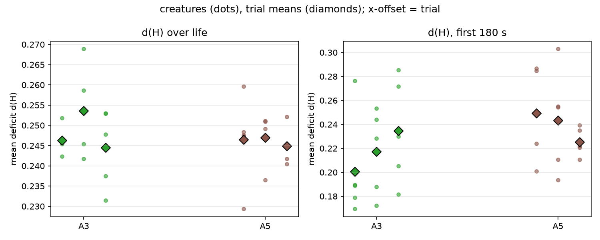
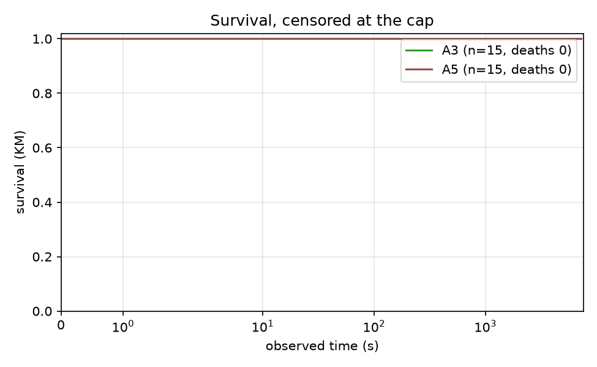
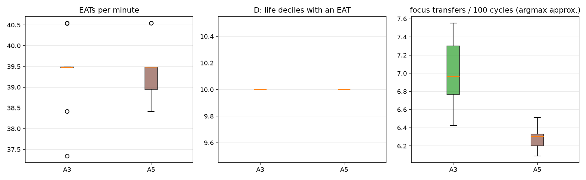

# Report: arbiter-ladder pilot (A0 / A1 / A2), analysis skeleton

## Purpose

Descriptive pilot of the arbiter ladder: spread of the outcomes #107 will pre-register, and a first run of the #106 analysis module end to end. Plan: `docs/plans/arbiter-ladder-pilot.md`, `docs/plans/issue-106-arbiter-ladder-analysis.md`; recipe: `docs/experiments/p107_pilot_stage2_recipe.md`. No pilot number enters a campaign result.

## Assumptions

The trial is the unit; creatures within a trial share a world, a food supply and a seed. The same seed is used in every arm (pairs the initial world only; Akka scheduling keeps trajectories nondeterministic). d(H) is measured from the set point 0.18. A0's focus switches use an argmax-of-urgency approximation, because the regulated emotion is not persisted. A0 lives minutes and A1/A2 up to the cap, so d(H) over life is not like for like; the common-window d(H) is. A1 and A2 use the tuned focus thresholds 0.4 / 0.15. DATA CAVEAT: in creatures that survive to the cap, `mouth_interactions` holds a whole number of 128-row blocks per creature (and `body_states` exactly 217,728 rows), so the last partial block is missing: EAT counts of A1/A2 survivors are lower bounds, short by up to 127 each (up to about 8% in A1, 2% in A2); A0 creatures, which died, are not quantized. The ordering of arms is not affected; the feeding rates are not exact.

## Hypothesis

None: this is a descriptive pilot. Predictions recorded before the data are in the recipe.

## Results

### Per-arm measures (creature mean, then trial means)

| measure | A3 arbiter, operant + episodic | A5 fixed order, episodic then operant |
|---|---|---|
| d(H) over life | 0.248 (trials 0.246, 0.254, 0.245) | 0.246 (trials 0.246, 0.247, 0.245) |
| d(H), first 180 s | 0.218 (trials 0.201, 0.217, 0.235) | 0.239 (trials 0.249, 0.243, 0.225) |
| EATs per minute | 39.408 (trials 39.689, 39.474, 39.061) | 39.336 (trials 39.051, 39.477, 39.480) |
| RED+GREEN EATs per minute | 18.716 (trials 18.711, 18.710, 18.728) | 18.664 (trials 18.519, 18.670, 18.805) |
| D: life deciles with an EAT | 10.000 (trials 10.000, 10.000, 10.000) | 10.000 (trials 10.000, 10.000, 10.000) |
| observed time (s) | 7197.736 (trials 7198.412, 7198.663, 7196.133) | 7197.873 (trials 7197.914, 7198.141, 7197.564) |
| died (share) | 0.000 (trials 0.000, 0.000, 0.000) | 0.000 (trials 0.000, 0.000, 0.000) |
| focus transfers per 100 cycles (argmax approx.) | 7.045 (trials 7.260, 7.157, 6.717) | 6.273 (trials 6.274, 6.232, 6.313) |
| focus opens per 100 cycles (argmax approx.) | 0.685 (trials 0.683, 0.695, 0.676) | 0.642 (trials 0.631, 0.637, 0.657) |
| focus transfers per 100 cycles (tracker) | 0.078 (trials 0.077, 0.079, 0.077) | 0.077 (trials 0.075, 0.077, 0.079) |
| focus opens per 100 cycles (tracker) | 0.118 (trials 0.117, 0.119, 0.117) | 0.117 (trials 0.115, 0.118, 0.117) |
| focused share of cycles (tracker) | 0.124 (trials 0.120, 0.132, 0.119) | 0.123 (trials 0.121, 0.123, 0.124) |
| episodes per creature | 425.800 (trials 422.800, 431.000, 423.600) | 422.533 (trials 414.200, 425.400, 428.000) |
| food share of EATs, first 20% of life (A3 criterion) | 0.478 (trials 0.485, 0.472, 0.479) | 0.473 (trials 0.470, 0.476, 0.473) |
### Drive deficit

Per creature (dots) and per trial (diamonds).
### Survival

- A3 vs A5: deaths 0/15 vs 0/15 (Fisher p = 1); KM median beyond the cap vs beyond the cap; log-rank p = n/a
### Feeding and focus

EATs per minute, life deciles with an EAT, and the argmax-approximated focus transfers per 100 cycles.
### Episodes (A1, A2)

Close-type mix per arm:

| condition | PREEMPTED | REGULATED | TIMED_OUT |
|---|---|---|---|
| a3 | 0.072 | 0.821 | 0.107 |
| a5 | 0.076 | 0.823 | 0.101 |

Steps per episode:

| condition | count | 50% | mean | max |
|---|---|---|---|---|
| a3 | 6387.000 | 21.000 | 63.300 | 201.000 |
| a5 | 6338.000 | 21.000 | 63.300 | 201.000 |
### A2 decision telemetry

**A3** (3,268,913 decisions). Source mix: {'SINGLE': 0.1426, 'GREEDY': 0.7874, 'THOMPSON': 0.0443, 'EPSILON': 0.0256}. Executed action not the chosen one: 4.11%. Informed share (late half, focused multi-candidate): 0.772. Deciding controller by life decile: {0: {'OPERANT': 0.955, 'EPISODIC': 0.045}, 1: {'OPERANT': 0.94, 'EPISODIC': 0.06}, 2: {'OPERANT': 0.944, 'EPISODIC': 0.056}, 3: {'OPERANT': 0.944, 'EPISODIC': 0.056}, 4: {'OPERANT': 0.94, 'EPISODIC': 0.06}, 5: {'OPERANT': 0.941, 'EPISODIC': 0.059}, 6: {'OPERANT': 0.941, 'EPISODIC': 0.059}, 7: {'OPERANT': 0.944, 'EPISODIC': 0.056}, 8: {'OPERANT': 0.933, 'EPISODIC': 0.067}, 9: {'OPERANT': 0.943, 'EPISODIC': 0.057}}.

Descriptive z by close type:

| close_type | n | mean | variance | rms |
|---|---|---|---|---|
| PREEMPTED | 54981.000 | 0.107 | 1.584 | 1.263 |
| REGULATED | 211441.000 | 0.050 | 1.622 | 1.275 |
| TIMED_OUT | 137886.000 | 0.043 | 1.560 | 1.250 |

Episodic calibration (decisions the episodic controller made, per closed episode): n = 182,636, mean z 0.024, variance 0.672 (an honest SE gives 0 and 1). Episodic share of decisions by life decile: [0.0446, 0.0597, 0.0556, 0.056, 0.0595, 0.0591, 0.0589, 0.0565, 0.0671, 0.0567]. Consulted the episodic controller in 0.058 of decisions, affordable in 0.073; mean novelty bonus 0.0018.

| close_type | n | mean | variance |
|---|---|---|---|
| PREEMPTED | 25903.000 | 0.132 | 0.375 |
| REGULATED | 121892.000 | 0.061 | 0.876 |
| TIMED_OUT | 34841.000 | -0.184 | 0.122 |

**A5** (3,267,899 decisions). Source mix: {'SINGLE': 0.1482, 'GREEDY': 0.7826, 'THOMPSON': 0.0436, 'EPSILON': 0.0256}. Executed action not the chosen one: 4.10%. Informed share (late half, focused multi-candidate): 0.756. Deciding controller by life decile: {0: {'OPERANT': 0.94, 'EPISODIC': 0.06}, 1: {'OPERANT': 0.928, 'EPISODIC': 0.072}, 2: {'OPERANT': 0.935, 'EPISODIC': 0.065}, 3: {'OPERANT': 0.939, 'EPISODIC': 0.061}, 4: {'OPERANT': 0.926, 'EPISODIC': 0.074}, 5: {'OPERANT': 0.928, 'EPISODIC': 0.072}, 6: {'OPERANT': 0.934, 'EPISODIC': 0.066}, 7: {'OPERANT': 0.933, 'EPISODIC': 0.067}, 8: {'OPERANT': 0.936, 'EPISODIC': 0.064}, 9: {'OPERANT': 0.93, 'EPISODIC': 0.07}}.

Descriptive z by close type:

| close_type | n | mean | variance | rms |
|---|---|---|---|---|
| PREEMPTED | 59872.000 | 0.117 | 0.413 | 0.653 |
| REGULATED | 213017.000 | 0.061 | 0.705 | 0.842 |
| TIMED_OUT | 128037.000 | -0.035 | 0.268 | 0.519 |

Episodic calibration (decisions the episodic controller made, per closed episode): n = 214,334, mean z 0.046, variance 0.590 (an honest SE gives 0 and 1). Episodic share of decisions by life decile: [0.0597, 0.0723, 0.0648, 0.0615, 0.0742, 0.0717, 0.0658, 0.067, 0.064, 0.0701]. Consulted the episodic controller in 0.068 of decisions, affordable in 0.068; mean novelty bonus 0.0021.

| close_type | n | mean | variance |
|---|---|---|---|
| PREEMPTED | 38278.000 | 0.169 | 0.424 |
| REGULATED | 129055.000 | 0.073 | 0.800 |
| TIMED_OUT | 47001.000 | -0.130 | 0.102 |
### Operant calibration (recipe 5)

Per trial: variance of z per (object type, action) cell with enough updates and varying outcomes, weighted by update count; adoption range [0.8, 1.25] for A2 (mean over trials). `pooled_variance` is the unrestricted variance of all z, for comparison: constant cells drag it down.

|  | statistic | pooled_variance | n_updates | cells | constant_cells |
|---|---|---|---|---|---|
| ('a3', 1) | 1.116 | 0.529 | 23998.000 | 2.000 | 1.000 |
| ('a3', 2) | 1.129 | 0.538 | 23996.000 | 2.000 | 1.000 |
| ('a3', 3) | 1.168 | 0.563 | 23815.000 | 2.000 | 1.000 |
| ('a5', 1) | 1.206 | 0.574 | 23833.000 | 2.000 | 1.000 |
| ('a5', 2) | 1.139 | 0.542 | 23916.000 | 2.000 | 1.000 |
| ('a5', 3) | 1.211 | 0.579 | 23879.000 | 2.000 | 1.000 |

**A3** cells (>= 30 updates, outcomes vary):

|  | n | mean_z | variance | constant |
|---|---|---|---|---|
| ('GREEN_APPLE', 'EAT') | 17478 | 0.020 | 1.081 | False |
| ('RED_APPLE', 'EAT') | 16647 | 0.013 | 1.215 | False |

Constant-outcome cells, left out:

|  | n | mean_z | variance | constant |
|---|---|---|---|---|
| ('GRAY_APPLE', 'EAT') | 37684 | -0.077 | 0.001 | True |

**A5** cells (>= 30 updates, outcomes vary):

|  | n | mean_z | variance | constant |
|---|---|---|---|---|
| ('GREEN_APPLE', 'EAT') | 17537 | 0.010 | 1.276 | False |
| ('RED_APPLE', 'EAT') | 16438 | 0.012 | 1.211 | False |

Constant-outcome cells, left out:

|  | n | mean_z | variance | constant |
|---|---|---|---|---|
| ('GRAY_APPLE', 'EAT') | 37653 | -0.077 | 0.001 | True |
### Paired differences by seed

Differences of trial means, later arm minus earlier arm; SD has 2 degrees of freedom, so size on the 80% upper bound (2.12 x SD), not the point estimate.

| measure | contrast | per-seed differences | mean | SD (2 df) | 80% upper bound on SD |
|---|---|---|---|---|---|
| d(H) over life | A3 - A5 | [-0.0002, 0.0066, -0.0003] | 0.002 | 0.004 | 0.008 |
| d(H), first 180 s | A3 - A5 | [-0.0487, -0.0261, 0.0093] | -0.022 | 0.029 | 0.062 |
| EATs per minute | A3 - A5 | [0.6374, -0.0029, -0.4191] | 0.072 | 0.532 | 1.128 |
| RED+GREEN EATs per minute | A3 - A5 | [0.1921, 0.0403, -0.0763] | 0.052 | 0.135 | 0.285 |
| D: life deciles with an EAT | A3 - A5 | [0.0, 0.0, 0.0] | 0.000 | 0.000 | 0.000 |
| observed time (s) | A3 - A5 | [0.4986, 0.522, -1.4302] | -0.137 | 1.120 | 2.375 |
| died (share) | A3 - A5 | [0.0, 0.0, 0.0] | 0.000 | 0.000 | 0.000 |
| focus transfers per 100 cycles (argmax approx.) | A3 - A5 | [0.9862, 0.9251, 0.4036] | 0.772 | 0.320 | 0.679 |
| focus opens per 100 cycles (argmax approx.) | A3 - A5 | [0.052, 0.0574, 0.0188] | 0.043 | 0.021 | 0.044 |
| focus transfers per 100 cycles (tracker) | A3 - A5 | [0.002, 0.0017, -0.0021] | 0.001 | 0.002 | 0.005 |
| focus opens per 100 cycles (tracker) | A3 - A5 | [0.0019, 0.0009, 0.0002] | 0.001 | 0.001 | 0.002 |
| focused share of cycles (tracker) | A3 - A5 | [-0.0009, 0.0086, -0.0046] | 0.001 | 0.007 | 0.014 |
| episodes per creature | A3 - A5 | [8.6, 5.6, -4.4] | 3.267 | 6.807 | 14.431 |
| food share of EATs, first 20% of life (A3 criterion) | A3 - A5 | [0.0151, -0.0044, 0.0058] | 0.006 | 0.010 | 0.021 |

## Analysis

To be written from the tables above (and the sample-size computation of #107).
