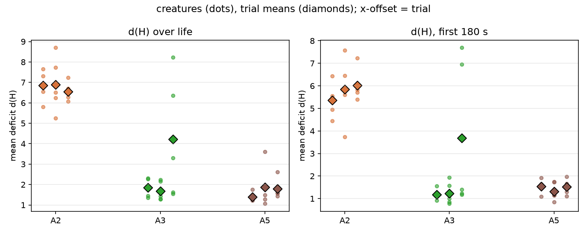
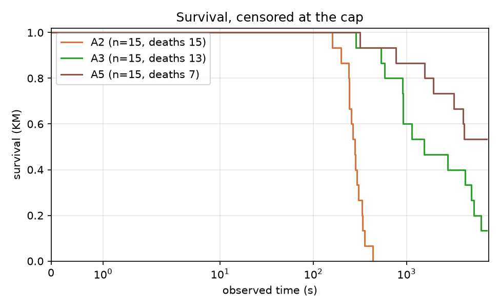
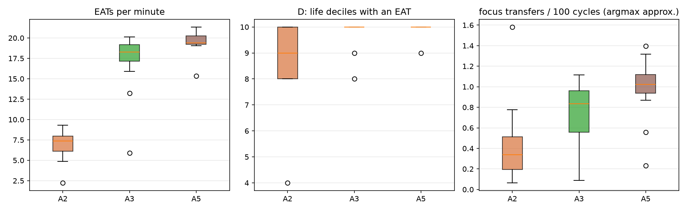

# Report: arbiter-ladder pilot (A0 / A1 / A2), analysis skeleton

## Purpose

Descriptive pilot of the arbiter ladder: spread of the outcomes #107 will pre-register, and a first run of the #106 analysis module end to end. Plan: `docs/plans/arbiter-ladder-pilot.md`, `docs/plans/issue-106-arbiter-ladder-analysis.md`; recipe: `docs/experiments/p107_pilot_stage2_recipe.md`. No pilot number enters a campaign result.

## Assumptions

The trial is the unit; creatures within a trial share a world, a food supply and a seed. The same seed is used in every arm (pairs the initial world only; Akka scheduling keeps trajectories nondeterministic). d(H) is measured from the set point 0.18. A0's focus switches use an argmax-of-urgency approximation, because the regulated emotion is not persisted. A0 lives minutes and A1/A2 up to the cap, so d(H) over life is not like for like; the common-window d(H) is. A1 and A2 use the tuned focus thresholds 0.4 / 0.15. DATA CAVEAT: in creatures that survive to the cap, `mouth_interactions` holds a whole number of 128-row blocks per creature (and `body_states` exactly 217,728 rows), so the last partial block is missing: EAT counts of A1/A2 survivors are lower bounds, short by up to 127 each (up to about 8% in A1, 2% in A2); A0 creatures, which died, are not quantized. The ordering of arms is not affected; the feeding rates are not exact.

## Hypothesis

None: this is a descriptive pilot. Predictions recorded before the data are in the recipe.

## Results

### Per-arm measures (creature mean, then trial means)

| measure | A2 operant arbiter, plants world, no sleep lock | A3 + episodic, plants world, no sleep lock | A5 fixed order, plants world, no sleep lock |
|---|---|---|---|
| d(H) over life | 6.761 (trials 6.848, 6.884, 6.551) | 2.576 (trials 1.842, 1.676, 4.211) | 1.682 (trials 1.392, 1.861, 1.792) |
| d(H), first 180 s | 5.746 (trials 5.357, 5.854, 6.027) | 2.028 (trials 1.169, 1.227, 3.688) | 1.467 (trials 1.548, 1.323, 1.529) |
| EATs per minute | 6.934 (trials 7.103, 7.045, 6.652) | 17.226 (trials 18.443, 18.646, 14.590) | 19.496 (trials 19.402, 19.447, 19.640) |
| RED+GREEN EATs per minute | 3.990 (trials 3.997, 4.132, 3.841) | 8.518 (trials 9.249, 9.191, 7.115) | 9.864 (trials 10.077, 9.515, 10.001) |
| D: life deciles with an EAT | 8.667 (trials 9.200, 8.800, 8.000) | 9.800 (trials 9.800, 10.000, 9.600) | 9.933 (trials 10.000, 9.800, 10.000) |
| observed time (s) | 282.040 (trials 300.970, 269.228, 275.922) | 2984.142 (trials 3352.054, 2621.527, 2978.846) | 4902.578 (trials 5767.277, 5204.213, 3736.243) |
| died (share) | 1.000 (trials 1.000, 1.000, 1.000) | 0.867 (trials 0.800, 1.000, 0.800) | 0.467 (trials 0.400, 0.400, 0.600) |
| focus transfers per 100 cycles (argmax approx.) | 0.426 (trials 0.411, 0.677, 0.191) | 0.719 (trials 0.839, 0.818, 0.501) | 0.989 (trials 1.129, 0.963, 0.875) |
| focus opens per 100 cycles (argmax approx.) | 0.012 (trials 0.009, 0.016, 0.010) | 0.002 (trials 0.001, 0.001, 0.004) | 0.001 (trials 0.001, 0.001, 0.002) |
| focus transfers per 100 cycles (tracker) | 0.055 (trials 0.092, 0.064, 0.010) | 0.101 (trials 0.069, 0.095, 0.141) | 0.244 (trials 0.239, 0.226, 0.268) |
| focus opens per 100 cycles (tracker) | 0.475 (trials 0.467, 0.465, 0.494) | 0.495 (trials 0.503, 0.494, 0.488) | 0.522 (trials 0.535, 0.516, 0.515) |
| focused share of cycles (tracker) | 0.972 (trials 0.983, 0.945, 0.989) | 0.932 (trials 0.926, 0.911, 0.960) | 0.908 (trials 0.895, 0.921, 0.909) |
| episodes per creature | 44.333 (trials 49.600, 42.000, 41.400) | 563.200 (trials 581.400, 466.800, 641.400) | 1097.067 (trials 1302.200, 1147.600, 841.400) |
| food share of EATs, first 20% of life (A3 criterion) | 0.638 (trials 0.564, 0.745, 0.606) | 0.454 (trials 0.497, 0.459, 0.406) | 0.507 (trials 0.514, 0.498, 0.508) |
### Drive deficit

Per creature (dots) and per trial (diamonds).
### Survival

- A2 vs A3: deaths 15/15 vs 13/15 (Fisher p = 0.483); KM median 281 s vs 1543 s; log-rank p = 0.0000
- A3 vs A5: deaths 13/15 vs 7/15 (Fisher p = 0.0502); KM median 1543 s vs beyond the cap; log-rank p = 0.0294
### Feeding and focus

EATs per minute, life deciles with an EAT, and the argmax-approximated focus transfers per 100 cycles.
### Episodes (A1, A2)

Close-type mix per arm:

| condition | DEATH | PREEMPTED | REGULATED | TIMED_OUT |
|---|---|---|---|---|
| a2 | 0.023 | 0.102 | 0.017 | 0.859 |
| a3 | 0.002 | 0.130 | 0.308 | 0.560 |
| a5 | 0.000 | 0.211 | 0.377 | 0.411 |

Steps per episode:

| condition | count | 50% | mean | max |
|---|---|---|---|---|
| a2 | 665.000 | 201.000 | 183.800 | 201.000 |
| a3 | 8448.000 | 201.000 | 148.200 | 201.000 |
| a5 | 16456.000 | 142.000 | 122.100 | 201.000 |
### A2 decision telemetry

**A2** (125,366 decisions). Source mix: {'SINGLE': 0.0, 'GREEDY': 0.9288, 'THOMPSON': 0.0411, 'EPSILON': 0.0302}. Executed action not the chosen one: 0.00%. Informed share (late half, focused multi-candidate): 0.514. Deciding controller by life decile: {0: {'OPERANT': 1.0}, 1: {'OPERANT': 1.0}, 2: {'OPERANT': 1.0}, 3: {'OPERANT': 1.0}, 4: {'OPERANT': 1.0}, 5: {'OPERANT': 1.0}, 6: {'OPERANT': 1.0}, 7: {'OPERANT': 1.0}, 8: {'OPERANT': 1.0}, 9: {'OPERANT': 1.0}}.

Descriptive z by close type:

| close_type | n | mean | variance | rms |
|---|---|---|---|---|
| DEATH | 1484.000 | -0.278 | 0.522 | 0.774 |
| PREEMPTED | 5062.000 | -0.002 | 0.018 | 0.133 |
| REGULATED | 818.000 | 0.016 | 0.006 | 0.079 |
| TIMED_OUT | 114775.000 | -0.001 | 0.020 | 0.141 |

**A3** (1,353,910 decisions). Source mix: {'SINGLE': 0.0, 'GREEDY': 0.4473, 'THOMPSON': 0.5229, 'EPSILON': 0.0299}. Executed action not the chosen one: 0.00%. Informed share (late half, focused multi-candidate): 0.861. Deciding controller by life decile: {0: {'EPISODIC': 0.604, 'OPERANT': 0.396}, 1: {'EPISODIC': 0.555, 'OPERANT': 0.445}, 2: {'EPISODIC': 0.566, 'OPERANT': 0.434}, 3: {'EPISODIC': 0.584, 'OPERANT': 0.416}, 4: {'EPISODIC': 0.599, 'OPERANT': 0.401}, 5: {'EPISODIC': 0.617, 'OPERANT': 0.383}, 6: {'EPISODIC': 0.648, 'OPERANT': 0.352}, 7: {'EPISODIC': 0.603, 'OPERANT': 0.397}, 8: {'EPISODIC': 0.672, 'OPERANT': 0.328}, 9: {'EPISODIC': 0.724, 'OPERANT': 0.276}}.

Descriptive z by close type:

| close_type | n | mean | variance | rms |
|---|---|---|---|---|
| DEATH | 1430.000 | -3.173 | 160.803 | 13.067 |
| PREEMPTED | 88241.000 | 0.007 | 0.352 | 0.593 |
| REGULATED | 209433.000 | 0.083 | 0.373 | 0.617 |
| TIMED_OUT | 953222.000 | -0.010 | 0.183 | 0.428 |

Episodic calibration (decisions the episodic controller made, per closed episode): n = 831,039, mean z 0.024, variance 0.482 (an honest SE gives 0 and 1). Episodic share of decisions by life decile: [0.6041, 0.5549, 0.5658, 0.584, 0.5994, 0.6168, 0.6482, 0.6027, 0.6718, 0.7244]. Consulted the episodic controller in 0.641 of decisions, affordable in 0.696; mean novelty bonus 0.0190.

| close_type | n | mean | variance |
|---|---|---|---|
| DEATH | 673.000 | -6.380 | 320.801 |
| PREEMPTED | 58813.000 | 0.034 | 0.354 |
| REGULATED | 90401.000 | 0.222 | 0.429 |
| TIMED_OUT | 681152.000 | 0.003 | 0.138 |

**A5** (2,224,752 decisions). Source mix: {'SINGLE': 0.0, 'GREEDY': 0.4957, 'THOMPSON': 0.4743, 'EPSILON': 0.03}. Executed action not the chosen one: 0.00%. Informed share (late half, focused multi-candidate): 0.829. Deciding controller by life decile: {0: {'EPISODIC': 0.64, 'OPERANT': 0.36}, 1: {'EPISODIC': 0.569, 'OPERANT': 0.431}, 2: {'EPISODIC': 0.594, 'OPERANT': 0.406}, 3: {'EPISODIC': 0.597, 'OPERANT': 0.403}, 4: {'EPISODIC': 0.596, 'OPERANT': 0.404}, 5: {'EPISODIC': 0.645, 'OPERANT': 0.355}, 6: {'EPISODIC': 0.625, 'OPERANT': 0.375}, 7: {'EPISODIC': 0.658, 'OPERANT': 0.342}, 8: {'EPISODIC': 0.656, 'OPERANT': 0.344}, 9: {'EPISODIC': 0.691, 'OPERANT': 0.309}}.

Descriptive z by close type:

| close_type | n | mean | variance | rms |
|---|---|---|---|---|
| DEATH | 610.000 | -3.104 | 112.084 | 11.024 |
| PREEMPTED | 223118.000 | 0.031 | 0.287 | 0.537 |
| REGULATED | 424099.000 | 0.123 | 0.393 | 0.639 |
| TIMED_OUT | 1361456.000 | 0.019 | 0.162 | 0.402 |

Episodic calibration (decisions the episodic controller made, per closed episode): n = 1,387,098, mean z 0.065, variance 0.271 (an honest SE gives 0 and 1). Episodic share of decisions by life decile: [0.6395, 0.5694, 0.5943, 0.5968, 0.5964, 0.6454, 0.6246, 0.6576, 0.6558, 0.6909]. Consulted the episodic controller in 0.629 of decisions, affordable in 0.629; mean novelty bonus 0.0194.

| close_type | n | mean | variance |
|---|---|---|---|
| DEATH | 355.000 | -4.924 | 183.910 |
| PREEMPTED | 159426.000 | 0.049 | 0.323 |
| REGULATED | 206576.000 | 0.253 | 0.462 |
| TIMED_OUT | 1020741.000 | 0.031 | 0.143 |
### Operant calibration (recipe 5)

Per trial: variance of z per (object type, action) cell with enough updates and varying outcomes, weighted by update count; adoption range [0.8, 1.25] for A2 (mean over trials). `pooled_variance` is the unrestricted variance of all z, for comparison: constant cells drag it down.

|  | statistic | pooled_variance | n_updates | cells | constant_cells |
|---|---|---|---|---|---|
| ('a2', 1) | n/a | 0.232 | 230.000 | 0.000 | 3.000 |
| ('a2', 2) | n/a | 0.237 | 208.000 | 0.000 | 3.000 |
| ('a2', 3) | 0.106 | 0.260 | 190.000 | 2.000 | 1.000 |
| ('a3', 1) | 1.085 | 0.547 | 6277.000 | 3.000 | 2.000 |
| ('a3', 2) | 1.059 | 0.527 | 5044.000 | 3.000 | 2.000 |
| ('a3', 3) | 1.245 | 0.649 | 5378.000 | 3.000 | 2.000 |
| ('a5', 1) | 1.211 | 0.643 | 10958.000 | 3.000 | 2.000 |
| ('a5', 2) | 0.861 | 0.452 | 10190.000 | 3.000 | 2.000 |
| ('a5', 3) | 1.035 | 0.555 | 7289.000 | 3.000 | 2.000 |

**A2** cells (>= 30 updates, outcomes vary):

|  | n | mean_z | variance | constant |
|---|---|---|---|---|
| ('ALOE', 'EAT') | 72 | 0.124 | 0.893 | False |
| ('GREEN_APPLE', 'EAT') | 138 | 0.350 | 0.028 | False |
| ('RED_APPLE', 'EAT') | 160 | 0.332 | 0.044 | False |

Constant-outcome cells, left out:

|  | n | mean_z | variance | constant |
|---|---|---|---|---|
| ('CACTUS', 'EAT') | 45 | -0.425 | 0.011 | True |
| ('GRAY_APPLE', 'EAT') | 213 | -0.322 | 0.007 | True |

**A3** cells (>= 30 updates, outcomes vary):

|  | n | mean_z | variance | constant |
|---|---|---|---|---|
| ('ALOE', 'EAT') | 1228 | 0.026 | 1.035 | False |
| ('GREEN_APPLE', 'EAT') | 3742 | 0.050 | 1.035 | False |
| ('RED_APPLE', 'EAT') | 3390 | 0.016 | 1.603 | False |

Constant-outcome cells, left out:

|  | n | mean_z | variance | constant |
|---|---|---|---|---|
| ('CACTUS', 'EAT') | 1341 | -0.176 | 0.006 | True |
| ('GRAY_APPLE', 'EAT') | 6998 | -0.098 | 0.003 | True |

**A5** cells (>= 30 updates, outcomes vary):

|  | n | mean_z | variance | constant |
|---|---|---|---|---|
| ('ALOE', 'EAT') | 2222 | 0.043 | 0.957 | False |
| ('GREEN_APPLE', 'EAT') | 6553 | 0.039 | 1.021 | False |
| ('RED_APPLE', 'EAT') | 6126 | 0.030 | 1.202 | False |

Constant-outcome cells, left out:

|  | n | mean_z | variance | constant |
|---|---|---|---|---|
| ('CACTUS', 'EAT') | 1483 | -0.172 | 0.006 | True |
| ('GRAY_APPLE', 'EAT') | 12053 | -0.089 | 0.002 | True |
### Paired differences by seed

Differences of trial means, later arm minus earlier arm; SD has 2 degrees of freedom, so size on the 80% upper bound (2.12 x SD), not the point estimate.

| measure | contrast | per-seed differences | mean | SD (2 df) | 80% upper bound on SD |
|---|---|---|---|---|---|
| d(H) over life | A3 - A2 | [-5.0064, -5.2078, -2.34] | -4.185 | 1.601 | 3.394 |
| d(H) over life | A3 - A5 | [0.4499, -0.1846, 2.4189] | 0.895 | 1.358 | 2.878 |
| d(H), first 180 s | A3 - A2 | [-4.1883, -4.6274, -2.3395] | -3.718 | 1.214 | 2.574 |
| d(H), first 180 s | A3 - A5 | [-0.379, -0.0961, 2.1591] | 0.561 | 1.391 | 2.949 |
| EATs per minute | A3 - A2 | [11.3399, 11.6009, 7.9376] | 10.293 | 2.044 | 4.333 |
| EATs per minute | A3 - A5 | [-0.9591, -0.8004, -5.0508] | -2.270 | 2.409 | 5.108 |
| RED+GREEN EATs per minute | A3 - A2 | [5.2522, 5.0587, 3.2745] | 4.528 | 1.090 | 2.311 |
| RED+GREEN EATs per minute | A3 - A5 | [-0.8282, -0.3235, -2.8855] | -1.346 | 1.357 | 2.877 |
| D: life deciles with an EAT | A3 - A2 | [0.6, 1.2, 1.6] | 1.133 | 0.503 | 1.067 |
| D: life deciles with an EAT | A3 - A5 | [-0.2, 0.2, -0.4] | -0.133 | 0.306 | 0.648 |
| observed time (s) | A3 - A2 | [3051.0838, 2352.2992, 2702.9236] | 2702.102 | 349.393 | 740.713 |
| observed time (s) | A3 - A5 | [-2415.2234, -2582.6864, -757.3972] | -1918.436 | 1008.969 | 2139.015 |
| died (share) | A3 - A2 | [-0.2, 0.0, -0.2] | -0.133 | 0.115 | 0.245 |
| died (share) | A3 - A5 | [0.4, 0.6, 0.2] | 0.400 | 0.200 | 0.424 |
| focus transfers per 100 cycles (argmax approx.) | A3 - A2 | [0.4288, 0.1416, 0.3103] | 0.294 | 0.144 | 0.306 |
| focus transfers per 100 cycles (argmax approx.) | A3 - A5 | [-0.2893, -0.1453, -0.3743] | -0.270 | 0.116 | 0.245 |
| focus opens per 100 cycles (argmax approx.) | A3 - A2 | [-0.008, -0.0146, -0.0063] | -0.010 | 0.004 | 0.009 |
| focus opens per 100 cycles (argmax approx.) | A3 - A5 | [-0.0001, -0.0004, 0.0024] | 0.001 | 0.002 | 0.003 |
| focus transfers per 100 cycles (tracker) | A3 - A2 | [-0.0232, 0.0308, 0.1305] | 0.046 | 0.078 | 0.165 |
| focus transfers per 100 cycles (tracker) | A3 - A5 | [-0.1705, -0.1309, -0.1266] | -0.143 | 0.024 | 0.051 |
| focus opens per 100 cycles (tracker) | A3 - A2 | [0.0367, 0.029, -0.0063] | 0.020 | 0.023 | 0.049 |
| focus opens per 100 cycles (tracker) | A3 - A5 | [-0.0311, -0.0221, -0.0273] | -0.027 | 0.005 | 0.010 |
| focused share of cycles (tracker) | A3 - A2 | [-0.0572, -0.0343, -0.0288] | -0.040 | 0.015 | 0.032 |
| focused share of cycles (tracker) | A3 - A5 | [0.0306, -0.0096, 0.0506] | 0.024 | 0.031 | 0.065 |
| episodes per creature | A3 - A2 | [531.8, 424.8, 600.0] | 518.867 | 88.313 | 187.224 |
| episodes per creature | A3 - A5 | [-720.8, -680.8, -200.0] | -533.867 | 289.828 | 614.435 |
| food share of EATs, first 20% of life (A3 criterion) | A3 - A2 | [-0.0674, -0.2867, -0.1997] | -0.185 | 0.110 | 0.234 |
| food share of EATs, first 20% of life (A3 criterion) | A3 - A5 | [-0.0173, -0.0395, -0.1021] | -0.053 | 0.044 | 0.093 |

## Analysis

To be written from the tables above (and the sample-size computation of #107).
